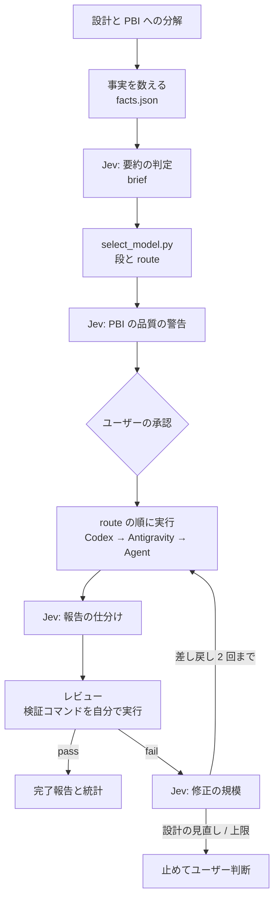

# pbi-orchestration-jev

[English](README.md) | 日本語

複数ファイルにまたがる実装を、**PBI (Product Backlog Item) に分けてサブエージェントに渡す**ための [Claude Code](https://claude.com/claude-code) のスキルです。メインのセッションがオーケストレーターになり、PBI の起票・担当モデルの決定・レビュー・差し戻しを受け持ちます。実装はサブエージェント (Codex CLI / Antigravity CLI の Claude / Claude Code の Agent ツール) が行います。

途中の判断の一部は、判定 API の **Jev** ([TypeSafe](https://api.typesafe.ai)) に短い文章で聞きます。ただし合否は検証コマンドの実行結果で決め、回数は状態ファイルで数えます。

<picture>
  <source media="(prefers-color-scheme: dark)" srcset="assets/architecture-dark.svg">
  
</picture>

図のソースは `assets/architecture.d2` です ([D2](https://d2lang.com) で描いています)。

## 特徴

- **モデルは決定表で決める**: オーケストレーターが数えた事実 (変更ファイル数・モジュール数・機密性) と、Jev による要約の判定 (新規性・結合度・あいまいさ) から、`select_model.py` が段 (haiku / sonnet / opus) を決めます。勘では決めません。
- **実行先を順に試す**: 段ごとに「上から試す実行先の並び (`route`)」を出します。利用上限やエラーで使えなければ、次の実行先へ移ります。
- **合否は検証コマンドで決める**: サブエージェントの報告も Jev の仕分けも、そのまま信じません。オーケストレーターが検証コマンドを自分で実行し、受け入れ条件を 1 つずつ判定します。
- **差し戻しは 2 回まで**: 修正の規模を Jev に聞き、haiku の段は 1 回だけ sonnet の段に上げられます。設計から見直す必要があるときや、2 回差し戻しても通らないときは止めて、ユーザーの判断を待ちます。
- **Jev に送るのは文章だけ**: PBI 本文、要約、報告の抜粋、差し戻し文だけを送ります。ソースコード、diff、環境変数、認証情報は送りません。
- **統計を取る**: `agent_stats.py` が、Claude Code の会話記録からモデル別のトークン数とプロンプトキャッシュの作り直しの回数を集計します。

## 流れ



## 振り分け

| 条件 (上から順に評価) | 段 |
|---|---|
| `sensitive` が true、または `coupling` = 2 | opus |
| `novelty` = 2 かつ `ambiguity` = 2 | opus |
| どれかの score が 1 以上、または変更ファイル ≥ 4、またはモジュール ≥ 2 | sonnet |
| 上のどれでもない | haiku |

| 段 | 1. Codex (`CODEX_UNTIL` まで) | 2. Antigravity (`agy`) | 3. Claude Code の Agent ツール |
|---|---|---|---|
| haiku | `gpt-6-astra` effort `medium` | `claude-sonnet-5-5-low` | haiku、effort `max` |
| sonnet | `gpt-6-astra` effort `high` | `claude-sonnet-5-5-high` | sonnet、effort `high` |
| opus | (使わない) | `claude-opus-5-5-high` | opus、effort 既定 |

- Jev の confidence が 0.7 未満の score は 1 段下げて扱います。Jev が使えないときは score をすべて 1 として扱います。
- Codex は `select_model.py` の `CODEX_UNTIL` の日まで使います。過ぎると route から外れます。使わないなら、この日付を過去にしてください。
- Antigravity には haiku が無いので、haiku の段は Sonnet の low にしています。

## 必要なもの

| もの | 必須 | 用途 |
|---|---|---|
| [Claude Code](https://claude.com/claude-code) | 必須 | オーケストレーターと Agent ツール |
| Python 3.10 以上 | 必須 | `select_model.py`、`agent_stats.py`、Jev クライアント |
| Jev の API キー | 推奨 | 無ければ Jev のゲートを飛ばし、既定値で進む |
| [Codex CLI](https://github.com/openai/codex) | 任意 | route の先頭 (期限内) |
| Antigravity CLI (`agy`) | 任意 | Claude を使う段の第一候補 |
| Node.js | 任意 | JS 版の Jev クライアント (`jev.mjs`) を使うとき |

使えない実行先は、route の次へ移るだけです。Claude Code だけでも動きます。

## 導入

```sh
git clone https://github.com/reeschan/pbi-orchestration-jev.git
cp -r pbi-orchestration-jev/skills/pbi-orchestration-jev ~/.claude/skills/
```

Jev の API キーは、次のどちらかに置きます (クライアントはこの順で探します)。

1. 環境変数 `TYPESAFE_API_KEY`
2. 資格情報ファイル `~/.config/typesafe/credentials.json` (`{"api_key": "..."}`)。場所は環境変数 `TYPESAFE_CREDENTIALS_FILE` で変えられます。

キーをリポジトリやスキルのファイルに書かないでください。エージェントが資格情報ファイルを読まないよう、Claude Code の `settings.json` の `permissions.deny` に入れておくことをお勧めします。

### Antigravity を使うとき

- `agy` は、許可の無いコマンドを**黙って拒否し、終了コード 0 で返します**。拒否は結果の JSON の `denied_actions` と標準エラーにしか出ません。スキルは毎回 `denied_actions` を確かめます。
- 許可ルールは `~/.gemini/antigravity-cli/settings.json` の `permissions.allow` に書きます。サンドボックスが既定でオフなので、`command(node)` だけでは足りず、`unsandboxed(node)` も要りました (agy 1.3.3 で確認)。

## 使い方

Claude Code で、複数ファイルにまたがる実装を頼むときに呼びます。

```
/pbi-orchestration-jev <やりたいこと>
```

作業の記録は、対象リポジトリの `docs/pbi/` に残ります。

| パス | 中身 |
|---|---|
| `docs/pbi/STATUS.md` | PBI ごとの状態・担当・差し戻しの回数 |
| `docs/pbi/PBI-<n>.md` | PBI 本文 |
| `docs/pbi/PBI-<n>.facts.json` / `.brief.md` | 振り分けの材料 |
| `docs/pbi/jev-log.jsonl` | Jev の判定と採った行動 |
| `docs/pbi/jev.config.json` | Jev のゲートとしきい値 (初回にテンプレートから作る) |
| `docs/pbi/codex/`、`docs/pbi/agy/` | Codex / Antigravity に渡した文章と報告 |
| `docs/pbi/stats/` | トークンとキャッシュの統計 |

止まってユーザーを待つのは、PBI 一覧の承認、差し戻しの上限 (または設計の見直し)、破壊的な操作の前の 3 つだけです。

## ファイル

```
skills/pbi-orchestration-jev/
├── SKILL.md                    # スキル本文 (オーケストレーターへの指示)
├── select_model.py             # 決定表: 段と route
├── agent_stats.py              # 会話記録からトークンとキャッシュを集計
├── jev.config.template.json    # Jev のゲートとしきい値の雛形
├── jev/
│   ├── jev.py / jev.mjs        # Jev クライアント (Python / JS)
│   └── test_jev.py / jev.test.mjs
├── test_select_model.py
└── test_agent_stats.py
```

### Jev クライアント

```sh
python jev/jev.py <config.json> <ゲート名> <文章ファイル>   # config のゲートを使う
python jev/jev.py --request <request.json>                 # リクエストを直接渡す
```

成功時は応答の JSON を標準出力に出し、終了コード 0 で終わります。Jev の失敗時は `{"error": ...}` を出して 1、引数の誤りは 2 です。429 / 529 は最大 3 回、5xx・接続エラー・タイムアウトは 1 回だけ再試行します。

## 調整

- 決定表としきい値は仮の値です。PBI が 10〜20 件たまったら、モデル別の結果 (一発合格・差し戻し・昇格) を見て、`select_model.py` と `jev.config.json` を見直してください。
- 実行先のモデルと effort は、`select_model.py` の `CODEX` / `AGY` / `AGENT` で変えられます。

## テスト

```sh
cd skills/pbi-orchestration-jev
python -m unittest test_select_model test_agent_stats
cd jev
python -m unittest test_jev
node --test --test-reporter=tap jev.test.mjs
```

Jev クライアントのテストは、127.0.0.1 のモックサーバーだけを相手にします (本物の Jev は呼びません)。

## ライセンス

[MIT](LICENSE)
