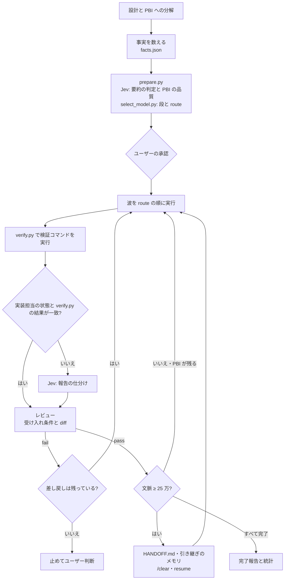

<p align="center"></p>

# Atelier

[](https://github.com/reeschan/atelier/actions/workflows/test.yml)
[](LICENSE)

[](https://claude.com/claude-code)

[English](README.md) | 日本語

Atelier (旧名 **pbi-orchestration-jev**) は、開発を**ワークフローのテンプレート**として回す [Claude Code](https://claude.com/claude-code) のスキルです。9 つの工程 (理解・設計・計画・振り分け・実装・検証・レビュー・差し戻し・仕上げ) それぞれに、差し替えられる部品を置きます。既定のテンプレートは複数ファイルにまたがる実装を **PBI (Product Backlog Item) に分けてサブエージェントに渡します**。メインのセッションがオーケストレーターになり、PBI の起票・担当モデルの決定・レビュー・差し戻しを受け持ちます。実装はサブエージェント (opencode CLI の DeepSeek / Codex CLI / Antigravity CLI の Claude / DeepSeek Harness (`dsh`) / Claude Code の Agent ツール) が行います。

途中の判断の一部は判定 API の **Jev** ([TypeSafe](https://api.typesafe.ai)) に短い文章で聞きます。ただし合否は検証コマンドの実行結果で決め、回数は状態ファイルで数えます。

> pbi-orchestration-jev から移る方は [pbi-orchestration-jev からの移行](#pbi-orchestration-jev-からの移行) を見てください。

<picture>
  <source media="(prefers-color-scheme: dark)" srcset="assets/architecture-dark.svg">
  
</picture>

図のソースは `assets/architecture.d2` です ([D2](https://d2lang.com) で描いています)。

## 特徴

- 流れそのものがテンプレートです。各工程を何が受け持つかは、スキルの本文ではなく `workflows/` と `components/` のデータです。スキルを書き換えずに、部品を差し替え、自分のスキルを足し、別のテンプレートを選べます ([工程・部品・テンプレート](#工程部品テンプレート))。
- オーケストレーターが数えた事実 (変更ファイル数・モジュール数・機密性) と Jev による要約の判定 (新規性・結合度・あいまいさ) から、`select_model.py` が決定表で段 (haiku / sonnet / opus) を決めます。勘では決めません。
- 段ごとに、上から順に試す実行先の並び (`route`) を出します。利用上限やエラーで使えなければ、次の実行先へ移ります。
- 合否は検証コマンドで決め、サブエージェントの報告も Jev の答えもそのまま信じません。実装担当は報告の先頭に状態の 1 行 (`DONE` / `DONE_WITH_CONCERNS` / `NEEDS_CONTEXT` / `BLOCKED`) を書き、オーケストレーターはその状態と検証の結果で仕分けます。食い違うときだけ Jev に仕分けを聞きます。オーケストレーターが検証コマンドを自分で実行し、受け入れ条件を 1 つずつ判定します。
- 差し戻しはレビューの指摘を付けて 2 回まで行い、段上げは任意です。段を上げるときは `prepare.py --only PBI-<n> --tier <tier>` でその PBI の route を書き直します (上げた先の route はその時点の振り分けから引きます)。設計から見直す必要があるときや、2 回差し戻しても通らないときは止めて、ユーザーの判断を待ちます。
- Jev に送るのは文章だけです。PBI 本文、要約、報告の抜粋、差し戻し文を送り、ソースコード、diff、環境変数、認証情報は送りません。
- オーケストレーターの文脈に入ったものは以後の全ターンで読み直されるので、文脈を小さく保ちます。実装担当は最後に状態の行から始まる 5 行の報告だけを返して詳細はファイルに書き、長いコマンドの出力はログファイルに書き、PBI 本文は 1 回だけ書いてパスで渡します (`worker.md`、`SKILL.md` の「Keep the context small」)。
- 文脈が大きくなったら引き継ぎます。PBI の波の区切りで `agent_stats.py --ctx` で文脈の大きさを測り、250,000 トークン以上なら `docs/pbi/HANDOFF.md` (と、共有メモリがあれば引き継ぎのメモリ) を書いて止まります。`/clear` のあと `/atelier resume` で続きから再開します。フォルダを選ばずに始めたセッションからは `/atelier resume <リポジトリのパス>` で再開でき、パスを省くと引き継ぎのメモリから作業リポジトリを探します。
- Opus は設計とレビューを受け持ち、実装は安いモデルに任せます。Opus で実装するのは設計判断が要る PBI だけです。機密に触れる PBI や結合度の高い PBI は Sonnet で実装し、Opus のオーケストレーターが重点的にレビューします。
- [rtk](https://github.com/rtk-ai/rtk) でコマンド出力を圧縮できます (任意)。同梱のフックが、スキルが有効にしたセッションだけ Bash / PowerShell のコマンドを `rtk <cmd>` に書き換えます。
- 機械的な手順はスクリプトが行います。Jev のゲート 1 (要約の判定・PBI の品質) と決定表の判定は `prepare.py` が、検証コマンドの実行は `verify.py` が 1 回で行い、オーケストレーターには表だけを返します。PBI が触ってはいけないファイルは、`unchanged.py` が起動前にハッシュを取って確かめます。スキル本文も毎回要る中核と、場面ごとに読む `appendix/` に分けてあります。作者の実測 (2026-10、6 タスク) では、この 2 つで費用が 15% 下がりました。
- 実装担当には必要十分な情報だけを渡します (任意)。共有メモリの MCP (`mcp__shared-memory__*`) があるとき、オーケストレーターだけが作業ごとの空間に「ref」(1 件 1 事実) を書き、PBI の参照欄に id を並べます。実装担当用の `pbi-worker` はメモリの `get` だけを持ち、search と write はできません。
- CLAUDE.md を前提にします。リポジトリの安定した知識 (規約・コマンド・落とし穴) は階層化した CLAUDE.md にあるものとして扱い、オーケストレーターの検索は補助にとどめます。
- 最初に 1 回セットアップし、あとは 1 つの編集画面で組みます。セットアップが実行先の CLI を見つけて使うものを記録し、実行先ごとのモデル一覧を取ります。編集画面には「エージェントとモデル」「振り分け」「優先テンプレートと適用」「開発フロー」の 4 つのタブがあり、保存先はすべて home です (下の「セットアップと編集画面」)。
- 振り分けを期限付きで上書きできます。優先テンプレートをオンにすると、期限までのあいだ段ごとの route を差し替えます。期限が来たら続けるかを聞きます。設定は Web ページ (Artifact) からもできます (下の「優先テンプレート」)。
- `agent_stats.py` が、Claude Code の会話記録からモデル別・エージェント別のトークン数、プロンプトキャッシュの作り直しの回数、今の文脈の大きさを集計します。
- 実行の合否 (合格・差し戻し・昇格・使えず・保留) を決めるたびに、`record_run.py` が `docs/pbi/runs.jsonl` に 1 行を足します。実行先・モデル・effort・トークン・コスト・ステップ数・時間・検証の結果はログから読み、オーケストレーターが渡すのは結果とレビュー指摘の件数だけです。読めない値は null のままにします。その実行の生ログはリポジトリの外の保全先にコピーします。保全先は環境変数 `PBI_RUNS_ARCHIVE` (同期するフォルダを指せば、ほかの場所にも残せます)、無ければ `~/.claude/pbi-runs` です。`model_report.py` はモデル別に集計し (`--archive` でリポジトリをまたいで)、後から人が調整する目安として仮の評価 A〜D を付けます。振り分けは変えません。
- 費用は参考値です。同梱の `prices.json` は見本の単価表で、home の `prices.json` で上書き・追加できます。`agent_stats.py --cost` は設計者の費用を API 換算の USD で出し、`model_report.py` は費用の分からない実行の件数を出します (合計には足しません)。

## 工程・部品・テンプレート

1 回の実行は **ワークフローのテンプレート** (`workflows/<名前>.json`) に従います。決まった順の 9 つの工程それぞれに **部品** (コンポーネント) を順に並べ、工程のあとに **関所** を置けます。工程は使えて `when` が成り立つ最初の部品を 1 つ動かします。各工程の最後は必ず built-in かスクリプトなので、どの工程にも後ろ盾があります。関所は `when` が成り立つ部品をすべて動かします。オーケストレーターが従う計画は `python skills/atelier/flow.py docs/pbi` で見られます。

| 工程 | すること | 同梱の部品 (既定のテンプレート `jev-routed`) |
|---|---|---|
| understand (理解) | コードと CLAUDE.md を読む | `understand.builtin` |
| design (設計) | 仕様と残った前提を書く (必要なときだけ) | `design.builtin` |
| plan (計画) | 作業を PBI に分ける | `plan.builtin`、そのあと関所 `gate.jev` (Jev ゲート 1: brief と PBI の品質) |
| route (振り分け) | PBI ごとに段と試す順番を決める | `route.jev` (判定表と振り分けテンプレート)。`high-model` では `route.opus` |
| build (実装) | 実装担当 (`worker.md`) が振り分け先で PBI を作る | `build.runners` |
| verify (検証) | PBI ごとの検証コマンドを実行する | `verify.builtin` |
| review (レビュー) | 全体の diff の最終レビュー | `review.code-review` (built-in の `/code-review`)、次に `review.builtin`。そのあと関所 `gate.security-review` |
| fix (差し戻し) | 落ちた PBI を `fix.max_rework` 回まで差し戻す | `fix.rework` |
| finish (仕上げ) | 完了報告 | `finish.builtin` |

- テンプレート: 同梱は 2 つです。`jev-routed` (既定。判定表が許す PBI は安いモデルへ) と `high-model` (すべての PBI を agent の opus へ)。対象リポジトリの `docs/pbi/workflow.json`、次に home の `workflows/<名前>.json` が同梱より優先されます。テンプレートは `fix.max_rework` (0〜5) と `build.external_memory` (外部の実行先が PBI に書かれた ref を読めるか) も決めます。
- 自分の部品: どのスキルも Claude Code のプラグインのコマンドで入れ、`component.py add` で登録できます ([外部部品](#外部部品))。同梱のテンプレートが使うのは、このスキルと Claude Code の built-in だけです。
- オプションの工程: テンプレートで入れたときだけ、選んだ工程の直後に動く工程が 3 つあります。`ui-design` (画面の方向性・テーマ・モックアップ・操作の動画。既定は design のあと)、`marketing` (誰のための作業で、どう受け取られるか。既定は understand のあと)、`security` (変えたコードのセキュリティ監査。既定は review のあと) です。`when` が成り立つ部品をすべて動かし、後ろ盾は要りません。使える部品が無ければ飛ばします。`ui-change` と `user-facing` はオーケストレーターが判断し、`ask-user` は毎回ユーザーに聞きます (route 以降の工程なら PBI 一覧の承認のときに一緒に聞きます。オプションの工程だけで使えます)。できたものは `docs/pbi/ui/<slug>/`・`docs/pbi/marketing/<slug>.md`・`docs/pbi/security/<slug>.md` に置きます。画面のものは計画がその画面を作る PBI からリンクし、セキュリティで確かめられた指摘はその PBI の差し戻しになります (`skills/atelier/appendix/optional.md`)。同梱のテンプレートはどれも入れていません。`component.py add <スキル> --stage ui-design` (か `marketing`・`security`。場所を変えるときは `--after <工程>`) で登録します。
- 編集画面の「開発フロー」タブを使えば、JSON を書かずに、工程・関所・オプションの工程ごとに部品を並べて home に保存できます ([セットアップと編集画面](#セットアップと編集画面))。
- 仕様は [docs/specs/atelier-workflow.md](docs/specs/atelier-workflow.md)、オーケストレーターの手順は `skills/atelier/appendix/engine.md` にあります。

## 既定の流れ (jev-routed)

既定のテンプレートはこのスキルの元になった PBI の振り分けそのものです。



## 振り分け

| 条件 (上から順に評価) | 段 | レビュー |
|---|---|---|
| `novelty` = 2 かつ `ambiguity` = 2 (設計判断が要る) | opus | normal |
| `sensitive` が true | sonnet (Agent ツールだけ) | deep |
| `coupling` = 2 | sonnet | deep |
| どれかの score が 1 以上、または変更ファイル ≥ 4、またはモジュール ≥ 2 | sonnet | normal |
| 上のどれでもない | haiku | normal |

同梱の既定は全段を Agent ツールで実行します (haiku は effort `max`、sonnet は effort `high`、opus は effort の指定なし)。既定は `routing.default.json` にあり、`select_model.py` の中に表は持ちません。外部の実行先を使うときは、対象リポジトリの `docs/pbi/` か home の `routing.json` に自分の振り分けテンプレートを書きます (下の[優先テンプレート](#優先テンプレート))。見本は `skills/atelier/examples/routing/multi-runner.json` です。

route を組んだあと (`routing.json` からでも優先テンプレートからでも)、スキルは各手順を home の `agents.json` と見つかった CLI に照合します。その実行先が無効になっている手順、CLI が見つからない手順、モデルがその実行先の一覧に無い手順は外し、承認一覧に理由とともに出します。最後の Agent の手順は外しません。

home に置く `agents.json` の最小の例です。

```json
{"runners": {"opencode": {"enabled": true, "models": ["opencode-go/deepseek-v4.1-flash"]}}}
```

- Jev の confidence が 0.7 未満の score は 1 段下げて扱います。Jev が無いときは facts (変更ファイル数・モジュール数・sensitive) だけで段を決めます。
- Antigravity には haiku が無いので、haiku の段を `agy` に送る route では Sonnet の low を使います。
- `--skip opencode,agy` で、このセッションで上限や拒否が出た実行先を外せます。`--all docs/pbi` は全 PBI を 1 回で判定し、1 PBI 1 行の表だけを出します。
- レビューが deep の PBI は、Opus のオーケストレーターが diff を全部自分で読みます。normal で 300 行を超える diff は、Opus のレビュー担当のエージェントに読ませます。

## セットアップと編集画面

セットアップと編集画面には 3 つのコマンドがあります。

```
/atelier setup      # 検出 → モデルの取得 → 編集画面 → 任意の連携の案内
/atelier models     # モデルの一覧だけを取り直す
/atelier templates  # 編集画面を開く
```

引数なしで、home に `agents.json` が無いときは、最初に「今セットアップ」か「agent だけで始める」を 1 問だけ聞きます。答えは `agents.json` に残るので、次の回からは聞きません。

セットアップは `opencode`・`codex`・`agy`・`dsh` の CLI を、`PATH`、fnm・nvm のグローバル、`dsh` は `PBI_DSH_BIN` から探します。`agent` (Agent ツール) は常に使えます。見つかった実行先のうち使うものを 1 問の複数選択で選ぶと、選んだ実行先・CLI の場所と版・確認した時刻を home の `agents.json` に書きます。

モデルの一覧は実行先ごとに次の方法で取ります。

| 実行先 | 取り方 | effort の取り方 |
|---|---|---|
| opencode | `opencode models --standalone` (1 行に 1 つ) | opencode のキャッシュにあるモデル情報 |
| codex | `codex debug models` (JSON) | 同じ JSON の reasoning levels |
| agy | `agy models` (タブ区切り) | ID の末尾 |
| dsh | 同梱の `dsh.models.json` と `dsh headless --dump-config` | カタログの thinking level |
| agent | Agent ツールの定義 (haiku・sonnet・opus・fable) | low〜max |

取れなかった実行先は前の一覧のまま (無ければ空) でエラーを残し、編集画面の「エージェントとモデル」タブか `python setup_agents.py add-model --runner <実行先> --id <モデル>` で手で足せます。ほかの実行先には波及しません。

編集画面は手元の 1 ページで、タブは 4 つです。

1. エージェントとモデル: 実行先と使うモデルにチェックを付け、手入力でモデルを足し、品質・価格の参考を横に読みます。
2. 振り分けテンプレート: 1 で選んだモデルだけから、段ごとの手順を組みます。
3. 優先テンプレートと適用: 優先テンプレートを作って直し (交互グループを含む)、期限と期限切れの扱いを付けて適用します。
4. 開発フロー: 開発フローのテンプレートを選び、工程と関所ごとに部品を並べます (順番・候補ごとの `when`・足す・外す)。差し戻しの上限と外部の実行先の共有メモリも決めます。保存の前に `flow.py` と同じ検証をして home の `workflows/<名前>.json` に書き、home の版を消すと同梱の版に戻ります。

保存先はすべて home (`agents.json`・`models/<実行先>.json`・`routing.json`・`templates/<名前>.json`・`overrides.json`・`workflows/<名前>.json`) で、対象リポジトリには書きません。スキルを通さずに開くときは次を実行します。

```sh
python ~/.claude/skills/atelier/studio/serve.py
```

- 画面は日本語と英語に対応しています。ブラウザの言語に合わせて開き、右上の「EN / 日本語」ボタンで切り替えられます (選んだ言語は次回も使います)。URL に `?lang=ja` か `?lang=en` を付けても切り替えられます。
- サーバーは 127.0.0.1 だけで待ち受けます。`/api/*` は画面に埋め込んだ起動ごとの合言葉と、`127.0.0.1` か `localhost` の Host が合わなければ断り、書き込みは 1 回 64 KB までの JSON です。保存のたびに `SAVED <種類> <パス>`、終わるときに `CLOSED` か `TIMEOUT` を出します。`--tab agents|routing|priority|flow` で開くタブ、`--home DIR` で別の home、`--timeout 0` で時間切れなしにできます。
- 品質・価格の参考は `studio/catalog.json` から出します (`python studio/update_catalog.py` で更新。価格と新しいモデルは OpenRouter、品質は `AA_API_KEY` があるとき Artificial Analysis のコーディング指標)。参考情報だけで、選べるモデルは home の `models/<実行先>.json` の一覧で決まります。
- 設計の詳細は [docs/template-studio.md](docs/template-studio.md) にあります。

## フェーズ・アダプター

設計・最終レビュー・セキュリティレビューの工程には、動かすかどうかの決まりと、`agents.json` の `adapters` で止めたりスキルを指定したりする切り替えがあります。**アダプター**はその場面ですでに入っているスキルを呼ぶための取り決めです。同梱のテンプレートが呼ぶのは、このスキル自身の手順と Claude Code の built-in のレビューだけです。mattpocock-skills・pstack・yomiyasu などほかのスキルは、利用者が入れて外部部品として足します (下の「外部部品」)。

| フェーズ | いつ | 呼び出し先 (優先順) | 補足 |
|---|---|---|---|
| 設計 | PBI に分解する前 | 設計者自身の手順。`setup --recommended` のあとは `mattpocock-skills:grilling` | 質問をするのでメインのセッションで呼びます |
| 最終レビュー | 最後の PBI のあと | built-in の `/code-review` (`setup --recommended` のあとは、その前に `mattpocock-skills:code-review`) | built-in はレベル `medium`・フラグなし。どれにも merge-base・head・仕様のパスを渡します |
| セキュリティレビュー | 同じ時点で、sensitive か deep な PBI があるとき | built-in の `/security-review` | 引数なし |

レビューの呼び出し先には報告だけをさせます。渡すのは merge-base・head・仕様のパスと「直さない・投稿しない」で、`--fix`・`--comment`・`ultra`・`--max-findings` は渡しません。呼ぶ前と後で `git rev-parse HEAD` と `git status --porcelain` を比べ、何か変わっていたら結果を捨てて自分の手順に戻ります。呼び出し先がユーザーに質問しようとしたときも `BLOCKED` で戻ります。指摘はそのまま信じず、設計者が確かめます。本物の指摘はそのファイルを担当した PBI の差し戻し (上限 2 回に数えます) にし、どの PBI のものでもない指摘は完了報告の「発見」に書き、好みや書き方だけの指摘では差し戻しません。

何も入れていなくても、作業は最後まで進みます。built-in の `/code-review` と `/security-review` は Claude Code に最初から入っているので、最終レビューとセキュリティレビューはそのまま動きます。組み込みの手順が無いのは設計だけで、そのときは設計者が、決めたことと置いた前提を短い手順で `docs/specs/<slug>.md` に書き、承認の一覧にも「未決の前提」として出して、承認のときに直せるようにします。

各フェーズを使うかどうかは次のとおりです。

- 設計: 明らかに複雑 (新しい概念・外部とのインターフェース・データモデルの変更のどれかがあり、2 つ以上のモジュールにまたがる見込み) なら、聞かずに使います。明らかに単純 (方針が決まっている、または 1 モジュールで PBI が 3 件以下の見込み) なら聞かずに飛ばします。どちらとも言えないときだけ、分解の前に 1 回聞きます。答えは `docs/pbi/adapters.json` に残るので、resume で聞き直しません。仕様のパスを渡して起動したとき (自分の設計用のスキルから渡されたときなど) は、設計は済んだものとして扱います。
- 最終レビュー: 全体の diff が 300 行以下、PBI が 2 件以下、deep も sensitive も無い、のすべてを満たすときだけ飛ばします。それ以外は使います。判定は `adapter_gate.py` が同じ表で行うので、回ごとにぶれません。
- セキュリティレビュー: sensitive か deep な PBI が 1 件でもあれば使います。

使ったか・飛ばしたかは STATUS.md と HANDOFF.md にフェーズごとに 1 行 (`adapter <フェーズ>: <呼び出し先 または built-in> run|skip|fallback|off (<理由>)`) で残ります。

止めたいフェーズや、呼び出し先を指定したいときは、home の `agents.json` に `adapters` を足します。キーは `design`・`review`・`security` で、値は `auto` (既定)・`off`・スキル名のどれかです。おかしなキーや値はその行だけ無視して理由を 1 行出し、`off` にしたフェーズは上の基準にかかわらず動きません。

```json
{"adapters": {"design": "off", "review": "mattpocock-skills:code-review", "security": "auto"}}
```

表に無い呼び出し先を使えるのは、ここに名前を書いたときだけです。名前が似ているだけのスキルが勝手に使われることはなく、モデルから呼べないスキル (`disable-model-invocation`) もここでは使いません (外部部品として登録すれば `read-skill` として動きます)。

### 外部部品

このスキルは他の人のスキルも、その部品の定義も同梱しません。スキルは Claude Code のプラグインのコマンドで入れ、`component.py add` で登録します。入ったスキルの `SKILL.md` を読んで部品を home の `components/` に書き、home の `workflows/` のテンプレート (既定 `jev-routed`。初回は同梱のものを写します) に差します。`component.py remove <id>` で外し、`component.py list` で一覧を見られます。`~/.claude/skills/<name>/` にある自分のスキルも同じ形で使えます (`add <name>`)。

```sh
S=skills/atelier   # スキルを入れた場所

# mattpocock-skills (MIT): 設計に grilling、最終レビューに code-review
/plugin install mattpocock-skills@claude-plugins-official
python $S/component.py add mattpocock-skills:grilling --stage design --when ask-or-decide
python $S/component.py add mattpocock-skills:code-review --stage review --when adapter-gate

# pstack (MIT、cursor/plugins): モデルから呼べないスキルなので read-skill の部品になる
/plugin marketplace add cursor/plugins
/plugin install pstack@cursor-plugins
python $S/component.py add pstack:how --stage understand --when clearly-complex
python $S/component.py add pstack:blast-radius --stage gate --after route --when coupling-high
python $S/component.py add pstack:architect --stage gate --after route --when tier-opus --forbid "do not run Phase D (implementation) or Phase E"
python $S/component.py add pstack:interrogate --stage review --when deep

# yomiyasu (MIT): 日本語の完了報告の言い回しを整える
/plugin marketplace add nanaism/yomiyasu
/plugin install yomiyasu@yomiyasu
python $S/component.py add yomiyasu:yomiyasu --stage gate --after finish

# founder-skill (MIT): マーケティングの工程で、買い手のパネルを模して反応を見る
/plugin marketplace add Jakeschincariol/founder-skill
/plugin install founder-skill@founder-skill
python $S/component.py add founder-skill:founder-consumer --stage marketing --when user-facing

# UI デザインの工程に自分のスキル (design-studio と、このリポジトリの ui-video)
python $S/component.py add design-studio --stage ui-design --when ui-change
python $S/component.py add ui-video --stage ui-design --when ui-change

# Cloudflare の security-audit (MIT): セキュリティの工程で、使うかを毎回聞く
npx skills add https://github.com/cloudflare/security-audit-skill --skill security-audit --global --agent claude-code --yes
python $S/component.py add security-audit --stage security --when ask-user
```

別のテンプレートに差すときは `--workflow high-model` を足します。スキルが入っていない、`when` がその場所に合わない、同梱の部品と id が重なる、のどれかなら終了コード 2 で止まり、何も残しません。

### 作者のおすすめのテンプレート

既定では、このスキルと Claude Code の外にあるものは使いません。作者が実際に使っている構成は、テンプレートの見本 `examples/workflows/recommended.json` として置いてあります。jev-routed に、[pstack](https://github.com/cursor/plugins) (理解の `how`、振り分けのあとの `blast-radius` と `architect`、深いレビューの `interrogate`)、[mattpocock-skills](https://github.com/mattpocock/skills) (設計の `grilling`、最終レビューの `code-review`)、[yomiyasu](https://github.com/nanaism/yomiyasu) (日本語の完了報告の推敲) と、3 つのオプションの工程を足したものです。マーケティングは [founder-skill](https://github.com/Jakeschincariol/founder-skill) の `founder-consumer` (買い手のパネルを模す。利用者に見える作業のとき)、UI デザインは作者の [design-studio](https://github.com/reeschan/claude-skill-design-studio) と [ui-video](skills/ui-video/SKILL.md) (画面が変わる作業のとき)、セキュリティは Cloudflare の [security-audit](https://github.com/cloudflare/security-audit-skill) (使うかを毎回聞く) です。どれも MIT です。見本が持つのはテンプレートと、スキルごとの入れ方・登録のしかただけで、他の人のスキルの中身はこのリポジトリに入れていません。

```sh
/atelier setup --recommended          # 確かめ、1 回だけ聞き、足りないものを入れ、登録し、テンプレートを書く
```

手でやるときは次のとおりです。

```sh
python $S/component.py example check recommended   # 足りないスキルと、入れるコマンド (足りないあいだは終了コード 3)
# check が出した install の行をすべて実行する。何も入っていない PC では次のとおり
claude plugin marketplace add cursor/plugins
claude plugin install pstack@cursor-plugins --scope user
claude plugin install mattpocock-skills@claude-plugins-official --scope user
claude plugin marketplace add nanaism/yomiyasu
claude plugin install yomiyasu@yomiyasu --scope user
claude plugin marketplace add Jakeschincariol/founder-skill
claude plugin install founder-skill@founder-skill --scope user
git clone https://github.com/reeschan/claude-skill-design-studio.git ~/dev/claude-skill-design-studio && node ~/dev/claude-skill-design-studio/scripts/install-self.ts
git clone https://github.com/reeschan/atelier.git ~/dev/atelier && mkdir -p ~/.claude/skills && cp -r ~/dev/atelier/skills/ui-video ~/.claude/skills/
npx skills add https://github.com/cloudflare/security-audit-skill --skill security-audit --global --agent claude-code --yes
python $S/component.py example use recommended --as jev-routed --replace   # 既定のテンプレートにする
```

- `check` は何も入れません。足りないコマンドを `install <コマンド>` の行で出すだけです。`setup --recommended` はスキルをライセンスとリンク付きで見せ、「はい」と答えたときだけそのコマンドを実行します。
- `use` はすべてのスキルを外部部品として登録し、テンプレートを home の `workflows/` に書きます。そのままの名前 (`recommended`。使うときは名前で頼む) か、`--as jev-routed --replace` で既定のテンプレートにします。同じ id の部品がほかの設定で登録済みなら止まり、誤りがあれば何も残しません。
- 同梱の見本の一覧は `component.py example list` で見られます。入れたあとは `/reload-plugins` か Claude Code の再起動が要ります。

## 優先テンプレート

**優先テンプレート**は振り分けを期限付きで上書きする仕組みです。いつもの振り分けは編集画面で決める home の `routing.json` で、優先テンプレートはその上に重なります。段ごとの route に名前を付けて保存し (形は `routing.json` と同じ)、期限を決めてオンにすると、その間は上書きした段の route がテンプレートのものになります (上書きの無い段はそのまま。最後に受ける Claude Code は `routing.json` のその段のもの)。期限を過ぎたときの扱いは、`ask` なら続けるかを聞き (「延長 / やめる / 期限なし」に答えます)、`drop` なら聞かずに外れます。テンプレートの作成・編集・適用は編集画面の「優先テンプレートと適用」タブからも、チャットからもできます。元になるデータは home の `overrides.json` にあり、同梱の Web ページ (専用のデータベースを持つ Artifact) は任意の同期先です。`web.json` に URL があるときだけ、開始時にページとローカルの写しを同期します。

テンプレートで変えられないことが 2 つあります。

- `sensitive` な PBI は、テンプレートが何を言っても外部の実行先に出ません。
- 設計判断の見直しとレビューの担当は、決定表のままです。

テンプレートは個人の設定で、home に置きます。home の既定は `~/.config/atelier` (`XDG_CONFIG_HOME` があれば `$XDG_CONFIG_HOME/atelier`)、`ATELIER_HOME` (旧名の `PBI_HOME` も可) で変えられます。home には `agents.json` (実行先・CLI の場所と版・確認した時刻・選んだモデル・課金の種類)・`models/<実行先>.json` (実行先ごとに最後に取ったモデルの一覧)・`routing.json` (振り分けテンプレート)・`templates/<name>.json` (優先テンプレート)・`overrides.json` (今の適用。元になるデータ)・`history.jsonl` (終わった適用を 1 行ずつ)・Web ページの URL (`web.json`)・`prices.json` (単価の上書き) を置けます。どれも任意で、セットアップと編集画面は、保存が要るときだけディレクトリとファイルを作ります。同梱の例を試すには、home の `templates/` にコピーします。

```sh
mkdir -p ~/.config/atelier/templates
cp skills/atelier/examples/templates/cheap-all-tiers.json ~/.config/atelier/templates/
```

`XDG_CONFIG_HOME` か `ATELIER_HOME` を設定したときは、`~/.config/atelier` を自分の home に読み替えてください。

この例は全段の route を `opencode-go/deepseek-v4.1-flash` の effort `max` にします。優先テンプレートの手順には交互グループ `{"rotate": [手順, 手順, ...]}` も書けます。PBI の番号で先頭のメンバーが決まり、残りのメンバーはその PBI の控えとして後ろに続くので、PBI がメンバーに等分に配られます (例: 2 つの無料枠のモデルを交互に使い、だめなら 2 つの有料のモデルを交互に使う)。ファイルの形・置き場所の決め方・手順の全部は `skills/atelier/appendix/priority-templates.md` にあります。

## 必要なもの

| もの | 必須 | 用途 |
|---|---|---|
| [Claude Code](https://claude.com/claude-code) | 必須 | オーケストレーターと Agent ツール |
| Python 3.10 以上 | 必須 | `prepare.py`・`select_model.py`・`verify.py` などのスクリプトと Jev クライアント |
| Jev の API キー | 推奨 | 無ければ Jev のゲートを飛ばし、facts だけで段を決める |
| shared-memory の MCP (`mcp__shared-memory__*`) | 任意 | 作業ごとの ref と引き継ぎのメモリ。無ければ PBI の補足に書く |
| [mattpocock-skills](https://github.com/mattpocock/skills) | 任意 | 設計と最終レビューのアダプター (下の「フェーズ・アダプター」) |
| [opencode](https://opencode.ai) + OpenCode Go | 任意 | `routing.json` で有効にしたときの外部の実行先 (見本は `examples/routing/multi-runner.json`) |
| [Codex CLI](https://github.com/openai/codex) | 任意 | `routing.json` で有効にしたときの外部の実行先 |
| Antigravity CLI (`agy`) | 任意 | Google AI のサブスクの Claude |
| [DeepSeek Harness](https://github.com/deepseek-ai/deepseek-harness) (`dsh`) | 任意 | `routing.json` か優先テンプレートで使う外部の実行先 (dsh の headless 経由の DeepSeek 公式 API など) |
| `claude` (Claude Code の headless) | 任意 | `agents.json` で有効にしたときだけ使う、`routing.json` か優先テンプレートの外部の実行先。設定は `default` と `edit-only` |
| Node.js | 任意 | rtk のフックと、JS 版の Jev クライアント (`jev.mjs`) |
| [rtk](https://github.com/rtk-ai/rtk) | 任意 | コマンド出力の圧縮 |

必須は Claude Code だけです。Jev・shared-memory・外部の CLI・Web ページ・rtk は任意です。セットアップは任意の CLI (opencode・codex・agy・dsh) を `PATH`・fnm・nvm のグローバル・`PBI_DSH_BIN` から探し、選んだものだけを記録します。使えない実行先は route の次へ移るだけなので、Claude Code だけでも動きます。

## 導入

```sh
git clone https://github.com/reeschan/atelier.git
cp -r atelier/skills/atelier ~/.claude/skills/
mkdir -p ~/.claude/agents && cp atelier/skills/atelier/agents/pbi-worker.md ~/.claude/agents/
```

### pbi-orchestration-jev からの移行

スキルの名前を `pbi-orchestration-jev` から `atelier` に変えました。今までの設定はそのまま使えます。

- home: 既定の home は `~/.config/atelier` (`$XDG_CONFIG_HOME/atelier`) になりました。このフォルダが無く `~/.config/pbi-orchestration-jev` があるあいだは、旧いフォルダをそのまま使います。移すときはフォルダの名前を変えてください。新しい環境変数は `ATELIER_HOME` で、`PBI_HOME` (とさらに旧い `PBI_TEMPLATES_HOME`) も引き続き読みます。
- スキル: 上のとおり `skills/atelier` をコピーします。`skills/pbi-orchestration-jev` は `/atelier` へ案内するだけの小さな中身になりました。旧いスキルに上書きすれば `/pbi-orchestration-jev` からも案内され、要らなければ旧いフォルダを消してかまいません。
- rtk のフック: rtk のフックを入れている場合は、`settings.json` のパスを `skills/atelier/rtk/rtk-gate.mjs` に変えてください。
- 作業中のもの: 各リポジトリの `docs/pbi/` は変わりません。`/atelier resume` で続きから再開できます。

`pbi-worker` は実装担当とレビュー用のサブエージェントの定義です。Claude Code を再起動すると使えるようになります。置かないときは general-purpose で動きます (メモリの search を止める仕組みが無くなるだけです)。

Jev の API キーは次のどちらかに置きます (クライアントはこの順で探します)。

1. 環境変数 `TYPESAFE_API_KEY`
2. 資格情報ファイル `~/.config/typesafe/credentials.json` (`{"api_key": "..."}`)。場所は環境変数 `TYPESAFE_CREDENTIALS_FILE` で変えられます。

キーをリポジトリやスキルのファイルに書かないでください。エージェントが資格情報ファイルを読まないよう、Claude Code の `settings.json` の `permissions.deny` に入れておくことをお勧めします。

### rtk を使うとき (任意)

[rtk](https://github.com/rtk-ai/rtk) はよく使うコマンド (git・テスト・ビルド) の出力を圧縮する CLI のプロキシです。このスキルは全セッションで有効になる `rtk init -g` を使いません。代わりに、同梱のフックが、スキルが `rtk/rtk-mode.mjs on` を実行したセッションだけコマンドを書き換えます。

1. rtk を入れて (例: `winget install rtk-ai.rtk`、または `cargo install --git https://github.com/rtk-ai/rtk`。Git URL なしの `cargo install rtk` は別物です)、`rtk gain` が動くことを確かめます。
2. `~/.claude/settings.json` にフックを足します。

   ```json
   {
     "hooks": {
       "PreToolUse": [
         {
           "matcher": "Bash|PowerShell",
           "hooks": [{ "type": "command", "command": "node \"<HOME>/.claude/skills/atelier/rtk/rtk-gate.mjs\"", "timeout": 10 }]
         }
       ]
     }
   }
   ```

3. Claude Code を再起動して、フックと PATH 上の `rtk` を読み直させます。

フラグのファイル (`~/.claude/state/rtk/<session_id>.on`) が無いとき、または `rtk` が PATH に無いときは、フックはコマンドを書き換えません。opencode と Codex には、rtk の `rtk init -g --opencode`・`rtk init -g --codex` が全体で効きます。

### opencode を使うとき

- OpenCode Go の DeepSeek は、ワークスペースの Privacy 設定が Global でないと HTTP 400 になります。
- `opencode run` を同時に起動すると `database is locked` で落ちることがあります。スキルは起動を 30 秒ずつずらします。
- fnm や nvm で入れた Node に opencode を入れていると、Claude Code の PATH に出ないことがあります。探し方は `runners.md` にあります。

### DeepSeek Harness (`dsh`) を使うとき

- `dsh` は既定の振り分けには入っていません。自分の `routing.json` か優先テンプレートに書きます。手順は `{"runner": "dsh", "model": "deepseek-official/deepseek-flash", "effort": "high"}` のように書き、model は `<dsh の provider>/<モデル>`、effort は dsh に `reasoningEffort` として渡します。使える値は provider と入れた dsh の版で変わります。`effort` を省くと `reasoningEffort` も付けず、dsh がその provider の既定を使うことがあります。
- `dsh_run.py` が PBI を 1 件動かします。実行ごとの上書き設定 (`--patch`) に provider・モデル・effort を書き、`dsh --profile headless --json` を実行して、イベント・最後の回答・開始と終了の時刻を `docs/pbi/dsh/` に残します。`record_run.py` は `status` イベントのトークン数を合計します (料金は出ません)。
- API キーは環境変数 (`DEEPSEEK_API_KEY`・`OPENCODE_GO_API_KEY`) か、キーだけを書いたファイル (`~/.config/deepseek/deepseek.key`・`~/.config/opencode/opencode-go.key`) から読みます。値は表示しません。
- PATH の `dsh` (`npm i -g @deepseek-ai/dsh`) を使います。PATH に無ければ `PBI_DSH_BIN`・`PBI_DSH_NODE` で渡します。独自の provider は `DSH_HOME` の `cordis.patch.yml` に書きます。
- headless は `DSH_PERMISSION_MODE=workspace-write` で動かします。書き込みはリポジトリの中だけで、確認に答える人がいないので昇格は拒否されます。named pipe が要るビルドはサンドボックスの中で落ちることがあり、検証はオーケストレーターが自分で実行します。

### Antigravity を使うとき

- 2026-10 時点では、ヘッドレス (`agy -p`) でコマンドの実行が自動で拒否され (`RunCommand`)、作業が進みませんでした。スキルは、最初にこの拒否が出たら、そのセッションの残りでは `agy` を外します。
- `agy` は許可の無いコマンドを**拒否しても、終了コード 0 で返します**。拒否は結果の JSON の `denied_actions` と標準エラーにしか出ません。スキルは毎回 `denied_actions` を確かめます。
- 許可ルールは `~/.gemini/antigravity-cli/settings.json` の `permissions.allow` に書きます。サンドボックスが既定でオフなので、`command(node)` だけでは足りず、`unsandboxed(node)` も要りました (agy 1.3.3 で確認)。

## 使い方

Claude Code で、複数ファイルにまたがる実装を頼むときに呼びます。

```
/atelier <やりたいこと>
```

実行先のセットアップとモデルの一覧は `/atelier setup` で行います。モデルの一覧だけを取り直すときは `/atelier models`、編集画面を開くときは `/atelier templates` です (上の「セットアップと編集画面」)。

作業の記録は対象リポジトリの `docs/pbi/` に残ります。

| パス | 中身 |
|---|---|
| `docs/pbi/STATUS.md` | PBI ごとの状態・担当・差し戻しの回数 |
| `docs/pbi/HANDOFF.md` | 引き継いだとき、次のセッションに要ること |
| `docs/pbi/PBI-<n>.md` | PBI 本文 |
| `docs/pbi/PBI-<n>.facts.json` / `.brief.md` / `.route.json` | 振り分けの材料と結果 |
| `docs/pbi/worker.md` | 実装担当の進め方と報告の形 (スキルからコピー) |
| `docs/pbi/tools/unchanged.py` | 触らない範囲の検証 (スキルからコピー) |
| `docs/pbi/routing.json` | このリポジトリで読む試す順番 (無ければ home の `routing.json` (編集画面が書く)、それも無ければ同梱の既定) |
| `docs/pbi/reports/`、`docs/pbi/notes/` | 実装担当の詳細な報告と、調べ物の結論 |
| `docs/pbi/verify/`、`docs/pbi/reviews/` | 検証コマンドのログと、任せたレビューの結果 |
| `docs/pbi/jev-log.jsonl` | 判定が変わったときの担当の判定、決定表の上書き、引き継ぎ、Jev に聞いた報告の仕分け |
| `docs/pbi/jev.config.json` | Jev のゲート (初回にテンプレートから作る) |
| `docs/pbi/opencode/`、`docs/pbi/codex/`、`docs/pbi/agy/`、`docs/pbi/dsh/` | 各実行先に渡した文章と出力 |
| `docs/pbi/stats/` | トークンとキャッシュの統計 |

止まってユーザーを待つのは、PBI 一覧の承認、差し戻しの上限 (または設計の見直し)、破壊的な操作の前、文脈が大きくなったときの引き継ぎの 4 つだけです。引き継いだら `/clear` のあと `/atelier resume` を実行します。

フォルダを選ばずに始めたセッション (Claude のデスクトップアプリが空のフォルダを作って動かすもの) では、作業ディレクトリに `docs/pbi/STATUS.md` がありません。そのときは次の順で作業リポジトリを決めます。

1. `/atelier resume <リポジトリのパス>` のパス
2. パスが無ければ、共有メモリの引き継ぎのメモリ (タグ `handoff`) にあるパス。複数の作業が引き継ぎ中なら、どれを再開するかを聞きます
3. それでも決まらなければ、ユーザーに聞きます

決まったら、`STATUS.md` とブランチが合うことを確かめ、セッションをそのフォルダへ移すか、以後は絶対パスで作業します。このため、`HANDOFF.md` と引き継ぎのメモリには、リポジトリの絶対パスとブランチを必ず書きます。

## ファイル

```
skills/atelier/
├── SKILL.md                    # スキル本文 (オーケストレーターが従うワークフローのエンジン)
├── CONTEXT.md                  # 用語集 (英語と日本語の対訳)
├── flow.py                     # 開発フローのテンプレートを解決・検証し、工程ごとの計画を表で出す
├── component.py                # 入れたスキルを外部部品として home に登録する
├── workflows/                  # 同梱のテンプレート (jev-routed・high-model)
├── components/                 # コンポーネントの定義 (各工程に差す部品と、その手順の doc。このスキルと Claude Code の built-in だけ)
├── runners.md                  # opencode / Codex / Antigravity / dsh への渡し方
├── dsh_run.py                  # DeepSeek Harness の headless で PBI を 1 件動かす
├── claude_run.py               # Claude Code の headless で PBI を 1 件動かす
├── worker.md                   # 実装担当の進め方と報告の形
├── appendix/                   # 場面ごとに読む付録: engine、工程の手順 (design・plan・verify・review・rework・finish・optional)、handoff・memory・jev・setup・adapters・priority-templates
├── prompts/                    # サブエージェントへの依頼文 (設計の見直し・PBI のレビュー・最終レビュー)
├── agents/pbi-worker.md        # 実装担当・レビュー用のサブエージェントの定義 (~/.claude/agents に置く)
├── prepare.py                  # Jev のゲート 1 と決定表を 1 回で実行し、表だけを出す
├── verify.py                   # PBI の検証コマンドを実行し、終了コードと末尾だけを表で出す
├── select_model.py             # 決定表: 段・route・レビューの深さ。agents.json で手順を外す
├── adapter_gate.py             # 最終レビューとセキュリティレビューを使うかどうかと理由を決める
├── setup_agents.py             # セットアップ: 実行先の CLI を検出し、選択を agents.json に書き、モデルを取得する
├── model_fetch.py              # 実行先 1 つのモデル一覧を CLI (または同梱の dsh カタログ・agent の組み込み一覧) から取る
├── dsh.models.json             # dsh のモデルのカタログ。dsh が一覧を出せないときに使う
├── agents.py                   # agents.json を読み、実行先の CLI を探す (PATH・fnm・nvm)
├── common.py                   # 共通の処理: home の解決・単価・パス・表記
├── routing.default.json        # 振り分けの既定: 全段 Agent ツール (docs/pbi/ か home の routing.json で差し替え)
├── studio/                     # 編集画面: home を 4 つのタブで読み書きする (index.html・serve.py・catalog.json・update_catalog.py)
├── templates.py                # 優先テンプレート: 検査、Web ページからの同期、適用・回答・写しの書き込み
├── web/priority-templates.html # 優先テンプレートを見て設定する Web ページ (Artifact)
├── examples/routing/           # 外部の実行先を使う振り分けの見本 (multi-runner.json)
├── examples/templates/         # 優先テンプレートの例 (home の templates/ にコピーして使う)
├── examples/workflows/         # 外部部品を使うテンプレートの見本と、要るスキルの入れ方 (component.py example)
├── unchanged.py                # PBI が触ってはいけないファイルをハッシュで確かめる
├── jev_mcp.py                  # jev-mcp: PBI を MCP クライアントに渡す MCP サーバー (stdio / HTTP)
├── agent_stats.py              # 会話記録からトークン・キャッシュ・文脈の大きさを集計
├── record_run.py               # 1 回の実行を runs.jsonl に 1 行で記録し、生ログを保全先にコピー
├── model_report.py             # runs.jsonl からモデル別の結果・トークン・コスト・仮の評価を集計
├── prices.json                 # API 換算コスト (cost_api_equiv) の見本の料金表 (home の prices.json で上書き。請求額ではない)
├── jev.config.template.json    # Jev のゲートの雛形
├── opencode.config.json        # opencode の権限 (push・reset・リポジトリ外を拒否)
├── opencode.edit-only.config.json # opencode の権限 (読む・書く・探すの道具だけで、コマンドを実行しない)
├── rtk/
│   ├── rtk-gate.mjs            # rtk 用の PreToolUse フック (任意)
│   └── rtk-mode.mjs            # このセッションの rtk の有効・無効を切り替える
├── jev/
│   ├── jev.py / jev.mjs        # Jev クライアント (Python / JS)
│   └── test_jev.py / jev.test.mjs
├── test_select_model.py / test_agents.py / test_common.py
├── test_setup_agents.py / test_model_fetch.py / test_templates.py / test_prepare.py / test_unchanged.py
├── test_record_run.py / test_model_report.py / test_dsh_run.py / test_jev_mcp.py
├── test_claude_run.py          # claude_run の引数・設定の道具・環境
├── test_adapter_gate.py        # レビューの判定 (299/300/301 行・PBI 2/3 件・deep・sensitive)
├── test_references.py          # スキルの文書が名前を挙げるファイルの実在
└── test_agent_stats.py
skills/ui-video/                # 作者の UI デザイン工程用のスキル: storyboard から UI の操作動画を録る (Playwright・ffmpeg)
skills/pbi-orchestration-jev/   # 旧名。atelier を案内する
```

### Jev クライアント

```sh
python jev/jev.py <config.json> <ゲート名> <文章ファイル>   # config のゲートを使う
python jev/jev.py --request <request.json>                 # リクエストを直接渡す
```

成功時は応答の JSON を標準出力に出し、終了コード 0 で終わります。Jev の失敗時は `{"error": ...}` を出して 1、引数の誤りは 2 です。429 / 529 は最大 3 回、5xx・接続エラー・タイムアウトは 1 回だけ再試行します。

### jev-mcp (MCP サーバー)

`jev_mcp.py` は、外の MCP クライアントが Jev の振り分け・実行・記録をそのまま使うための MCP サーバーです。設計者は他の外部の実行先と同じく `docs/pbi/mcp/<報告名>.prompt.md` に依頼文を書きます。クライアントはそれを取得して作業し、いつもの形で報告します (詳細は `docs/pbi/reports/<報告名>.md`、5 行の要約は `docs/pbi/mcp/<報告名>.last.md`)。承認・検証・レビュー・差し戻しは設計者のままです。

```sh
python skills/atelier/jev_mcp.py --root /path/to/repo                      # stdio
python skills/atelier/jev_mcp.py --http --port 7830 --root /path/to/repo   # http://127.0.0.1:7830/mcp
```

| ツール | すること |
|---|---|
| `list_tasks` | `docs/pbi/mcp/` の依頼文と状態 (queued / claimed / done) |
| `claim_task` | 依頼文を取得済みにし (1 回だけ)、依頼文・PBI と見出しごとの節・検証コマンド・差し戻し文・facts・route・`worker.md` を返す |
| `submit_result` | 詳細ファイルと 5 行の要約を書く。`artifacts` (クライアントの summary など) は `<報告名>.artifacts.json` に残る |
| `fail_task` | NEEDS_CONTEXT / BLOCKED を同じ 2 つのファイルで報告する |
| `verify` | 作業ツリー (worktree など) で `verify.py` を実行し、表と終了コードを返す |
| `jev_gate` | `jev/jev.py` で Jev のゲートを 1 回聞く。API キーはサーバーの側だけが持つ |
| `route` | `select_model.py` の 1 件の判定。段・試す順の手順・外した手順・レビュー・scores を、`python select_model.py <facts.json> [--tier T] [--skip S]` と同じに返す。`route.json` は書かない |
| `run` | `runners.md` の渡し方で、報告名 1 件を実行先 (`dsh` / `opencode` / `claude`) で 1 回動かす。`setting` (`default` / `edit-only`) で実行先の道具を選ぶ (edit-only は読む・書く・探すの道具だけでコマンドを実行しない。`dsh` には無い)。依頼文を `docs/pbi/<実行先>/<報告名>.prompt.md` に書いて起動する |
| `record` | `record_run.py` を 1 回呼び、試行 1 回の結果を `docs/pbi/runs.jsonl` に 1 行足す |

`route`・`run`・`record` は、外の MCP クライアントが使う 3 つのツールです。`route` で試す手順を受け取り、`run` でその 1 つを動かし、`record` で結果を残します。どれも包んでいるスクリプトと同じ引数を取り、その結果をそのまま返します。`route` は `repo`・`report`・`tier` (`--tier`)・`skip` (`--skip`)、`run` は `repo`・`report`・`runner`・`model`・`effort`・`setting`・`prompt`・`workdir`・`timeout`、`record` は `repo`・`report`・`attempt`・`outcome`・`findings`・`runner`・`model`・`effort`・`tier` です。`run` の `workdir` は `--root` の下だけ (省けば `repo`) で、終了コード・`.last.md`・報告ファイルとログのパス・使えないときの判定を返します。`record` は `record_run.py` と同じ列を `docs/pbi/runs.jsonl` に足します。jev-mcp は、それらの実行先が動く機械で動かしてください。

扱うのは `--root` (または `PBI_MCP_ROOTS`) の下のリポジトリだけです。HTTP は 127.0.0.1 だけで待ち受け、ほかの Host と、自分以外のブラウザーの Origin は断り、本文は `application/json` だけを受け付けます。認証は無いので、ほかの機械には公開しないでください。詳しくは `runners.md` の mcp の節を見てください。

## 調整

- 決定表としきい値は仮の値です。PBI が 10〜20 件たまったら、モデル別の結果 (`model_report.py --archive` の一発合格・差し戻し・昇格・トークン・コスト) を見て、`select_model.py` と `prepare.py` の定数を見直してください。
- 実行先のモデルと effort はテンプレート `routing.json` で変えられます (形は `routing.default.json`)。対象リポジトリの `docs/pbi/routing.json`、または home の `routing.json` に置くと、`select_model.py` がそちらを使います。無ければ同梱の `routing.default.json` のままです。
- テンプレートは編集画面でも組めます (上の「セットアップと編集画面」)。
- 引き継ぎのしきい値 (250,000 トークン) と、外部の実行先の結果も同じ時期に見直してください。

## テスト

```sh
cd skills/atelier
python -m unittest discover -p 'test_*.py'
python -m unittest discover -s studio -p 'test_*.py'
cd jev
python -m unittest test_jev
node --test --test-reporter=tap jev.test.mjs
```

Jev クライアントのテストは 127.0.0.1 のモックサーバーだけを相手にします (本物の Jev は呼びません)。

## ライセンス

[MIT](LICENSE)
