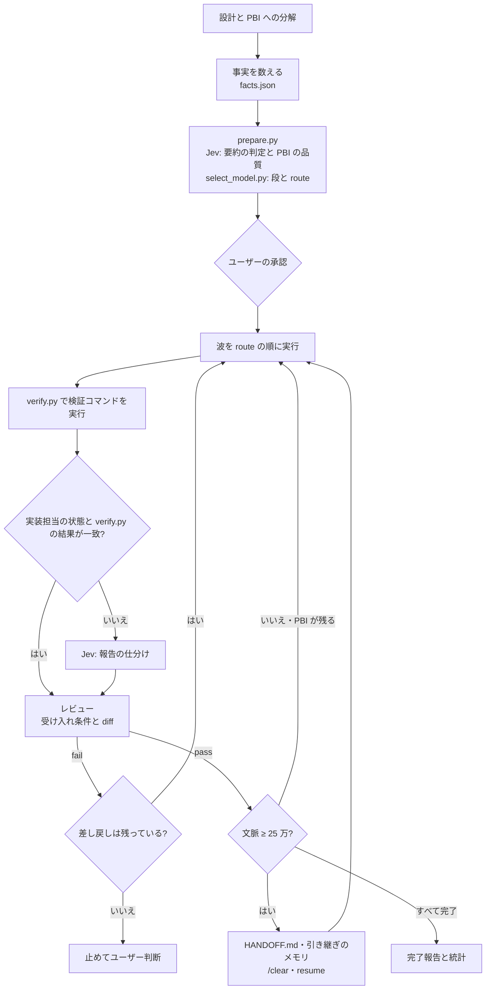

# pbi-orchestration-jev

[English](README.md) | 日本語

複数ファイルにまたがる実装を、**PBI (Product Backlog Item) に分けてサブエージェントに渡す**ための [Claude Code](https://claude.com/claude-code) のスキルです。メインのセッションがオーケストレーターになり、PBI の起票・担当モデルの決定・レビュー・差し戻しを受け持ちます。実装はサブエージェント (opencode CLI の DeepSeek / Codex CLI / Antigravity CLI の Claude / DeepSeek Harness (`dsh`) / Claude Code の Agent ツール) が行います。

途中の判断の一部は、判定 API の **Jev** ([TypeSafe](https://api.typesafe.ai)) に短い文章で聞きます。ただし合否は検証コマンドの実行結果で決め、回数は状態ファイルで数えます。

<picture>
  <source media="(prefers-color-scheme: dark)" srcset="assets/architecture-dark.svg">
  
</picture>

図のソースは `assets/architecture.d2` です ([D2](https://d2lang.com) で描いています)。

## 特徴

- **モデルは決定表で決める**: オーケストレーターが数えた事実 (変更ファイル数・モジュール数・機密性) と、Jev による要約の判定 (新規性・結合度・あいまいさ) から、`select_model.py` が段 (haiku / sonnet / opus) を決めます。勘では決めません。
- **実行先を順に試す**: 段ごとに「上から試す実行先の並び (`route`)」を出します。利用上限やエラーで使えなければ、次の実行先へ移ります。
- **合否は検証コマンドで決める**: サブエージェントの報告も Jev の答えも、そのまま信じません。実装担当は報告の先頭に状態の 1 行 (`DONE` / `DONE_WITH_CONCERNS` / `NEEDS_CONTEXT` / `BLOCKED`) を書き、オーケストレーターはその状態と検証の結果で仕分けます。食い違うときだけ Jev に仕分けを聞きます。オーケストレーターが検証コマンドを自分で実行し、受け入れ条件を 1 つずつ判定します。
- **差し戻しは 2 回まで、段上げは任意**: 差し戻しはレビューの指摘を付けて 2 回まで行います。段を上げるときは `prepare.py --only PBI-<n> --tier <tier>` でその PBI の route を書き直します (上げた先の route はその時点の振り分けから引きます)。設計から見直す必要があるときや、2 回差し戻しても通らないときは止めて、ユーザーの判断を待ちます。
- **Jev に送るのは文章だけ**: PBI 本文、要約、報告の抜粋、差し戻し文だけを送ります。ソースコード、diff、環境変数、認証情報は送りません。
- **オーケストレーターの文脈を細く保つ**: オーケストレーターの文脈に入ったものは、以後の全ターンで読み直されます。実装担当は最後に状態の行から始まる 5 行の報告だけを返して詳細はファイルに書き、長いコマンドの出力はログファイルに書き、PBI 本文は 1 回だけ書いてパスで渡します (`worker.md`、`SKILL.md` の 0.7)。
- **文脈が大きくなったら引き継ぐ**: PBI の波の区切りで `agent_stats.py --ctx` で文脈の大きさを測り、250,000 トークン以上なら `docs/pbi/HANDOFF.md` (と、共有メモリがあれば引き継ぎのメモリ) を書いて止まります。`/clear` のあと `/pbi-orchestration-jev resume` で続きから再開します。フォルダを選ばずに始めたセッションからは `/pbi-orchestration-jev resume <リポジトリのパス>` で再開でき、パスを省くと引き継ぎのメモリから作業リポジトリを探します。
- **Opus は設計とレビュー、実装は安いモデル**: Opus で実装するのは設計判断が要る PBI だけです。機密に触れる PBI や結合度の高い PBI は Sonnet で実装し、Opus のオーケストレーターが重点的にレビューします。
- **[rtk](https://github.com/rtk-ai/rtk) でコマンド出力を圧縮 (任意)**: 同梱のフックが、スキルが有効にしたセッションだけ Bash / PowerShell のコマンドを `rtk <cmd>` に書き換えます。
- **機械的な手順はスクリプトで**: Jev のゲート 1 (要約の判定・PBI の品質) と決定表の判定は `prepare.py`、検証コマンドの実行は `verify.py` が 1 回で行い、オーケストレーターには表だけを返します。PBI が触ってはいけないファイルは、`unchanged.py` が起動前にハッシュを取って確かめます。スキル本文も、毎回要る中核と、場面ごとに読む `appendix/` に分けてあります。作者の実測 (2026-10、6 タスク) では、この 2 つで費用が 15% 下がりました。
- **実装担当には必要十分な情報だけ (任意)**: 共有メモリの MCP (`mcp__shared-memory__*`) があるとき、オーケストレーターだけが作業ごとの空間に「ref」(1 件 1 事実) を書き、PBI の参照欄に id を並べます。実装担当用の `pbi-worker` はメモリの `get` だけを持ち、search と write はできません。
- **CLAUDE.md を前提にする**: リポジトリの安定した知識 (規約・コマンド・落とし穴) は、階層化した CLAUDE.md にあるものとして扱い、オーケストレーターの検索は補助にとどめます。
- **最初に 1 回セットアップし、あとは 1 つの編集画面で組む**: セットアップが実行先の CLI を見つけて使うものを記録し、実行先ごとのモデル一覧を取ります。編集画面には「エージェントとモデル」「振り分け」「優先テンプレートと適用」の 3 つのタブがあり、保存先はすべて home です (下の「セットアップと編集画面」)。
- **期限付きで振り分けを上書きする**: 優先テンプレートをオンにすると、期限までのあいだ段ごとの route を差し替えます。期限が来たら続けるかを聞きます。設定は Web ページ (Artifact) からもできます (下の「優先テンプレート」)。
- **統計を取る**: `agent_stats.py` が、Claude Code の会話記録からモデル別・エージェント別のトークン数、プロンプトキャッシュの作り直しの回数、今の文脈の大きさを集計します。
- **実行ごとに記録する**: 実行の合否 (合格・差し戻し・昇格・使えず・保留) を決めるたびに、`record_run.py` が `docs/pbi/runs.jsonl` に 1 行を足します。実行先・モデル・effort・トークン・コスト・ステップ数・時間・検証の結果はログから読み、オーケストレーターが渡すのは結果とレビュー指摘の件数だけです。読めない値は null のままにします。その実行の生ログはリポジトリの外の保全先にコピーします。保全先は環境変数 `PBI_RUNS_ARCHIVE` (同期するフォルダを指せば、ほかの場所にも残せます)、無ければ `~/.claude/pbi-runs` です。`model_report.py` はモデル別に集計し (`--archive` でリポジトリをまたいで)、後から人が調整する目安として仮の評価 A〜D を付けます。振り分けは変えません。
- **費用は参考値**: 同梱の `prices.json` は見本の単価表で、home の `prices.json` で上書き・追加できます。`agent_stats.py --cost` は設計者の費用を API 換算の USD で出し、`model_report.py` は費用の分からない実行の件数を出します (合計には足しません)。

## 流れ



## 振り分け

| 条件 (上から順に評価) | 段 | レビュー |
|---|---|---|
| `novelty` = 2 かつ `ambiguity` = 2 (設計判断が要る) | opus | normal |
| `sensitive` が true | sonnet (Agent ツールだけ) | deep |
| `coupling` = 2 | sonnet | deep |
| どれかの score が 1 以上、または変更ファイル ≥ 4、またはモジュール ≥ 2 | sonnet | normal |
| 上のどれでもない | haiku | normal |

同梱の既定は、全段を Agent ツールで実行します (haiku は effort `max`、sonnet は effort `high`、opus は effort の指定なし)。既定は `routing.default.json` にあり、`select_model.py` の中に表は持ちません。外部の実行先を使うときは、対象リポジトリの `docs/pbi/` か home の `routing.json` に自分の振り分けテンプレートを書きます (下の[優先テンプレート](#優先テンプレート))。見本は `skills/pbi-orchestration-jev/examples/routing/multi-runner.json` です。

route を組んだあと (`routing.json` からでも優先テンプレートからでも)、スキルは各手順を home の `agents.json` と見つかった CLI に照合します。その実行先が無効になっている手順、CLI が見つからない手順、モデルがその実行先の一覧に無い手順は外し、承認一覧に理由とともに出します。最後の Agent の手順は外しません。

home に置く `agents.json` の最小の例:

```json
{"runners": {"opencode": {"enabled": true, "models": ["opencode-go/deepseek-v4.1-flash"]}}}
```

- Jev の confidence が 0.7 未満の score は 1 段下げて扱います。Jev が無いときは facts (変更ファイル数・モジュール数・sensitive) だけで段を決めます。
- Antigravity には haiku が無いので、haiku の段を `agy` に送る route では Sonnet の low を使います。
- `--skip opencode,agy` で、このセッションで上限や拒否が出た実行先を外せます。`--all docs/pbi` は全 PBI を 1 回で判定し、1 PBI 1 行の表だけを出します。
- レビューが deep の PBI は、Opus のオーケストレーターが diff を全部自分で読みます。normal で 300 行を超える diff は、Opus のレビュー担当のエージェントに読ませます。

## セットアップと編集画面

セットアップと編集画面には 3 つの入口があります。

```
/pbi-orchestration-jev setup      # 検出 → モデルの取得 → 編集画面 → 任意の連携の案内
/pbi-orchestration-jev models     # モデルの一覧だけを取り直す
/pbi-orchestration-jev templates  # 編集画面を開く
```

引数なしで、home に `agents.json` が無いときは、最初に「今セットアップ」か「agent だけで始める」を 1 問だけ聞きます。答えは `agents.json` に残るので、次の回からは聞きません。

セットアップは `opencode`・`codex`・`agy`・`dsh` の CLI を、`PATH`、fnm・nvm のグローバル、`dsh` は `PBI_DSH_BIN` から探します。`agent` (Agent ツール) は常に使えます。見つかった実行先のうち使うものを 1 問の複数選択で選ぶと、選んだ実行先・CLI の場所と版・確認した時刻を home の `agents.json` に書きます。

モデルの一覧は実行先ごとに次の方法で取ります。

| 実行先 | 取り方 | effort の取り方 |
|---|---|---|
| opencode | `opencode models --standalone` (1 行に 1 つ) | opencode のキャッシュにあるモデル情報 |
| codex | `codex debug models` (JSON) | 同じ JSON の reasoning levels |
| agy | `agy models` (タブ区切り) | ID の末尾 |
| dsh | 同梱の `dsh.models.json` と `dsh headless --dump-config` | カタログの thinking level |
| agent | Agent ツールの定義 (haiku・sonnet・opus・fable) | low〜max |

取れなかった実行先は前の一覧のまま (無ければ空) でエラーを残し、編集画面の「エージェントとモデル」タブか `python setup_agents.py add-model --runner <実行先> --id <モデル>` で手で足せます。ほかの実行先には波及しません。

編集画面は手元の 1 ページで、タブは 3 つです。

1. **エージェントとモデル**: 実行先と使うモデルにチェックを付け、手入力でモデルを足し、品質・価格の参考を横に読みます。
2. **振り分けテンプレート**: 1 で選んだモデルだけから、段ごとの手順を組みます。
3. **優先テンプレートと適用**: 優先テンプレートを作って直し (交互グループを含む)、期限と期限切れの扱いを付けて適用します。

保存先はすべて home (`agents.json`・`models/<実行先>.json`・`routing.json`・`templates/<名前>.json`・`overrides.json`) で、対象リポジトリには書きません。スキルを通さずに開くときは次を実行します。

```sh
python ~/.claude/skills/pbi-orchestration-jev/studio/serve.py
```

- 画面は日本語と英語に対応しています。ブラウザの言語に合わせて開き、右上の「EN / 日本語」ボタンで切り替えられます (選んだ言語は次回も使います)。URL に `?lang=ja` か `?lang=en` を付けても切り替えられます。
- サーバーは 127.0.0.1 だけで待ち受けます。`/api/*` は画面に埋め込んだ起動ごとの合言葉と、`127.0.0.1` か `localhost` の Host が合わなければ断り、書き込みは 1 回 64 KB までの JSON です。保存のたびに `SAVED <種類> <パス>`、終わるときに `CLOSED` か `TIMEOUT` を出します。`--tab agents|routing|priority` で開くタブ、`--home DIR` で別の home、`--timeout 0` で時間切れなしにできます。
- 品質・価格の参考は `studio/catalog.json` から出します (`python studio/update_catalog.py` で更新。価格と新しいモデルは OpenRouter、品質は `AA_API_KEY` があるとき Artificial Analysis のコーディング指標)。参考情報だけで、選べるモデルは home の `models/<実行先>.json` の一覧で決まります。
- 設計の詳細は [docs/template-studio.md](docs/template-studio.md) にあります。

## フェーズ・アダプター

**アダプター**は、作業の決まった場面で、すでに入っているスキルを呼ぶための取り決めです。スキルは何も同梱しません。下の表にある名前だけを使い、どれも入っていなければ自分の手順で進みます。

| フェーズ | いつ | 呼び出し先 (優先順) | 補足 |
|---|---|---|---|
| 設計 | PBI に分解する前 | `mattpocock-skills:grilling`、続いて `mattpocock-skills:domain-modeling` | domain-modeling は、対象のリポジトリにもう `GLOSSARY.md` か `CONTEXT.md` があるときだけ。どちらも質問をするのでメインのセッションで呼びます |
| 最終レビュー | 最後の PBI のあと | `mattpocock-skills:code-review`、続いて built-in の `/code-review` | built-in はレベル `medium`・フラグなし。どちらにも merge-base・head・仕様のパスを渡します |
| セキュリティレビュー | 同じ時点で、sensitive か deep な PBI があるとき | built-in の `/security-review` | 引数なし |

レビューの呼び出し先には、報告だけをさせます。渡すのは merge-base・head・仕様のパスと「直さない・投稿しない」で、`--fix`・`--comment`・`ultra`・`--max-findings` は渡しません。呼ぶ前と後で `git rev-parse HEAD` と `git status --porcelain` を比べ、何か変わっていたら結果を捨てて自分の手順に戻ります。呼び出し先がユーザーに質問しようとしたときも `BLOCKED` で戻ります。指摘はそのまま信じず、設計者が確かめます。本物の指摘はそのファイルを担当した PBI の差し戻し (上限 2 回に数えます) にし、どの PBI のものでもない指摘は完了報告の「発見」に書き、好みや書き方だけの指摘では差し戻しません。

何も入れていなくても、作業は最後まで進みます。built-in の `/code-review` と `/security-review` は Claude Code に最初から入っているので、最終レビューとセキュリティレビューはそのまま動きます。組み込みの手順が無いのは設計だけで、そのときは設計者が、決めたことと置いた前提を短い手順で `docs/specs/<slug>.md` に書き、承認の一覧にも「未決の前提」として出して、承認のときに直せるようにします。

そのフェーズを使うかどうか:

- **設計**: 明らかに複雑 (新しい概念・外部とのインターフェース・データモデルの変更のどれかがあり、2 つ以上のモジュールにまたがる見込み) なら、聞かずに使います。明らかに単純 (方針が決まっている、または 1 モジュールで PBI が 3 件以下の見込み) なら黙って飛ばします。どちらとも言えないときだけ、分解の前に 1 回聞きます。答えは `docs/pbi/adapters.json` に残るので、resume で聞き直しません。仕様のパスを渡して起動したとき (自分の設計用のスキルから渡されたときなど) は、設計は済んだものとして扱います。
- **最終レビュー**: 全体の diff が 300 行以下、PBI が 2 件以下、deep も sensitive も無い、のすべてを満たすときだけ飛ばします。それ以外は使います。判定は `adapter_gate.py` が同じ表で行うので、回ごとにぶれません。
- **セキュリティレビュー**: sensitive か deep な PBI が 1 件でもあれば使います。

使ったか・飛ばしたかは、STATUS.md と HANDOFF.md にフェーズごとに 1 行 (`adapter <フェーズ>: <呼び出し先 または built-in> run|skip|fallback|off (<理由>)`) で残ります。

止めたいフェーズや、呼び出し先を指定したいときは、home の `agents.json` に `adapters` を足します。キーは `design`・`review`・`security` で、値は `auto` (既定)・`off`・スキル名のどれかです。おかしなキーや値はその行だけ無視して理由を 1 行出し、`off` にしたフェーズは上の基準にかかわらず動きません。

```json
{"adapters": {"design": "off", "review": "mattpocock-skills:code-review", "security": "auto"}}
```

表に無い呼び出し先を使えるのは、ここに名前を書いたときだけです。名前が似ているだけのスキルが勝手に使われることはなく、モデルから呼べないスキル (`disable-model-invocation`) も使いません。

### おすすめ: mattpocock-skills

`/pbi-orchestration-jev setup --recommended` が、推奨のセットを 1 つだけ案内します。はいと答えるまで何も入れません。

```sh
/pbi-orchestration-jev setup --recommended
claude plugin install mattpocock-skills@claude-plugins-official --scope user
```

- [mattpocock/skills](https://github.com/mattpocock/skills) — MIT (Copyright (c) 2026 Matt Pocock)。設計に grilling と domain-modeling、最終レビューに code-review が加わります。
- `setup --recommended` は、名前・使うフェーズ・リンク・ライセンス・入れるコマンドを見せます。1 回承認すると、設計者が install のコマンドを実行します。同梱のスクリプトは何もインストールしません (パッケージのインストールは、パッケージのスキャンで危険なコマンドとして検出されるためです)。
- 「いいえ」と答えたときや、`claude` コマンドが PATH に無いときは、コマンドを表示するだけです。
- 入れたあとに `/reload-plugins` か Claude Code の再起動が要ります。それまではプラグインのスキルが一覧に出ず、アダプターは組み込みの手順のまま動きます。
- 設計の呼び出し先が無いまま複雑な作業を進めたときは、承認の一覧に「`setup --recommended` で mattpocock-skills を入れられます」と 1 回だけ出ます。出したことは home に残り、以後は出しません。

## 優先テンプレート

**優先テンプレート**は、振り分けを期限付きで上書きする仕組みです。いつもの振り分けは編集画面で決める home の `routing.json` で、優先テンプレートはその上に重なります。段ごとの route に名前を付けて保存し (形は `routing.json` と同じ)、期限を決めてオンにすると、その間は上書きした段の route がテンプレートのものになります (上書きの無い段はそのまま。最後に受ける Claude Code は `routing.json` のその段のもの)。期限を過ぎたときの扱いは、`ask` なら続けるかを聞き (「延長 / やめる / 期限なし」に答えます)、`drop` なら黙って外れます。テンプレートの作成・編集・適用は、編集画面の「優先テンプレートと適用」タブからも、チャットからもできます。正本は home の `overrides.json` で、同梱の Web ページ (専用のデータベースを持つ Artifact) は任意の同期先です。`web.json` に URL があるときだけ、開始時にページとローカルの写しを同期します。

テンプレートで変えられないことが 2 つあります。

- `sensitive` な PBI は、テンプレートが何を言っても外部の実行先に出ません。
- 設計判断の見直しとレビューの担当は、決定表のままです。

テンプレートは個人の設定で、home に置きます。home の既定は `~/.config/pbi-orchestration-jev` (`XDG_CONFIG_HOME` があれば `$XDG_CONFIG_HOME/pbi-orchestration-jev`)、`PBI_HOME` で変えられます。home には `agents.json` (実行先・CLI の場所と版・確認した時刻・選んだモデル・課金の種類)・`models/<実行先>.json` (実行先ごとに最後に取ったモデルの一覧)・`routing.json` (振り分けテンプレート)・`templates/<name>.json` (優先テンプレート)・`overrides.json` (今の適用。正本)・`history.jsonl` (終わった適用を 1 行ずつ)・Web ページの URL (`web.json`)・`prices.json` (単価の上書き) を置けます。どれも任意で、セットアップと編集画面は、保存が要るときだけディレクトリとファイルを作ります。同梱の例を試すには、home の `templates/` にコピーします。

```sh
mkdir -p ~/.config/pbi-orchestration-jev/templates
cp skills/pbi-orchestration-jev/examples/templates/cheap-all-tiers.json ~/.config/pbi-orchestration-jev/templates/
```

`XDG_CONFIG_HOME` か `PBI_HOME` を設定したときは、`~/.config/pbi-orchestration-jev` を自分の home に読み替えてください。

この例は全段の route を `opencode-go/deepseek-v4.1-flash` の effort `max` にします。優先テンプレートの手順には交互グループ `{"rotate": [手順, 手順, ...]}` も書けます。PBI の番号で先頭のメンバーが決まり、残りのメンバーはその PBI の控えとして後ろに続くので、PBI がメンバーに等分に配られます (例: 2 つの無料枠のモデルを交互に使い、だめなら 2 つの有料のモデルを交互に使う)。ファイルの形・置き場所の決め方・手順の全部は `skills/pbi-orchestration-jev/appendix/priority-templates.md` にあります。

## 必要なもの

| もの | 必須 | 用途 |
|---|---|---|
| [Claude Code](https://claude.com/claude-code) | 必須 | オーケストレーターと Agent ツール |
| Python 3.10 以上 | 必須 | `prepare.py`・`select_model.py`・`verify.py` などのスクリプトと Jev クライアント |
| Jev の API キー | 推奨 | 無ければ Jev のゲートを飛ばし、facts だけで段を決める |
| shared-memory の MCP (`mcp__shared-memory__*`) | 任意 | 作業ごとの ref と引き継ぎのメモリ。無ければ PBI の補足に書く |
| [mattpocock-skills](https://github.com/mattpocock/skills) | 任意 | 設計と最終レビューのアダプター (下の「フェーズ・アダプター」) |
| [opencode](https://opencode.ai) + OpenCode Go | 任意 | `routing.json` で有効にしたときの外部の実行先 (見本は `examples/routing/multi-runner.json`) |
| [Codex CLI](https://github.com/openai/codex) | 任意 | `routing.json` で有効にしたときの外部の実行先 |
| Antigravity CLI (`agy`) | 任意 | Google AI のサブスクの Claude |
| [DeepSeek Harness](https://github.com/deepseek-ai/deepseek-harness) (`dsh`) | 任意 | `routing.json` か優先テンプレートで使う外部の実行先 (dsh の headless 経由の DeepSeek 公式 API など) |
| Node.js | 任意 | rtk のフックと、JS 版の Jev クライアント (`jev.mjs`) |
| [rtk](https://github.com/rtk-ai/rtk) | 任意 | コマンド出力の圧縮 |

必須は Claude Code だけです。Jev・shared-memory・外部の CLI・Web ページ・rtk は任意です。セットアップは任意の CLI (opencode・codex・agy・dsh) を `PATH`・fnm・nvm のグローバル・`PBI_DSH_BIN` から探し、選んだものだけを記録します。使えない実行先は route の次へ移るだけなので、Claude Code だけでも動きます。

## 導入

```sh
git clone https://github.com/reeschan/pbi-orchestration-jev.git
cp -r pbi-orchestration-jev/skills/pbi-orchestration-jev ~/.claude/skills/
mkdir -p ~/.claude/agents && cp pbi-orchestration-jev/skills/pbi-orchestration-jev/agents/pbi-worker.md ~/.claude/agents/
```

`pbi-worker` は実装担当とレビュー用のサブエージェントの定義です。Claude Code を再起動すると使えるようになります。置かないときは general-purpose で動きます (メモリの search を止める仕組みが無くなるだけです)。

Jev の API キーは、次のどちらかに置きます (クライアントはこの順で探します)。

1. 環境変数 `TYPESAFE_API_KEY`
2. 資格情報ファイル `~/.config/typesafe/credentials.json` (`{"api_key": "..."}`)。場所は環境変数 `TYPESAFE_CREDENTIALS_FILE` で変えられます。

キーをリポジトリやスキルのファイルに書かないでください。エージェントが資格情報ファイルを読まないよう、Claude Code の `settings.json` の `permissions.deny` に入れておくことをお勧めします。

### rtk を使うとき (任意)

[rtk](https://github.com/rtk-ai/rtk) は、よく使うコマンド (git・テスト・ビルド) の出力を圧縮する CLI のプロキシです。このスキルは、全セッションで有効になる `rtk init -g` を使いません。代わりに、同梱のフックが、スキルが `rtk/rtk-mode.mjs on` を実行したセッションだけコマンドを書き換えます。

1. rtk を入れて (例: `winget install rtk-ai.rtk`、または `cargo install --git https://github.com/rtk-ai/rtk`。Git URL なしの `cargo install rtk` は別物です)、`rtk gain` が動くことを確かめます。
2. `~/.claude/settings.json` にフックを足します。

   ```json
   {
     "hooks": {
       "PreToolUse": [
         {
           "matcher": "Bash|PowerShell",
           "hooks": [{ "type": "command", "command": "node \"<HOME>/.claude/skills/pbi-orchestration-jev/rtk/rtk-gate.mjs\"", "timeout": 10 }]
         }
       ]
     }
   }
   ```

3. Claude Code を再起動して、フックと PATH 上の `rtk` を読み直させます。

フラグのファイル (`~/.claude/state/rtk/<session_id>.on`) が無いとき、または `rtk` が PATH に無いときは、フックはコマンドをそのまま通します。opencode と Codex には、rtk の `rtk init -g --opencode`・`rtk init -g --codex` が全体で効きます。

### opencode を使うとき

- OpenCode Go の DeepSeek は、ワークスペースの Privacy 設定が Global でないと HTTP 400 になります。
- `opencode run` を同時に起動すると `database is locked` で落ちることがあります。スキルは起動を 30 秒ずつずらします。
- fnm や nvm で入れた Node に opencode を入れていると、Claude Code の PATH に出ないことがあります。探し方は `runners.md` にあります。

### DeepSeek Harness (`dsh`) を使うとき

- `dsh` は既定の振り分けには入っていません。自分の `routing.json` か優先テンプレートに書きます。手順は `{"runner": "dsh", "model": "deepseek-official/deepseek-flash", "effort": "high"}` のように書き、model は `<dsh の provider>/<モデル>`、effort は dsh に `reasoningEffort` として渡します。使える値は provider と入れた dsh の版で変わります。`effort` を省くと `reasoningEffort` も付けず、dsh がその provider の既定を使うことがあります。
- `dsh_run.py` が PBI を 1 件動かします。実行ごとの上書き設定 (`--patch`) に provider・モデル・effort を書き、`dsh --profile headless --json` を実行して、イベント・最後の回答・開始と終了の時刻を `docs/pbi/dsh/` に残します。`record_run.py` は `status` イベントのトークン数を合計します (料金は出ません)。
- API キーは環境変数 (`DEEPSEEK_API_KEY`・`OPENCODE_GO_API_KEY`) か、キーだけを書いたファイル (`~/.config/deepseek/deepseek.key`・`~/.config/opencode/opencode-go.key`) から読みます。値は表示しません。
- PATH の `dsh` (`npm i -g @deepseek-ai/dsh`) を使います。PATH に無ければ `PBI_DSH_BIN`・`PBI_DSH_NODE` で渡します。独自の provider は `DSH_HOME` の `cordis.patch.yml` に書きます。
- headless は `DSH_PERMISSION_MODE=workspace-write` で動かします。書き込みはリポジトリの中だけで、確認に答える人がいないので昇格は拒否されます。named pipe が要るビルドはサンドボックスの中で落ちることがあり、検証はオーケストレーターが自分で実行します。

### Antigravity を使うとき

- 2026-10 時点では、ヘッドレス (`agy -p`) でコマンドの実行が自動で拒否され (`RunCommand`)、作業が進みませんでした。スキルは、最初にこの拒否が出たら、そのセッションの残りでは `agy` を外します。
- `agy` は、許可の無いコマンドを**黙って拒否し、終了コード 0 で返します**。拒否は結果の JSON の `denied_actions` と標準エラーにしか出ません。スキルは毎回 `denied_actions` を確かめます。
- 許可ルールは `~/.gemini/antigravity-cli/settings.json` の `permissions.allow` に書きます。サンドボックスが既定でオフなので、`command(node)` だけでは足りず、`unsandboxed(node)` も要りました (agy 1.3.3 で確認)。

## 使い方

Claude Code で、複数ファイルにまたがる実装を頼むときに呼びます。

```
/pbi-orchestration-jev <やりたいこと>
```

実行先のセットアップとモデルの一覧は `/pbi-orchestration-jev setup` で行います。モデルの一覧だけを取り直すときは `/pbi-orchestration-jev models`、編集画面を開くときは `/pbi-orchestration-jev templates` です (上の「セットアップと編集画面」)。

作業の記録は、対象リポジトリの `docs/pbi/` に残ります。

| パス | 中身 |
|---|---|
| `docs/pbi/STATUS.md` | PBI ごとの状態・担当・差し戻しの回数 |
| `docs/pbi/HANDOFF.md` | 引き継いだとき、次のセッションに要ること |
| `docs/pbi/PBI-<n>.md` | PBI 本文 |
| `docs/pbi/PBI-<n>.facts.json` / `.brief.md` / `.route.json` | 振り分けの材料と結果 |
| `docs/pbi/worker.md` | 実装担当の進め方と報告の形 (スキルからコピー) |
| `docs/pbi/tools/unchanged.py` | 触らない範囲の検証 (スキルからコピー) |
| `docs/pbi/routing.json` | このリポジトリで読む試す順番 (無ければ home の `routing.json` (編集画面が書く)、それも無ければ同梱の既定) |
| `docs/pbi/reports/`、`docs/pbi/notes/` | 実装担当の詳細な報告と、調べ物の結論 |
| `docs/pbi/verify/`、`docs/pbi/reviews/` | 検証コマンドのログと、任せたレビューの結果 |
| `docs/pbi/jev-log.jsonl` | 判定が変わったときの担当の判定、決定表の上書き、引き継ぎ、Jev に聞いた報告の仕分け |
| `docs/pbi/jev.config.json` | Jev のゲート (初回にテンプレートから作る) |
| `docs/pbi/opencode/`、`docs/pbi/codex/`、`docs/pbi/agy/`、`docs/pbi/dsh/` | 各実行先に渡した文章と出力 |
| `docs/pbi/stats/` | トークンとキャッシュの統計 |

止まってユーザーを待つのは、PBI 一覧の承認、差し戻しの上限 (または設計の見直し)、破壊的な操作の前、文脈が大きくなったときの引き継ぎの 4 つだけです。引き継いだら `/clear` のあと `/pbi-orchestration-jev resume` を実行します。

フォルダを選ばずに始めたセッション (Claude のデスクトップアプリが空のフォルダを作って動かすもの) では、作業ディレクトリに `docs/pbi/STATUS.md` がありません。そのときは次の順で作業リポジトリを決めます。

1. `/pbi-orchestration-jev resume <リポジトリのパス>` のパス
2. パスが無ければ、共有メモリの引き継ぎのメモリ (タグ `handoff`) にあるパス。複数の作業が引き継ぎ中なら、どれを再開するかを聞きます
3. それでも決まらなければ、ユーザーに聞きます

決まったら、`STATUS.md` とブランチが合うことを確かめ、セッションをそのフォルダへ移すか、以後は絶対パスで作業します。このため、`HANDOFF.md` と引き継ぎのメモリには、リポジトリの絶対パスとブランチを必ず書きます。

## ファイル

```
skills/pbi-orchestration-jev/
├── SKILL.md                    # スキル本文 (オーケストレーターへの指示)
├── runners.md                  # opencode / Codex / Antigravity / dsh への渡し方
├── dsh_run.py                  # DeepSeek Harness の headless で PBI を 1 件動かす
├── verify-commands.md          # 検証コマンドを書くときの注意
├── worker.md                   # 実装担当の進め方と報告の形
├── appendix/                   # 場面ごとに読む付録 (memory・rework・handoff・finish・jev・setup・adapters・priority-templates)
├── agents/pbi-worker.md        # 実装担当・レビュー用のサブエージェントの定義 (~/.claude/agents に置く)
├── prepare.py                  # Jev のゲート 1 と決定表を 1 回で実行し、表だけを出す
├── verify.py                   # PBI の検証コマンドを実行し、終了コードと末尾だけを表で出す
├── select_model.py             # 決定表: 段・route・レビューの深さ。agents.json で手順を外す
├── adapter_gate.py             # 最終レビューとセキュリティレビューを使うかどうかと理由を決める
├── setup_agents.py             # セットアップ: 実行先の CLI を検出し、選択を agents.json に書き、モデルを取得する
├── model_fetch.py              # 実行先 1 つのモデル一覧を CLI (または同梱の dsh カタログ・agent の組み込み一覧) から取る
├── dsh.models.json             # dsh のモデルのカタログ。dsh が一覧を出せないときに使う
├── agents.py                   # agents.json を読み、実行先の CLI を探す (PATH・fnm・nvm)
├── common.py                   # 共通の処理: home の解決・単価・パス・表記
├── routing.default.json        # 振り分けの既定: 全段 Agent ツール (docs/pbi/ か home の routing.json で差し替え)
├── studio/                     # 編集画面: home を 3 つのタブで読み書きする (index.html・serve.py・catalog.json・update_catalog.py)
├── templates.py                # 優先テンプレート: 検査、Web ページからの同期、適用・回答・写しの書き込み
├── web/priority-templates.html # 優先テンプレートを見て設定する Web ページ (Artifact)
├── examples/routing/           # 外部の実行先を使う振り分けの見本 (multi-runner.json)
├── examples/templates/         # 優先テンプレートの例 (home の templates/ にコピーして使う)
├── unchanged.py                # PBI が触ってはいけないファイルをハッシュで確かめる
├── jev_mcp.py                  # jev-mcp: PBI を MCP クライアントに渡す MCP サーバー (stdio / HTTP)
├── agent_stats.py              # 会話記録からトークン・キャッシュ・文脈の大きさを集計
├── record_run.py               # 1 回の実行を runs.jsonl に 1 行で記録し、生ログを保全先にコピー
├── model_report.py             # runs.jsonl からモデル別の結果・トークン・コスト・仮の評価を集計
├── prices.json                 # API 換算コスト (cost_api_equiv) の見本の料金表 (home の prices.json で上書き。請求額ではない)
├── jev.config.template.json    # Jev のゲートの雛形
├── opencode.config.json        # opencode の権限 (push・reset・リポジトリ外を拒否)
├── rtk/
│   ├── rtk-gate.mjs            # rtk 用の PreToolUse フック (任意)
│   └── rtk-mode.mjs            # このセッションの rtk の有効・無効を切り替える
├── jev/
│   ├── jev.py / jev.mjs        # Jev クライアント (Python / JS)
│   └── test_jev.py / jev.test.mjs
├── test_select_model.py / test_agents.py / test_common.py
├── test_setup_agents.py / test_model_fetch.py / test_templates.py / test_prepare.py / test_unchanged.py
├── test_record_run.py / test_model_report.py / test_dsh_run.py / test_jev_mcp.py
├── test_adapter_gate.py        # レビューの判定 (299/300/301 行・PBI 2/3 件・deep・sensitive)
├── test_references.py          # スキルの文書が名前を挙げるファイルの実在
└── test_agent_stats.py
```

### Jev クライアント

```sh
python jev/jev.py <config.json> <ゲート名> <文章ファイル>   # config のゲートを使う
python jev/jev.py --request <request.json>                 # リクエストを直接渡す
```

成功時は応答の JSON を標準出力に出し、終了コード 0 で終わります。Jev の失敗時は `{"error": ...}` を出して 1、引数の誤りは 2 です。429 / 529 は最大 3 回、5xx・接続エラー・タイムアウトは 1 回だけ再試行します。

### jev-mcp (MCP サーバー)

`jev_mcp.py` を使うと、Harness² などの MCP クライアントを実行先の 1 つとして使えます。設計者は他の外部の実行先と同じく `docs/pbi/mcp/<報告名>.prompt.md` に依頼文を書きます。クライアントはそれを取得して作業し、いつもの形で報告します (詳細は `docs/pbi/reports/<報告名>.md`、5 行の要約は `docs/pbi/mcp/<報告名>.last.md`)。承認・検証・レビュー・差し戻しは設計者のままです。

```sh
python skills/pbi-orchestration-jev/jev_mcp.py --root /path/to/repo                      # stdio
python skills/pbi-orchestration-jev/jev_mcp.py --http --port 7830 --root /path/to/repo   # http://127.0.0.1:7830/mcp
```

| ツール | すること |
|---|---|
| `list_tasks` | `docs/pbi/mcp/` の依頼文と状態 (queued / claimed / done) |
| `claim_task` | 依頼文を取得済みにし (1 回だけ)、依頼文・PBI と見出しごとの節・検証コマンド・差し戻し文・facts・route・`worker.md` を返す |
| `submit_result` | 詳細ファイルと 5 行の要約を書く。`artifacts` (Harness² の summary など) は `<報告名>.artifacts.json` に残る |
| `fail_task` | NEEDS_CONTEXT / BLOCKED を同じ 2 つのファイルで報告する |
| `verify` | 作業ツリー (worktree など) で `verify.py` を実行し、表と終了コードを返す |
| `jev_gate` | `jev/jev.py` で Jev のゲートを 1 回聞く。API キーはサーバーの側だけが持つ |

扱うのは `--root` (または `PBI_MCP_ROOTS`) の下のリポジトリだけです。HTTP は 127.0.0.1 だけで待ち受け、ほかの Host は断ります。認証は無いので、ほかの機械には公開しないでください。詳しくは `runners.md` の mcp の節を見てください。

## 調整

- 決定表としきい値は仮の値です。PBI が 10〜20 件たまったら、モデル別の結果 (`model_report.py --archive` の一発合格・差し戻し・昇格・トークン・コスト) を見て、`select_model.py` と `prepare.py` の定数を見直してください。
- 実行先のモデルと effort は、テンプレート `routing.json` で変えられます (形は `routing.default.json`)。対象リポジトリの `docs/pbi/routing.json`、または home の `routing.json` に置くと、`select_model.py` がそちらを使います。無ければ同梱の `routing.default.json` のままです。
- テンプレートは編集画面でも組めます (上の「セットアップと編集画面」)。
- 引き継ぎのしきい値 (250,000 トークン) と、外部の実行先の結果も同じ時期に見直してください。

## テスト

```sh
cd skills/pbi-orchestration-jev
python -m unittest discover -p 'test_*.py'
python -m unittest discover -s studio -p 'test_*.py'
cd jev
python -m unittest test_jev
node --test --test-reporter=tap jev.test.mjs
```

Jev クライアントのテストは、127.0.0.1 のモックサーバーだけを相手にします (本物の Jev は呼びません)。

## ライセンス

[MIT](LICENSE)
