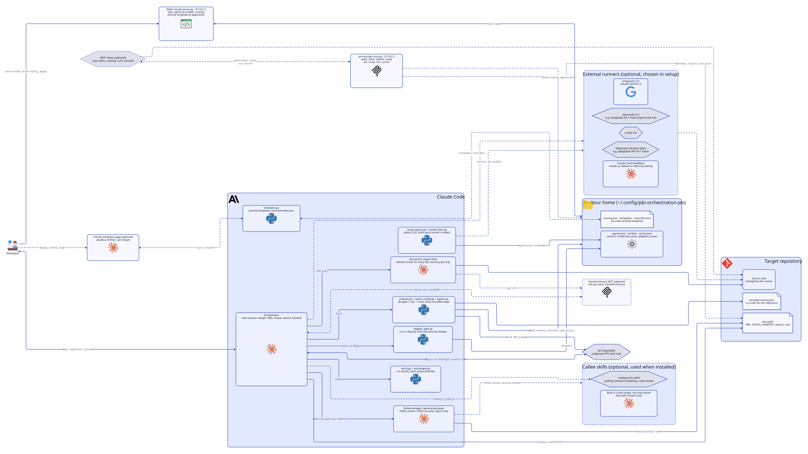
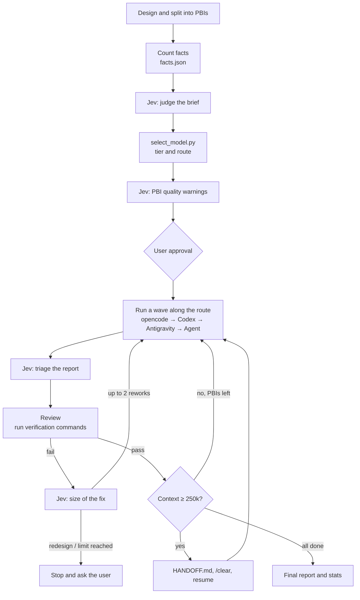
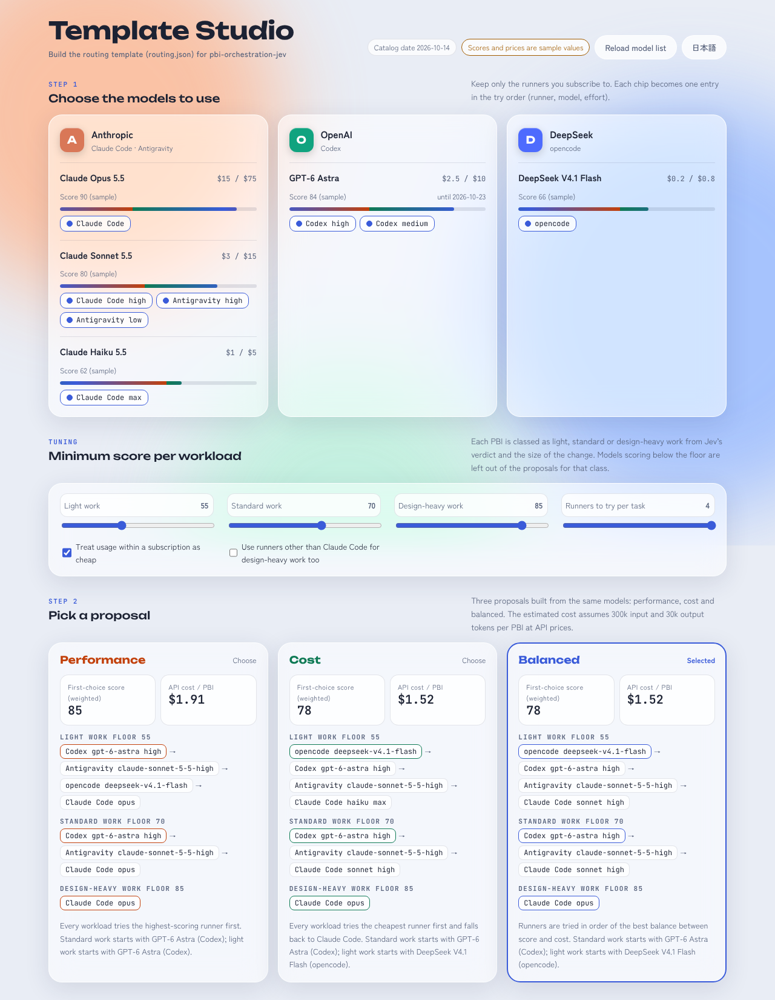
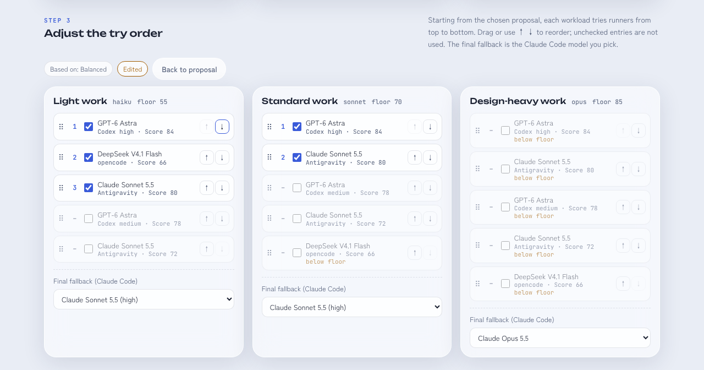

# pbi-orchestration-jev

English | [日本語](README.ja.md)

A [Claude Code](https://claude.com/claude-code) skill that splits multi-file implementation work into **PBIs (Product Backlog Items) and hands them to sub-agents**. The main session acts as the orchestrator: it writes the PBIs, picks a model for each, reviews the results and sends work back. The sub-agents (the opencode CLI with DeepSeek, Codex CLI, Claude via the Antigravity CLI, or Claude Code's Agent tool) do the implementation.

Some judgment calls along the way go to **Jev** ([TypeSafe](https://api.typesafe.ai)), a judgment API, as short text. Pass/fail is still decided by actually running verification commands, and counts are kept in a status file.

> The skill text itself (`SKILL.md`) is written in Japanese. Claude reads it fine either way.

<picture>
  <source media="(prefers-color-scheme: dark)" srcset="assets/architecture-dark.svg">
  
</picture>

The diagram source is `assets/architecture.d2` (rendered with [D2](https://d2lang.com)).

## Highlights

- **Models are chosen by a decision table, not by gut feeling.** `select_model.py` combines facts the orchestrator counts (files changed, modules touched, sensitivity) with Jev's reading of a short brief (novelty, coupling, ambiguity) and picks a tier: haiku, sonnet or opus.
- **Runners are tried in order.** Each tier comes with a `route`, an ordered list of runners. If one is out of quota or fails, the next one takes over.
- **Pass/fail comes from verification commands.** Neither the sub-agent's report nor Jev's triage is taken at face value. The orchestrator runs the commands itself and checks each acceptance criterion.
- **At most two rounds of rework.** Jev estimates how big the fix is. The haiku tier may be promoted to sonnet once. If the design needs rethinking, or a PBI still fails after two rounds, the orchestrator stops and asks the user.
- **Only prose goes to Jev.** PBI text, briefs, excerpts from reports and rework notes. Never source code, diffs, environment variables or credentials.
- **The orchestrator's context stays small.** Every token in the orchestrator's context is re-read on every later turn. Workers end with a 4-line report and put the details in a file, long command output goes to log files, and PBI text is written once and passed by path (`worker.md`, section 0.7 of `SKILL.md`).
- **Hand-off when the context grows.** Between waves of PBIs the orchestrator measures its context with `agent_stats.py --ctx`. Above 250,000 tokens it writes `docs/pbi/HANDOFF.md` and asks you to `/clear` and resume with `/pbi-orchestration-jev resume`.
- **Opus designs and reviews; cheaper models implement.** Only PBIs that need design decisions are implemented by Opus. Sensitive or tightly coupled PBIs are implemented by Sonnet and get a deep review from the Opus orchestrator.
- **Optional output compression with [rtk](https://github.com/rtk-ai/rtk).** A bundled hook rewrites Bash / PowerShell commands to `rtk <cmd>` only in sessions where the skill switched it on.
- **Mechanical steps run as scripts.** `prepare.py` runs Jev gate 1 (brief and PBI quality) plus the decision table in one call, and `verify.py` runs a PBI's verification commands; both return only a table to the orchestrator. The skill body is split into a core and `appendix/` files that are read only when needed. In the author's measurements (2026-10, 6 tasks) these two changes cut cost by 15%.
- **Workers get just what they need (optional).** With a shared-memory MCP (`mcp__shared-memory__*`), only the orchestrator writes per-task "refs" (one fact each) and lists their ids in the PBI. The `pbi-worker` sub-agent can only `get` memories, never search or write.
- **CLAUDE.md first.** Stable repository knowledge (conventions, commands, pitfalls) is expected to live in layered CLAUDE.md files; the orchestrator searches memory only as a supplement.
- **Pick the try order in a browser.** Template Studio turns the models you have into performance, cost and balanced proposals; reorder and press Apply to write `docs/pbi/routing.json` (see Template Studio below).
- **Usage stats.** `agent_stats.py` reads Claude Code transcripts and reports tokens per model and per agent, how often the prompt cache had to be rebuilt, and the current context size.

## Flow



## Routing

| Condition (evaluated top to bottom) | Tier | Review |
|---|---|---|
| `novelty` = 2 and `ambiguity` = 2 (design decisions needed) | opus | normal |
| `sensitive` is true | sonnet (Agent tool only) | deep |
| `coupling` = 2 | sonnet | deep |
| any score ≥ 1, or files changed ≥ 4, or modules ≥ 2 | sonnet | normal |
| none of the above | haiku | normal |

| Tier | 1. opencode | 2. Codex (until `CODEX_UNTIL`) | 3. Antigravity (`agy`) | 4. Claude Code Agent tool |
|---|---|---|---|---|
| haiku | `opencode-go/deepseek-v4.1-flash` | `gpt-6-astra`, effort `medium` | `claude-sonnet-5-5-low` | haiku, effort `max` |
| sonnet | `opencode-go/deepseek-v4.1-flash` | `gpt-6-astra`, effort `high` | `claude-sonnet-5-5-high` | sonnet, effort `high` |
| sonnet (sensitive) | (not used: stays off outside services) | (not used) | (not used) | sonnet, effort `high` |
| opus | (not used) | (not used) | (not used) | opus, default effort |

- A Jev score with confidence below 0.7 is lowered by one step. If Jev is unavailable, every score counts as 1.
- Codex is used until the `CODEX_UNTIL` date in `select_model.py`, then dropped from the route. Set it to a past date to skip Codex entirely.
- Antigravity offers no Haiku, so the haiku tier uses Sonnet at low effort there.
- `--skip opencode,agy` drops runners that hit a quota or got denied in this session. `--all docs/pbi` routes every PBI at once and prints one line per PBI.
- "deep" review means the Opus orchestrator reads the whole diff itself. A normal review over 300 lines is delegated to an Opus reviewer agent.

## Template Studio

The "which runner and model, in what order" part of the tables above can be picked in a browser. The decision table that sets the tier does not change.

```
/pbi-orchestration-jev templates
```

Run this in Claude Code and the skill starts a small server on 127.0.0.1 and opens the page. To open it without the skill:

```sh
python ~/.claude/skills/pbi-orchestration-jev/studio/serve.py --target <target repo root>
```

1. **Pick models**: keep only the runner chips you have on each provider card.
2. **Pick a proposal**: the page builds performance, cost and balanced proposals from those models. You can set a quality floor per workload (light / standard / design-heavy).

<picture>
  <source media="(prefers-color-scheme: dark)" srcset="assets/studio-proposals-en-dark.png">
  
</picture>

3. **Adjust the order**: for each work class, drag or use the arrow buttons to reorder, and untick what you do not want. Pick the Claude Code model that catches the rest.

<picture>
  <source media="(prefers-color-scheme: dark)" srcset="assets/studio-order-en-dark.png">
  
</picture>

4. **Apply**: the Apply button writes `docs/pbi/routing.json` and the server stops. The previous file is kept as `routing.prev.json`. From then on `prepare.py` tries runners in that order.

- The page is in English or Japanese. It follows your browser language, and the 日本語 / EN button in the header switches it (the choice is remembered). `?lang=en` or `?lang=ja` in the URL also works.
- Refresh the model list (`studio/catalog.json`) with `python studio/update_catalog.py`. Prices and new models come from OpenRouter; quality is the Artificial Analysis coding index (when `AA_API_KEY` is set). Until then the values are placeholders, and the page says so.
- The server only writes `docs/pbi/routing.json`, and only when the per-run token, the Host header and the template shape all check out.
- Design notes (Japanese): [docs/template-studio.md](docs/template-studio.md).

## Requirements

| Tool | Required | Used for |
|---|---|---|
| [Claude Code](https://claude.com/claude-code) | yes | the orchestrator and the Agent tool |
| Python 3.10+ | yes | `select_model.py`, `agent_stats.py`, the Jev client |
| Jev API key | recommended | without it, Jev gates are skipped and defaults apply |
| [opencode](https://opencode.ai) + OpenCode Go | no | first runner for the haiku and sonnet tiers |
| [Codex CLI](https://github.com/openai/codex) | no | next runner, until `CODEX_UNTIL` |
| Antigravity CLI (`agy`) | no | Claude via a Google AI subscription |
| Node.js | no | the rtk hook, and the JS Jev client (`jev.mjs`) |
| [rtk](https://github.com/rtk-ai/rtk) | no | compressing command output |

A missing runner just means the route moves on. Claude Code alone is enough to run the skill.

## Install

```sh
git clone https://github.com/reeschan/pbi-orchestration-jev.git
cp -r pbi-orchestration-jev/skills/pbi-orchestration-jev ~/.claude/skills/
mkdir -p ~/.claude/agents && cp pbi-orchestration-jev/skills/pbi-orchestration-jev/agents/pbi-worker.md ~/.claude/agents/
```

`pbi-worker` defines the worker and reviewer sub-agent. Restart Claude Code to load it. Without it the skill falls back to general-purpose (you only lose the guard that stops workers from searching memory).

Put your Jev API key in one of these places (checked in this order):

1. the `TYPESAFE_API_KEY` environment variable
2. a credentials file at `~/.config/typesafe/credentials.json` containing `{"api_key": "..."}`. Override the path with `TYPESAFE_CREDENTIALS_FILE`.

Never commit the key. Consider adding the credentials file to `permissions.deny` in Claude Code's `settings.json` so agents cannot read it.

### Optional: rtk

[rtk](https://github.com/rtk-ai/rtk) is a CLI proxy that compresses the output of common commands (git, tests, builds). The skill does not use `rtk init -g`, which would turn it on for every session. Instead, a bundled hook rewrites commands only in sessions where the skill ran `rtk/rtk-mode.mjs on`.

1. Install rtk (for example `winget install rtk-ai.rtk`, or `cargo install --git https://github.com/rtk-ai/rtk`; plain `cargo install rtk` is a different package) and check `rtk gain` works.
2. Add the hook to `~/.claude/settings.json`:

   ```json
   {
     "hooks": {
       "PreToolUse": [
         {
           "matcher": "Bash|PowerShell",
           "hooks": [{ "type": "command", "command": "node \"<HOME>/.claude/skills/pbi-orchestration-jev/rtk/rtk-gate.mjs\"", "timeout": 10 }]
         }
       ]
     }
   }
   ```

3. Restart Claude Code so the hook and `rtk` on your `PATH` are picked up.

Without the flag file (`~/.claude/state/rtk/<session_id>.on`), or without `rtk` on the `PATH`, the hook passes commands through unchanged. For opencode and Codex, rtk's own `rtk init -g --opencode` / `rtk init -g --codex` apply globally.

### Notes on opencode

- The DeepSeek models on OpenCode Go return HTTP 400 unless the workspace's privacy setting is Global.
- Starting several `opencode run` at the same moment can fail with `database is locked`. The skill staggers starts by 30 seconds.
- If opencode lives in a Node installed by fnm or nvm, it may not be on Claude Code's `PATH`. `runners.md` shows how to find it.

### Notes on Antigravity

- As of 2026-10-13, headless runs (`agy -p`) had command execution auto-denied (`RunCommand`), so work did not progress. The skill drops `agy` for the rest of the session after the first such denial.
- `agy` **silently denies commands it has no permission for and still exits 0**. Denials only show up in `denied_actions` in the JSON result and on stderr. The skill checks `denied_actions` every time.
- Permissions live in `permissions.allow` in `~/.gemini/antigravity-cli/settings.json`. The sandbox is off by default, so `command(node)` alone was not enough; `unsandboxed(node)` was also needed (checked with agy 1.3.3).

## Usage

In Claude Code, invoke it for work that spans several files:

```
/pbi-orchestration-jev <what you want built>
```

To pick the routing template in a browser, run `/pbi-orchestration-jev templates` (see Template Studio above).

Everything is recorded under `docs/pbi/` in the target repository.

| Path | Contents |
|---|---|
| `docs/pbi/STATUS.md` | status, runner and rework count per PBI |
| `docs/pbi/HANDOFF.md` | what the next session needs after a hand-off |
| `docs/pbi/PBI-<n>.md` | the PBI itself |
| `docs/pbi/PBI-<n>.facts.json` / `.brief.md` / `.route.json` | routing inputs and result |
| `docs/pbi/worker.md` | how workers proceed and report (copied from the skill) |
| `docs/pbi/reports/` | workers' detailed reports |
| `docs/pbi/verify/`, `docs/pbi/reviews/` | verification logs and delegated reviews |
| `docs/pbi/jev-log.jsonl` | every Jev answer and the action taken |
| `docs/pbi/jev.config.json` | Jev gates and thresholds (created from the template) |
| `docs/pbi/opencode/`, `docs/pbi/codex/`, `docs/pbi/agy/` | prompts and outputs for each runner |
| `docs/pbi/stats/` | token and cache stats |

The orchestrator only stops to wait for the user in four cases: approving the PBI list, hitting the rework limit (or needing a redesign), before destructive operations, and when it hands off a large context. After a hand-off, run `/clear` and then `/pbi-orchestration-jev resume`.

## Files

```
skills/pbi-orchestration-jev/
├── SKILL.md                    # the skill (instructions for the orchestrator)
├── runners.md                  # how to hand PBIs to opencode / Codex / Antigravity
├── verify-commands.md          # pitfalls when writing verification commands
├── worker.md                   # how workers proceed and report
├── appendix/                   # read only when needed (memory, rework, handoff, finish, jev)
├── agents/pbi-worker.md        # worker / reviewer sub-agent (copy to ~/.claude/agents)
├── prepare.py                  # Jev gate 1 + decision table in one call; prints a table
├── verify.py                   # runs a PBI's verification commands; prints exit codes and tails
├── select_model.py             # decision table: tier, route and review depth
├── routing.default.json        # default routing template (override with docs/pbi/routing.json)
├── studio/                     # build templates in a browser (index.html, serve.py, update_catalog.py, catalog.json)
├── agent_stats.py              # tokens, cache rebuilds and context size from transcripts
├── jev.config.template.json    # template for Jev gates and thresholds
├── opencode.config.json        # opencode permissions (no push, no reset, no outside dirs)
├── rtk/
│   ├── rtk-gate.mjs            # optional PreToolUse hook for rtk
│   └── rtk-mode.mjs            # turn rtk on / off for the current session
├── jev/
│   ├── jev.py / jev.mjs        # Jev client (Python / JS)
│   └── test_jev.py / jev.test.mjs
├── test_select_model.py
└── test_agent_stats.py
```

### Jev client

```sh
python jev/jev.py <config.json> <gate> <text-file>   # use a gate from the config
python jev/jev.py --request <request.json>           # send a raw request
```

On success it prints the response JSON and exits 0. A Jev failure prints `{"error": ...}` and exits 1; bad arguments exit 2. 429/529 are retried up to 3 times; 5xx, connection errors and timeouts are retried once.

## Tuning

- The decision table and thresholds are starting points. After 10–20 PBIs, look at the results per model (first-try pass, reworks, promotions) and adjust `select_model.py` and `jev.config.json`.
- Runner models and effort levels come from a routing template (`routing.json`, same shape as `routing.default.json`). Put it at `docs/pbi/routing.json` in the target repo, or `routing.json` in the skill directory, and `select_model.py` uses it; without one, the built-in table applies.
- You can also build the template in a browser (see Template Studio above).
- Review the hand-off threshold (250,000 tokens) and the opencode results on the sonnet tier at the same time.

## Tests

```sh
cd skills/pbi-orchestration-jev
python -m unittest test_select_model test_agent_stats
python -m unittest discover -s studio -p 'test_*.py'
cd jev
python -m unittest test_jev
node --test --test-reporter=tap jev.test.mjs
```

The Jev client tests only talk to a mock server on 127.0.0.1; they never call the real Jev.

## License

[MIT](LICENSE)
