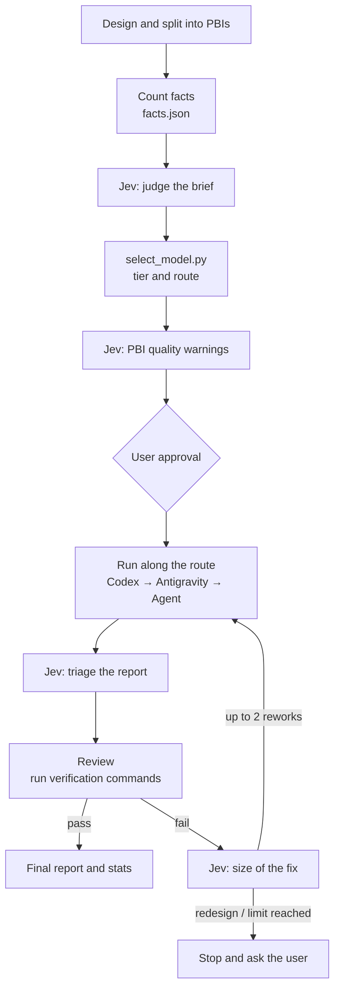

# pbi-orchestration-jev

English | [日本語](README.ja.md)

A [Claude Code](https://claude.com/claude-code) skill that splits multi-file implementation work into **PBIs (Product Backlog Items) and hands them to sub-agents**. The main session acts as the orchestrator: it writes the PBIs, picks a model for each, reviews the results and sends work back. The sub-agents (Codex CLI, Claude via the Antigravity CLI, or Claude Code's Agent tool) do the implementation.

Some judgment calls along the way go to **Jev** ([TypeSafe](https://api.typesafe.ai)), a judgment API, as short text. Pass/fail is still decided by actually running verification commands, and counts are kept in a status file.

> The skill text itself (`SKILL.md`) is written in Japanese. Claude reads it fine either way.

<picture>
  <source media="(prefers-color-scheme: dark)" srcset="assets/architecture-dark.svg">
  
</picture>

The diagram source is `assets/architecture.d2` (rendered with [D2](https://d2lang.com)).

## Highlights

- **Models are chosen by a decision table, not by gut feeling.** `select_model.py` combines facts the orchestrator counts (files changed, modules touched, sensitivity) with Jev's reading of a short brief (novelty, coupling, ambiguity) and picks a tier: haiku, sonnet or opus.
- **Runners are tried in order.** Each tier comes with a `route`, an ordered list of runners. If one is out of quota or fails, the next one takes over.
- **Pass/fail comes from verification commands.** Neither the sub-agent's report nor Jev's triage is taken at face value. The orchestrator runs the commands itself and checks each acceptance criterion.
- **At most two rounds of rework.** Jev estimates how big the fix is. The haiku tier may be promoted to sonnet once. If the design needs rethinking, or a PBI still fails after two rounds, the orchestrator stops and asks the user.
- **Only prose goes to Jev.** PBI text, briefs, excerpts from reports and rework notes. Never source code, diffs, environment variables or credentials.
- **Usage stats.** `agent_stats.py` reads Claude Code transcripts and reports tokens per model and how often the prompt cache had to be rebuilt.

## Flow



## Routing

| Condition (evaluated top to bottom) | Tier |
|---|---|
| `sensitive` is true, or `coupling` = 2 | opus |
| `novelty` = 2 and `ambiguity` = 2 | opus |
| any score ≥ 1, or files changed ≥ 4, or modules ≥ 2 | sonnet |
| none of the above | haiku |

| Tier | 1. Codex (until `CODEX_UNTIL`) | 2. Antigravity (`agy`) | 3. Claude Code Agent tool |
|---|---|---|---|
| haiku | `gpt-6-astra`, effort `medium` | `claude-sonnet-5-5-low` | haiku, effort `max` |
| sonnet | `gpt-6-astra`, effort `high` | `claude-sonnet-5-5-high` | sonnet, effort `high` |
| opus | (not used) | `claude-opus-5-5-high` | opus, default effort |

- A Jev score with confidence below 0.7 is lowered by one step. If Jev is unavailable, every score counts as 1.
- Codex is used until the `CODEX_UNTIL` date in `select_model.py`, then dropped from the route. Set it to a past date to skip Codex entirely.
- Antigravity offers no Haiku, so the haiku tier uses Sonnet at low effort there.

## Requirements

| Tool | Required | Used for |
|---|---|---|
| [Claude Code](https://claude.com/claude-code) | yes | the orchestrator and the Agent tool |
| Python 3.10+ | yes | `select_model.py`, `agent_stats.py`, the Jev client |
| Jev API key | recommended | without it, Jev gates are skipped and defaults apply |
| [Codex CLI](https://github.com/openai/codex) | no | first runner, until `CODEX_UNTIL` |
| Antigravity CLI (`agy`) | no | first choice for Claude tiers |
| Node.js | no | only for the JS Jev client (`jev.mjs`) |

A missing runner just means the route moves on. Claude Code alone is enough to run the skill.

## Install

```sh
git clone https://github.com/reeschan/pbi-orchestration-jev.git
cp -r pbi-orchestration-jev/skills/pbi-orchestration-jev ~/.claude/skills/
```

Put your Jev API key in one of these places (checked in this order):

1. the `TYPESAFE_API_KEY` environment variable
2. a credentials file at `~/.config/typesafe/credentials.json` containing `{"api_key": "..."}`. Override the path with `TYPESAFE_CREDENTIALS_FILE`.

Never commit the key. Consider adding the credentials file to `permissions.deny` in Claude Code's `settings.json` so agents cannot read it.

### Notes on Antigravity

- `agy` **silently denies commands it has no permission for and still exits 0**. Denials only show up in `denied_actions` in the JSON result and on stderr. The skill checks `denied_actions` every time.
- Permissions live in `permissions.allow` in `~/.gemini/antigravity-cli/settings.json`. The sandbox is off by default, so `command(node)` alone was not enough; `unsandboxed(node)` was also needed (checked with agy 1.3.3).

## Usage

In Claude Code, invoke it for work that spans several files:

```
/pbi-orchestration-jev <what you want built>
```

Everything is recorded under `docs/pbi/` in the target repository.

| Path | Contents |
|---|---|
| `docs/pbi/STATUS.md` | status, runner and rework count per PBI |
| `docs/pbi/PBI-<n>.md` | the PBI itself |
| `docs/pbi/PBI-<n>.facts.json` / `.brief.md` | routing inputs |
| `docs/pbi/jev-log.jsonl` | every Jev answer and the action taken |
| `docs/pbi/jev.config.json` | Jev gates and thresholds (created from the template) |
| `docs/pbi/codex/`, `docs/pbi/agy/` | prompts and reports for Codex / Antigravity |
| `docs/pbi/stats/` | token and cache stats |

The orchestrator only stops to wait for the user in three cases: approving the PBI list, hitting the rework limit (or needing a redesign), and before destructive operations.

## Files

```
skills/pbi-orchestration-jev/
├── SKILL.md                    # the skill (instructions for the orchestrator)
├── select_model.py             # decision table: tier and route
├── agent_stats.py              # tokens and cache rebuilds from transcripts
├── jev.config.template.json    # template for Jev gates and thresholds
├── jev/
│   ├── jev.py / jev.mjs        # Jev client (Python / JS)
│   └── test_jev.py / jev.test.mjs
├── test_select_model.py
└── test_agent_stats.py
```

### Jev client

```sh
python jev/jev.py <config.json> <gate> <text-file>   # use a gate from the config
python jev/jev.py --request <request.json>           # send a raw request
```

On success it prints the response JSON and exits 0. A Jev failure prints `{"error": ...}` and exits 1; bad arguments exit 2. 429/529 are retried up to 3 times; 5xx, connection errors and timeouts are retried once.

## Tuning

- The decision table and thresholds are starting points. After 10–20 PBIs, look at the results per model (first-try pass, reworks, promotions) and adjust `select_model.py` and `jev.config.json`.
- Runner models and effort levels are in the `CODEX` / `AGY` / `AGENT` tables in `select_model.py`.

## Tests

```sh
cd skills/pbi-orchestration-jev
python -m unittest test_select_model test_agent_stats
cd jev
python -m unittest test_jev
node --test --test-reporter=tap jev.test.mjs
```

The Jev client tests only talk to a mock server on 127.0.0.1; they never call the real Jev.

## License

[MIT](LICENSE)
