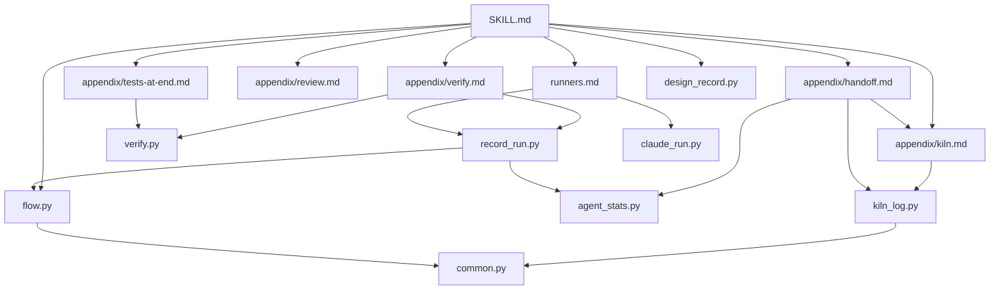

# Map: Atelier restructure (caller / designer episode / conductor)

## Layers (outermost first)
1. Instruction layer, read by the orchestrating session: `skills/atelier/SKILL.md`, `appendix/*.md`, `runners.md`, `worker.md`, `prompts/*.md`, `agents/pbi-worker.md`, `CONTEXT.md`.
2. Component/template layer (data): `skills/atelier/components/*.json`, `routing.default.json`, `agents.json` (home) resolved by `flow.py`.
3. Script layer (deterministic CLIs, stdlib only): `skills/atelier/*.py` (entry points are `python <skill>/x.py`; no package, flat modules).
4. Shared helpers: `common.py` (JSON, prices, home), `agents.py` (agents.json, drop reasons).
5. Run state on disk: `docs/pbi/` (STATUS.md, PBI-*.md, runs.jsonl, `.kiln/`, verify/, reviews/, notes/) and `docs/specs/`.
6. Verification: `skills/atelier/test_*.py` run by `.github/workflows/test.yml` (unittest discover in `skills/atelier`; also studio, jev, node tests). No manifest; Python 3.10 and 3.13.

Today the orchestrator (caller session) is the designer: SKILL.md says "You are the orchestrator", and Kiln/handoff make it cool and resume by manual /clear.

## Modules the request touches
- `skills/atelier/SKILL.md` : orchestrator contract, stop points, stage table, read-on-event table; must be split into a thin caller part and a designer part (instruction layer).
- `skills/atelier/appendix/handoff.md` : wave-boundary measure, rtk mode, hand off and `resume` (manual /clear + resume today); to be replaced by conductor relaunch (instruction layer).
- `skills/atelier/appendix/kiln.md` : context budget for designer/implementer, state tablet, when to cool; calls `kiln_log.py`, cites `prompts/kiln-chamber.md` (instruction layer). It also names `log_compact_event.py`, which does not exist in the tree.
- `skills/atelier/appendix/verify.md` : triage, `verify.py`, judge, `record_run.py`, no self-review rule (instruction layer).
- `skills/atelier/appendix/review.md` : final review, `prompts/final-review.md`, `adapter_gate.py` (instruction layer).
- `skills/atelier/appendix/tests-at-end.md` : deferred tests after last wave via `verify.py`; the Sonnet tester subagent would hook in here (instruction layer).
- `skills/atelier/runners.md` : launching workers: `agent` (Agent tool, `pbi-worker`), `claude` (`claude -p` via `claude_run.py`), opencode/codex/agy/dsh/mcp (instruction layer).
- `skills/atelier/claude_run.py` : runs `claude -p --output-format json` for one PBI, writes `<report>.json/.err/.run.json`; no local imports; model for a designer episode launcher (script layer).
- `skills/atelier/record_run.py` : appends one run to `docs/pbi/runs.jsonl`, uses `agent_stats`, `common`, `flow` (script layer).
- `skills/atelier/agent_stats.py` : token/cache stats from Claude Code transcripts for orchestrator and subagents; imports `common` (script layer).
- `skills/atelier/kiln_log.py` : compares context size to soft/peak lines, appends compact-event, keeps `.kiln/run_id`; imports `common` (script layer).
- `skills/atelier/design_record.py` : design-record.json, slices, approval Markdown, reply check; imports `common` (script layer).
- `skills/atelier/verify.py` : runs a PBI's verify commands, prints exit-code table; no local imports (script layer).
- `skills/atelier/flow.py` : resolves template, prints stage plan, `--decide`; imports `agents`, `common` (script layer).
- Supporting: `common.py`, `agents.py` (helpers); `prompts/kiln-chamber.md`, `prompts/final-review.md`, `prompts/pbi-review.md`, `agents/pbi-worker.md` (instruction layer); `docs/specs/atelier-v4.md`, `atelier-workflow.md`, `statechart/atelier-v4.mmd` (spec, to be updated).

## Dependency direction
- Python imports (all inward, none against the layer order): `record_run -> agent_stats, common, flow`; `flow -> agents, common`; `agents -> common`; `agent_stats, kiln_log, design_record -> common`; `claude_run` and `verify` import only stdlib. No import cycles. Other importers outside the list: `adapter_gate`, `component -> common, flow`; `export_cases -> record_run`.
- Doc to script pointers: `SKILL.md -> flow, verify, prepare, unchanged, record_run, tools_check, kiln_log, design_record`; `handoff.md -> kiln_log, agent_stats`; `kiln.md -> kiln_log, record_run, agent_stats, tools_check`; `verify.md -> verify, record_run, prepare, kiln_log`; `review.md -> adapter_gate`; `tests-at-end.md -> verify, record_run`; `runners.md -> claude_run, record_run, select_model, prepare, dsh_run, jev_mcp, agent_stats`.
- Doc to doc: SKILL.md points at every appendix; handoff.md <-> kiln.md; verify.md -> tests-at-end.md, kiln.md; review.md -> verify.md, prompts/final-review.md.
- Against layer order: none among imports. Conceptually, instruction docs (SKILL, handoff, kiln) assume the caller session is the designer, which is the coupling the request removes. No script yet reads or writes designer/episode state, so a conductor would be a new script-layer module over `docs/pbi/` state, reusing `claude_run`, `kiln_log`, `record_run`.

Source: fallback prompt (no OMM cache)
