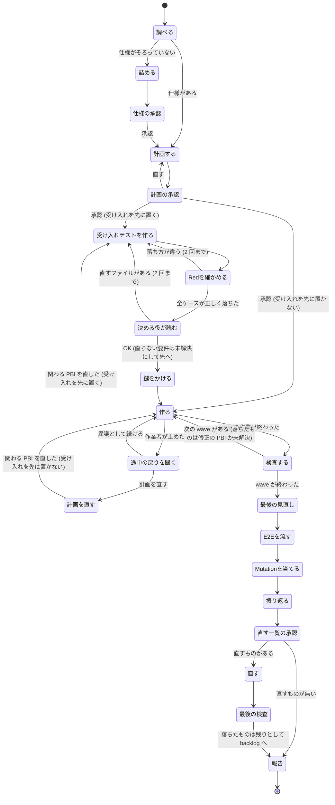

# 受け入れテストを先に置く：仕様

置き場所：このファイル（docs/specs/acceptance-first-tests.md）。
用語は `skills/atelier/GLOSSARY.md` に従う。決定の理由は `docs/adr/0002-acceptance-tests-as-pbis.md`。
もとにした下書き：`docs/drafts/acceptance-first-tests.v3.md`（v7 の言葉で書いたもの）と、詰めた 3 巡の記録 `docs/drafts/grill-round-{1,2,3}.md`。

## Problem Statement

Atelier v8 では、作業者が PBI の受け入れ基準 (`acceptance`) を読んで実装し、PBI の `checks` を自分で流して通す。受け入れ基準は文字列で、機械はどこでも判定しない。テストを書く役もいない。そのため次のことが起きる。

- 作業者が自分でゴールを解釈し、自分で通している。ゴールの読み違いが、最後の見直しまで見つからない。
- テストを足す・消す・緩めることは指示で禁じているだけで、普通の PBI がテストのファイルを変えても止まらない。止まるのは修正の PBI だけ。
- テストの値だけ通る作り (値の決め打ち) や、テストのときだけ動く作りを見つける仕組みが無い。
- テストの強さを測る仕組み (Mutation Testing) が無い。
- 途中の失敗が上限を超えると、run の途中でユーザーに聞く (`asking_rebuild`)。E2E で落ちると修正の段に何度も戻る。「途中で計画に戻っても、どうせ後でまた直す」ので、戻りが多いほど手間と費用が増える。

## Solution

受け入れテストを先に置き、作業者はそれを通すことだけを目指す形に作り替える。

- **シナリオを先に決める。** planner が計画のときに、要件ごとのシナリオを Gherkin (Scenario Outline と Examples) で書き、計画と一緒にユーザーが承認する。Examples の 1 行がケースで、id を持つ。
- **受け入れの PBI でテストに起こす。** 新しい役は足さない。最初の wave で、実装役が受け入れの PBI としてステップ定義などを書く。進行役が Red の確認と、ステップ定義の機械の検査を流し、planner が 1 回だけ読んで確かめる。通ったら鍵をかける。
- **作業者は鍵に触れない。** 実装の PBI の作業者は、実装と、`targets` にあるユニットテストだけを書く。シナリオが違うと思っても、変えずに異議を残して進む。
- **差し戻しは機械の規則だけで決める。** wave の検査で、鍵・流れたケースの数・割り当てたケース・控え (見せないケース) を確かめる。落ちたら今の持ち越しと修正の PBI で直す。2 回で直らなければ、聞かずに未解決として保留し、先へ進む。
- **判断は最後に 1 回だけ。** 最後の見直し・E2E・Mutation の後に、異議・未解決・Mutation の生き残りなどを全部、振り返りの一覧に集める。planner が仕分け、ユーザーが直す一覧を承認し、修正の段を 1 回だけ回す。そこで残ったものは次の run の backlog に入れる。

## User Stories

### 計画と承認

1. ユーザーとして、要件ごとのシナリオを Gherkin で読んで承認したい。何が作られるかを、コードを読まずに確かめられるようにするため。
2. ユーザーとして、承認ページで各要件のシナリオと Examples の表を見たい。期待値を一つずつ確かめるため。
3. ユーザーとして、期待値が要件から決まらないケースを、承認のときに聞かれたい。build の途中で止まらないようにするため。
4. ユーザーとして、PBI ごとに通常か軽量かが承認ページで分かりたい。小さな変更に重い手順を使っていないかを確かめるため。
5. ユーザーとして、控えのケースが要件ごとに何件あるか (中身ではなく数) を承認ページで見たい。値の決め打ちへの備えがあるかを知るため。
6. ユーザーとして、ステップ定義の機械の検査を飛ばす言語があれば、承認ページで知りたい。守りが弱いところを把握するため。
7. ユーザーとして、受け入れの PBI・E2E の PBI・Mutation のぶんの見積もりも、承認ページの上限と見積もりに含まれていてほしい。費用を承認の前に知るため。
8. planner として、要件ごとに `normal`・`light`・`light-no-red` を選びたい。依存の更新のように Red にできない変更も扱うため。
9. planner として、軽量の条件 (新しい公開の口が無い・PBI が 1 つで実装のファイルが 3 つ以下・期待値に `?` が無い) から外れた計画を出したら、計画の形の検査で拒まれたい。迷いを残さないため。
10. planner として、ケースを PBI に割り当てたい。複数の PBI がそろって初めて通るケースは、wave の順で一番後に終わる PBI に割り当てたい。先に終わる PBI を不当に差し戻さないため。
11. planner として、同じ wave の複数の PBI がそろわないと通らないケースを書いたら、計画の形の検査で拒まれたい。持ち主の決まらないケースを作らないため。
12. planner として、要件ごとに控えの型 (値どうしの関係と期待値) を書きたい。値そのものはどこにも書かずに済ませるため。
13. planner として、控えの型の式に許されない形 (`+ - *` 以外の演算・未定義の変数) を書いたら、計画の形の検査で拒まれたい。
14. planner として、公開の口 (関数・コマンド・HTTP の経路と型) を計画で決め、空の stub を置く PBI を受け入れの PBI と同じ最初の wave に入れたい。Red の理由が「import できない」にならないようにするため。
15. planner として、新しい振る舞いの E2E を書く PBI を計画に入れたい。その PBI の難度は L3 以上でなければ拒まれたい。安いモデルに E2E を書かせないため。
16. planner として、既存のテストのうち期待値が古くなるものを、その PBI の `targets` に入れたい (今の v8 のまま)。

### 受け入れの PBI と鍵

17. 実装役として、受け入れの PBI では、承認されたシナリオから、ステップ定義 (または 4.4 の形の小さな関数)・受け入れテスト用の fixture だけを書きたい。ソースは変えない。
18. 進行役として、受け入れの PBI の検査を「全ケースが落ち、理由が assertion か未実装であれば合格」と判定したい。import の失敗・構文の誤り・最初から通るケースは不合格にしたい。
19. 進行役として、Red の確認で、流れたケースの id が計画のケースの一覧と一致するかを確かめたい。書き起こしの漏れを見つけるため。
20. 進行役として、Python と JS/TS では、ステップ定義の機械の検査 (公開の口だけを import・各 Then に assert・対象を mock しない・広い例外を握りつぶさない・未定義のステップは失敗) を流したい。
21. planner として、Red の確認が全部通った後に 1 回だけ起動され、受け入れテストを読んで「OK」か「直す (理由)」をファイルごとに返したい。見るのは、When が決めた口を呼ぶか・Then が要件の値と副作用を見るか・Given がシナリオの文と同じか。
22. 進行役として、planner が「直す」と返したファイルの受け入れの PBI を作り直したい。2 回目は L5 の経路で作りたい。それでも直らない要件は、鍵をかけずに未解決として振り返りに回し、その要件に割り当てた PBI は軽量と同じ扱いで進めたい。
23. 進行役として、鍵をかけるときに、鍵の一覧をコミットし、そのコミット (鍵のコミット) と一覧の写しを作業ツリーの外に置き、写しのハッシュを持ち主の設定の場所に書きたい。作業者が一覧を書き換えても検査が騙されないようにするため。
24. 進行役として、鍵には、シナリオ・ステップ定義・受け入れテストの fixture と support・ランナーの設定・テストを流すコマンドの行・公開の口のシグネチャ・鍵の一覧そのものを入れたい。
25. 進行役として、シグネチャは Python・TypeScript・Go では道具で取り出し、それ以外の言語ではシグネチャを鍵に入れず、公開の口の diff を振り返りで planner に見せたい。
26. 作業者として、実装の PBI のチケットで、鍵のファイルの一覧と、自分に割り当てられたケースの id を知りたい。何を通せばよいかを迷わないため。

### 実装と wave の検査

27. 作業者として、実装と、`targets` に `kind: unit` として入っているユニットテストを書きたい。自分の作りを支えるテストを足せるようにするため。
28. 作業者として、鍵のファイルを変えたら、G1 で止められたい。鍵のファイルは鍵のコミットの中身に戻されたい。
29. 作業者として、シナリオが違うと思ったら、結果ファイルの `objections` に、ケースの id・何が違うか・なぜ・今の状態 (Green か赤のまま)・採った仮の解釈を書いて先へ進みたい。
30. 作業者として、シナリオのとおりには作れないとき (ほかの鍵つきのケースと矛盾する・公開の口では表せない) だけ、そのケースを赤のまま残したい。
31. 作業者として、このまま進めると後の PBI がほぼ無駄になるとき (公開の口の前提が崩れた・鍵つきのケースどうしが矛盾する・前提の外のものが無い・安全の問題) だけ、結果ファイルに `stop` と例外の番号と理由を書きたい。
32. ユーザーとして、作業者が `stop` を返したら、「計画を直す」か「異議として振り返りに回して続ける」かを 1 問で聞かれたい。その間、その PBI と、それに依る PBI だけが止まり、ほかは進んでほしい。
33. ユーザーとして、「計画を直す」を選んだら、planner がその口とシナリオに関わる PBI だけを直し、受け入れの PBI が作り直されて鍵がかけ直されてほしい。
34. 作業者として、自分の受け入れのケースを流して確かめたい。ただし、その結果で差し戻されることは無く、差し戻しは wave の終わりの検査の結果だけで決まってほしい。ほかの PBI の途中の変更に巻き込まれるため。
35. 進行役として、wave の終わりに、(1) 鍵のハッシュ・キー・シグネチャ、(2) 流れたケースの id、(3) 割り当てたケースと PBI の `checks` と全体の検査、(4) 控え、の順に確かめたい。
36. 進行役として、鍵の一覧の写しのハッシュが記録と違ったら、検査を止めてユーザーに知らせたい。これは作業者への差し戻しではなく、鍵の仕組みの故障だから。
37. 進行役として、流れたケースが足りなければ (skip・タグで外れた・ファイルが動いた)、その wave の差し戻しの理由にしたい。異議つきで赤のまま残したケースは「流れた」に数えたい。
38. 進行役として、作業者の diff にテストの環境を見分けるコード (`PYTEST_CURRENT_TEST`・`NODE_ENV === "test"` など) があれば、差し戻したい。
39. 進行役として、落ちた検査の持ち主を、①その PBI の `checks` で落ちた → その PBI、②落ちたテストのファイルがある PBI の `targets` にある → その PBI、③どれでもない → 未解決、の順で決めたい。wave の全 PBI を落ちた扱いにはしない。
40. 進行役として、前の wave で通ったケースが赤になったときも、同じ順で持ち主を決めたい。
41. 進行役として、持ち越しの修正の PBI が 2 回落ちたら (2 回目は 1 難度上)、ユーザーに聞かずに、その PBI と、それに依る PBI を保留にし、未解決として振り返りに回したい。依らない PBI は先へ進めたい。
42. 進行役として、控えの型から、見せた行に出てこない値を毎回新しく選んで控えのケースを作り、鍵のフォルダの別ファイルに写して流し、流し終えたら消したい。消した後に、鍵のフォルダに余計なファイルが無いことを確かめたい。
43. 進行役として、控えだけが落ちたら、その PBI を 1 回だけ差し戻したい。差し戻しのメモには控えの型も値も書かない。2 回目も落ちたら未解決にしたい。
44. 進行役として、控えの値を選んだ乱数の種と、wave ごとの控えの記録 (見せた行の数・控えの数・控えで落ちた数・差し戻したか) を作業ツリーの外に残したい。後で控えの割合を見直すため。
45. 進行役として、軽量のケースと修正の段には控えを使わない。

### 最後の段

46. 進行役として、最後の build の wave の後に、最後の見直しを今どおり 1 回だけ回したい。
47. 進行役として、見直しの後に E2E を流し、続けて Mutation を変えたファイルに当てたい。どちらも、落ちたり生き残ったりしたものは振り返りの一覧に入れ、修正の段には直接戻らない。
48. 進行役として、E2E の PBI が書いた E2E のファイルを、書き終えた時点で鍵に足したい。E2E の期待値を後から実装に合わせて変えさせないため。
49. 進行役として、Mutation の結果は共通の JSON の形 (mutation-testing-report-schema) だけを読みたい。読めない道具では生き残りの数だけを報告したい。Mutation のコマンドが無ければ飛ばして報告に書きたい。
50. 進行役として、振り返りの一覧に、見直しの指摘・異議・未解決・途中の戻り・Mutation の生き残り・E2E の失敗・鍵を外す要望・軽量の見直しを、種類つきの同じ形で集めたい。
51. 進行役として、確かさ 80 未満を外す決まりは、見直しの指摘にだけ当てたい。ほかの種類は機械や作業者が出したものだから。
52. planner として、振り返りの一覧を 1 回で仕分けたい (fix / skip / ask)。Mutation の生き残りは「要件の穴」「ユニットの穴」「等価」に分けたい。要件の解釈が変わるものは ask にしてユーザーに回したい。
53. ユーザーとして、直す一覧の承認で、振り返りの各件の「何が・なぜ・今の状態・選択肢・推奨・影響する PBI」を読んで決めたい。ほかの記録を開かずに決められるようにするため。
54. ユーザーとして、途中の戻りが何回あったかを報告と振り返りで知りたい。計画の質を測るため。
55. 進行役として、鍵を外すと決まったケースは、修正の段で受け入れの PBI として直させたい。直した行・足した行は、鍵のコミットの状態を別の一時的な作業ツリーで作って流し、そこで落ちることを確かめたい。今の実装での結果が決めたことと合う (シナリオを直すなら通る、実装を直すなら落ちる) ことも確かめたい。確かめたら鍵をかけ直したい。
56. 進行役として、修正の段は 1 回だけ回したい。修正の段の後に、全体の検査・E2E・修正の段で変えたファイルへの Mutation を 1 回だけ流し、落ちたものは作り直さずに残りにしたい。
57. 進行役として、残りを作業ツリーの外の backlog に 1 件ずつ入れたい (振り返りの 1 件をそのまま写し、どの run のどの件から来たかを付ける)。
58. ユーザーとして、残りが 1 件でもあれば、run が未完了と報告されたい。報告の 1 行目に、残りの件数と backlog に入れたことが書かれていてほしい。
59. planner として、次の run の計画のときに、そのリポジトリの backlog を PBI の候補として受け取りたい。取り込んだ件には、取り込んだ run が記されてほしい。

### 切り替えと調べる段

60. ユーザーとして、テンプレートで `acceptance_first`・`hidden_cases`・`mutation` を切り替えたい。小さな run やテストのランナーが無いリポジトリで重くしないため。
61. 進行役として、surveyor が受け入れテストを流すコマンドを見つけられなかったら、`acceptance_first` を自動で切り、承認ページにそう出したい。`acceptance_first` が切れていれば、`hidden_cases` も切りたい。
62. surveyor として、事実の束の `commands` に、`acceptance` (1 つの feature かテストファイルを流し、JUnit XML で結果を書き出す方法) と `mutation` (変えたファイルを `{files}` で渡して流し、共通の JSON を書き出す方法) を書きたい。
63. ユーザーとして、`acceptance_first` を切ったときは、今の v8 と同じ動き (受け入れ基準は文字列) になってほしい。

## Implementation Decisions

### 工程と状態

- 工程は次の順に変える。調べる → 詰める → 仕様の承認 → 計画 → 計画の承認 → データの用意 → **受け入れテストを作る (最初の wave)** → **Red の確認** → **planner の確認** → **鍵をかける** → 実装の wave と検査 (繰り返し) → **E2E の PBI** → 最後の見直し → **E2E** → **Mutation** → 振り返り (仕分け) → 直す一覧の承認 → 修正の段 (1 回) → **最後の検査** → 報告。
- 状態の流れの表に、受け入れテストを作る・Red を確かめる・planner の確認・鍵をかける・途中の戻りを聞く・Mutation・最後の検査の状態を足す。E2E は修正の段の後から、見直しの後へ移す。
- `asking_rebuild` (修正の PBI が 2 回落ちたときの問い) と `asking_e2e_limit`・`e2e_rounds` は無くす。修正の段の後の検査で落ちても、修正の段には戻らない。
- 新しい never の規則: 鍵をかける前に実装の PBI を作らない。修正の段に 2 回入らない。鍵のファイルが変わったまま次の起動へ進まない。途中で planner に戻るときは必ずユーザーに聞いてから。今の「見直しは 1 回」は残す。
- planner の起動点を 1 つ足す (受け入れテストの確認)。途中の戻りでユーザーが「計画を直す」を選んだときも planner を起動する。ほかの起動点は増やさない。新しい役は足さない (ADR 0002)。

### 計画の形

- 計画に `scenarios` を足す。要件ごとに、id・要件の本文・モード (`normal` / `light` / `light-no-red`)・Gherkin の本文 (`normal` のとき)・ケースの一覧 (id と値)・ケースの割り当て先の PBI・控えの型の件数を持つ。
- PBI に `kind` を足す: `build` (今の PBI)・`acceptance`・`e2e`・`stub` (公開の口の stub を置く PBI)。`acceptance` と `stub` は最初の wave に置く。`e2e` は最後の build の wave の後に置き、難度は L3 以上。
- `targets` の各ファイルに、ユニットテストであることを示す印を付けられるようにする。作業者は印の付いたテストのファイルだけを足して書ける。
- 計画に公開の口の一覧 (`interfaces`: モジュールと名前) を足す。ステップ定義の import の許可リストと、シグネチャの鍵の対象になる。
- 控えの型は計画の JSON には書かず、planner が進行役の指定する作業ツリーの外の場所に書く。型の書き方は、列ごとに、決まった値・変数の範囲 (`int a..b`)・変数の式 (`+ - *` のみ)・`fresh` (見せた行に出ない新しい文字列) のどれか。式は Python の `ast` で読み、許した形以外は計画の形の検査で拒む。
- 計画の形の検査に足すもの: 軽量の 3 条件、同じ wave の複数の PBI にまたがるケースの禁止、ケースの割り当て漏れ、`e2e` の PBI の難度、控えの型の式。

### 受け入れテスト・Red の確認・鍵

- 受け入れの PBI の検査は、通常の「通れば合格」と逆の判定をする。ランナーの JUnit XML を読み、全ケースの id がそろい、全ケースが失敗し、失敗の種類が assertion か未実装であれば合格。エラー (import・構文・収集の失敗) や通ったケースがあれば不合格。
- ステップ定義の機械の検査は、Python (pytest・pytest-bdd・behave) と JS/TS (vitest・jest・cucumber-js) で作る。正規表現と簡単な構文の読み取りで行う。ほかの言語では飛ばし、承認ページと報告に出す。
- planner の確認の結果は、ファイルごとに OK か「直す (理由)」。直すものは、進行役が受け入れの PBI の作り直しにする (2 回目は L5 の経路)。直らない要件は未解決にし、その要件の PBI は軽量と同じ扱いで進める。
- 鍵の一覧 (`locks.json`) は、ファイルの一覧・作業者も触るファイルのうち比べるキー・公開の口のシグネチャ・ケースの id の一覧・ケースの割り当て・鍵を外した記録を持つ。作業ツリーの `docs/pbi/` にもコミットするが、これは作業者が読むための写しで、検査の基準にはしない。
- 検査の基準は、作業ツリーの外 (`<git common dir>/atelier/<run>/`) に置く一覧の写しと鍵のコミット。写しのハッシュは、進行役が持ち主の設定の場所 (`~/.config/atelier/locks/<run>.json`) に書く。共有メモリには書かない (進行役のスクリプトは共有メモリを呼べない)。
- 鍵のファイルは、git の blob で鍵のコミットと比べる (改行の変換で誤って破られたとしないため)。
- G1 は、今の起動ごとの比較に加えて、鍵の一覧のファイルの変更を止める (今の修正の PBI の「テストを変えさせない」止め方を、すべての起動の鍵のファイルに広げる)。止めたら、鍵のファイルを鍵のコミットの中身に戻す。
- シグネチャは、Python は `ast`、TypeScript は宣言の出力、Go は `go doc` で取り出す。それ以外の言語では鍵に入れない。
- 鍵を書式の自動修正から外す仕組み (下書き v3 の 5.5) は作らない。v8 の作業者は変えたファイルにしか書式をかけないため。書式で鍵が変わったときは、G1 がそのまま止める。
- E2E の PBI が書いた E2E のファイルは、その PBI が終わった時点で鍵に足し、鍵のコミットを進める。

### 作業者

- 作業者の指示を変える: 実装の PBI では、`targets` にあるユニットテストのファイルは書いてよい。鍵のファイルは変えない。テストを消す・飛ばす・緩めることは今どおり禁止。古くなった既存のテストは、planner が `targets` に入れたものだけ期待値を直してよい (今の v8 のまま)。
- 結果ファイルに `objections` と `stop` を足す。異議の既定は「書いてあるとおりに作る」。書いてあるとおりに作れないときだけ赤のまま残す。`stop` は 4 つの例外 (公開の口の前提が崩れた・鍵つきのケースどうしが矛盾する・前提の外のものが無い・安全の問題) のときだけ。
- チケットに、鍵のファイルの一覧と、割り当てられたケースの id を載せる。
- 作業者が自分で流した結果は参考で、差し戻しには使わない (今の v8 の、wave の終わりに進行役が検査を流す仕組みのまま)。

### wave の検査と差し戻し

- wave の検査の順番: (0) 一覧の写しのハッシュを記録と比べる (違えば止めてユーザーに知らせる) → (1) 鍵のファイル・キー・シグネチャを鍵のコミットと比べる → (2) 流れたケースの id を一覧と比べる (控えは除く) → (3) 割り当てたケース・PBI の `checks`・全体の検査 → (4) 控えを作って流し、消す。
- テストの環境を見分けるコードの検査は、作業者の diff の grep で行う。
- 落ちた検査の持ち主は、① PBI の `checks` → ② 落ちたテストのファイルを `targets` に持つ PBI → ③ どちらでもなければ未解決。coverage は使わない。前の wave で通ったケースが赤になったときも同じ。
- 差し戻しは今の持ち越しと修正の PBI のまま。同じ持ち越しの修正の PBI は 2 回まで (2 回目は 1 難度上)。それでも落ちたら、聞かずに保留にし、それに依る PBI も保留にして未解決にする。控えによる差し戻しは 1 PBI に 1 回まで。
- 鍵のファイル・キー・シグネチャの違いが G1 をすり抜けて wave の検査で見つかったときは、鍵のコミットの中身に戻し、持ち主が決まらなければ未解決にする。

### 控え

- 控えの値は、進行役が wave の検査のたびに型から新しく選ぶ。値と乱数の種は、作業ツリーの外の控えの記録にだけ残す。
- 控えのケースは、鍵のかかったファイルに行を足さず、受け入れテストのフォルダの別ファイルに写して流し、流し終えたら消す。消した後に、鍵のフォルダに余計なファイルが無いことを確かめる。
- 控えの記録は wave ごとに 1 行 (run・wave・PBI・見せた行の数・控えの数・控えで落ちた数・差し戻したか・後で決め打ちと分かったか)。報告に run の合計を出す。割合の見直しの決まりは置かない。

### 最後の段

- E2E は、計画の `e2e` のコマンドを今どおり流す。E2E の PBI が足したスペックも含める。落ちたものは振り返りの一覧に `e2e_failure` として入れる。E2E の期待値を直して通すことはしない。
- Mutation は、計画の `mutation` のコマンドに、変えたファイルを入れて流す。結果は mutation-testing-report-schema の JSON だけを読み、生き残りを振り返りの一覧に入れる。
- 振り返りの一覧は、今の見直しの指摘の形に、種類 (`review` / `objection` / `unresolved` / `plan_return` / `requirement_gap` / `unit_gap` / `e2e_failure` / `unlock_request` / `light_review`) と、試したこと・今の状態・仮の解釈・選択肢・推奨・影響するものの欄を足して揃える。作業ツリーの外に置く。
- planner の仕分けは今の起動点のまま、全種類を 1 回で仕分ける。要件の解釈が変わるものは ask にする。確かさ 80 未満で外す決まりは `review` にだけ当てる。シグネチャを取り出せない言語の公開の口の diff は、仕分けの入力に含める。
- 修正の段では、鍵を外すと決まったケースを受け入れの PBI として直す。直した行は、鍵のコミットを一時的な別の作業ツリー (`git worktree`) に作って流し、落ちることを確かめる。確かめたら一覧を書き直し、新しい鍵のコミットにし、外の写しとハッシュも書き直し、鍵を外した記録を足す。
- 最後の検査は、全体の検査・E2E・修正の段で変えたファイルへの Mutation を 1 回ずつ。落ちたもの・新しい生き残りは残りにする。

### backlog と報告

- backlog は `<git common dir>/atelier/backlog.jsonl`。1 行 1 件で、振り返りの 1 件をそのまま写し、来た run と件の id を付ける。
- `start` は、backlog に件があれば planner に PBI の候補として渡す。取り込んだ件には取り込んだ run を記す。
- 報告に足すもの: ケースの数と結果、控えの記録の合計、途中の戻りの回数、鍵を外した記録、飛ばした機械の検査、Mutation の結果、backlog に入れた残り。残りが 1 件でもあれば `complete: false` で、1 行目に件数を書く。

### テンプレートと調べる段

- テンプレートの部品の入り切りに `acceptance_first`・`hidden_cases`・`mutation` を足す。既定はすべて入り。
- surveyor の `commands` の種類に `acceptance` と `mutation` を足す。`acceptance` が見つからなければ `acceptance_first` を自動で切り、`hidden_cases` も切る。`mutation` が見つからなければ Mutation を飛ばす。どれも承認ページと報告に出す。
- `acceptance_first` が切れているときは、今の v8 と同じ動きにする。

### 承認ページ

- 計画の承認ページに、要件ごとのシナリオ (Gherkin と Examples の表)、PBI の表のモードと種類の列、要件ごとの控えの件数、飛ばす機械の検査、部品の入り切りを足す。軽量の要件はケースの id とテスト名の一覧だけ出す。
- 直す一覧の承認ページに、振り返りの各件の種類と、足した欄を出す。

### 状態の図

図の中の `%% never` の行は、起きてはいけないことの一覧 (描画には出ない):

- 鍵をかける前に、実装の PBI を作る
- 作業者が鍵のファイルを変えたまま、次の起動へ進む
- 修正の段に 2 回入る
- 見直しを 2 回する
- ユーザーに聞かずに、途中で決める役に戻る
- 最後の検査で落ちたものを、もう一度直しに行く
- 受け入れを先に置かない run で、受け入れテストを作る

**機械の検査 (2026-11-24):** pstack の `/statechart` (TLC 1.7.4) で、この図を検査した。状態・遷移・規則を英語の名前にした写しと、「鍵」「問い」「見直しの回数」「修正の回数」「最後の検査」を数える領域を足して流した。
- 最初の図では、受け入れを先に置かない run でも、途中の戻りで「計画を直す」を選ぶと「受け入れテストを作る」に進んでいた。上の図は、計画を直した後の行き先をモードで分けて直したもの。
- 直した図では、到達できる 39 の状態のどれも、上の規則を破らない。「作業者が鍵のファイルを変えたまま次の起動へ進む」は工程の図では表せないので、G1 と wave の検査の結合テスト (Testing Decisions) で確かめる。

## Testing Decisions

- **合意済みの seam:** Seam 1 だけ。一時的な git リポジトリの上で、進行役の CLI (`start` / `drive` / `answer`) を、役の結果を偽物にして回す結合テスト。関数ごとのユニットの境界は新しく作らない。
- **良いテスト:** 進行役の外から見える振る舞い (次の行動・状態の遷移・記録・書かれたファイル・承認ページの原稿・報告) だけを確かめる。内部の関数の呼び方や順番は確かめない。
- **確かめ方:**
  - Red の確認・ケースの数え方: 偽物の検査コマンド (小さな Python のスクリプト) に JUnit XML を書かせ、合格・不合格の判定と、流れたケースの数の検査を確かめる。
  - Mutation の読み取り: 偽物の検査コマンドに mutation-testing-report-schema の JSON を書かせ、生き残りが振り返りの一覧に入ることを確かめる。
  - 控えの式: 計画の形の検査で許されない式が拒まれること、wave の検査で作られる控えのファイルの値が見せた行に無いこと、流し終えたら消えていることを確かめる。
  - ステップ定義の機械の検査: 一時リポジトリに、良い例と骨抜きの例 (空の Then・対象の mock・広い except・内部の import) の受け入れテストのファイルを置いて確かめる。
  - 鍵: 偽物の作業者が鍵のファイル・鍵の一覧・作業ツリーの外の写しを書き換えたときに、それぞれ G1 で止まる・wave の検査で戻される・故障として止まることを確かめる。
  - 差し戻しと未解決: 修正の PBI が 2 回落ちると聞かずに保留になり、依る PBI も保留になり、依らない PBI は進むことを確かめる。持ち主の決まらない失敗が未解決になることを確かめる。
  - 途中の戻り: 偽物の作業者の `stop` で問いが出て、両方の答えで正しく進むことを確かめる。
  - 最後の段: E2E・Mutation の失敗が振り返りの一覧に入り、修正の段が 1 回だけ回り、最後の検査で落ちたものが backlog に入り、報告が未完了になることを確かめる。次の run の `start` が backlog を planner に渡すことを確かめる。
  - 切り替え: `acceptance_first` を切ったときに今の v8 と同じ流れになることを、今の結合テストがそのまま通ることで確かめる。
  - 承認ページ: `tests/expected/` の原稿 (計画・直す一覧) を新しい欄つきに更新して突き合わせる。
- **先例:** `tests/test_integration.py` (Seam 1 の結合テスト・全状態を 1 回ずつ通す偽物の run)、`tests/test_conductor.py` (CLI を回す道具)、`tests/test_flow_rules.py` (never の規則)、`tests/test_carry_over.py` (持ち越しと修正の PBI)、`tests/test_worker_checks.py` (作業者の検査の範囲)、`tests/test_pages.py` と `tests/expected/` (承認ページ)。
- **変える既存のテスト:** `asking_rebuild`・`asking_e2e_limit`・`e2e_rounds` を前提にしたもの、計画の `checks` の失敗で wave の全 PBI を落とす前提のもの、修正の段の後の作り直しの前提のもの、作業者の指示の文言を確かめるもの。

## Out of Scope

- 計画のときに既存のコードへ Mutation を当て、生き残りに特性テストを足す段 (下書き v3 の「既存の挙動を守る段」)。今回は、planner が既存の挙動のケースを `light-no-red` で書けるところまで。
- Python と JS/TS 以外の言語での、ステップ定義の機械の検査。
- coverage を使った失敗の持ち主の決め方。
- 鍵のパスを書式の自動修正から外す仕組み (v3 の 5.5)。
- 控えの割合を自動で上げ下げする決まり。記録を残し、何 run か溜まってから決める。
- 途中の戻りの回数に閾値を置くこと。毎回報告と振り返りに出す。
- 共有メモリへの書き込み。
- v7 の仕組み (tests-at-end・tester・`tests_plan.py`・`e2e_run.py`) の復活。

## Further Notes

- 実装は 3 段に分け、各段の終わりで Atelier が使える状態にする。
  1. **受け入れテストと鍵:** 計画の形 (`scenarios`・`kind`・`interfaces`・ユニットテストの印)、受け入れの PBI と stub の PBI、Red の確認、ステップ定義の機械の検査、planner の確認、鍵 (一覧・外の写し・ハッシュ・G1 の拡張)、流れたケースの数の検査、作業者の指示と結果ファイル (`objections`・`stop`)、承認ページ、`acceptance_first` の切り替え、surveyor の `acceptance`。
  2. **振り返りと工程:** 工程の組み替え、未解決の自動保留、持ち主の決め方の 3 段、途中の戻りの問い、振り返りの一覧の種類と欄、E2E の PBI と E2E の移動、修正の段 1 回と最後の検査、backlog と報告。
  3. **控えと Mutation:** 控えの型・値の生成・記録・差し戻し 1 回、Mutation のコマンドと読み取り、生き残りの仕分け、`hidden_cases`・`mutation` の切り替え、surveyor の `mutation`。
- 用語集に、振り返りの一覧・残り・backlog・未解決・異議・途中の戻り・受け入れの PBI・シナリオ・ケース・Red の確認・鍵・軽量モード・控え・生き残りを足した。直しの一覧の定義を「振り返りの一覧のうち、直すと承認されたもの」に改めた。
- 下書き v3 の決定のうち、v8 に合わせて改めたもの: tester → 進行役の検査と受け入れの PBI、設計者が読む → planner の起動点 1 つ、鍵の基準のハッシュは共有メモリ → `~/.config/atelier/`、coverage による持ち主の決め方 → 3 段の規則、`Breaks by design:` → 今の v8 の `targets` のやり方、書式の除外 → 作らない、E2E を書く「中位以上のティア」→ L3 以上の E2E の PBI。
