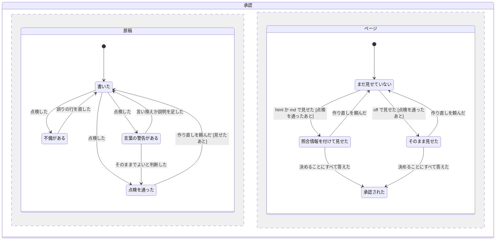

# 承認の原稿を、ユーザーが読んで判断できる形にそろえる (approval-draft)

2026-11-11、design-flow で持ち主と合意した (問い Q1〜Q19、すべて推奨どおり)。対象は atelier (`skills/atelier`) の承認 (Approve) の原稿。見せ方 (am でページにする・照合情報) は present-with-am (`docs/specs/present-with-am.md`、ブランチ `claude/atelier-present`) の関心で、この仕様では変えない。

## Problem Statement

承認ページを読んでも、持ち主には「この run で何が変わるのか」「何を決めればよいのか」が分からない。2026-11-11 の run (present-with-am、`docs/pbi/notes/approve.md`) の原稿では、次のことが起きた。

- 決めること (ask) が最後にあり、その前に設計者の作業の記録 (「段ごとの記録」15 行) が並ぶ。持ち主はその記録を必要としていない。
- PBI の表が機械向けになっている (段・route の先頭・review の水準・`criteria_checkable 0.55`)。各 PBI でどんな作業をして、流れがどう変わるのかが分からない。
- 内部の言葉 (段・route・novelty / coupling / ambiguity・`gate.pstack-blast-radius`・`ds1017-only`・`P-102`) と、コードの名前 (`question_lines`・`with_envelope`・循環 import) が説明なしに出る。
- 影響範囲の点検で見つかったことが文だけで書かれ、何が何に頼っていて何が壊れうるのかが見えない。
- 問いに判断の材料が無い (選ぶと何が変わるか、費用や質への影響)。呼び出し側のコマンドの扱いのような、ユーザーに聞くべきでない問いも混ざる。

`designer.md` の `## Approve` は載せる項目を並べているだけで、順番・書き方・見せ方を決めていない。そのため原稿の形は設計者しだいになる。

## Solution

承認の原稿の形を決め、機械で点検する。

- 原稿は決まった 7 つの節を決まった順に持つ。結論 → 今の流れ → あとの流れ → 決めること → PBI → 影響範囲 → 作る人と見直し。
- 今の流れとあとの流れは、利用者から見た流れを am の図で描く。あとの図では、変わる所に印 (`+` 足す・`-` 消す・`~` 変える) と PBI の番号を付ける。
- PBI は「何をするか」「終わると何ができるか」を利用者の言葉で書く。影響範囲は「変える所 → それに頼っている所」の図にする。
- ユーザーに聞く問いは、答えで受け取るもの・費用・時間・危うさが変わるものだけにする。どの選択肢にも、選ぶと何が変わるかを書く。
- `design_record.py lint` が原稿を点検する。形の不備は誤りで止め、内部の言葉は言い換えの案付きの警告にする。`markdown` は照合情報を付ける前に同じ点検を走らせる。
- よい形の見本 `examples/approve.md` を置き、設計者はそれに倣って書く。

## User Stories

1. As a atelier の持ち主, I want 承認ページの最初に、この run で何が変わるかが 2〜3 文で書かれていてほしい, so that 全部を読まなくても何の承認かが分かる
2. As a atelier の持ち主, I want 今の流れと、この run のあとの流れが 2 枚の図で並んでいてほしい, so that 何が変わるかを見比べられる
3. As a atelier の持ち主, I want あとの図で、変わる所に印と PBI の番号が付いていてほしい, so that どの PBI がどこを変えるかを図から辿れる
4. As a atelier の持ち主, I want 図のノードと線が利用者の言葉で書かれていてほしい, so that 関数名を知らなくても流れが読める
5. As a atelier の持ち主, I want 決めることが、全体の図のすぐあとにあってほしい, so that 何が変わるかを見てから判断し、記録を読み飛ばさずに済む
6. As a atelier の持ち主, I want どの選択肢にも、選ぶと何が変わるかが書かれていてほしい, so that 材料を探さずに選べる
7. As a atelier の持ち主, I want 自分が答えても変わらない問い (呼び出し側の中の扱いなど) を聞かれたくない, so that 判断の要る問いだけに集中できる
8. As a atelier の持ち主, I want 決めることが無い run では「なし」と書かれていてほしい, so that 問いを見落としたのではないと分かる
9. As a atelier の持ち主, I want PBI ごとに、何をして、終わると何ができるようになるかが 1 つの表で読めてほしい, so that 作業の中身と順番が分かる
10. As a atelier の持ち主, I want 段・route・点数を PBI の表で見たくない, so that 作業の中身だけを読める
11. As a atelier の持ち主, I want 1 つの PBI だけで流れが変わる場合は、その PBI の小さな図も付いてほしい, so that 全体の図に収まらない変化も見える
12. As a atelier の持ち主, I want 影響範囲の点検で見つかったことが、変える所とそれに頼っている所の図で見えてほしい, so that 何が壊れうるかが一目で分かる
13. As a atelier の持ち主, I want 見つかったことごとに、どう守るかが 1 行で書かれていてほしい, so that 危うさに手当てがあるかを確かめられる
14. As a atelier の持ち主, I want 影響範囲の点検を走らせなかった run では、その理由が 1 行で書かれていてほしい, so that 抜けたのか不要だったのかが分かる
15. As a atelier の持ち主, I want 見つけたがこの run ではしないことが、影響範囲の下に並んでいてほしい, so that 次の run の候補が分かる
16. As a atelier の持ち主, I want 最後に、どのモデルが作り、どの深さで見直すかだけが小さな表で載っていてほしい, so that 費用と質の見当がつく
17. As a atelier の持ち主, I want 設計者が段ごとにどの部品を選んだかの記録をページで読まされたくない, so that ページが短くなる
18. As a atelier の持ち主, I want 内部の言葉が出るときは、同じ行で説明されていてほしい, so that 用語を調べずに読める
19. As a atelier の持ち主, I want 決まった形でない原稿が、ページになる前に止められてほしい, so that 読みにくいページを見せられない
20. As a 設計者, I want 原稿の誤りが行の番号と直し方付きで出てほしい, so that どこを直せばよいかがすぐ分かる
21. As a 設計者, I want 内部の言葉の警告に言い換えの案が付いていてほしい, so that 言葉を探さずに直せる
22. As a 設計者, I want よい形の見本の原稿を 1 本読めてほしい, so that 節の書き方を真似できる
23. As a 設計者, I want `confirm` が `off` のときも同じ点検を走らせられてほしい, so that チャットに出す原稿も同じ形になる
24. As a 設計者, I want 英語の原稿でも同じ点検が通ってほしい, so that 利用者の言語で書ける
25. As a 設計者, I want ファイルだけを変える run (文書の直しなど) では、ファイルの木の図で前後を示せばよいことにしてほしい, so that 流れの無い変更でも図を描ける
26. As a 呼び出し側, I want 点検で止まったときは、照合情報の付いた原稿が出ないでほしい, so that 不備のある原稿をページにしない
27. As a atelier の持ち主, I want 見本の原稿がいつも点検を通ることが試験で確かめられていてほしい, so that 見本と点検の規則がずれない
28. As a atelier の持ち主, I want 照合と承認の仕組み (`check-reply`) が今のまま動いてほしい, so that 書き方の変更で承認が通らなくなることがない

## Implementation Decisions

### 用語 (CONTEXT.md に足す)

- **承認の原稿** (approval draft): 設計者が `docs/pbi/notes/approve.md` に書く、承認ページの元の Markdown。決まった 7 つの節を決まった順に持つ。避ける語: 承認の一覧、下書き。
- **今の流れ・あとの流れ** (before / after flow): 承認の原稿に載せる 2 枚の図。利用者から見た流れを描く。あとの図では、変わる所に印と PBI の番号を付ける。避ける語: 設計図、構成図。
- **内部の言葉** (internal term): atelier の中だけで通じる言葉 (route・tier・`criteria_checkable` など)。ユーザーに見せる文では言い換えるか、同じ行で説明する。避ける語: 専門用語。
- `appendix/design.md` の「"Open questions" の下に置く」は「`## 決めること` (`## Decisions`) に置く」に改める。

### 原稿の節

見出しの名前と順番を固定する。日本語と英語のどちらの組でも受ける。原稿は利用者の言語で書く。

| 順 | 日本語 | 英語 | 中身 |
|---|---|---|---|
| 1 | `## 結論` | `## Summary` | この run で何が変わるか、2〜3 文 (callout) |
| 2 | `## 今の流れ` | `## Before` | 利用者から見た今の流れの図 |
| 3 | `## この run のあとの流れ` | `## After` | 同じ流れのあとの図。変わる所に印と `(PBI-<n>)` |
| 4 | `## 決めること` | `## Decisions` | ask を並べる。無ければ「なし」の 1 行 |
| 5 | `## PBI` | `## PBIs` | 表 1 つ。要るときだけ PBI ごとの小さな図 |
| 6 | `## 影響範囲` | `## Impact` | 点検で見つかったことの図と守り方。しないことの一覧 |
| 7 | `## 作る人と見直し` | `## Who builds` | 作るモデルと見直しの深さの表。最後の試験 |

- 7 つ以外の `##` の節は誤りにする。特に「段ごとの記録」は、ページにもファイルの付録にも載せない。段ごとに選んだ部品は、設計の記録とメモに残るだけにする。
- 図は am の部品 `flow`・`tree`・`er`・`sequence` のどれか。あとの図は今の図の行から始め、消える行に `- `、新しい行に `+ ` を行の頭に付ける (印は行の頭だけで、ノードの名前には入れない)。am はこの図に「変更前・差分・変更後」の切り替えを付ける。ノードとラベルは利用者の言葉で書き、関数名を書かない (design-flow の状態の図と同じ規則)。
- 文書やファイルだけを変える run では、今の流れとあとの流れを `tree` の図にしてよい。

### 今の `## Approve` の項目の行き先

- 判断が要る項目は、すべて `## 決めること` の ask にする。次がそれに当たる。
  - 設計で決まらなかった点
  - 任意の段 (security など) を走らせるか
  - lint の調査で見つけた直し (`Survey fix:`) をこの run でするか
  - 足りない道具を入れるか
- lint の調査で見つけたが、この run でしないもの: `## 影響範囲` の下に「見つけたが、この run ではしないこと」として並べる。
- 最後にまとめて走らせる試験 (tests-at-end) と、モデルの確認の図: `## 作る人と見直し` に入れる。
- 優先テンプレートの行と、期限の切れた適用: 判断が要るときだけ ask にする。要らなければ載せない。
- 品質の警告 (`criteria_checkable` など): 判断が要るときだけ ask にする。点数は載せない。

### 問いの基準 (問い全体の規則)

- ユーザーに聞いてよいのは、答えで「ユーザーが受け取るもの・費用・時間・危うさ」が変わる問いだけ。
- 呼び出し側や作業者の中の扱い (例えば `then:` のコマンドの形) は、設計者が決めて仕様に書く。聞かない。
- ask のどの選択肢にも `| 選ぶと何が変わるか` を書く。推す選択肢を先頭 (`*`) に置く。
- 問いの文に内部の言葉が出るときは、同じ文で説明する。
- この基準は承認に限らず、設計者が出す問い全体の規則として `designer.md` に書く。

### 点検 (`design_record.py lint`)

- 使い方: `python <skill>/design_record.py lint --draft <file>`。正本 (design-record.json) は読まないので、`confirm` が `off` でも走らせられる。
- `markdown` は、照合情報を付ける前に同じ点検を走らせる。誤りがあれば何も出さずに止める。
- 誤りの行は `✗ L<行> <何が違うか>`、続けて `  例: <直した形>` の形で、標準エラーに全部出す。誤りがあれば終了コード 6。
- 誤りにするもの:
  1. 7 つの節が揃っていない、順番が違う、ほかの `##` の節がある。
  2. 今の流れ・あとの流れに am の図が無い。
  3. あとの流れの図に、印の行 (`+ `・`- `・`~ ` で始まる行) が 1 つも無い。
  4. PBI の表の見出しが `PBI | 何をするか | 終わると何ができるか | 先に要る PBI` (英語は `PBI | What it does | What works after | Needs`) でない。
  5. 決めることに ask も「なし」も無い。ask の選択肢に `|` の補足が無い。
  6. ask が決めることの節の外にある。
- 警告にするもの (終了コードは 0 のまま): 内部の言葉の一覧にある言葉が出て、同じ行に括弧の説明が無い。`! L<行> <言葉> → <言い換えの案>` の形で出す。
- 内部の言葉の一覧は、`design_record.py` の中に、言い換えの案と一緒に定数で持つ。使うのはこの点検だけなので、ファイルに分けない。最初の一覧は、route・tier・段 (stage)・wave・`criteria_checkable` など品質の点数の名前・novelty・coupling・ambiguity・`gate.<名前>` などの部品の名前・優先テンプレートの名前・課題の番号 (`P-<数>`)。
- 言い換えの判断は機械に任せきれないので、内部の言葉は止めない。
- 照合 (`check-reply`) の終了コードと動きは変えない。

### 文書

- `appendix/approve.md` (新しい付録): 7 つの節・図の書き方・項目の行き先・問いの基準・`lint` の使い方を書く。設計者は承認の原稿を書くときだけ読む (毎回読む本文を長くしないため)。
- `designer.md` の `## Approve`: 載せる項目の箇条書きをやめ、付録と見本 `examples/approve.md` を指し、`lint` を走らせることを書く。問いの基準は `## When to stop` に問い全体の規則として 1 行で書く。付録を読む場面の表に 1 行足す。
- `appendix/adapters.md` の `## Confirm`: 手順 2 に「`markdown` は先に点検し、終了コード 6 なら `✗` の行を直してから走らせ直す」を足す。
- `appendix/design.md`: "Open questions" を `## 決めること` に改める。
- `examples/approve.md`: よい形の見本。題材は present-with-am の run (悪い例と比べられるように)。
- `CHANGELOG.md`: 「未リリース」の節に書く。版の番号はマージのときに決める (present-with-am も v7.5 を予定しているため)。

## Testing Decisions

- よい試験は、外から見える振る舞い (CLI の出力・終了コード) だけを確かめる。点検の関数の分け方には頼らない。
- 合意済みの seam:
  1. **`design_record.py lint`** (CLI): よい原稿は終了コード 0。7 つの誤りの種類のそれぞれで、終了コード 6 と `✗ L<行>` の行。内部の言葉の警告 `! L<行>` と言い換えの案、終了コード 0。括弧の説明がある行は警告しない。英語の見出しの組も通る。
  2. **`design_record.py markdown`** (CLI): 点検で誤りのある原稿では、照合情報を付けた Markdown を出さずに終了コード 6。よい原稿では今と同じ出力。
  3. **見本** (`examples/approve.md`): `lint` を誤りも警告も無く通る。
- 前例: `test_design_record.py` (markdown と check-reply の CLI)、`test_references.py` (文書の中のパス)。`skills/atelier` の unittest をすべて通す。

## Out of Scope

- 見せ方 (am でページにすること、`present.py`、照合情報の形)。present-with-am の関心。
- approve 以外の問い (decision など) と完了報告の原稿の形。問いの基準の規則だけは問い全体に書く。
- yomiyasu などによる推敲を手順に入れること。設計者は Claude 以外でも動き、スキルを呼べないことがあるため。
- 内部の言葉の言い換えを自動で直すこと (警告だけにする)。
- ページの「Reply」でコピーできない件、`answer --approve --choices` が ask の承認原稿に使えない件 (親のセッションが別の不具合として持つ)。
- スキル本体の版上げ (マージのあとに skill-versioning で行う)。

## Further Notes

- main から切ったブランチ `claude/atelier-approve-writing` (worktree `atelier-approve`) で進める。present-with-am の PBI-005 も `designer.md` を書き換えるので、`## Approve` でマージの衝突がありうる。後から入る側が直す。
- present-with-am の `present.py` は、承認の原稿に照合情報を付けるとき `design_record.py` の処理を関数として呼ぶ。点検はその処理の前に入るので、present 側は終了コード 6 を「原稿の誤り (設計者が直す)」として、am の原稿の誤り (終了コード 3) と同じに扱えばよい。
- push と PR は持ち主の指示を待つ。

## 状態の図 (承認の原稿を書いてから承認されるまで)

原稿とページの 2 つの領域に分けた。ページの側は、原稿が点検を通ったあとでしか動かない。

- 2026-11-11 に pstack の `/statechart` (from-chart) で検査した。TLC は文字列に日本語を受けないので、状態の名前だけを英字にした同じ構造の写しで検査し、5 つの規則がすべて成り立った (7 状態、12 の遷移、図はそのまま描き戻せた)。
- 図に描けない 2 つの規則は、点検の誤りとして守る。「決めることの前に作業の記録が並ばない」は節の順番の点検 (誤り 1) で、「選ぶと何が変わるかの無い選択肢を選ばされない」は選択肢の補足の点検 (誤り 5) で守る。
