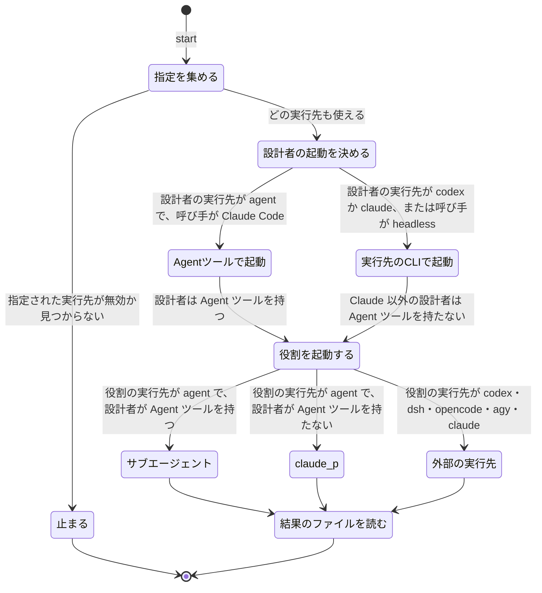

# atelier v7.4: 役割を Claude 以外の実行先で動かす

2026-11-11 にユーザーの依頼から起こし、design-flow（grilling Q1〜Q16、試作 1 回）で決めた。v7.3 からの差分だけを書く。用語は `CONTEXT.md` に従う。

## Problem Statement

- 設計者は `conductor.py` が `claude -p` で、または呼び手が Agent ツールで起動する。どちらも Claude のモデルしか動かせない。
- レビュー担当とテスト担当は、設計者が Agent ツールで起動する。こちらも Claude のモデルに限られる。
- 役割の設定（`--role`・`docs/pbi/roles.json`・home の `agents.json` の `roles`）のキーは `model`・`effort`・`permission_mode` だけで、実行先を選べない。作業者だけが、経路のテンプレートで実行先とモデルを選べる。
- このため、「設計者とレビュー担当は GPT Terra 6.1、作業者は DeepSeek 純正の V4.1 Flash 1017」のような 1 回の実行を組めない。

## Solution

役割に `runner` のキーを足す。既定は `agent`（Claude）で、指定しないときの動きは v7.3 と変わらない。

- 設計者の実行先が `agent` 以外（`codex`・`claude`）なら、進行役は呼び手の起動方法によらず headless として扱い、`run` がその実行先の CLI で設計者を起動する。
- Agent ツールを持たない設計者（`codex` で動く設計者）は、`agent` に割り当てられた役割と作業者を `claude -p` で起動する。
- 外部の実行先で動くレビュー担当とテスト担当は、新しいスクリプト `role_run.py` で起動する。長く走る子（作業者・役割）を待てない設計者のために、切り離して起動し、あとで待つスクリプト `background.py` を足す。

目標の使い方:

```
python <skill>/conductor.py start --goal-file <file> --workflow <名前> \
  --role designer.runner=codex --role designer=gpt-6.1-terra \
  --role reviewer.deep.runner=codex --role reviewer.deep=gpt-6.1-terra \
  --role reviewer.other.runner=codex --role reviewer.other=gpt-6.1-terra
```

作業者は、今までどおり優先テンプレート（例 `ds1017-first`）で dsh の `deepseek-official/deepseek-flash` に回す。

## 状態の図（1 つの役割を起動するまで）



## User Stories

1. As a user, I want to set the designer's runner and model with `--role`, so that one run's design can go to GPT Terra 6.1.
2. As a user, I want to set the reviewer's runner and model for both stages, so that review runs on a model other than Claude.
3. As a user, I want to set the tester's runner and model, so that the tests at the end can also run outside Claude.
4. As a user, I want the runner to be settable in `docs/pbi/roles.json` and in home's `agents.json` too, so that a repository or all my runs can keep the choice.
5. As a user, I want a run with no runner set to behave exactly like v7.3, so that my existing runs do not change.
6. As a user, I want `start` to stop with an error when a runner I named is disabled or missing, so that no model I did not choose spends tokens.
7. As a user, I want a warning when the model is not in the runner's model list, so that I notice a typo but can still use a model the list has not caught up with.
8. As a caller in a Claude Code main session, I want `next` to tell me to run headless when the designer runs on codex, so that I follow the existing headless steps without new rules.
9. As a caller, I want the `roles:` line to show each role's runner, so that I can confirm what will run.
10. As a designer on codex, I want my prompt to tell me that I have no Agent tool, so that I launch every role and worker through scripts.
11. As a designer without the Agent tool, I want workers whose route head is `agent` to run through `claude -p`, so that routes written for Claude still work.
12. As a designer, I want one script that launches a reviewer or tester on any runner and writes its logs at fixed paths, so that I do not compose CLI flags myself.
13. As a designer on codex, I want to start a long child detached and wait on it with a timeout, so that a shell command limit does not kill a worker.
14. As a designer, I want to fall back to the v7.3 reviewer pair when both review stages equal the model that built the work, so that a review never runs on its builder.
15. As a designer on codex, I want shared-memory tools to be callable without an approval prompt, so that refs and handoffs keep working.
16. As a designer on codex, I want the usual "without the MCP" steps when memory is not reachable, so that the run goes on.
17. As a user, I want the token counts of a codex designer kept in the run's history, so that I can compare runs.
18. As a user, I want Kiln to keep working with a codex designer, so that long runs still hand off before the context fills.
19. As a reviewer on an external runner, I want the refs copied into my prompt, so that I can review without memory tools.
20. As a user, I want the role's effort passed to codex as the reasoning effort without the workers' `high` cap, so that the designer can think as hard as I chose.

## Implementation Decisions

### 役割の設定（進行役）

- 役割の各部分（`designer`・`reviewer.deep`・`reviewer.other`・`tester`）に `runner` のキーを足す。既定は `agent`。
- 解決の順は v7.3 と同じで、キーごとに run → repo → home → 既定。
- 設計者の `runner` は `agent`・`codex`・`claude` だけを受け付ける。ほかの役割は `agent`・`opencode`・`codex`・`agy`・`dsh`・`claude` を受け付ける。
- 受け付けない値は v7.3 と同じ扱いで、その層を飛ばして warn を出す。`start --role` で渡されたときは exit 2 にする。
- `start` は、`agent` 以外の実行先が home の `agents.json` で有効になっていて、CLI が見つかること（`path` が在るか、PATH にある）を確かめる。どちらかを満たさなければ exit 2 にし、`error:` の行に役割と実行先を書く。
  - 暗黙に使う `claude -p`（Agent ツールの無い設計者が `agent` を起動するとき）は、この検査の対象外とする。
- モデルが home の `models/<runner>.json` の一覧に無いときは、`warn roles.<role>.model` を出して続ける。
- 表示は `model[/effort]` の後ろに、`agent` 以外のときだけ `@<runner>` を付ける（例 `gpt-6.1-terra/high@codex`）。`roles:` の行、依頼文の `Roles:` の行、`running.roles` と history の記録で同じ形を使う。

### 設計者の起動

- 設計者の実行先が `agent` でなければ、`run.json` の `launch` が `agent` でも、`next` は headless の行（`launch: headless`、`then: ... run --detach`）を出す。
  - 理由の 1 行 `launch: headless (designer runner codex)` を添える。
- `run` は、実行先ごとに起動のコマンドを組む。
  - `agent`・`claude`: v7.3 の `claude -p` のまま。
  - `codex`: `codex -a never exec --skip-git-repo-check --json -m <model> -s <sandbox> -c mcp_servers.shared-memory.default_tools_approval_mode="auto" [-c model_reasoning_effort="<effort>"] -o <最後の文> -`。依頼は標準入力で渡し、その先頭に「`agents/atelier-designer.md` を読んで従う」の行を付ける。
- codex の `<sandbox>` は `permission_mode` から取る。値が `read-only`・`workspace-write`・`danger-full-access` のどれかならその値を、それ以外（既定の `auto` を含む）なら `danger-full-access` を使う。
  - `workspace-write` では、ネットワークとワークスペースの外への書き込みが塞がれる。そのため、dsh の作業者も入れ子の codex も動かない（試作で確かめた）。
- `ATELIER_DESIGNER_CMD` は、どの実行先でも起動する実行ファイルの差し替えとして効く（テスト用の継ぎ目）。codex の実行ファイルは `ATELIER_DESIGNER_CMD`、home の `agents.json` の `runners.codex.path`、PATH の `codex` の順に探す。
- codex の設計者の出力（JSONL）の扱い:
  - 終了コードが 0 以外、または `turn.failed`・`error` のイベントがあれば、起動の失敗とする。
  - `thread.started` の `thread_id` を `session_id` に、`turn.completed` の `usage`（input・cached_input・output）を history の `tokens` に残す。`cost_usd` は残さない。
- Kiln の `Context probe:` は v7.3 の `--ctx --session <id>` のまま。codex の設計者は記録が無いので `context=unknown` を返し、`appendix/episodes.md` の決まり（2 回続いたら 3 PBI ごとに handoff）で回る。

### 設計者の依頼文

- `prompts/designer-episode.md` に `Agent tool: yes|no` の行を足す（`agent` の設計者は yes、それ以外は no）。
- `Roles:` の行に、レビュー担当とテスト担当の実行先を含める。
- `designer.md` と `agents/atelier-designer.md` に、Agent ツールが無いときの起動のしかたを書く。
  - `agent` の役割と、経路の先頭が `agent` の作業者は、`claude_run.py`（作業者）か `role_run.py --runner claude`（役割）で起動する。
  - 記録は `record_run.py --runner claude --model <model>` で行う。
  - 長く走る起動はすべて `background.py` で切り離し、`background.py wait` で待つ。

### 役割の起動（role_run.py）

- `python <skill>/role_run.py <名前> --role reviewer|tester --runner <R> --model <M> [--effort <E>] [--pbi-dir docs/pbi]`。
- 依頼文は設計者が `docs/pbi/roles/<名前>.prompt.md` に書く。`role_run.py` は、その先頭に「`agents/atelier-<role>.md` を読んで従う」の行を付けて実行先に渡す。
- 実行先ごとの起動:
  - `codex`: 設計者と同じ形で `-s danger-full-access -a never`。`-o` は `<名前>.last.md`。
  - `claude`: `claude_run.py` と同じ引数・環境。
  - `dsh`・`opencode`・`agy`: `runners.md` と同じコマンド。dsh は `dsh_run.py` の作りを使う。
- ログはすべて `docs/pbi/roles/<名前>.*`（`.jsonl` か `.json`、`.err`、`.last.md`、`.run.json`）に書く。終了コードは子の終了コードにする。合否は、レビューやテストの結果の JSON（決まったパス）が決める。
- 外部の実行先は shared-memory を使えない前提にする。設計者は、作業者と同じく refs を依頼文の `## Refs (workspace)` に写す。
- レビュー担当の両方の段が作った人のモデルと同じときは、v7.3 の既定（opus／sonnet・high）を `agent` で使い、段の記録に理由を書く。設計者が Agent ツールを持たないときは、それを `claude -p` で動かす。

### 切り離しと待ち（background.py）

- `python <skill>/background.py start --name <名前> [--dir docs/pbi/bg] -- <コマンド…>`: 切り離して起動し、pid と開始時刻を `<名前>.json` に書いてすぐ戻る。標準出力と標準エラーは `<名前>.log` に書く。
- `python <skill>/background.py wait --name <名前> [--timeout 300]`: 終われば `state: done exit <n>` を出して exit 0、時間内に終わらなければ `state: running` を出して exit 3。
- `python <skill>/background.py status [--name <名前>]`: 一覧を出す。
- Claude の設計者は、今までどおり Bash の `run_in_background` を使ってよい。Agent ツールの無い設計者は、これを使う。

### 文書

- `appendix/setup.md`（`## roles`）、`appendix/episodes.md`（Roles・Launch）、`runners.md`（新しい節「Roles on a runner」と「Without the Agent tool」）、`prompts/pbi-review.md`、`prompts/tester.md`、`SKILL.md`（headless になる場合と、auto モードの判定の注意）、`CONTEXT.md` を直す。

## Testing Decisions

合意済みの seam（テストを書く境界）:

1. **`conductor.py` の CLI**（`test_conductor.py`、偽の設計者 `ATELIER_DESIGNER_CMD`）: `--role <part>.runner=` の解決と出所、受け付けない値、`start` の無効・見つからない実行先での exit 2、`roles:` の行の表示、codex の設計者で `next` が headless を案内すること、`run` が codex の引数（`-a never`・`-s`・`-o`・`-c` の effort と MCP の承認）で偽の codex を起動し、JSONL のトークン数を history に残すこと、指定なしで v7.3 と同じ行が出ること。
2. **`role_run.py` の CLI**（新しい `test_role_run.py`、偽の実行ファイルを環境変数で差す）: 実行先ごとの引数、定義の行を先頭に付けた依頼、ログのパス、終了コードの受け渡し、受け付けない実行先や名前の拒否。
3. **`background.py` の CLI**（新しい `test_background.py`）: start で切り離して戻ること、wait の done と running（タイムアウト）、終了コードの記録。
4. **指示文の参照**（`test_references.py`）: 新しい文書の参照が切れていないこと。

よいテストは、外から見える振る舞い（出力の行・終了コード・書かれたファイル）だけを確かめ、内部の関数の形を確かめない。前例は `test_conductor.py` の偽の設計者と `test_claude_run.py`・`test_dsh_run.py`。

## Out of Scope

- codex 以外の実行先（dsh・opencode・agy）で設計者を動かすこと。
- codex のログから文脈の大きさを測り、Kiln に渡すこと。
- ユーザーの `~/.codex/config.toml` を書き換えること。
- codex の設計者の費用（ドル）を出すこと。
- Studio（設定の画面）で役割の実行先を選べるようにすること。

## Further Notes

- 試作（2026-11-11、`gpt-6.1-terra`、effort low、`-s danger-full-access -a never`）で、Python の実行・ネットワーク（200）・入れ子の `codex exec`・shared-memory の `search`（`-c mcp_servers.shared-memory.default_tools_approval_mode=auto`）がすべて通った。使用量は input 145k（うち cached 127k）、output 372。codex は `~/.claude/skills` も読み込むので、1 ターンに約 30k の下地がかかる。
- `codex sandbox` の `workspace-write` では、mise の Python 以外（WindowsApps と uv の Python）は起動できなかった。pnpm も見つからなかった。このため、役割もサンドボックスなしにしている。
- 状態の図の `%% never` の 3 つは、pstack の `/statechart` の from-chart で、「指定」と「起動」の 2 つの領域に分けたモデルとして TLC で検査した。3 つとも成り立つ（6 状態、規則を破る状態 0、2026-11-11）。TLA+ の文字列は ASCII に限られるので、検査に使った図はラベルを英語にしている。中身は上の図と同じ。
- 既知の制約: 呼び手の Claude Code の auto モードは、`codex -a never exec -s danger-full-access` を直接流すことを「危険なエージェントの作成」として拒否した。`conductor.py run --detach` や `role_run.py` 経由の起動も止められることがある。そのときは、ユーザーが Bash の許可ルールを足すか、自分で流す。
- 既知の制約: Agent ツールの無い設計者が `agent` の作業者を `claude -p` で動かすとき、作業者は MCP を持たない（`claude_run.py` の `--strict-mcp-config`）。そのため refs は依頼文に写す。
