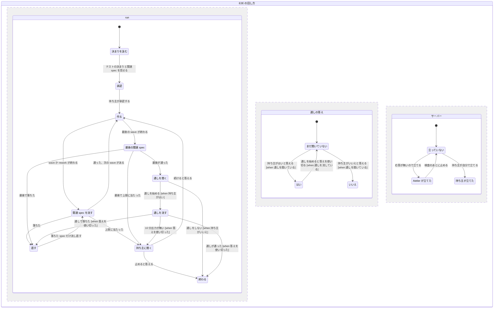
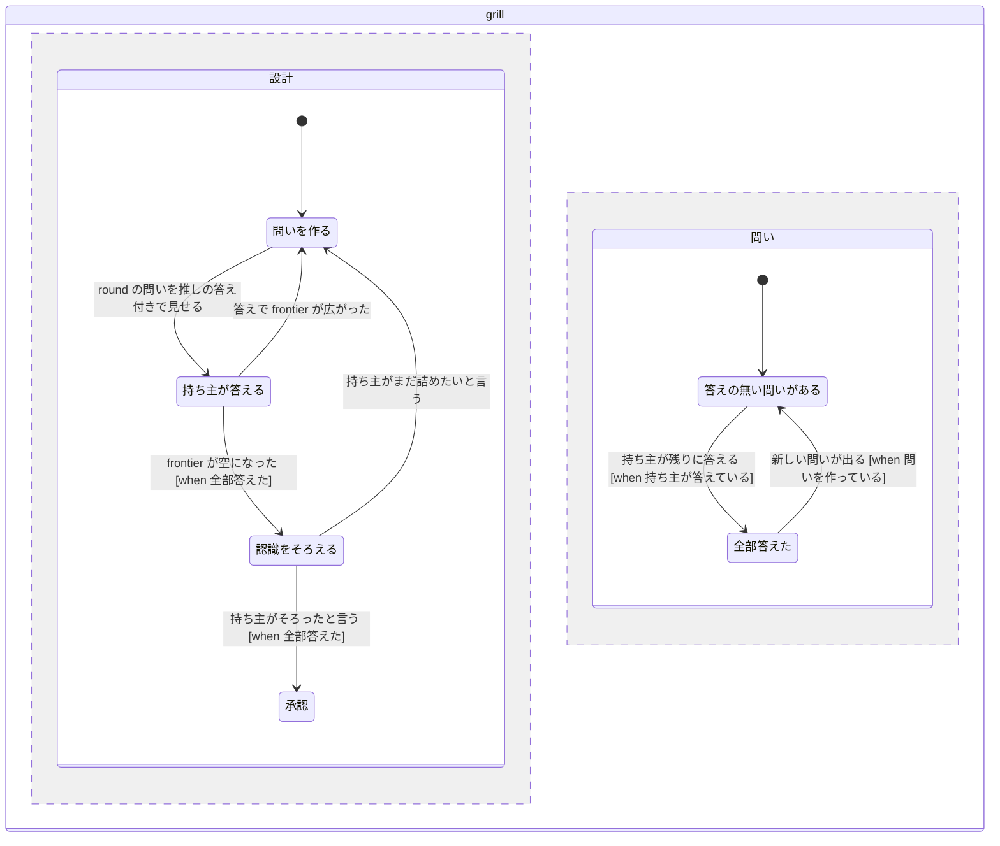

# run の不具合を直し、指示を JSON のタスクで渡す (atelier-run-fixes)

2026-11-12、design-flow で持ち主と合意した（問い Q1〜Q16'。Q16 は持ち主の指摘で改めた。ほかはすべて推奨どおり）。きっかけは、手元の v7.6 で動かした sekisuiheim-home-simulator の P-109 の run（設計は Opus、worker とレビューは codex の gpt-6.1-terra）。

PR は 2 つに分ける。

- **A**: 不具合の直し、E2E の回し方、grill をユーザーに回す件、answer-me-with-any への名前の変更。マージ後は v7.7 にする。
- **B**: サブエージェントへの指示を JSON のタスクにする件。マージ後は v8 にする。

スキル側の名前の変更は、`reeschan/answer-me-with-any` に別の PR を出す。

## Problem Statement

P-109 の run では、各部が正しく動かず、設計者・tester・呼び手（caller）が手で埋め合わせた。

- **検証が別の環境で動いた**
  - verify は PATH で最初に見つかった bash（WSL）を使い、tester が Linux 用の node_modules を入れた。
  - Node は Git Bash の v22 で、プロジェクトの Node 26 の `.mts` を読めなかった。
- **E2E を流しすぎた**
  - 持ち主は「テストは最後に」（tests-at-end）を on にしていた。それでも E2E の通し（1 回約 64 分）が、wave ごと・rework のたび・最後に何度も流れた。
  - 打ち切りは一律 900 秒で、通しは毎回途中で切れた。
  - E2E 用の開発サーバーが立っておらず、cypress は exit 12 で落ちた。
  - tester が `-- --spec` で絞り込みを外したまま流し直しを繰り返し、ループが止まらずに残った。
- **プロジェクトの決まりが渡らなかった**
  - プロジェクトの決まり（AGENTS.md・CLAUDE.md・e2e/README.md）と、持ち主の指示「E2E の通しは最後に 1 回、調べるときは `--spec`」は、tester に届いていなかった。
- **各部が正常に起動しなかった**
  - jevlint 0.2.4 の dry-run の行を読めず、lint の段が exit 2 で止まった。
  - prepare が、goal で指定した worker の route（codex gpt-6.1-terra）を書き換えた。
  - 承認の下書きに照合の行（reply-meta）が無く、`answer --approve` が止まった。
  - 設計者（サブエージェント）が `docs/pbi/REPORT.md` を書けなかった。Claude Code がサブエージェントに入れる「報告の .md を書くな」という注記にぶつかった。
  - codex の worker のサンドボックスでは pnpm・python・Biome が使えず、reviewer が代わりに検証を流した。
- **見せ方と問い方が持ち主の意図と違った**
  - 承認が、answer-me-with-html ではなくチャットの Markdown で出た。
  - 設計者が grilling を自分のセッションで動かし、「残りは spec に決めた」と問いに自分で答えた。持ち主は、grill の問いには必ず自分が答えるつもりでいる。
- **指示が重い**
  - worker の指示は、prompt（約 2.6KB）・PBI の Markdown（4〜10KB）・worker.md（4.6KB）に分かれている。同じ決まり（作業ルートの外に書かない、Kiln、レビューを呼ばない、長い出力の扱い）が役割ごとに繰り返され、コンテキストを食う。
- **スキルの名前**
  - 承認や問いを見せるスキルを、Atelier が `answer-me-with-html` と名指ししている。持ち主はスキルを `answer-me-with-any` に改名したい。

## Solution

**A（v7.7）**

- **検証の環境**: verify は、Windows では Git Bash を、プロジェクトが求める版の Node を選んで流す。ログの先頭に、使った bash と `node -v` を書く。
- **E2E の回し方**
  - E2E は、関連する spec だけを流すのを基本にする。wave・rework・run の最後のどこでも同じ。
  - run の最後は、run 全体で関わった spec をまとめて 1 回流す。
  - 通しは、関連する spec が通ったあとに毎回持ち主に聞き、「はい」のときだけ流す。
  - サーバーが要る検査は、Atelier がサーバーを立て、応答を待ってから流し、自分で立てたものだけを止める。
- **プロジェクトの決まりを汲む**
  - run の冒頭（understand の段）で、設計者は次を読む。
    - 対象プロジェクトの `AGENTS.md`・`AGENTS.project.md`・`CLAUDE.md`・テストの README
    - 持ち主のメモリ（shared-memory の検索と、Claude Code の auto-memory の `MEMORY.md`）
  - そこからテストの決まりを下書きし、承認の画面で見せる。承認されたものだけを tester に毎回渡す。
- **grill**
  - grilling が有効な run では、設計の問いを round ごとに必ず持ち主に回す。設計者は自分で答えない。
  - 答えの無い問いが残っているあいだ、run は承認に進まない。
  - 設計をする run では、grilling を既定で有効にする。
- **各部の起動を直す**
  - lint の dry-run の行の読み取り
  - goal の route を残すこと
  - 承認の照合の行
  - REPORT.md の書き方
  - codex の worker のサンドボックス
- **承認の見せ方**: 承認と問いは、confirm のスキルが入っていれば必ずそれで見せる。
- **名前**: 名指しを `answer-me-with-any` に変える。古い名前のスキルしか無いときは、それを使って warn を出す。

**B（v8）**

- PBI ごとの指示を、JSON のタスク（`atelier.task/1`）1 つにする。章立ては承認の画面に合わせ、細かい手順ではなく大まかな変更範囲を伝える。
- 役割（worker・reviewer・tester）の違いは、役割の名前と読む入力だけにする。共通の決まりは 1 つのファイルにまとめ、タスクからは参照する。
- 設計者の episode の入力も JSON にし、prompt は「どのファイルを読むか」の数行にする。

## User Stories

**検証の環境**

1. As a 持ち主（Windows）, I want verify が Git Bash で流れること, so that WSL の pnpm が Linux 用の依存を入れて作業フォルダを壊さない
2. As a 持ち主, I want verify がプロジェクトの `.node-version`・`.nvmrc`・`engines` の Node を使うこと, so that シェルの既定の Node が古くても検査が正しく動く
3. As a 持ち主, I want 検査のログの先頭に使った bash と Node の版が出ること, so that 環境の取り違えにすぐ気づける
4. As a 持ち主, I want `agents.json` の `tools.bash.path` で bash を指定できること, so that Git Bash を標準以外の場所に入れていても使える

**E2E の回し方**

5. As a 持ち主, I want E2E が関連する spec だけ流れるのが基本であること, so that 1 回 1 時間の通しを何度も待たない
6. As a 持ち主, I want run の最後に、run 全体で関わった spec をまとめて 1 回だけ流すこと, so that 最後の確認が速く終わる
7. As a 持ち主, I want 通しを流すかを毎回聞かれること, so that 時間を使うかを自分で決められる
8. As a 持ち主, I want 各 PBI の関連する spec が承認の画面に出ること, so that 流す範囲が足りているかを承認の前に確かめられる
9. As a 持ち主, I want プロジェクトに「変えた spec だけ流す」仕組みがあり決まりに書かれていれば、それも使われること, so that プロジェクトのやり方が活きる
10. As a 持ち主, I want サーバーが要る E2E の前に Atelier がサーバーを立てて待つこと, so that 接続できずに落ちる無駄な失敗が無い
11. As a 持ち主, I want 自分で立てたサーバーは止められないこと, so that 手元の作業が切られない
12. As a 持ち主, I want 1 spec の流し直しが 15 分・2 回までに抑えられること, so that ループが止まらずに残らない
13. As a 持ち主, I want 関連 spec のまとめの上限が spec の数に比例すること, so that 大きな run でも途中で切られない
14. As a 持ち主, I want 通しは時間で切られず、10 分出力が無いときだけ止まること, so that 長い通しが途中で無駄にならない
15. As a 持ち主, I want 上限に当たったら tester が止まり、自分に聞かれること, so that 判断が必要な所で勝手に進まない
16. As a tester, I want `--spec` の絞り込みが効いたかを出力の spec の数で確かめる決まりがあること, so that `--` の取り違えで通しを流し続けない
17. As a 設計者, I want build の PBI の verify に通しを書けないこと, so that wave の途中で通しが流れない
18. As a 持ち主, I want 最後の検査で落ちたあと、直したら落ちた spec だけが流し直されること, so that 直すたびに全体を待たない

**プロジェクトの決まり**

19. As a 持ち主, I want run の冒頭でプロジェクトの AGENTS.md・AGENTS.project.md・CLAUDE.md・テストの README が読まれること, so that プロジェクトの E2E の決まりに沿って流れる
20. As a 持ち主, I want 自分のメモリ（shared-memory と auto-memory）にあるテストの指示も汲まれること, so that 毎回言い直さなくてよい
21. As a 持ち主, I want 汲んだテストの決まり（env・server・final・investigate・limits・notes）が承認の画面に出ること, so that 間違って汲んだものを承認の前に直せる
22. As a 持ち主, I want プロジェクトの決まりが Atelier の既定より優先され、ぶつかった点が 1 行ずつ示されること, so that どちらが使われるかが分かる
23. As a 持ち主, I want 決まりが見つからないときは package scripts から下書きされること, so that 決まりの無いプロジェクトでも動く
24. As a tester, I want 承認されたテストの決まりを毎回入力で受け取ること, so that 持ち主のメモリが見えない起動のされ方でも同じ決まりで流せる

**grill**

25. As a 持ち主, I want grilling の問いが必ず自分に届くこと, so that 設計者が勝手に決めた設計で実装が進まない
26. As a 持ち主, I want 問いが round ごとに、番号と推しの答え付きで届くこと, so that 「はい」だけで速く答えられる
27. As a 持ち主, I want 答えの無い問いが残っているあいだ承認に進まないこと, so that 聞かれていない決定が承認に紛れ込まない
28. As a 設計者, I want 設計の木（決まったこと・frontier）がファイルに残ること, so that episode ごとに新しく起動されても続きから問える
29. As a 持ち主, I want 設計をする run では grilling が既定で有効なこと, so that 毎回 workflow を選び直さなくてよい
30. As a 持ち主, I want 設計しない小さい run では grilling が動かないこと, so that 小さな直しで問いが増えない

**各部の起動**

31. As a 持ち主, I want jevlint の新しい版の dry-run の行も読まれること, so that lint の段が止まらない
32. As a 持ち主, I want goal で指定した worker の route が prepare で上書きされないこと, so that 指定したモデルで作られる
33. As a 設計者, I want 承認の下書きを最後に `markdown` で仕上げる手順が 1 つにそろっていること, so that 照合の行の無い下書きを出さない
34. As a 設計者, I want REPORT.md が後のゲートの読む固定の成果物だと定義に書かれていること, so that サブエージェントの注記とぶつかっても書ける
35. As a 持ち主, I want REPORT.md が無いまま finish が終わらないこと, so that 報告が抜けない
36. As a 持ち主, I want codex の worker でも pnpm・python・Biome が使えること, so that worker が自分で検証を流せる

**承認の見せ方と名前**

37. As a 持ち主, I want 承認と問いが、confirm のスキルが入っていれば必ずそれで見せられること, so that チャットの長い Markdown を読まされない
38. As a 呼び手, I want conductor が承認のときに使うスキルを 1 行で示すこと, so that 見せ方を自分で判断しなくてよい
39. As a 持ち主, I want Atelier が `answer-me-with-any` を名指しすること, so that 改名したスキルが使われる
40. As a 持ち主, I want 古い名前のスキルしか無いときも動き、warn が出ること, so that 改名の途中でも run が止まらない

**JSON のタスク（B）**

41. As a worker, I want 1 つのタスクの JSON に、要約・変更範囲・決まった答え・受け入れ条件・検査・影響・作る人がそろっていること, so that 読むものが少なくて済む
42. As a 持ち主, I want worker に渡る指示が、承認の画面と同じ章立てであること, so that 承認したことがそのまま渡ったと分かる
43. As a 設計者, I want タスクに細かい手順ではなく大まかな変更範囲を書くこと, so that 書く量も読む量も減る
44. As a reviewer, I want 同じタスクに、役割と入力（報告のパス）だけが足されて渡ること, so that worker と同じ基準で見られる
45. As a tester, I want 同じタスクとテストの決まりを受け取ること, so that 流す spec と上限が分かる
46. As a 持ち主, I want 共通の決まりが 1 つのファイルにまとまっていること, so that 役割ごとに同じ文がコンテキストを食わない
47. As a 設計者, I want episode の入力を JSON で受け取ること, so that 何を続けるかを取り違えない
48. As a 持ち主, I want タスクの JSON を人が読める Markdown にする道具があること, so that JSON だけになっても中身を確かめられる
49. As a 持ち主, I want v7 の run を v8 で再開しようとしたら止まり、v7.7 で終えるか変換するかが示されること, so that 途中の run が壊れない
50. As a 設計者, I want PBI の Markdown をタスクの JSON に写す変換があること, so that 古い run も v8 に移せる
51. As a 持ち主, I want Jev のルーティングがタスクの JSON から作った要約を読むこと, so that ルーティングの結果が変わらない

## Implementation Decisions

### A: 検証（verify）

- **bash の選び方**: Windows では次の順に探し、最初に見つかったものを使う。どれも無ければ止めて、理由を出す。
  1. `agents.json` の `tools.bash.path`
  2. `git` と同じ場所の `..\bin\bash.exe`
  3. `which`（System32 と WindowsApps の下は除く）
- **Node の選び方**
  - プロジェクトの `.node-version`、`.nvmrc`、`package.json` の `engines.node` の順に版を読む。
  - fnm の場所の探索（`agents` の既存の探索）で該当の版を探し、その場所を子プロセスの PATH の先頭に置く。
  - 版が見つからなければ warn を出し、今の PATH で流す。
- **`deferred` の要素**: `tests-at-end.json` の `deferred` は、文字列（今の形）と object の両方を受ける。object のキーは次のとおり。
  - `match`
  - `when`: `wave` か `end`
  - `timeout`
  - `per_spec_timeout`
  - `server`: `start` と `url`
- **サーバー**: verify は `server` のある検査の前に、`url` が応答するかを見る。
  - 応答すれば、そのサーバーをそのまま使う。
  - 応答しなければ `start` を起動し、応答を待つ。起動したサーバーだけを、検査のあとにプロセスの木ごと止める。

### A: テストの決まり（tests-at-end.json）

- run の冒頭の下書きで、次のキーを足す。
  - `env`: Node の版、bash
  - `server`
  - `final`: 通しのコマンド
  - `investigate`: 1 spec を流すコマンドの形
  - `changed`: 変えた spec を流すコマンド。任意
  - `limits`
  - `notes`
  - `sources`: どのファイル・メモリから汲んだか
- 決まりの出所の優先順位は、プロジェクトの決まり、持ち主のメモリ、Atelier の既定の順。ぶつかった点は、承認の画面の「作る人と見直し」に 1 行ずつ書く。
- `limits` の既定値は次のとおり。上限に当たったら、tester は `blocked` で返す。
  - 1 spec: 15 分、流し直しは 2 回まで
  - 最後の関連 spec のまとめ: spec の数 × 15 分
  - 通し: 時間で打ち切らず、出力が 10 分無いときに止める
- 各 PBI は関連する spec（`related_specs`）を持つ。設計者が書き、承認の「作る人と見直し」に `| PBI | 関連する E2E |` の表で出す（PBI の表の見出しは変えない）。
- **流す時期**
  - wave と rework のあと: その PBI の `related_specs` だけを流す。
  - run の最後: run 全体の `related_specs` の和を 1 回流す。`changed` が承認されていれば、それも使う。
  - 通し: 最後の検査が通ったあとに conductor の問いで持ち主に聞き、「はい」のときだけ `final` で流す。「はい」は 1 回の通しで使い切り、次の通しの前にはまた聞く。
  - 最後の検査で落ちた後の流し直し: 落ちた spec だけ。
- **final の二重の実行をやめる**: final の各報告の流し直しは deferred を飛ばす。
- build の PBI の verify に通し（`final`）と同じコマンドを書くことを、plan の決まりで禁じる。`verify.py PBI-<n>` は、そのコマンドを exit 2 で断る（流れる直前に止めるほうが確かなため、`design_record.py lint` ではなく verify で検査する）。
- **tester の決まり**（`prompts/tester.md`）
  - 臨時のコマンドには必ず上限を付ける。
  - 出力の spec の数で絞り込みが効いたかを確かめ、違えば止める。
  - pnpm の `--` の注意を書く。

### A: grill

- 設計者の定義の「Never ask the user」を「ユーザーに聞くのは question の result だけで」に改める。
- grilling が有効な run の進め方:
  - 設計者は、設計の木を `docs/pbi/notes/grill.json` に保つ。中身は round、問い、推しの答え、持ち主の答え、frontier。
  - round ごとに `question` の episode を 1 つ出す。
  - 「残りは自分で決めた」と書くことは、`designer.md` と `appendix/design.md` で禁じる。
- conductor は、`grill.json` に答えの無い問いがあるか、frontier が空でないあいだ、承認の episode に進めない。
- 同梱の workflow（jev-routed・high-model）は、設計をする run で grilling を既定で有効にする。設計しないと判定された run では動かさない。
- grilling が無効な run では、今の決め方（中身は設計者、変わるものだけ聞く）のまま。

### A: 各部の起動

- **lint の dry-run**: `lint_run.py` が次の行を受ける。
  - 行の途中で終わり、そのあとに「pinned」の後ろ書きが付く形
  - 費用の無い形
  - 送らずに local で解析する形
- **route**
  - prepare は select_model に対象の PBI を常に渡す。
  - route.json に `override` があれば、select_model はその route を残す。
  - goal で指定された worker の route は `override` として書く。
- **承認の下書き**: `designer.md` と `appendix/approve.md` の最後の手順を、lint ではなく「`design_record.py markdown` を最後に流す」にそろえる。
- **REPORT.md**
  - `agents/atelier-designer.md` に「REPORT.md は後のゲートが読む固定パスの成果物で、報告のファイルではない」と書く。
  - finish の result に `report_body` を持てるようにする。ファイルが無ければ conductor がその本文から書く。
  - `done` は、REPORT.md も `report_body` も無い finish を拒む。
- **codex の worker**: `runners.md` の worker の起動を `danger-full-access` にし、役割の既定にそろえる。絞りたいときの選択肢として `workspace-write` を書く。

### A: 承認の見せ方と名前

- conductor は、approve と question のときに `confirm_row` を呼び、`confirm: skill <名前>` か `confirm: chat` の行を出す。
- `SKILL.md` の Questions は「confirm が skill なら、auto でも必ずそのスキルで見せる」に書き直す。
- 名指しは `answer-me-with-any` にする。対象は次のとおり。
  - `CONFIRM_SKILL`
  - `tools_check`
  - `adapter_gate`
  - `design_record` の説明
  - `appendix/adapters.md`
- 古い名前（`answer-me-with-html`）しか無いときは、それを confirm に使い、`warn confirm: old name` を出す。古い名前への戻りは v8 まで残し、その次の版で外す。
- `tools_check` が固定しているコミットは、スキル側の改名の PR のマージ後のコミットに書き換える。この書き換えは A の PR の最後に行う。

### B: JSON のタスク

- **タスク**: PBI ごとに `docs/pbi/PBI-n.task.json`（schema `atelier.task/1`）を 1 つ作る。章は承認の画面に合わせる。

  | 章 | 中身 |
  |---|---|
  | `summary` | 何をするか、終わると何ができるか |
  | `scope` | 触る所、触らない所。大まかな範囲で、行単位の手順は書かない |
  | `decisions` | 承認で決まった答え |
  | `acceptance` | 受け入れ条件 |
  | `verify` | 検査のコマンド、`related_specs` |
  | `impact` | 頼る所、壊れうること、守り方 |
  | `builder` | モデル、見直しの深さ |
  | `refs` | 読む ref |
  | `depends_on` | 先に要る PBI |

- **役割の入力**: 役割ごとの違いは、prompt の `role` と `inputs`（報告・レビュー・rework ノートのパス）だけにする。tester には、テストの決まり（`tests-at-end.json`）のパスも渡す。
- **共通の決まり**: 作業ルート、Kiln、レビューを呼ばない、長い出力の扱い、memory を使わない、Writing files を、1 つのファイル（`rules.json` か同等のもの）にまとめる。タスクと prompt からは参照だけする。
- **設計者の入力**: conductor は episode ごとに `episode.json`（schema `atelier.episode-input/1`）を書く。中身は、今の prompt の行（Work root、Episode、Wave、PBIs、Goal、Roles、Answer、Continue from、Result など）。prompt は、そのパスと読む順だけにする。
- `PBI-n.md` は書かない。`task.py` は次の 4 つを持つ。
  - `validate`: schema の検査
  - `render`: 人が読む Markdown にする
  - `brief`: Jev のルーティングが読む `brief.md` を作る
  - `migrate`: PBI の Markdown の見出しを章に写す
- 出力（worker の報告 `reports/*.md`、`atelier.review/1`、`atelier.test-result/1`、`atelier.episode/1`）は変えない。`facts.json` も変えない。
- v8 は、task.json が無く PBI の Markdown だけの run の再開を止め、「v7.7 で終える」か「`task.py migrate`」を示す。

## Testing Decisions

- **よいテスト**: 外から見える振る舞いだけを確かめる。例えば、コマンドの終了コード、書かれたファイル、標準出力の行、子プロセスに渡った環境。関数の中の手順は確かめない。既存の `test_*.py`（`unittest`、偽の CLI を `testdata/` に置く形）にならう。
- **合意済みの seam**
  - `verify.py`
    - bash の選び方（System32 の bash を選ばない、`tools.bash.path` が勝つ）
    - Node の PATH（`.node-version` の版が先頭に来る）
    - `deferred` の object（`when`・`timeout`・`server`）
    - サーバーの扱い（応答していれば立てない、自分で立てたものだけ止める）
  - `lint_run.py`: dry-run の行の読み取り。偽の jevlint に pinned 付きの出力・費用無し・local の形を足す。
  - `select_model.py` / `prepare.py`: `override` のある route.json が残ること、`--only` が常に渡ること。
  - `conductor.py`
    - approve と question のときの confirm の行
    - REPORT.md の有無の検査と `report_body` からの書き出し
    - grill の未回答のゲート
    - 通しを聞く問い
  - `tools_check.py` / `agents.py` / `adapter_gate.py`: 新しい名前、古い名前への戻りと warn。
  - `verify.py PBI-<n>`: build の PBI の verify に通しのコマンドがあると拒む。`verify.py --final`: 持ち主の「はい」が無ければ拒み、流し始めに使い切る。
  - （B）`task.py`: validate・render・brief・migrate。conductor が書く `episode.json` と prompt の組み立て。
- **前例**
  - `test_verify.py`、`test_lint_run.py` と `testdata/fake_jevlint.py`
  - `test_conductor.py`（episode と answer の流れ）
  - `test_tools_check.py`、`test_design_record.py`

## Out of Scope

- スキル側（`reeschan/answer-me-with-any`）の改名そのもの。別の PR で行う。
- 手元の `~/.claude/skills/` の差し替え。両方の PR のマージ後に、skill-versioning で版を作るときに改めて聞く。
- 手元の answer-me-with-html を、上流（QingYunA）のコピーから fork の版に差し替えること。
- grilling が無効な run の決め方の変更。
- 出力の形（報告・レビュー・テストの結果）の JSON 化。
- E2E の並列化の仕組みを Atelier が持つこと。並列はプロジェクトのコマンドに任せる。

## Further Notes

- main ではもう直っているものがある。`Workflow: default` の行と、古い封筒の承認の拒否で、どちらも 6a6f5b1。P-109 は v7.6 で動いた。
- 調べの記録: 共有のノートの場所の `atelier-run-fixes-findings.md`。
- P-109 の run の記録: sekisuiheim-home-simulator の worktree `notion-p-109-0d1190` の `docs/pbi/`。

### 状態の図: E2E の回し方（A）

3 つの部分（run・通しの答え・サーバー）が同時に動く。pstack の `/statechart` from-chart で `%% never` の規則を TLC で検査した（状態の名前を英字にした写しで。42 状態、規則を破る状態は 0）。初めの図では、通しの「はい」が残ったまま作り直しに戻り、次の最後の検査のあとに聞かずに通しが流れた。そのため、通しを始めた時点で答えを使い切る形にした。

### 状態の図: grill（A）

同じ検査で、規則を破る状態は 0（6 状態）。

