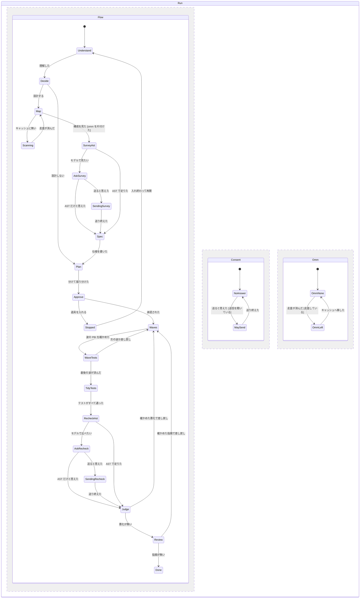

# atelier v4: 構成図・lint の下調べと見直し・既定の tests-at-end と kiln

2026-11-08 に design-flow（今の設定のまま）でユーザーと合意した。それまでの atelier（作者の手元の版で v3。tests-at-end の選択肢まで）からの差分だけを書く。用語は `skills/atelier/CONTEXT.md` に従う（「段」は tier、工程は stage）。工程と部品の契約は [atelier-workflow.md](atelier-workflow.md) にある。

## Problem Statement

atelier v3 で実装を回すと、次の困りごとがある。

- 変える範囲を決める前に、リポジトリの層と構成を毎回ゼロから読んでいる。OMM の走査の結果は `forgers-inc/.omm-cache` に残しているのに、atelier からは使っていない。
- 変える範囲の弱い所（長すぎる関数、責務の混ざり、バグの候補）を、設計の前に体系だって見ていない。jevlint を手で流して、結果から決まりを作った事例はあるが、atelier の流れには入っていない。
- 変更が、前より悪い形（100 行を超える関数、握りつぶした例外など）を持ち込んでも、review の担当が気づかなければそのまま通る。
- tests-at-end は効果が大きいのに（作業者 1 本 70〜95 分 → 数分、トークン半分以下）、指定しないと効かない。
- kiln は設計者にしか当たらない。サブエージェントと外の作業者には何も渡らない。sac-strategic-compact が無い環境では記録を手で書いている。設計者の線（48k）は低すぎて、線として働いていない。
- 推奨の道具（oh-my-mermaid、jevlint、sac-strategic-compact、pstack の test principle）が入っていないとき、入れ方の案内も代わりの手順もそろっていない。

## Solution

v4 の流れ（既定のテンプレート `jev-routed` と `high-model`）は、次のとおり。

understand → 設計するかの判断 → **map**（OMM で層と構成）→ **lint-survey**（jevlint で変える範囲の点・弱い問い・bug-hunt の候補）→ design → plan → route → 承認 → build と verify（波ごと、**tests-at-end が既定**）→ テストの工程 → **lint-recheck**（前と比べて悪くなった所）→ review → fix → finish

- map・lint-survey・lint-recheck は新しいオプションの工程で、同梱のテンプレートに既定で並ぶ。各工程の最後の部品は「代わりの依頼文」で、道具が無くても動く。
- jevlint がファイルの中身を外のモデル（既定は TypeSafe の Jev）に送るのは、lint-survey と lint-recheck の 2 か所だけ。どちらも、送る直前に `--dry-run` の数字を見せて、ユーザーの許可を取る。それ以外はいつも `--ast-only`。
- tests-at-end と kiln は既定で有効。止めるときは run の写しに `{"enabled": false}` と書く。
- kiln は、設計者・サブエージェント・外の作業者のすべてに当てる。
- 推奨の道具が無いときは、PBI 一覧の承認で入れ方を 1 行ずつ見せる。入れずに進むときは、同梱の代わりの依頼文や写しで進める。

## User Stories

1. ユーザーとして、atelier が設計の前にリポジトリの層と構成を見てほしい。範囲の決め方が、場当たりにならないように。
2. ユーザーとして、同じ基点の OMM の走査を繰り返してほしくない。走査は重いので。
3. ユーザーとして、`.omm/` がリポジトリに残らないでほしい。OMM はリポジトリに足さないと決めているので。
4. ユーザーとして、OMM の結果の置き場所を、リポジトリごとに決めたい。Forgers 以外のリポジトリでも使えるように。
5. ユーザーとして、oh-my-mermaid が入っていないときは、入れ方を教えてほしい。入れずに進むなら、代わりに構成の要約を作ってほしい。
6. ユーザーとして、設計の前に、変える範囲のファイルの点・100 行以上の関数・弱い問い・バグの候補を知りたい。直す範囲と順番を決められるように。
7. ユーザーとして、バグの候補は、設計者が実際にファイルを開いて確かめてから扱ってほしい。jevlint の点は意見なので。
8. ユーザーとして、範囲の外で見つかったバグの候補を、黙って直してほしくない。承認のときに、足すかを決めたい。
9. ユーザーとして、作業者に、触るファイルの弱い所（伸ばしてはいけない関数など）を 1〜2 行で伝えてほしい。変更で悪くならないように。
10. ユーザーとして、ファイルの中身が外のモデルに送られる前に、毎回、送るファイルの数・トークン・費用・送り先を見て決めたい。送ったものは取り消せないので。
11. ユーザーとして、送らない選択をしても流れを止めずに、AST の計測だけで進んでほしい。
12. ユーザーとして、sensitive な PBI のファイルと秘密のファイルは、許可しても外に送らないでほしい。
13. ユーザーとして、作業者には jevlint を流させないでほしい。送信と費用を設計者だけが扱うように。
14. ユーザーとして、review の前に、変更で悪くなった所の一覧がほしい。review の担当の見落としを減らすため。
15. ユーザーとして、関数の長さは 100 行からを合図にしてほしい。60 行は厳しすぎるので。
16. ユーザーとして、どのリポジトリでも低く出る問い（`documentation.contracts-stated` など）は、比較から外してほしい。ただし、報告をよく見せるために jevlint の設定を変えないでほしい。
17. ユーザーとして、確かめられたバグの候補と、新しくできた 100 行以上の関数は、その PBI の差し戻しにしてほしい。点が少し下がっただけでは差し戻さないでほしい。
18. ユーザーとして、jevlint が入っていないときは、入れ方（Node の版を含む）を教えてほしい。入れずに進むなら、同じ物差しで読む代わりの依頼文で進めてほしい。
19. ユーザーとして、jevlint を、リポジトリの Node と別の Node で動かしたい。リポジトリの Node を変えずに済むように。
20. ユーザーとして、tests-at-end を既定にしてほしい。作業者の時間とトークンが大きく減ったので。
21. ユーザーとして、テストのコマンドが無いリポジトリでは、tests-at-end が黙って効かないのではなく、そう書いてほしい。
22. ユーザーとして、tests-at-end の `deferred` と `test_paths` は、設計者が案を作り、承認のときに見せてほしい。止まる回数を増やさないため。
23. ユーザーとして、kiln を、親のセッションからサブエージェント・外の作業者まで当ててほしい。どこでも文脈が膨らみすぎないように。
24. ユーザーとして、サブエージェントが終わりきらないときは、きりのよい所で状態を書いて返してほしい。新しい作業者が続きから進められるように。
25. ユーザーとして、圧縮の記録をスクリプトで 1 行ずつ足してほしい。手で書かずに済むように。
26. ユーザーとして、kiln の線を、実際の文脈の大きさで働く値にしてほしい。区切りのたびに冷ますことにならないように。
27. ユーザーとして、sac-strategic-compact が無いときも、同じ決まりで動いてほしい。入れ方も教えてほしい。
28. ユーザーとして、`setup` で、推奨の道具の有無と版を一覧で見たい。何を入れればよいか分かるように。
29. ユーザーとして、承認の一覧で、どの工程が道具で動き、どれが代わりの依頼文で動くかを知りたい。結果の重みを判断できるように。
30. ユーザーとして、resume のときに、送信の許可や設計の判断を聞き直さないでほしい。

## Implementation Decisions

### 工程と部品

- オプションの工程に `map`・`lint-survey`・`lint-recheck` を足す。既定の置き場所は、`map` と `lint-survey` が understand のあと（テンプレートの並びで map が先）、`lint-recheck` が verify のあと。
- 「verify のあと」に置いたオプションの工程は、すべての PBI が通り、テストの工程（tests-at-end が有効なとき）も終わったあと、review の前に 1 回だけ動く。
- この 3 つは「先に使えるものを 1 つだけ選ぶ」工程にする（ふつうの工程と同じ選び方）。ui-design・marketing・security は今のまま「使えるものをすべて動かす」。最後の部品は、`requires` の無い後ろ盾にする。
- 部品（実装で改めた。v3 の決まり「同梱の部品は、このスキルと Claude Code の built-in だけ」に合わせるため）:
  - `map.builtin`（builtin、subagent）: `oh-my-mermaid:omm-scan` は部品ではなく呼び出し先（callee）として、付録の手順の中で使う。tests-at-end が pstack の test principle を使うのと同じ形。道具が無ければ同じ部品の中で代わりの依頼文に切り替える
  - `lint-survey.jevlint`・`lint-recheck.jevlint`（script `lint_run.py`、requires: cli `jevlint`）
  - `lint-survey.builtin`・`lint-recheck.builtin`（builtin、代わりの依頼文）
- 推奨の道具の有無は `tools_check.py` が一覧にする（Start・承認・setup）。
- `map` と `lint-survey` の `when` は `ask-or-decide`（設計を動かすときだけ）。`lint-recheck` は `always`。
- 設計するかの判断は、understand の直後にする（聞くときも、そこで聞く）。design の工程は、その答えを使い、聞き直さない。答えは今までどおり `docs/pbi/adapters.json` に残す。
- `flow.py` は、cli の有無を `agents.find_cli` で判定する。これは PATH のほかに fnm・nvm の Node の版の中も探す（jevlint の `jevlint.cmd` は同じフォルダの `node.exe` で動く）。別の場所にあるときは、home の `agents.json` の `tools.jevlint.path` で指す（実装で改めた。仕様の段階の `lint.node_dir` は要らなかった）。

### map（構成図の工程）

- 置き場所は、home の `agents.json` の `omm.cache_dir`。既定は、リポジトリのメインの clone の親フォルダの `.omm-cache`。その下に `<repo>/<フィンガープリントの先頭 12 桁>/` を作り、`.omm/` と `fingerprint.json` を置く（共有メモリの決めと同じ形）。
- フィンガープリントは、マージ基点での `git rev-parse <base>:<dir>`。対象のディレクトリは `docs/pbi/map.json` の `scan_dirs`。既定は、`src` があれば `src`、無ければリポジトリ全体（`<base>^{tree}`）。
- 当たれば走査しない。外れたら、サブエージェントが `omm-scan` で走査する。視点は overall-architecture と dependency-map に絞る。できた `.omm/` は置き場所へ移し、作業ツリーから消す。
- `forbid`: `npm install` をしない。`.omm/` をコミットしない。`omm view` をしない。
- どちらの場合も、サブエージェントが `docs/pbi/notes/map.md` に書く。中身は、層・変える範囲のモジュール・依存の向きを 5 行ほどと、キャッシュのパス。設計者は図を読まない。
- 代わりの依頼文（`map.builtin` の代わりの依頼文）: サブエージェントがコードを読んで、同じ要約と Mermaid 1 枚を `docs/pbi/notes/map.md` に書く。キャッシュには置かない。

### lint-survey（lint の下調べ）

1. `--ast-only` で `scan_dirs` 全体を `audit --json` にかける（送らない）。
2. map の要約と依頼から、範囲のファイルを決める。
3. 範囲から、sensitive な PBI の対象になりそうなファイルと秘密のファイルを外す。
4. 残りで `--dry-run` を流し、送信の許可を聞く。
5. 許可があれば、モデルで `audit --json` にかける。
6. `lint_run.py survey` が `docs/pbi/notes/survey.md` に書く（代わりの依頼文のときはサブエージェント）。中身は、範囲のファイルの点、100 行以上の関数、弱い問い（除外の一覧を抜く）、`bug-hunt` の候補。設計者は要約だけを読む。
7. `bug-hunt` の候補は、設計者がファイルを開いて確かめる。
   - 範囲の中で確かめられたもの: 仕様の Implementation Decisions に入れる
   - 範囲の外のもの: 承認の一覧の「見つけたが、この回ではやらない」に載せる
8. 下調べで弱い所が出たファイルが PBI の Targets にあれば、その PBI の Notes に `jevlint:` の行を 1〜2 行入れる。

### lint-recheck（lint の見直し）

1. 変わったファイルの一覧を作る。中身は、マージ基点からの変更と、PBI の新しいファイル。消したファイルと、対象外の拡張子は外す。
2. 「前」: スクラッチに一時的な `git worktree add --detach <tmp> <merge-base>` を作り、その中で変わったファイル（基点にあるもの）を `audit --json` にかける。終わったら `git worktree remove` と `git worktree prune` をする。`node_modules` はつながない。
3. 「後」: 作業ツリーで、同じファイルと新しいファイルを `audit --json` にかける。
4. いつも `--ast-only` で比べる。モデルで比べるのは、送信の許可があったときだけ。
   - 「前」のうち下調べで送った中身は、キャッシュに当たる
   - 送らないものは lint-survey と同じ
5. `lint_compare.py` が 2 つの JSON を比べ、`docs/pbi/jevlint/recheck.md` に表を書く。悪くなったとする線は次のとおり。
   - 点が `score_drop`（既定 5）以上下がった
   - AST の新しい指摘（線を超えた）。前からある指摘は `ast_growth`（既定 10%）より大きくなったときだけ。関数の長さは `function_lines`（既定 100）以上だけ。照合は rule と値の順位で行い、行番号のずれは無視する
   - 差し戻しの候補（`rework-candidate`）は、`bug-hunt` と、新しく 100 行以上になった関数だけ。前から長い関数が伸びたものは申し送り。`report_only_paths`（テストのファイル）の行は、いつも申し送り
   - 実装のあとに本物の jevlint（AST だけ）で、sekisuiheim の 6 コミット分の変更を比べて決めた。前の線では 28 行が出て、前から 297 行の関数が 1 行伸びただけでも差し戻しの候補になった。今の線では 11 行になる
   - 問いの合致が `compliance`（既定 0.7）以上から未満に落ちた（新しいファイルなら未満のもの）
   - `bug-hunt.*` が落ちた
   - `exclude_questions` は外す
6. 設計者が 1 件ずつ、ファイルを開いて確かめる。
   - 確かめられた `bug-hunt` と、新しい 100 行以上の関数: review の指摘と同じく、その PBI の差し戻し（上限に数える）
   - 点が下がっただけのもの: 差し戻さない。review の担当への依頼文と、完了報告に載せる
7. 差し戻した PBI が通ったら、その PBI のファイルだけを `--ast-only` で比べ直す。モデルでもう一度比べるのは、改めて許可を取ったときだけ。
8. 代わりの依頼文（`lint-recheck.builtin`）: サブエージェントが差分の前後を、同じ物差しで読む（100 行以上の関数、`bug-hunt` の問いの抜粋）。結果は同じ形で `recheck.md` に書く。外には送らない。

### 送信の許可

- 外に送るのは lint-survey と lint-recheck の、モデルの判定だけ。作業者は jevlint を流さない。`jevlint fix`・`pr`・`commits`・`baseline` は使わない。
- 送る直前に、毎回 AskUserQuestion で聞く。見せるものは、ファイルの数、トークン数、費用の見込み、送り先のプロバイダー、送るファイルの一覧のパス。選択肢は「送る」「AST だけにする」の 2 つ。前もってまとめての許可や、上限額までの自動の許可は設けない。
- これを atelier の止まる点の 5 つ目にする。
- 答えは `docs/pbi/adapters.json` の `sends` に、回ごと（工程・ファイルの一覧のハッシュ・答え・日時）に残す。resume で同じ送信を聞き直さない。
- 送らないファイル: sensitive な PBI の対象のファイルと、秘密のファイル（`.env*`、`*.pem`、`*.key`、`credentials*`、`secrets*`）。許可があっても送らない。

### 設定

- run の写しは `docs/pbi/lint.json`（テンプレートの `lint` より優先）。項目は次のとおり。
  - `preset`: 既定 `full`。前後で同じものを使う
  - `exclude_questions`: 既定 `["documentation.contracts-stated"]`
  - `score_drop`: 5
  - `function_lines`: 100
  - `compliance`: 0.7
  - `ast_growth`: 0.1
  - `report_only_paths`: Start で tests-at-end の `test_paths` から埋める
  - `extensions`
- `docs/pbi/map.json` は `scan_dirs`。
- home の `agents.json` に `tools.jevlint.path`（必要なときだけ）と `omm.cache_dir` を置く。
- jevlint の設定（`~/.config/jevlint`、`jevlint.toml`）は atelier から変えない。

### tests-at-end（既定で有効）

- 同梱のテンプレートに `build.tests_at_end` を既定で置く。止めるときは `docs/pbi/tests-at-end.json` に `{"enabled": false}` と書く。
- Start で run の写しが無ければ、設計者がリポジトリのスクリプトとテストの置き場所から `deferred` と `test_paths` の案を作り、PBI 一覧の承認に載せる。
- `deferred` が空になるとき（テストのコマンドが無い）は、STATUS に `Tests at end: off (no test command)` と書き、v3 の動きで進める。
- `verify.py` は `enabled: false` の写しを「無効」と読む。

### kiln（既定で有効、全員に当てる）

- 同梱のテンプレートの `kiln.enabled` を真にする。止めるときは `docs/pbi/kiln.json` に `{"enabled": false}` と書く。
- 既定の線:
  - 設計者: soft 120000、peak 180000
  - 実装者: soft 60000、peak 90000
  - handoff: 250000
  - aux: 150000
- 設計者: 工程と波の区切りで `agent_stats.py --ctx` で測る。冷ますときは、先に状態の板 `docs/pbi/CONTEXT_STATE.md` を書いてから `/compact` か引き継ぎをする。区切りごとに、`kiln_log.py` で 1 行足す（何もしなかったときも `noop`）。
- サブエージェント（作業者・レビュー・下調べ・走査）: 1 回ごとに新しく立てる。依頼文に `prompts/kiln-chamber.md` のブロックを入れる。中身は次の 3 つ。
  - 長い出力はファイルに出し、末尾だけを読む
  - 途中では圧縮しない
  - 終わりきらないと見たら、きりのよい所で止める。報告に `## State`（状態の板の 6 つの見出し）を書き、`NEEDS_CONTEXT`（理由は `kiln`）で返す
- 設計者は、`NEEDS_CONTEXT`（`kiln`）を STATUS の Continue として扱う。新しい作業者に、PBI と `## State` を渡す。差し戻しには数えない。
- 外の作業者には、同じブロックを依頼文の文字で渡す。
- 回が終わったら、設計者が `record_run.py` のトークンで `role: implementer` の行を足す。
- 記録の 1 行の項目: ts・run_id・host・regime・boundary・role・phase・tokens_before・peak_budget・soft_budget・handoff_at・action・state_path・task_id・note。`action` は `noop`・`suggest`・`compact`・`handoff`・`aux_on`・`fork`。
- sac-strategic-compact があれば、設計者はスキルに従う。無ければ、`appendix/kiln.md` の写し（状態の板の見出し、いつ圧縮するかの表、してはいけないこと）に従う。サブエージェントと外の作業者には、スキルの有無にかかわらず、写しのブロックを渡す。

### 推奨の道具が無いとき

| 道具 | 有無の確かめ方 | 入れ方の案内 | 入れずに進むときの代わり |
|---|---|---|---|
| oh-my-mermaid | プラグインの `omm-scan` と cli `omm` | プラグインと `npm install -g oh-my-mermaid` | `map.builtin` の代わりの依頼文 |
| jevlint | `agents.find_cli` で cli `jevlint`。`jevlint auth list` の typesafe（キーの値は出さない） | `fnm install 26.12.1`、`npm install -g @indxjp/jevlint`、`jevlint auth set typesafe` | `lint-survey.builtin`・`lint-recheck.builtin` |
| sac-strategic-compact | `~/.claude/skills/sac-strategic-compact/SKILL.md` | https://github.com/reeschan/sac-strategic-compact | `appendix/kiln.md` の写しと `prompts/kiln-chamber.md` |
| pstack の test principle | `principle-test-behavior-not-implementation` の SKILL.md | `/plugin install pstack@cursor-plugins` | `appendix/tests-at-end.md` の `## Test principle (fallback)` |

- PBI 一覧の承認（今ある止まる点）に、無い道具を 1 行ずつ、入れ方と一緒に載せる。止まる点は増やさない。
- 「入れる」と言われたら、そこで止める。入れ終わって resume したら、道具を使う。
- 入れずに進むときは、代わりで動き、STATUS の工程の記録に書く（例: `stage map after understand: map.builtin run (fallback prompt: oh-my-mermaid missing)`）。
- atelier は自分では入れない（ダウンロードには許可が要る）。
- `setup` でも、同じ表を 1 行ずつ出す。

## Testing Decisions

- 良いテストとは: スクリプトをコマンドの入口から呼び、入力（ファイル・JSON）を与え、出力（表・ファイル・終了コード）だけを確かめる。内部の関数の呼ばれ方は確かめない。v3 の `test_verify.py`・`test_flow.py` と同じ形にする。
- 合意済みの seam:
  1. `flow.py` のコマンドの出力（表の行、`error` の行）: 新しいオプションの工程の並び、先に使えるものを 1 つだけ選ぶ規則、後ろ盾の検査、`tools.jevlint.path` での cli の判定
  2. `lint_compare.py` のコマンド: 2 つの jevlint の JSON → `recheck.md` の表と、悪化の件数の出力
  3. `lint_run.py` のコマンド: 変わったファイルの一覧（送らないファイルの除外を含む）、「前」の一時的な worktree の作成と後片付け。jevlint は偽物の実行ファイルに差し替えて確かめる
  4. `omm_cache.py` のコマンド: フィンガープリントの計算、当たり・外れの判定、`.omm/` の移動
  5. `kiln_log.py` のコマンド: 1 行の追記と、項目の検査
  6. `verify.py` の `enabled: false` の読み方
  7. `test_references.py`: 本文と付録が指すファイルが、すべてあること
  8. `tools_check.py` のコマンド: 道具の有無・キーの無さ・入れ方と代わりの列（実装で足した）
- 先例: `test_verify.py`（偽物のコマンドを流す）、`test_flow.py`（テンプレートの検査）、`test_unchanged.py`（git の一時リポジトリ）。

## Out of Scope

- jevlint をリポジトリに入れること、`jevlint.toml` や `~/.config/jevlint` を書き換えること。関心ごとのルール（CONCERN）・oxlint・閉じたモジュールを決める作業（sekisuiheim の `docs/specs/implementer/concern-rules.md` の仕事）。
- `.omm/` をリポジトリに入れること。OMM の図を PR の本文に載せること（`omm-pr-scan` の仕事）。
- 道具を atelier が自分で入れること。
- 作業者が jevlint を流すこと。
- v4 を有効にすること（`switch` はユーザーに聞いてから）。
- v3 の本文の編集。

## Further Notes

- jevlint の点は意見で、モデルの版でも少し動く。小さな差は追わない（`score_drop` の既定 5 はそのため）。点を上げるためだけに、動いているコードを分け直さない。
- `jevlint pr` は push した head しか見ず、atelier は作業中にコミットしないので、使わない。`jevlint baseline` は `.jevlint/baseline.json` をリポジトリに書くので、使わない。
- 別の worktree に `node_modules` をジャンクションでつないで pnpm を流すと、元の中身が消える（共有メモリに記録済み）。「前」の worktree では jevlint だけを流し、`node_modules` はつながない。
- 親のセッションの指摘: sac-strategic-compact の本文が呼ぶ `scripts/log_compact_event.py` は、入れたスキルに入っていない。v4 は `kiln_log.py` を同梱し、同じ形の 1 行を書く。

## 状態の図

pstack の `/statechart` の from-chart で検査した図（`statechart/atelier-v4.mmd`）。工程・送信の許可・作業ツリーの `.omm/` を別の領域に分け、5 つの規則がどの状態でも破れないことを TLC で確かめた（22 状態、33 遷移、図とモデルは一致）。最初の図では、許可の答えと走査の結果が工程と関係なく起きうるため 6 つの道が規則を破った。そこで「許可は聞いているときだけ受け取る」「`.omm/` は走査のときだけできる」の 2 つの条件を足した。

| 状態 | 意味 |
|---|---|
| Understand / Decide | 理解する / 設計するかを決める |
| Map / Scanning | 構成を見る / OMM で走査する（キャッシュに無いとき） |
| SurveyAst / AskSurvey / SendingSurvey | 下調べ（AST）/ 送ってよいかを聞く / 外のモデルに送っている |
| Spec / Plan / Approve / Stopped | 仕様を書く / 分けて振り分ける / 承認を待つ / 道具を入れるために止まる |
| Waves / WaveTests / TidyTests | 波を作る（build・verify・fix）/ 波の終わりにテストを流す / テストの工程 |
| RecheckAst / AskRecheck / SendingRecheck / Judge | 見直し（AST）/ 送ってよいかを聞く / 外のモデルに送っている / 悪化を確かめる |
| Review / Done | レビューする / 終える |
| NoAnswer / MaySend | 許可の答えが無い / この 1 回だけ送ってよい |
| OmmNone / OmmLeft | 作業ツリーに `.omm/` が無い / 走査でできた `.omm/` が残っている |

図の外で守る決まり（状態ではなく、検査と差し戻しで守る）:

- sensitive な PBI のファイルや秘密のファイルは、許可があっても外のモデルに送らない（`lint_run.py` が一覧から外す）
- tests-at-end が有効なとき、作業者はテストのファイルを作る・直す・消すをしない（verify で差分を見て差し戻す）
- 作業者は jevlint を流さない（作業者への依頼文に入れず、`worker.md` で禁じる）
- tests-at-end を止めたときは、WaveTests と TidyTests を通らず、作業者がテストを流す（v3 の既定の動き）
- v3 の止まる点（差し戻しの上限、壊す操作の前、波の区切りの引き継ぎ）も残る。図には描かない
