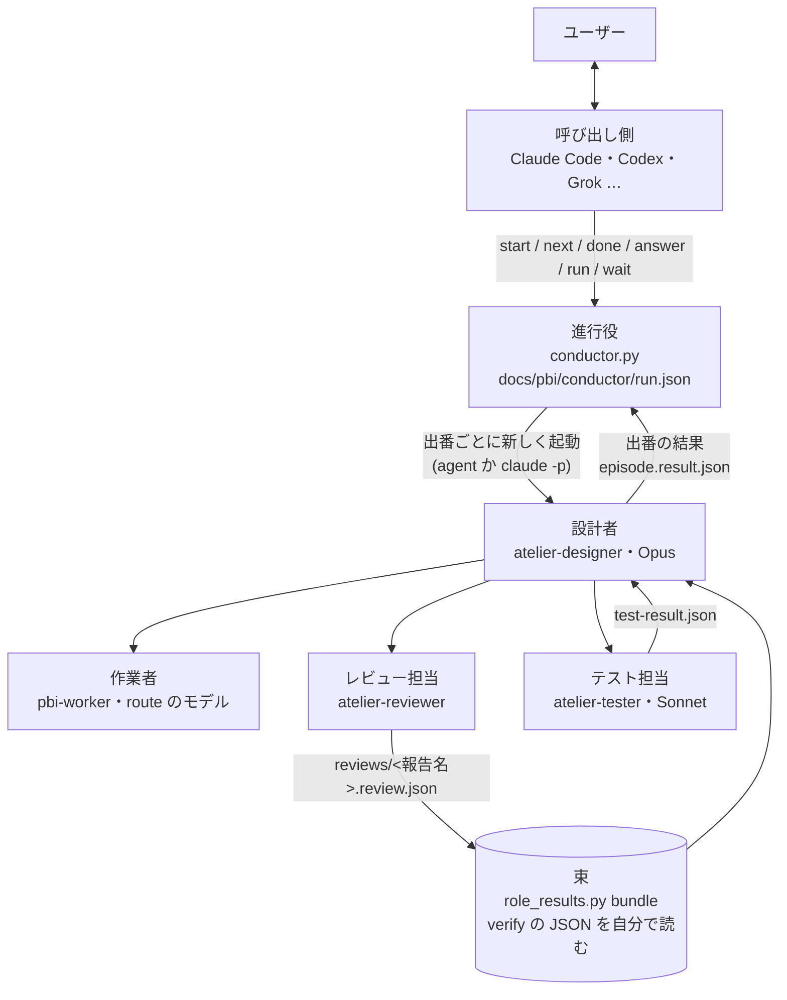

# atelier v6: 設計者を Atelier の中へ (呼び出し側・進行役・出番)

2026-11-10 にユーザーの依頼から起こし、Atelier 自身の流れ (jev-routed) で設計した。v5 (設計の正本 `design-record.json` と返信の照合、PBI-012〜014) からの差分だけを書く。用語は `skills/atelier/CONTEXT.md` に従う。工程と部品の契約は [atelier-workflow.md](atelier-workflow.md) にある。

revision 2 (同日): 実装の前の設計レビュー (`docs/pbi/notes/design-review.md`) と、前提を実物で確かめた結果 (`docs/pbi/notes/spike.md`) を入れた。直した箇所と指摘の対応は末尾の「改訂の記録」にある。

## Problem Statement

- 長い run では、設計者 (今は Claude Code のメインのセッション) の文脈が引き継ぎの線を越えるたびに、ユーザーが `/clear` と `/atelier resume` を手で打っている。止まる場所の 4 番目 (波の境目の引き継ぎ) は、ユーザーの判断が要らないのに止まっている。
- 設計者が、ユーザーとの対話・設計・作業者の起動・PBI ごとの検証・差分の精読・テストの仕分け・最終レビューの照合まで、1 つの会話で全部を持っている。どの仕事の出力も同じ文脈に積もる。
- 設計者は Claude Code のメインのセッションでしか動かない。Codex や Grok などから Atelier を使う道が無い。
- v5 で設計を JSON (正本) で受け渡せるようになったが、レビューとテストの結果は Markdown と会話の中の数行のまま。役割を分けても、受け取った側が照合できる形になっていない。

## Solution

役割を 6 つに分け、設計者を Atelier が持つ。

- **呼び出し側** (Claude Code・Codex・Grok など) は、ユーザーと話すだけ。`conductor.py` を呼び、返ってきた数行と問いをユーザーに渡し、答えを `conductor.py answer` で返す。PBI・差分・レビューは読まない。
- **進行役** (`conductor.py`、LLM ではないスクリプト) が run の状態を `docs/pbi/conductor/run.json` に持ち、次の出番と、その依頼文を決める。
- **設計者** (`agents/atelier-designer.md`、Opus) は出番ごとに新しく起動される。今の付録の「orchestrator」は、この設計者を指す。責務は次の 3 つと、その間で作業者を動かすことだけ。
  1. 初回の設計: understand から route まで進め、承認の下書きを出す。承認で直しを頼まれたら、直して承認を出し直す
  2. レビュー担当の結果を受け取って照合する: 波のレビューがそろったら束を読み、PBI ごとに pass・差し戻し・段上げ・保留を決めて記録する
  3. テスト担当の結果を受け取って照合する: 失敗を「意図した変更」と「壊した動き」に分け、差し戻しかテストの工程に回す
- **作業者** は今のまま (`pbi-worker`・`worker.md`)。設計者のサブエージェントとして動く。
- **レビュー担当** (`agents/atelier-reviewer.md`) は 1 報告に 1 つ。波の作業者が全部返ってから起こす。`verify.py` を流し、受け入れ条件を 1 つずつ判定し、差分を読み、`docs/pbi/reviews/<報告名>.review.json` を書く。作ったモデルでは動かない (今の決まりのまま)。
- **テスト担当** (`agents/atelier-tester.md`、Sonnet) は、波の終わりのあとに回したコマンド、テストの工程の下調べ、最後の通し (今の review.md の Whole check の「流す」部分を含む) を受け持ち、`docs/pbi/verify/tests/<名前>.test-result.json` を書く。テストのスキルが決まっていればそれを呼ぶ。
- **ファイルが正。** 役割どうしの受け渡しは、すべてディスクのファイルで行う。サブエージェントの返事 (Agent ツールの戻り) は、届かないことがある (spike A': 入れ子の haiku が SubagentHandback を呼ばずに終わった)。どの役割も、返事が空でも、決まったパスのファイルがあれば進める。
- **文脈を冷ますのは Atelier の中で済ます。** 設計者は出番ごとに新しく起動されるので、前の出番の会話を持たない。出番の途中で線を越えたら状態の板を書いて `handoff` で終わり、進行役がすぐに新しい設計者を `Continue from:` で起こす。ユーザーの `/clear` と resume は要らない。呼び出し側の文脈には、出番ごとに数行しか積もらない。

流れ (出番):

design → build (波 1) → build (波 2) … → test → review → finish

- design: understand → 設計するかの判断 → map → lint-survey → design → plan (波の中身を `waves.json` に書く) → route → 承認の下書き → `question` (approve) で終わる。承認のあと、同じ出番が答えを読んで `done` (次は build 波 1) を返す。直しを頼まれたら (`revise`)、直して revision を上げ、もう一度 `question` (approve) で終わる。
- build (波 n): その波の作業者を起動 → 全部が返ったら報告ごとにレビュー担当 → 束 → 照合して記録 → 差し戻しがあれば同じ出番の中で次の試行 → 波が片づいたらテスト担当 (あとに回したコマンド) → 照合 → `done` (次の波か test)。
- test: テスト担当の下調べ → 照合 → テストの PBI を作業者とレビュー担当で回す → テスト担当の最後の通し → 照合 → lint-recheck → `done` (review)。
- review: 最終レビュー (レビュー担当が code-review などのスキルを呼ぶ) → 照合 → 差し戻しがあれば `done` (build、対象の PBI だけ) か、無ければ `done` (finish)。
- finish: 今の付録どおり。統計は役割ごとに分けて出す。完了報告のパスを返して run を閉じる。
- この run (v6 を作る run) では、W5 のあと finish の前に、設計者が `arch-diagram` のスキルで README の構成図 (`assets/architecture.d2` と light・dark の SVG、alt テキスト) を v6 の役割に描き直す。図は PBI の作業者に渡さない (スキルを呼べるのは設計者のため)。

## User Stories

1. ユーザーとして、文脈が膨らむたびに `/clear` と resume を打ちたくない。Atelier の中で冷ましてほしい。
2. ユーザーとして、ユーザーの判断が要らない場所で止まってほしくない (波の境目の引き継ぎ)。
3. ユーザーとして、呼び出し側のセッションとは話すだけにしたい。開発の文脈を呼び出し側に積もらせたくない。
4. ユーザーとして、Claude Code だけでなく Codex や Grok からも Atelier を動かしたい (その PC に `claude` CLI があること)。
5. ユーザーとして、設計者を Atelier の部品として持ちたい。呼び出し側の会話の調子で設計がぶれないように。
6. ユーザーとして、設計者には設計と照合に専念してほしい。検証・差分の精読・テストの実行は、別の担当に任せたい。
7. ユーザーとして、レビューの結果を JSON で受け取りたい。設計者が数を数え、根拠を照らし合わせられるように。
8. ユーザーとして、波のレビューがすべてそろってから、まとめて設計者に渡してほしい。1 件ずつ設計者を起こさないように。
9. ユーザーとして、テストの実行は Sonnet 級の担当に任せたい。スキルを呼んで流すだけなので。
10. ユーザーとして、テストの失敗を「意図した変更」と「壊した動き」に分けた結果を、設計者に照合してほしい。
11. ユーザーとして、設計者が途中で止まっても、run の状態がディスクに残っていてほしい。呼び出し側を開き直しても `status` と `next` で続けられるように。
12. ユーザーとして、止まる場所は今の決まり (承認・差し戻しの上限・壊す操作の前・外への送信の前) だけにしてほしい。
13. ユーザーとして、承認の返信は v5 の照合 (`design_record.py check-reply`) をそのまま通してほしい。囲みを書けない呼び出し側からも承認でき、承認の場で直しも頼めるように。
14. ユーザーとして、Agent ツールの入れ子が使えない環境では、`claude -p` で設計者を動かしてほしい。それも無ければ今の流れ (v5) で動いてほしい。
15. ユーザーとして、設計者・レビュー担当・テスト担当のモデルを home の設定で変えたい。
16. ユーザーとして、設計者が自分の文脈の大きさを測れてほしい。Kiln の線が設計者自身に効くように。
17. ユーザーとして、同じ run を 2 つの呼び出し側から動かして、設計者が 2 人にならないようにしてほしい。

## Implementation Decisions

### 層 (map より)

変更は 3 つの層に分かれる。指示文 (SKILL.md・designer.md・appendix・prompts・agents) が上で、スクリプト (conductor.py・role_results.py・agent_stats.py) を名前で指す。スクリプトどうしは `common` だけを使い、`conductor.py` が `role_results` を import する。スクリプトから指示文への依存は、`conductor.py` が `prompts/designer-episode.md` と `agents/atelier-*.md` (後ろ盾の起動のため) を読むことだけ。

### 進行役 (`conductor.py`)

- 置き場所は `docs/pbi/conductor/`。`run.json` (schema `atelier.run/1`)、`goal.md`、`episodes/<seq>-<出番>.prompt.md`・`.alive` と結果の `episodes/<run_id の先頭 8 文字>-<seq>-<出番>.result.json` (前の run の設計者の結果を読まないため)、`answers/<seq>-<種類>.md`。波の中身は `docs/pbi/waves.json` (設計者が plan で書く)。
- 状態: `none` (run.json が無い)・`ready`・`running`・`question`・`retry` (起動か結果の失敗のあと、起こし直し待ち)・`finished`・`aborted`。
- コマンド。1 行目はいつも `state: <状態>`、全部で 8 行以内を出す。
  - `start --goal TEXT|--goal-file F [--workflow N] [--launch agent|headless] [--force]`: run.json を作る (run ごとの `run_id` (uuid) を入れる)。終わっていない run があれば断る (2)。`--force` は今の run.json を `run.<日時>.json` に退けて新しく始める。
  - `next [--relaunch]`: 次の出番の依頼文を書き、起動のしかた (subagent_type・model・依頼文と結果のパス・description `ATELIER.<run>.<seq> <出番>`。`<run>` は run.json の `run_id` の先頭 8 文字) を出す。状態を running にし、`launched_at`・起動した側 (`agent` か `headless`)・headless なら子の pid を run.json に書く。問いが残っていれば問いを出して 10。
    - **running の間の `next` は起動の指示を出さない。** `state: running since <時刻> alive <秒> ago` と `relaunch: python <skill>/conductor.py next --relaunch` を出して 0。`--relaunch` は、止まったと呼び出し側が判断したときだけ使う。子の pid が生きていれば止め、seq と session の uuid を新しくする。
    - **launch が headless の run の `next` は起動の指示を出さない。** running にせず、`launch: headless` と `then: python <skill>/conductor.py run --detach` を出して 0 (起動するのは `run`)。
    - `--launch` は `start` と `run` だけが受ける (`next` は受けない)。
  - `done`: running の出番の結果を読み、`role_results.check_episode` とつながり (下の表) を確かめて状態を進める。Agent ツールの返事が空でも、結果のファイルがあれば進める。
  - `answer`: 残っている問いに答える。
    - `--reply F|--text T`: 答えを `answers/<seq>-<kind>.md` に書く。承認 (`check: design-record`) は `design_record.py check-reply` に渡し、0 なら受ける。3・4・5 なら問いを残し、`check-reply exit <code>` と、次に使える `--approve` と `--revise` の行を出して 10。
    - `--approve [--choices 1=a,2=b]`: 囲みを書けない呼び出し側のための承認。進行役が問いの下書きの `reply-meta-` 行と choices から返信の囲みを組み、`check-reply` に通す。組むのは決まった処理なので、承認と revision の結びつきは崩れない。
    - `--revise --text T|--reply F`: kind `approve` の問いを「直してほしい」として閉じ、design の出番を `Answer:` (直しの依頼のファイル) 付きで起こせる状態にする。
    - 受けたら、同じ出番を `Answer:` 付きで起こせる状態にする。出番の途中の問い (approve 以外) では、`Continue from:` も付ける。
  - `run [--max-episodes N] [--detach] [--launch agent|headless]`: headless。依頼文を書く → `claude -p` → `done` を、問い・終わり・失敗まで繰り返す (retry になったら 12 で止め、起こし直しは次の `run`)。`--launch` は run.json の起動のしかたを書き換えてから動く (設計者が `no-agent-tool` で終わったあとなど)。`--detach` は、子を起こす前に `runner_pid` を run.json に書いてロックを放し、自分を切り離して、すぐに `state: running` で返す。
  - `wait [--timeout S]`: 状態が running でなくなるか、S 秒 (既定 300) たつまで待って、`status` と同じ行を出す。シェルの時間の上限がある呼び出し側は、`run --detach` と `wait` を繰り返す。
  - `status`: 今の状態・出番・波・問い・出番の数・`.alive` の古さ・費用の合計 (agent では `cost: unmeasured`)。run.json が無ければ `state: none`、`docs/pbi/HANDOFF.md` があれば `inline: v5 run (follow designer.md)` の行も出す。
  - `abort [--reason T]`: run を `aborted` で閉じる。子の pid が生きていれば止める。
- 終了コード: 0 進める・終わった・running の案内 / 10 ユーザーの答え待ち / 12 起動か結果の失敗 / 2 引数と状態の誤り。
- 出番のつながり (`done` の next):

  | 出番 | 次に許すもの |
  |---|---|
  | design | build (波 1) |
  | build | build・test・review・finish |
  | test | build・review |
  | review | build (`pbis` で対象を限る)・finish |
  | finish | なし (run を閉じる) |

  build の `next` は `{"episode": "build", "wave": n}` か、差し戻しのときは `{"episode": "build", "wave": n, "pbis": [...]}`。`n` は `waves.json` にある番号でなければならない。

- `handoff`: `state` の状態の板が在ることを確かめ、同じ出番を `Continue from:` 付きで起こせる状態にする。進みは出番の結果の外で測る: handoff のたびに、`docs/pbi/runs.jsonl` の行の数と `docs/pbi/STATUS.md` のハッシュを run.json に記録する。**3 回続けてどちらも変わらなかったときだけ**、種類 `handoff-loop` の問いにする。
- 結果が無い・壊れている・表に無い next: 失敗として数え、状態を `retry` にする。`next` で同じ出番を `Continue from:` 無しで起こし直す (設計者は入り直しの決まりに従う)。同じ出番で 2 回続いたら種類 `launch-failure` の問いにする。status が `done`・`question`・`handoff` の結果を検査で受けたら数を 0 に戻し、どの答えのあとも 0 に戻す。設計者の結果が `error` で reason が `no-agent-tool` なら、数えずにすぐ種類 `decision` の問いにし、`run --launch headless --detach` を案内する。
- 依頼文は `prompts/designer-episode.md` の text ブロックを埋めて作る (`{name}` を埋め、`{?name}` で始まる行は値があるときだけ残す)。
- 役割のモデルは home の `agents.json` の `roles` (無ければ既定): `designer` (opus、permission_mode `auto`)、`reviewer` (`{"deep": {"model": "opus"}, "other": {"model": "sonnet", "effort": "high"}}`。review の段が deep なら deep、それ以外は other。作ったモデルと同じになるときは、もう一方に替える)、`tester` (sonnet)。値が不正なら既定にし、`warn` 行を出す。
- headless の起動: `claude -p --output-format json --agent atelier-designer --model <m> [--effort <e>] --permission-mode <mode> --permission-prompts none --session-id <uuid>`。依頼文は標準入力。`claude_run.py` と同じく API キーと接続先の環境変数を外す。出力は `episodes/<seq>-<出番>.json`・`.err`。**`is_error` が true なら、`subtype` によらず起動の失敗**とする (spike C: 課金の失敗が `subtype: success` で返った)。session_id と `total_cost_usd` を run.json の履歴に残す。テストのため、起動のコマンドは環境変数 `ATELIER_DESIGNER_CMD` (JSON の配列) で差し替えられる。
- 排他: `docs/pbi/conductor/lock` に `{"pid", "started_at" (ISO 8601 の文字列), "host"}` を書く。どのコマンドも状態を読み書きする間だけロックを取る (`status`・`wait` は取らない)。`run` は `claude -p` の子を待つ間はロックを持たない (出番の間の二重起動は running の案内が防ぐ)。`run --detach` の親は、子を起こす前に `runner_pid` を run.json に書いてからロックを放す。ロックが取れないときは 5 秒まで取り直し、それでも生きている pid のロックがあれば断る (2)。状態を書いてからロックを消す順にし、`wait` は running 以外を見たら、ロックが消えるまで (5 秒まで) 待ってから返す。pid の生死は、POSIX では `os.kill(pid, 0)`、**Windows では `ctypes` の `OpenProcess(PROCESS_QUERY_LIMITED_INFORMATION)` と `GetExitCodeProcess == STILL_ACTIVE`** で確かめる (Windows の `os.kill(pid, 0)` は Ctrl+C を送る)。pid の使い回しに備え、プロセスの起動の時刻がロックの時刻より後なら死とみなす。二重起動はロック (コマンドの間) と running の案内 (出番の間) の 2 つで防ぐ。

### 起動のしかた (launch)

- `agent` (既定。呼び出し側が Claude Code のメインのセッション): 呼び出し側が Agent ツールで `atelier-designer` を起動する。深さ (spike A で確かめた): 呼び出し側 0 → 設計者 1 → 作業者・レビュー担当・テスト担当 2 → レビュー担当やテスト担当が呼ぶスキルの子 3。**深さ 3 のエージェントは Agent ツールを持たない**ので、それより下は起動できない。スキルの子がさらに子を要るときは、そのスキルを使わず built-in の後ろ盾で回す (review.md に書く)。呼び出し側がすでにサブエージェントの中なら、1 段足りないので `headless` を使う。設計者は Agent ツールが無いと分かったら `error` (reason `no-agent-tool`) で終わる。Agent ツールが裏で動く環境では、呼び出し側は完了の通知が来てから `done` を呼ぶ。
- `headless` (Codex・Grok などの呼び出し側、または裏で回したいとき): `conductor.py run` (多くは `--detach` と `wait`) が `claude -p` で設計者を起動する。設計者はそのセッションのメインなので、深さは 1 つ浅い。
- `inline` (後ろ盾): Agent の入れ子も `claude` も無いとき。呼び出し側が `designer.md` に自分で従う。今の v5 の流れで、`appendix/handoff.md` の `/clear` と resume も今のまま。Codex・Grok で `claude` CLI が無いときは、Atelier は使えない (README に書く)。
- **エージェント定義が home に無いとき** (setup の前、置くのを許されなかったとき): `next` は `warn agents: atelier-<role> not installed; using fallback` を出す。agent では `subagent_type: general-purpose` で起動し、依頼文の先頭に `Read <skill>/agents/atelier-<role>.md and follow it as your instructions.` を付ける。headless では、進行役が定義のファイルから `--agents` の JSON を組んで渡す。設計者がレビュー担当・テスト担当を起こすときも同じ後ろ盾を使う (designer.md に書く)。

### 設計者 (`designer.md` と `agents/atelier-designer.md`)

- 今の SKILL.md の本文 (止まる場所・不変の決まり・Read on event・Start・工程・Approve・PBI 1 件・文脈を小さく・作業のメモリ) を `designer.md` に移し、出番の節を足す。付録が指す `SKILL.md` の `## Approve` などは `designer.md` を指すように直す。
- 止まる場所は「ユーザーに聞く」のではなく、`question` の結果を書いて出番を終えること。種類は `approve`・`rework-limit`・`destructive`・`send-approval`・`decision`。波の境目の引き継ぎは止まる場所ではなくなる。**付録のどこかが「ユーザーに聞く」「AskUserQuestion」と書いていれば、`question` (kind `decision`) で出番を終える**と When to stop に 1 行で書く (付録の書き換えの漏れを、この 1 行で受ける)。
- 出番の途中の問い (approve 以外) は、状態の板 `state` を必ず書く。`rework-limit` は、走っている試行が全部返って照合し終えてから出す (走っている試行を残して出番を終えない)。v5 の rework.md の「依存しない PBI は走り続ける」は、「同じ波の依存しない PBI の照合を済ませてから問う」に読み替える。
- **入り直しの決まり**: `Continue from:` が無い build・test の出番は、`docs/pbi/STATUS.md`・`docs/pbi/reports/`・`docs/pbi/reviews/`・`docs/pbi/runs.jsonl` を見て、最初の終わっていない手順から始める。runs.jsonl に記録済みの試行は記録し直さない。報告があってレビューが無い PBI は、レビューから始める。
- **波の中身**: plan の終わりに `docs/pbi/waves.json` (`{"waves": [{"n": 1, "pbis": [...]}, ...]}`) を書く。保留・段上げで波を組み直したら、ここを書き直す。build の出番は、依頼文の `wave` と、あれば `pbis` で対象を決める。束の `--reports` もここから決める。
- 検証 (`appendix/verify.md` の `## Check`) はレビュー担当に移す。設計者は束の表を読み、照合が要る行 (pass 以外・verify の失敗・触ってはいけないファイルの変化・critical か major の指摘・review.json と verify の JSON の食い違い) だけ review.json を開く。
- `record_run.py` での記録・差し戻し文・段上げは今のまま設計者が行う。review.md の Whole check の「流す」部分はテスト担当の kind `final` に移し、設計者は結果の照合だけをする。lint-recheck と finish は設計者に残す。
- Kiln: 設計者は境目ごとに自分を測る (下の `agent_stats.py`)。`suggest`・`compact`・`handoff` はどれも、状態の板を書いて `handoff` で終わる (headless でも Agent でも `/compact` は使わない)。測れない (`context=unknown`) が 2 回続いたら、照合した PBI 3 件ごとに handoff する。
- サブエージェント (作業者・レビュー担当・テスト担当) の返事は、空でもよい。決まったパスのファイルで受け取る。
- レビュー担当を起こすときは、実際に作業者を動かした実行先とモデル (route を飛ばして別の実行先に回したときは、回した先) を、依頼文の `Built on: <runner> <model>` の行で渡す。レビュー担当はそれを review.json の `built` に写す。
- 依頼文の「ユーザーに聞く」「AskUserQuestion」は question (kind `decision`) で出番を終え、「ユーザーに伝える・渡す・送る」は出番の結果の `summary` に入れる (When to stop の 1 行)。
- 出番の最後の動作は、結果のファイル (schema `atelier.episode/1`) を書くこと。返事は summary の行だけ。出番の間、境目ごとに `episodes/<seq>-<出番>.alive` に時刻を書く (パスは依頼文の `Alive:` 行で受け取る)。

### レビュー担当・テスト担当と JSON (`role_results.py`)

- `atelier.review/1` (1 報告): `report`・`pbi`・`reviewer.model`・`verify.failed` (番号)・`criteria` (番号ごとに `pass|fail|deferred` と根拠)・`findings` (`critical|major|minor`・file・line・why・repro)・`recommendation` (`pass|rework|tier-up|hold`)・任意の `built` (`{runner, model}`。依頼文の `Built on:` の写し)。
- `role_results.py bundle --wave <n> [--dir docs/pbi] --out docs/pbi/reviews/wave-<n>.bundle.json`: 対象の報告は `waves.json` と `docs/pbi/reports/` から決める (設計者が言い落とさない)。報告ごとに次を**自分で**確かめて 1 報告 1 行の表を出す。欠け・誤りがあれば終了コード 3 で、設計者はその報告のレビューだけやり直す。
  - review.json が在り、schema に合う。
  - `docs/pbi/verify/<報告名>.json` が在り、報告より新しく、PBI の verify の番号を全部 (deferred を除いて) 覆う。表の verify の列は、ここの終了コードから作る (合否は `verify.py` の終了コード、の決まりを保つ)。review.json の `verify.failed` と食い違えば、その行に `mismatch` を付ける。
  - `python docs/pbi/tools/unchanged.py check PBI-<n>` の終了コード。
  - 作ったモデルと `reviewer.model` が同じなら誤り。作ったモデルは、review.json の `built.model` (依頼文の `Built on:`) を先に使い、無ければ `runs.jsonl` のその報告の行、それも無ければ `route.json` から引く。
  - 束のファイルは引き継ぎ用の写しで、別の schema として検査しない。
- `atelier.test-result/1`: `kind` (`wave|survey|final`)・`commands` (コマンドと終了コード)・`failing` (test・file・pbi・`cause` `intended|regression|unknown`・why)・`recommendation` (`pass|rework|needs-designer`)。テスト担当の `cause` は案で、決めるのは設計者。survey の判定の数は `test-survey.md` に任せ、ここには持たない。
- `atelier.episode/1`: `episode`・`seq`・`status` (`done|question|handoff|error`)・`summary` (5 行・各 200 文字まで)・`next` (`{episode, wave, pbis?}`)・`question` (`kind`・`path`・`summary`・`check`)・`state` (question のうち approve 以外と handoff では必須)・`report`・`reason`。
- `role_results.py check <files>` が review・test-result・episode の 3 つの schema を確かめる。
- `tests-at-end.json` に任意の `skill` を足す: テスト担当が呼ぶテストのスキルの名前。無ければ `verify.py --deferred` で流す。

### `agent_stats.py`

- `--ctx --session <id>`: headless の設計者は自分の session_id を依頼文で受け取る (依頼文の `Context probe:` の行)。
- `--ctx --agent <description の先頭>`: agent の設計者は `ATELIER.<run>.<seq> ` を渡す (run の短い id が入るので、前の run や別のリポジトリの設計者と取り違えない)。 `~/.claude/projects/*/*/subagents/agent-*.meta.json` の `description` がそれで始まる、いちばん新しいものの jsonl から文脈の大きさを出す (spike B: 入れ子も同じ `subagents/` に平らに入り、meta.json に description・parentAgentId・spawnDepth がある。プロジェクトのフォルダは**セッションを始めたフォルダ**で決まり、作業フォルダを移しても変わらないので、今のディレクトリからは決めない)。`record_run.py` の今の探し方 (`*/*/subagents/agent-*.meta.json`) はこれと同じなので、変えない。
- `--out` の統計 (finish): run.json の history から設計者のセッション (headless は session_id、agent は description `ATELIER.<run>.`) を集め、「呼び出し側・設計者・作業者・レビュー担当・テスト担当」に分けて出す。meta.json の description (`ATELIER.`・`PBI-`・`.review`・`.design`・`REVIEW`・`TEST`) で役割を分ける (`.design` で終わる設計のレビューもレビュー担当)。finish は `agent_stats.py --out docs/pbi/stats --run docs/pbi/conductor/run.json` を流し、完了報告のパスを出番の結果の `report` に書いて `done` で終える。

### 呼び出し側 (`SKILL.md`)

- 本文は呼び出し側の手順だけにする (120 行・5,000 トークン以内のまま): home に agents.json が無ければ先に `setup` を済ませる → 目的を 2〜3 行で言い直す → `start` → `next` → 設計者を起動 → `done` → 出力の行をユーザーに渡す → 問いなら見せて答えを `answer` → 繰り返す。
- 承認の問いでは、ユーザーの返信をそのまま `answer --reply` で渡す。`check-reply exit 4` (囲みが無い) なら、返信が承認なら `answer --approve --choices ...`、直しの依頼なら `answer --revise --text ...` で返す。
- `next` が `state: running since` を出したら、設計者を起動しない。止まったと判断できるとき (`.alive` が Kiln の線より古い、呼び出し側を開き直して子がいない) だけ `next --relaunch`。
- `setup`・`models`・`templates` の引数は今のまま呼び出し側が `appendix/setup.md` に従う。
- 引数 `resume` は `conductor.py status` と `next` になる (状態はディスクにある)。`status` が `inline: v5 run` を出したら、v5 の流れ (designer.md と handoff.md) で続ける。フォルダ無しで始めたセッションからの作業ルートの探し方は、v5 の handoff.md の Resume の 1 をそのまま使う。
- Codex などから使うときの短い案内を README に載せる (AGENTS.md に書く 1 段落。`run --detach` と `wait` の繰り返しで書く。`claude` CLI が要る)。

## Testing Decisions

- tests-at-end が有効: 作業者はテストを書かず、テストの工程で足す。`python -m unittest discover -p 'test_*.py'` (skills/atelier) を波ごとに回す。
- 足すテスト:
  - `test_role_results.py`: 3 つの schema の正しい例と、欠けた項目ごとの誤り。束の欠け・verify の JSON の欠け・古さ・番号の覆い漏れ・review.json との食い違い・作ったモデルと同じレビュー担当・表の 1 報告 1 行。
  - `test_conductor.py`: 偽の設計者を `ATELIER_DESIGNER_CMD` で差し込み、start → design の question → answer (check-reply の 0・3・4) → `--revise` で design が再び起きる → `--approve --choices` → build → handoff (進みあり) → 同じ出番の再起動 → 進みなしの handoff 3 回で handoff-loop → 出番の途中の question (state 付き) → answer で `Continue from:` と `Answer:` の両方 → 結果なしで retry → finish の流れ。つながりの表にない next・waves.json に無い波の拒否、running の間の `next` が起動の指示を出さないこと、`--relaunch`、ロック (Windows の生死の分岐を含む)、`is_error: true` の出力を失敗にすること、`abort`、`state: none`、依頼文の `{?name}` 行、定義が無いときの後ろ盾の起動。
  - `test_agent_stats.py`: `--ctx --agent` (平らな subagents と meta.json、別のプロジェクトのフォルダ) と `--ctx --session`、`--out` の役割ごとの分け方。
- `test_references.py` は新しい指示文 (designer.md・appendix/episodes.md・agents/atelier-*.md・prompts/tester.md・prompts/designer-episode.md) の参照も確かめる。SKILL.md の大きさの上限はそのまま。
- **v6 の通し** (承認で選ぶ。費用がかかり、`claude` CLI が手元で動くことが要る): テストの工程の最後に、小さな見本のリポジトリで `conductor.py start --launch headless` と `run` を本物の `claude -p` (haiku) で design の question まで回し、`answer --approve` のあと build の 1 波 (PBI 1 件) まで進める。agent でも、呼び出し側から design の出番を 1 回起動する。選ばれなければ、確かめる項目の一覧として完了報告に入れる。

## Out of Scope

- 設計者を Claude 以外 (Codex など) で動かすこと。進行役の `roles.designer.runner` は claude だけを受ける。
- 作業者の実行先 (runners.md) と振り分け (prepare.py・select_model.py) の変更。runners.md の「ユーザーに聞く」の文は、designer.md の When to stop の 1 行で受ける。
- jev-mcp に進行役の道具を足すこと (呼び出し側が MCP で進行役を使う道)。
- lint の下調べで見つけた、範囲の外の弱い所 (record_run.py の main 127 行、例外の握りつぶし、`claude_run.py`・`verify.py` の起動失敗の扱い、追記の排他)。
- 承認の答えに作業が無いとき (版の名前を選ぶだけなど) に、設計者を起こさず build 1 へ進める近道。

## Further Notes

- 入れ子の深さと会話記録の置き場所は、2026-11-10 に Claude Code 2.1.319 で確かめた (`docs/pbi/notes/spike.md`)。版が上がって変わったら、`agent_stats.py --ctx --agent` が `context=unknown` を返すので、Kiln の代わりの線で回り続ける。
- `claude -p --agent` で、カスタムエージェントの定義がメインのスレッドに効くこと、`--permission-mode auto` が使えることは、公式の文書 (https://code.claude.com/docs/en/cli-reference.md) と引数の一覧で確かめた。手元の起動は課金の状態で失敗したので、中身は v6 の通しで確かめる。使えない環境では `roles.designer.permission_mode` で変える。ただし `--permission-prompts none` の下では acceptEdits でも Bash の多くが拒まれるので、auto が使えないときは bypassPermissions (コンテナ・VM だけ) か inline にする。

## 改訂の記録

revision 2 で直したところ (指摘の番号は `docs/pbi/notes/design-review.md`、spike は `docs/pbi/notes/spike.md`):

| 指摘 | 直したところ |
|---|---|
| C1 承認で直しを返せない・囲みを書けない | `answer --approve --choices`・`answer --revise`、SKILL.md の手順、User Story 13 |
| C2 Windows の `os.kill(pid, 0)` | 排他の生死の確かめ方 |
| M1 二重起動 | running の間の `next` の案内、`--relaunch`、`.alive`、User Story 17 |
| M2 headless の run が長く止まる | `run --detach`・`wait` |
| M3 出番の途中の問い | `state` を必須に、`Continue from:` と `Answer:` の両方、rework-limit を出す時 |
| M4 handoff-loop の判定 | runs.jsonl の行の数と STATUS.md のハッシュで進みを測る |
| M5 入り直し・波の中身 | 入り直しの決まり、`waves.json`、build の `pbis` |
| M6 束が自己申告 | 束が verify の JSON・unchanged・作ったモデルを自分で確かめる |
| M7 付録の「ユーザーに聞く」 | When to stop の 1 行、付録の書き換えの対象を広げる (PBI) |
| M8 エージェント定義が無い | 後ろ盾の起動 (general-purpose と `--agents`) |
| M9 記録と統計 | 置き場所は平ら (spike B) で record_run.py は変えない、finish の統計を役割ごとに |
| M10 実物で通さない | v6 の通し (承認で選ぶ) |
| m1〜m12 | `retry`・`aborted`・`abort`・`--force` (m1)、`state: none` と inline の判定 (m2)、`no-agent-tool` と `--launch` (m3)、Kiln の代わりの線 (m4)、レビュー担当を波の後に (m5)、レビュー担当のモデルを段で分ける (m6)、`cost: unmeasured` (m7)、atelier-workflow.md を PBI に (m8)、`claude` CLI が要る (m9)、Whole check をテスト担当に (m10)、opus の段の振り分けは承認で聞く (m11)、完了の通知を待つ・近道は範囲の外 (m12) |
| spike A・A' | 深さ 3 は Agent ツールを持たない、ファイルが正 |
| spike C | `is_error` で失敗を判定 |

2 回目の設計レビュー (`docs/pbi/notes/design-review-r2.md`) で直したところ:

| 指摘 | 直したところ |
|---|---|
| C-N1 smoke と失敗の数え方の食い違い | 失敗の数え方 (done・question・handoff を受けたら 0、どの答えのあとも 0)、PBI-014、conductor_smoke の main_flow から 2 回続きの失敗を外す |
| M-N2 PBI-003 の retry と run smoke | `run` は retry で 12 で止まる (起こし直しは次の `run`)、PBI-003 の「食い違えばスクリプトに従う」 |
| M-N3 `run` のロックの範囲 | 排他 (状態を読み書きする間だけ、子を待つ間は持たない、`--detach` の親は `runner_pid` を書いてから放す、5 秒の取り直し、`wait` はロックが消えるまで待つ)、PBI-002・003 |
| M-N4 `next --launch headless` の行き止まり | `--launch` は `start` と `run` だけ、headless の run の `next` は `launch: headless` と `run --detach` の案内、no-agent-tool の案内は `run --launch headless --detach`、PBI-002・003・007・014、recovery smoke |
| M-N5 `.alive` のパスが 2 通り | `episodes/<seq>-<出番>.alive` の 1 つに、PBI-002、recovery smoke は依頼文の `Alive:` のパスに書いて確かめる |
| M-N6 finish の統計の配線と受け入れ | finish.md を PBI-009 に、PBI-011 に作り物の projects フォルダの見本と `--out --run` の受け入れ |
| M-N7 承認の材料が revision 1 のまま | 設計者が承認の材料を作り直す |
| n1 ロックの項目名 | `{"pid", "started_at", "host"}` にそろえ、読めない時刻は比べない (PBI-002) |
| n2 headless の後ろ盾に受け入れが無い | run smoke に定義を置かない場合の 1 項目 |
| n3 headless の `next` の出力 | M-N4 と同じ |
| n4 作ったモデルの引き方 | 依頼文の `Built on:` と review.json の `built` を束が先に使う (PBI-001・005) |
| n5 「ユーザーに渡す・送る」 | When to stop の 1 行を広げる (PBI-006) |
| n6 依頼文の `Session:` と `Context probe:` | `Context probe:` だけに (下書き) |
| n7 `--ctx --agent` の取り違え | description を `ATELIER.<run>.<seq> <出番>` に (PBI-002・006・007・011・014、smoke) |
| n8 `role_of` の `.design` | `.design` で終わるものもレビュー担当 (PBI-011) |
| n9 受け入れの強さ | 承認の ask で受ける |
