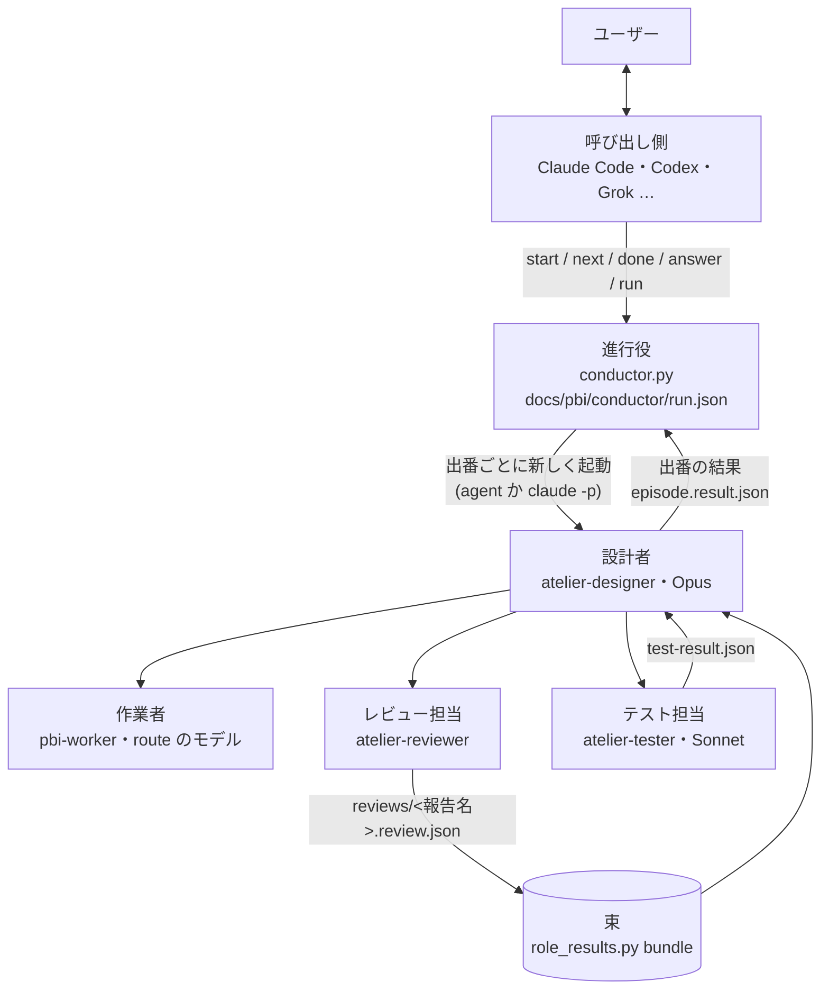

# atelier v6: 設計者を Atelier の中へ (呼び出し側・進行役・出番)

2026-11-10 にユーザーの依頼から起こし、Atelier 自身の流れ (jev-routed) で設計した。v5 (設計の正本 `design-record.json` と返信の照合、PBI-012〜014) からの差分だけを書く。用語は `skills/atelier/CONTEXT.md` に従う。工程と部品の契約は [atelier-workflow.md](atelier-workflow.md) にある。

## Problem Statement

- 長い run では、設計者 (今は Claude Code のメインのセッション) の文脈が引き継ぎの線を越えるたびに、ユーザーが `/clear` と `/atelier resume` を手で打っている。止まる場所の 4 番目 (波の境目の引き継ぎ) は、ユーザーの判断が要らないのに止まっている。
- 設計者が、ユーザーとの対話・設計・作業者の起動・PBI ごとの検証・差分の精読・テストの仕分け・最終レビューの照合まで、1 つの会話で全部を持っている。どの仕事の出力も同じ文脈に積もる。
- 設計者は Claude Code のメインのセッションでしか動かない。Codex や Grok などから Atelier を使う道が無い。
- v5 で設計を JSON (正本) で受け渡せるようになったが、レビューとテストの結果は Markdown と会話の中の数行のまま。役割を分けても、受け取った側が照合できる形になっていない。

## Solution

役割を 6 つに分け、設計者を Atelier が持つ。

- **呼び出し側** (Claude Code・Codex・Grok など) は、ユーザーと話すだけ。`conductor.py` を呼び、返ってきた数行と問いをユーザーに渡し、答えを `conductor.py answer` で返す。PBI・差分・レビューは読まない。
- **進行役** (`conductor.py`、LLM ではないスクリプト) が run の状態を `docs/pbi/conductor/run.json` に持ち、次の出番と、その依頼文を決める。
- **設計者** (`agents/atelier-designer.md`、Opus) は出番ごとに新しく起動される。今の付録の「orchestrator」は、この設計者を指す。責務は次の 3 つと、その間で作業者を動かすことだけ。
  1. 初回の設計: understand から route まで進め、承認の下書きを出す
  2. レビュー担当の結果を受け取って照合する: 波のレビューがそろったら束を読み、PBI ごとに pass・差し戻し・段上げ・保留を決めて記録する
  3. テスト担当の結果を受け取って照合する: 失敗を「意図した変更」と「壊した動き」に分け、差し戻しかテストの工程に回す
- **作業者** は今のまま (`pbi-worker`・`worker.md`)。設計者のサブエージェントとして動く。
- **レビュー担当** (`agents/atelier-reviewer.md`) は 1 報告に 1 つ。`verify.py` を流し、受け入れ条件を 1 つずつ判定し、差分を読み、触ってはいけないファイルを `unchanged.py` で確かめ、`docs/pbi/reviews/<報告名>.review.json` を書く。作ったモデルでは動かない (今の決まりのまま)。
- **テスト担当** (`agents/atelier-tester.md`、Sonnet) は、波の終わりのあとに回したコマンド、テストの工程の下調べ、最後の通しを受け持ち、`docs/pbi/verify/tests/<名前>.test-result.json` を書く。テストのスキルが決まっていればそれを呼ぶ。
- **文脈を冷ますのは Atelier の中で済ます。** 設計者は出番ごとに新しく起動されるので、前の出番の会話を持たない。出番の途中で線を越えたら状態の板を書いて `handoff` で終わり、進行役がすぐに新しい設計者を `Continue from:` で起こす。ユーザーの `/clear` と resume は要らない。呼び出し側の文脈には、出番ごとに数行しか積もらない。

流れ (出番):

design → build (波 1) → build (波 2) … → test → review → finish

- design: understand → 設計するかの判断 → map → lint-survey → design → plan → route → 承認の下書き → `question` (approve) で終わる。承認のあと、同じ出番が答えを読んで `done` (次は build 波 1) を返す。
- build (波 n): その波の作業者を起動 → 報告ごとにレビュー担当 → 全部の review.json がそろったら束 → 照合して記録 → 差し戻しがあれば同じ出番の中で次の試行 → 波が片づいたらテスト担当 (あとに回したコマンド) → 照合 → `done` (次の波か test)。
- test: テスト担当の下調べ → 照合 → テストの PBI を作業者とレビュー担当で回す → テスト担当の最後の通し → 照合 → lint-recheck → `done` (review)。
- review: 最終レビュー (レビュー担当が code-review などのスキルを呼ぶ) → 照合 → 差し戻しがあれば `done` (build、その PBI の波) か、無ければ `done` (finish)。
- finish: 今の付録どおり。完了報告のパスを返して run を閉じる。

## User Stories

1. ユーザーとして、文脈が膨らむたびに `/clear` と resume を打ちたくない。Atelier の中で冷ましてほしい。
2. ユーザーとして、ユーザーの判断が要らない場所で止まってほしくない (波の境目の引き継ぎ)。
3. ユーザーとして、呼び出し側のセッションとは話すだけにしたい。開発の文脈を呼び出し側に積もらせたくない。
4. ユーザーとして、Claude Code だけでなく Codex や Grok からも Atelier を動かしたい。
5. ユーザーとして、設計者を Atelier の部品として持ちたい。呼び出し側の会話の調子で設計がぶれないように。
6. ユーザーとして、設計者には設計と照合に専念してほしい。検証・差分の精読・テストの実行は、別の担当に任せたい。
7. ユーザーとして、レビューの結果を JSON で受け取りたい。設計者が数を数え、根拠を照らし合わせられるように。
8. ユーザーとして、波のレビューがすべてそろってから、まとめて設計者に渡してほしい。1 件ずつ設計者を起こさないように。
9. ユーザーとして、テストの実行は Sonnet 級の担当に任せたい。スキルを呼んで流すだけなので。
10. ユーザーとして、テストの失敗を「意図した変更」と「壊した動き」に分けた結果を、設計者に照合してほしい。
11. ユーザーとして、設計者が途中で止まっても、run の状態がディスクに残っていてほしい。呼び出し側を開き直しても `status` と `next` で続けられるように。
12. ユーザーとして、止まる場所は今の決まり (承認・差し戻しの上限・壊す操作の前・外への送信の前) だけにしてほしい。
13. ユーザーとして、承認の返信は v5 の照合 (`design_record.py check-reply`) をそのまま通してほしい。
14. ユーザーとして、Agent ツールの入れ子が使えない環境では、`claude -p` で設計者を動かしてほしい。それも無ければ今の流れ (v5) で動いてほしい。
15. ユーザーとして、設計者・レビュー担当・テスト担当のモデルを home の設定で変えたい。
16. ユーザーとして、設計者が自分の文脈の大きさを測れてほしい。Kiln の線が設計者自身に効くように。

## Implementation Decisions

### 層 (map より)

変更は 3 つの層に分かれる。指示文 (SKILL.md・designer.md・appendix・prompts・agents) が上で、スクリプト (conductor.py・role_results.py・agent_stats.py) を名前で指す。スクリプトどうしは `common` だけを使い、`conductor.py` が `role_results` を import する。スクリプトから指示文への依存は、`conductor.py` が `prompts/designer-episode.md` を読むことだけ。

### 進行役 (`conductor.py`)

- 置き場所は `docs/pbi/conductor/`。`run.json` (schema `atelier.run/1`)、`goal.md`、`episodes/<seq>-<出番>.prompt.md`・`.result.json`、`answers/<seq>-<種類>.md`。
- コマンド。1 行目はいつも `state: <ready|running|question|finished|failed>`、全部で 8 行以内を出す。
  - `start --goal TEXT|--goal-file F [--workflow N] [--launch agent|headless]`: run.json を作る。終わっていない run があれば断る (終了コード 2)。
  - `next`: 次の出番の依頼文を書き、起動のしかた (subagent_type・model・依頼文と結果のパス・description `ATELIER.<seq> <出番>`) を出す。状態を running にする。問いが残っていれば問いを出して 10。
  - `done`: running の出番の結果を読み、`role_results.check_episode` とつながり (下の表) を確かめて状態を進める。
  - `answer --reply F|--text T`: 残っている問いに答える。承認 (`check: design-record`) は `design_record.py check-reply` に渡し、その終了コード (0・3・4・5) で受けるかを決める。受けたら同じ出番を `Answer:` 付きで起こせる状態にする。
  - `run [--max-episodes N]`: headless。`next` → `claude -p` → `done` を、問い・終わり・失敗まで繰り返す。
  - `status`: 今の出番・波・問い・出番の数・費用の合計。
- 終了コード: 0 進める・終わった / 10 ユーザーの答え待ち / 12 起動か結果の失敗 / 2 引数と状態の誤り。
- 出番のつながり (`done` の next):

  | 出番 | 次に許すもの |
  |---|---|
  | design | build |
  | build | build・test・review・finish |
  | test | build・review |
  | review | build・finish |
  | finish | なし (run を閉じる) |

- `handoff`: `state` の状態の板が在ることを確かめ、同じ出番を `Continue from:` 付きで起こせる状態にする。続けて 3 回、進みなし (同じ出番・同じ波) で handoff したら、種類 `handoff-loop` の問いにしてユーザーに渡す。
- 結果が無い・壊れている: 失敗として数え、`next` で同じ出番をやり直す。2 回続いたら種類 `launch-failure` の問いにする。
- 依頼文は `prompts/designer-episode.md` の text ブロックを埋めて作る (`{name}` を埋め、`{?name}` で始まる行は値があるときだけ残す)。
- 役割のモデルは home の `agents.json` の `roles` (無ければ既定): `designer` (opus、permission_mode `auto`)、`reviewer` (opus、作ったのが opus なら sonnet high)、`tester` (sonnet)。値が不正なら既定にし、`warn` 行を出す。
- headless の起動: `claude -p --output-format json --agent atelier-designer --model <m> [--effort <e>] --permission-mode <mode> --permission-prompts none --session-id <uuid>`。依頼文は標準入力。`claude_run.py` と同じく API キーと接続先の環境変数を外す。出力は `episodes/<seq>-<出番>.json`・`.err`、session_id と `total_cost_usd` を run.json の履歴に残す。テストのため、起動のコマンドは環境変数 `ATELIER_DESIGNER_CMD` (JSON の配列) で差し替えられる。
- 排他: `docs/pbi/conductor/lock` に pid を書く。生きている pid のロックがあれば断る。

### 起動のしかた (launch)

- `agent` (既定。呼び出し側が Claude Code): 呼び出し側が Agent ツールで `atelier-designer` を起動する。Claude Code のサブエージェントは既定で 3 層まで入れ子にできる (https://code.claude.com/docs/en/sub-agents.md)。深さ: 呼び出し側 0 → 設計者 1 → 作業者・レビュー担当・テスト担当 2 → レビュー担当が呼ぶスキルの子 3。`CLAUDE_CODE_MAX_SUBAGENT_SPAWN_DEPTH` が 3 より小さいと足りない。設計者は Agent ツールが無いと分かったら `error` (reason `no-agent-tool`) で終わり、進行役は `--launch headless` への切り替えを `next` の出力で案内する。
- `headless` (Codex・Grok などの呼び出し側、または裏で回したいとき): `conductor.py run` が `claude -p` で設計者を起動する。設計者はそのセッションのメインなので、深さは 1 つ浅い。
- `inline` (後ろ盾): Agent の入れ子も `claude` も無いとき。呼び出し側が `designer.md` に自分で従う。今の v5 の流れで、`appendix/handoff.md` の `/clear` と resume も今のまま。

### 設計者 (`designer.md` と `agents/atelier-designer.md`)

- 今の SKILL.md の本文 (止まる場所・不変の決まり・Read on event・Start・工程・Approve・PBI 1 件・文脈を小さく・作業のメモリ) を `designer.md` に移し、出番の節を足す。付録が指す `SKILL.md` の `## Approve` などは `designer.md` を指すように直す。
- 止まる場所は「ユーザーに聞く」のではなく、`question` の結果を書いて出番を終えること。種類は `approve`・`rework-limit`・`destructive`・`send-approval`・`decision` (設計するかなど、AskUserQuestion で聞いていたもの)。波の境目の引き継ぎは止まる場所ではなくなる。
- 検証 (`appendix/verify.md` の `## Check`) はレビュー担当に移す。設計者は束の表を読み、照合が要る報告 (pass 以外・verify の失敗・触ってはいけないファイルの変化・critical か major の指摘) だけ review.json を開く。verify の合否はレビュー担当の言葉ではなく、`verify.py` が書いた `docs/pbi/verify/<報告名>.json` の終了コードで決める (不変の決まりのまま)。
- `record_run.py` での記録・差し戻し文・段上げは今のまま設計者が行う。
- Kiln: 設計者は境目ごとに自分を測る (下の `agent_stats.py`)。`suggest`・`compact`・`handoff` はどれも、状態の板を書いて `handoff` で終わる (headless でも Agent でも `/compact` は使わない)。
- 出番の最後の動作は、結果のファイル (schema `atelier.episode/1`) を書くこと。返事は summary の行だけ。

### レビュー担当・テスト担当と JSON (`role_results.py`)

- `atelier.review/1` (1 報告): `report`・`pbi`・`reviewer.model`・`built_on`・`verify.failed` (番号)・`criteria` (番号ごとに `pass|fail|deferred` と根拠)・`findings` (`critical|major|minor`・file・line・why・repro)・`unchanged_ok`・`recommendation` (`pass|rework|tier-up|hold`)。
- `atelier.review-bundle/1`: `role_results.py bundle --reports ... --out docs/pbi/reviews/wave-<n>.bundle.json` が全部の review.json を確かめて 1 報告 1 行にまとめ、表を出す。欠け・誤りがあれば終了コード 3 で、設計者はその報告のレビューだけやり直す。
- `atelier.test-result/1`: `kind` (`wave|survey|final`)・`commands` (コマンドと終了コード)・`failing` (test・file・pbi・`cause` `intended|regression|unknown`・why)・survey のときは判定ごとの数・`recommendation` (`pass|rework|needs-designer`)。テスト担当の `cause` は案で、決めるのは設計者。
- `atelier.episode/1`: `episode`・`seq`・`status` (`done|question|handoff|error`)・`summary` (5 行・各 200 文字まで)・`next` (`{episode, wave}`)・`question` (`kind`・`path`・`summary`・`check`)・`state`・`report`・`reason`。
- `role_results.py check <files>` が 3 つの schema を確かめる。
- `tests-at-end.json` に任意の `skill` を足す: テスト担当が呼ぶテストのスキルの名前。無ければ `verify.py --deferred` で流す。

### `agent_stats.py --ctx`

- `--ctx` を `--session <id>` と一緒に使えるようにする (headless の設計者は自分の session_id を依頼文で受け取る)。
- `--ctx --agent <description の先頭>` を足す: 今のディレクトリのプロジェクトの下のサブエージェントの会話記録 (入れ子も含めて `subagents/` を再帰で探す) から、description がそれで始まる最新のものの文脈の大きさを出す。設計者の description は `ATELIER.<seq> <出番>`。

### 呼び出し側 (`SKILL.md`)

- 本文は呼び出し側の手順だけにする (120 行・5,000 トークン以内のまま): 目的を 2〜3 行で言い直す → `start` → `next` → 設計者を起動 → `done` → 出力の行をユーザーに渡す → 問いなら見せて答えを `answer` → 繰り返す。`setup`・`models`・`templates` の引数は今のまま呼び出し側が `appendix/setup.md` に従う。
- 引数 `resume` は `conductor.py status` と `next` になる (状態はディスクにある)。v5 の HANDOFF.md だけがある run は inline で続ける。
- Codex などから使うときの短い案内を README に載せる (AGENTS.md に書く 1 段落)。

## Testing Decisions

- tests-at-end が有効: 作業者はテストを書かず、テストの工程で足す。`python -m unittest discover -p 'test_*.py'` (skills/atelier) を波ごとに回す。
- 足すテスト: `test_role_results.py` (3 つの schema の正しい例と、欠けた項目ごとの誤り、束の欠け・誤り・表の 1 報告 1 行)、`test_conductor.py` (偽の設計者を `ATELIER_DESIGNER_CMD` で差し込み、start → design の question → answer (check-reply の 0・3) → build → handoff → 同じ出番の再起動 → handoff-loop → finish の流れ、つながりの表にない next の拒否、ロック、依頼文の `{?name}` 行)、`test_agent_stats.py` に `--ctx --agent` と `--ctx --session`。
- `test_references.py` は新しい指示文 (designer.md・appendix/episodes.md・agents/atelier-*.md・prompts/tester.md・prompts/designer-episode.md) の参照も確かめる。SKILL.md の大きさの上限はそのまま。

## Out of Scope

- 設計者を Claude 以外 (Codex など) で動かすこと。進行役の `roles.designer.runner` は claude だけを受ける。
- 作業者の実行先 (runners.md) と振り分け (prepare.py・select_model.py) の変更。
- jev-mcp に進行役の道具を足すこと (呼び出し側が MCP で進行役を使う道)。
- lint の下調べで見つけた、範囲の外の弱い所 (record_run.py の main 127 行、例外の握りつぶし、`claude_run.py`・`verify.py` の起動失敗の扱い、追記の排他)。

## Further Notes

- 入れ子のサブエージェントの会話記録の置き場所 (どのディレクトリに入るか) は、実装のときに実物で確かめる。`record_run.py` が作業者の記録を description で見つけられることを、最初の波で確かめる。
- `claude -p --agent` で、カスタムエージェントの定義がメインのスレッドに効くこと、`--permission-mode auto` が使えることは公式の文書 (https://code.claude.com/docs/en/cli-reference.md) による。使えない環境では `roles.designer.permission_mode` で変える。
