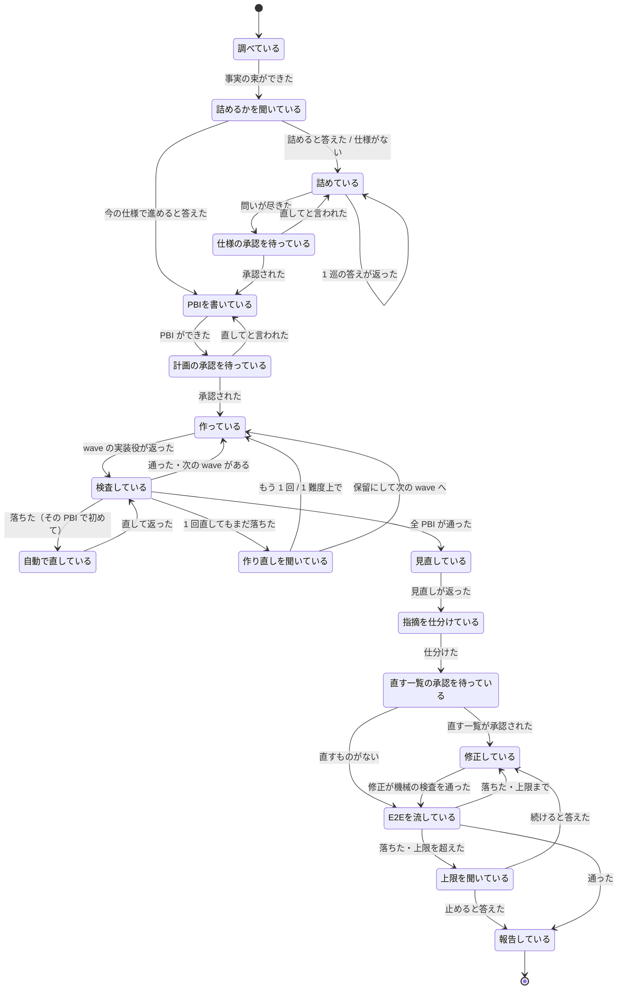

# Atelier v8：作り直しの仕様

置き場所：このファイル（docs/specs/atelier-v8.md）。
用語は `skills/atelier/GLOSSARY.md` に従う。

## Problem Statement

Atelier は、複数のファイルにまたがる実装を PBI に分け、モデルに振り分けて作らせ、確かめて見直すスキルである。v1 から v7.15 まで、3 週間で 44 版を重ねた。そのたびに事件の後追いで規則を足してきたため、次のことが起きている。

- 作る役のモデルの理由が、承認ページに出ない。記録には理由があったが、ユーザーには見えなかった（PBI-3 は「novelty=2 かつ ambiguity=2」で Opus になったが、ページには出ていない）。
- 見直しで差し戻されると、作り直しがユーザーに聞かれずに回る。PBI-3 は Opus で 3 回作られた。
- 設計役が出番ごとに新しく起動され、毎回 33〜65KB の指示文を読み直す。run 8af2ae7f では 12 回・計 633KB になった。見直し役も PBI ごとに一から読む。
- 承認したあとで作り直しのために取り決めを書き直すと、関係のない PBI まで古さの検査で止まる。
- 文書の決まり（見直しは Sonnet が基本）と、手元の設定（見直し役が Opus）が食い違っても、気づけない。
- run 全体のトークンの合計が記録に残らない。11 の出番すべてで、モデル・費用・トークンが空だった。
- 段が haiku / sonnet / opus という Claude のモデル名で固定され、Gemini や DeepSeek に振るときに選んだ基準が見えない。テンプレートで変えられない決まりが、コードのあちこちにある。
- 指示文に約 220 件の注意書きが溜まり、同じ規則が 3〜5 か所に書かれている。そのうち本当の危険を防ぐものは約 60 件しかない。
- 本体のスクリプトは約 25,600 行、テストも約 25,800 行あり、1 つ直すたびに指示文と検査の両方が増える。

## Solution

v8 として最初から作り直す。v7.15 は参考として読むだけにする。

- **工程**：調べる → （仕様がそろっていなければ）詰める → 決める → 承認 → wave ごとの実装と機械の検査 → 最後の見直し → 修正 → E2E → 報告。
- **層は 2 つ**：進行役（スクリプト）が次の 1 手を返し、呼び出し側がモデルの役を深さ 1 で起動する。進行役が持つのは、次の作業・回数の上限・予算・関門・記録だけ。
- **モデルの役**：調べる役（安いモデル＋OMM の差分キャッシュ）、詰める役（grill で仕様を書く）、決める役（PBI を書く・指摘を仕分ける）、実装役、見直し役。決める役は決まった 3 か所でしか呼ばない。
- **判断の置き場所**：繰り返しの中の判断はモデルに戻さない。規則で決まらないことは、ユーザーに聞く。
- **見直し**：モデルによる見直しは、最後の 1 回だけ。wave ごとには機械の検査だけを回す。
- **振り分け**：PBI に難度（L1〜L5、モデル名に依らない）を付け、テンプレートの表で経路を選ぶ。承認ページに、難度・理由・規則・モデルを出す。
- **テンプレート**：1 種類にまとめ、ユーザーが自分で変えられるようにする。sensitive の扱いはテンプレートに持たせず、ユーザーが決めて run から外す。
- **守りの規則**：注意書きは、14 の守りの規則（G1〜G14）だけにする。できるものは機械で止める。
- **記録**：起動・検査・直しのたびに、トークン・規則・読み物の内訳を記録する。規則が成果物の質にどれだけ効くかを見られるようにする。

## User Stories

### 入口と仕様

1. As a ユーザー, I want 仕様がまだ固まっていないときに Atelier が grill で問いを出してくれること, so that 浅い理解のまま PBI が書かれて、意図と違うものができるのを防げる
2. As a ユーザー, I want design-flow で作った仕様をそのまま渡して、詰める工程を飛ばせること, so that 同じ問いに 2 度答えずに済む
3. As a ユーザー, I want 詰めるのを飛ばすかを自分で 1 問で選べること, so that 仕様が十分かをモデルに勝手に決められない
4. As a Codex など Claude Code 以外のエージェントから Atelier を呼ぶユーザー, I want Atelier の中で grill が回ること, so that design-flow が呼ばれない環境でも設計を詰められる
5. As a ユーザー, I want grill の問いが番号つきでおすすめの答えと一緒に出ること, so that 「はい」だけで進められ、違う所だけ直せる
6. As a ユーザー, I want 詰める役が問いに自分で答えないこと, so that 自分の意図でない答えが仕様に入らない
7. As a ユーザー, I want grill の巡を重ねても読み込みが膨れないこと, so that 長い grill でもトークンが抑えられる
8. As a ユーザー, I want 仕様を今と同じ HTML のページで見て承認できること, so that 慣れた形で中身を確かめられる
9. As a ユーザー, I want 承認した仕様だけが PBI 作りに使われること, so that 承認していない内容で実装が始まらない
10. As a ユーザー, I want 仕様が to-spec と同じ章立てであること, so that design-flow の仕様と同じように読める

### 調べる

11. As a ユーザー, I want 事前にリポジトリの事実（モジュール、層、触りそうなファイル、既存のテスト、規約）を安いモデルと OMM のキャッシュで集めてもらうこと, so that 強いモデルが一から読む量を減らせる
12. As a ユーザー, I want 事実の 1 つ 1 つに出典（file:line か OMM の要素）が付くこと, so that 安いモデルの要約が抜けていても確かめられる
13. As a ユーザー, I want OMM のキャッシュが外れたときに、近いコミットのキャッシュから差分で更新されること, so that 毎回全体を走査しなくて済む

### 決める・承認

14. As a ユーザー, I want 決める役には仕様と事実の束だけが渡ること, so that grill のやりとりや指示文の全部を読ませずに済む
15. As a ユーザー, I want 各 PBI に難度（L1〜L5）とその理由が付くこと, so that なぜそのモデルなのかが分かる
16. As a ユーザー, I want 承認ページで、PBI ごとに難度・理由・当たった規則・経路が見えること, so that 「なぜ Sonnet でなく Opus か」を自分で確かめられる
17. As a ユーザー, I want 承認ページで難度を変えられること, so that 見立てが違うときに直せる
18. As a ユーザー, I want この run で使う役・モデル・テンプレートが承認ページに出ること, so that 文書と設定の食い違いにその場で気づける
19. As a ユーザー, I want sensitive の候補とその理由が出ること, so that 本当に慎重に扱うべきかを自分で判断できる
20. As a ユーザー, I want sensitive と決めた部分が run から外れ、引き継ぎメモと別セッションの提案が出ること, so that 文脈の多い一連の実装に慎重な部分が混ざらない
21. As a ユーザー, I want sensitive の部分に依存する PBI は保留にされ、前提なしで進めてよいと自分が言ったものだけが進むこと, so that 前提が崩れたまま作られない
22. As a ユーザー, I want 外部のモデルに送る PBI の一覧が承認ページに出ること, so that 外に出してよいかを承認できる
23. As a ユーザー, I want 上限（作り直しの回数、E2E の回数、予算）と見積もりが承認ページに出ること, so that 始める前に費用の見当がつく
24. As a ユーザー, I want 仕様の分からない点が「決めること」に載ること, so that 決める役が勝手に埋めない
25. As a ユーザー, I want 承認で「直して」と言えば、決める役が PBI を書き直すこと, so that 計画を直してから始められる

### 作る・確かめる

26. As a ユーザー, I want 依存の済んだ PBI が wave として並んで作られること, so that 時間が短くなる
27. As a ユーザー, I want wave ごとの確かめは機械の検査（テスト、lint、型検査、変えてはいけないファイル）だけであること, so that 見直しのトークンがかからない
28. As a ユーザー, I want 合否が終了コードだけで決まること, so that モデルの言い分で通らない
29. As a ユーザー, I want 検査で落ちたら、失敗の出力と差分だけを渡して同じ実装役に 1 回だけ自動で直させること, so that 小さな失敗で止まらない
30. As a ユーザー, I want 1 回直してもまだ落ちたら、同じ経路でもう 1 回・1 難度上の経路で・保留から自分で選べること, so that 聞かずに何度も作り直されない
31. As a ユーザー, I want 合格した PBI がやり直されないこと, so that 費用を二重に払わない
32. As a ユーザー, I want 計画が崩れたら、決める役が呼び直されずに自分に聞かれること, so that 同じ判断が繰り返されて膨れない
33. As a ユーザー, I want 予算を超えそうなときに起動の前に聞かれること, so that 知らないうちに使いすぎない

### 見直し・修正・E2E

34. As a ユーザー, I want モデルによる見直しが全 PBI がそろったあとの 1 回だけであること, so that 見直しのたびに一から読み直さない
35. As a ユーザー, I want 見直しの指摘に重さと確かさが付き、確かさの低いものと軽い書き方の指摘が捨てられること, so that どうでもいい指摘で直しの一覧が膨れない
36. As a ユーザー, I want 残った指摘を決める役が「直す・見送る・聞く」に仕分けること, so that 判断の材料が整った形で見られる
37. As a ユーザー, I want 直す一覧を承認してから直されること, so that 直すかどうかを自分で決められる
38. As a ユーザー, I want 直しの一覧が、ファイルの重ならないまとまりで実装役に渡されること, so that 一度の wave で直せる
39. As a ユーザー, I want 修正の差分には機械の検査と E2E だけが流れること, so that 見直しのループに戻らない
40. As a ユーザー, I want E2E はモデルを使わないスクリプトで流れること, so that E2E にトークンがかからない
41. As a ユーザー, I want E2E が落ちたら修正に戻り、上限（既定 2 回）を超えたら聞かれること, so that 終わらないループにならない

### モデルとテンプレート

42. As a ユーザー, I want テンプレートが 1 種類で、中身が難度ごとの経路・役ごとのモデル・上限・部品のオン/オフ・読ませる規則であること, so that どこを見れば何が決まるかが分かる
43. As a ユーザー, I want 難度の名前がモデル名に依らないこと, so that モデルが入れ替わっても難度の意味がずれない
44. As a ユーザー, I want 隣り合う難度が同じモデルで effort だけ違う設定ができること, so that 使えるモデルが少なくても 5 つの難度を使える
45. As a ユーザー, I want 期限つきで別のテンプレートに切り替えられること, so that 無料枠の期間だけ外部モデルを使うといった運用ができる
46. As a ユーザー, I want 切り替えで、実装の経路だけでなく役のモデルも上限も変わること, so that 「この期間は見直しも Gemini で」ができる
47. As a ユーザー, I want 役ごとのモデルが設定の 1 か所にだけ書かれていること, so that 文書と設定が食い違わない
48. As a ユーザー, I want 経路の実行先がすべて使えないときに聞かれること, so that 勝手に別のモデルへ落ちない
49. As a ユーザー, I want 経路の最後を Claude にするかを自分で決められること, so that 外部モデルだけの経路も作れる
50. As a ユーザー, I want 難度とモデルの組ごとに初回の合格率が報告に出ること, so that テンプレートの表を直す根拠になる
51. As a ユーザー, I want テンプレートの表は自分で直し、自動では書き換わらないこと, so that 知らないうちに振り分けが変わらない
52. As a ユーザー, I want 詰める役と決める役を別のモデルにできること, so that 役ごとに向いたモデルを選べる

### 守りの規則

53. As a ユーザー, I want 実装役が作業ルートの外に書けないこと, so that ほかのリポジトリや設定が壊れない
54. As a ユーザー, I want 実装役・見直し役が commit・push・reset・stash・clean・PR への投稿をできないこと, so that 履歴と作業ツリーが守られる
55. As a ユーザー, I want 承認していない外部への送信が起動されないこと, so that コードが勝手に外に出ない
56. As a ユーザー, I want 依頼文と記録が秘密を含まないかを、送る前に走査されること, so that 鍵や `.env` の中身が漏れない
57. As a ユーザー, I want インストールとグローバルな設定変更は、自分が承認してからであること, so that 環境が勝手に変わらない
58. As a ユーザー, I want 答えのファイルが自分の答えからしか書かれないこと, so that モデルが答えを作れない
59. As a ユーザー, I want 未完了の run が、自分が言わない限り潰されないこと, so that 途中の作業を失わない
60. As a ユーザー, I want 文字化けした承認ページが出されないこと, so that 読めないものを承認しない
61. As a ユーザー, I want ファイルの削除やマイグレーションを含む差分が検査で止まり、聞かれること, so that データを失う変更に気づける
62. As a ユーザー, I want 守りの規則が 1 枚にまとまり、規則ごとに止め方と検査のテストの場所が書かれていること, so that 規則がどう守られているかを確かめられる

### 記録と計測

63. As a ユーザー, I want 起動ごとに、役・モデル・入力と出力のトークン・費用が記録されること, so that run の合計が分かる
64. As a ユーザー, I want 報告に、PBI 別・役別・モデル別の合計が出ること, so that どこにトークンを使ったかが分かる
65. As a ユーザー, I want 外部 CLI で数が取れないものは「不明」と書かれること, so that 0 と取り違えない
66. As a ユーザー, I want 起動ごとに、読ませたものの内訳（指示文の節・規則・事実の束の ID ごとのトークン）が記録されること, so that 文脈が何に食われているかが見える
67. As a ユーザー, I want 規則ごとに、発火した回数・直した回数・読ませたのに違反した回数が記録されること, so that 規則が質にどれだけ効いているかを見られる
68. As a ユーザー, I want テンプレートで規則や節を読ませる・読ませないに切り替えられること, so that 読ませたときと読ませないときの結果を比べられる
69. As a ユーザー, I want 比べた結果が件数だけで出て、「効いた」とは書かれないこと, so that run が少ないうちに誤った結論を出さない
70. As a ユーザー, I want 記録が 1 起動 1 行の JSON であること, so that あとで改善の実験の仕組みにつなげられる

### 再開と運用

71. As a ユーザー, I want セッションが落ちても、run の状態から続きを始められること, so that 最初からやり直さずに済む
72. As a ユーザー, I want 小さな作業では Atelier を使わないと入口で言われること, so that 重い仕組みを小さな直しに使わない
73. As a ユーザー, I want 質問が出たときに、要点がチャットにも書かれ、ページのファイルも送られること, so that ページを開けないときでも答えられる
74. As a 開発者, I want 外部 CLI の癖が、注意書きではなくその CLI を起動する仕組みとテストに入っていること, so that 指示文が膨れない

## Implementation Decisions

### 全体の形

- v8 は reeschan/atelier に新しく作る。v7.15 のコードは参考として読むだけにし、v7 の途中の run は引き継がない（移行の仕組みは作らない）。
- 層は 2 つ。進行役（モデルを使わないスクリプト）と、呼び出し側（ユーザーのセッション）。モデルの役はすべて、呼び出し側が進行役の指示どおりに深さ 1 で起動する。外部 CLI の役は、進行役のスクリプトが起動する。
- 進行役のコマンドは「次の 1 手」「終わった」「答え」の 3 つ。次の 1 手は、起動する役と依頼文の場所、ユーザーへの質問、終わり、のどれかを返す。
- 役は 5 つ。調べる役・詰める役・決める役・実装役・見直し役。修正役は置かず、実装役が直しの一覧のまとまりを受け取って作る。テスト役も置かず、テストは機械の検査として進行役が流す。
- 受け渡しはすべて、決まった場所のファイルで行う。役の返事は短い要約だけにする。

### 工程と遷移

- 工程は 10 個で固定する。調べる → 詰める（飛ばせる）→ 決める → 承認 → 作る（wave ごと）→ 機械の検査 → 最後の見直し → 修正 → E2E → 報告。部品のオン/オフで変わるのは、工程の中の部品だけ。
- 入口では、渡された仕様に必要な節（目的・範囲・受け入れ条件・範囲外）がそろっているかを機械で見る。そのうえで、詰めるかどうかをユーザーに 1 問で聞く。
- 詰める工程は巡ごとに詰める役を新しく起動し、手順・事実の束・設計の木のファイルだけを、毎回同じ順で読ませる。設計の木には、決まったこと 1 項目 1 行と、まだ決まっていない問いの一覧だけを置く。
- 決める役を呼ぶのは、次の 3 か所だけ。PBI を書くとき、承認で直すとき、最後の見直しの指摘を仕分けるとき。途中で計画が崩れたら、決める役を呼ばずにユーザーに聞く。
- 承認したあとの取り決めの変更は、設計の記録に追記する。古さの検査は、変わった PBI に依存する PBI だけを対象にする。
- 機械の検査で落ちたら、失敗の出力と差分だけを渡し、同じ実装役で 1 回だけ自動で直す。まだ落ちたら、ユーザーに 3 択（同じ経路でもう 1 回／1 難度上の経路で／保留）を聞く。
- 最後の見直しは 1 回だけ。見直し役は指摘ごとに重さと確かさを付ける。進行役は、確かさ 80 未満と軽い書き方の指摘を仕分けに渡さない。残りは決める役が「直す・見送る・聞く」に仕分け、直す一覧はユーザーの承認後に修正へ渡す。仕分けに渡さなかった指摘と「見送る」にした指摘も、直す一覧の承認で見せる。ユーザーが直すと決めた指摘は、確かさや仕分けに関係なく直す一覧に入れる。指摘がすべて仕分けに渡らなかったときも、直す一覧の承認は飛ばさない。
- 修正の差分には、機械の検査と E2E だけを流す。E2E で落ちたら修正に戻す。回数の上限はテンプレートにあり（既定 2）、超えたらユーザーに聞く。ユーザーが「続ける」と答えたら修正を 1 回だけ回し、そのあとまた落ちたら、そのたびに聞く。
- E2E で落ちたテストを直すときは、直す一覧の承認を取らない（上限までは自動）。直す一覧の承認が要るのは、見直しの指摘を直すときだけ。
- E2E はモデルを使わないスクリプトで流す（v7 の e2e の仕組みを引き継ぐ）。

### 調べる

- 事実の束は 1 つの JSON にする。中身は、関係するモジュールと層、触りそうなファイル、既存のテスト、規約。項目ごとに出典（file:line、または OMM の要素）を付ける。
- 調べる役は、安いモデルと OMM のキャッシュを使う。キャッシュが外れたら、omm-pr-scan v1.2 の `--cache` で、一番近いコミットのキャッシュから差分で更新する（仕様は別セッションで合意済み）。
- 共有メモリは、決める役が ID を指定して読むだけにする。

### 振り分けとテンプレート

- 難度は L1〜L5。各難度に、言葉の定義と例を付ける。軸は「熟練者なら何分か」の見当（〜15 分／〜1 時間／〜4 時間／半日／それ以上）と、「仕様が曖昧で設計の判断が要るか」。定義は v8 に同梱し、テンプレートでは変えない。
- 難度は決める役が PBI ごとに理由つきで付ける。ユーザーは承認ページで変えられる。リスクの軸は、v8 の核には持たせない。
- テンプレートは 1 種類。中身は 5 つの節で、難度ごとの経路（実行先・モデル・effort の並び）、役ごとのモデル、上限（作り直し・E2E・予算）、部品のオン/オフ、読ませる規則と節。
- 隣り合う難度が、同じモデルで effort だけ違う経路を持ってよい。
- テンプレートの切り替えは、期限・期限切れの扱い・理由を付けて行い、テンプレート全体（役と上限を含む）が替わる。同時に有効なのは 1 つだけ。
- 経路の最後を Claude にする決まりは置かない。経路の実行先がすべて使えないときは、ユーザーに聞く。同梱の既定のテンプレートでは、最後を Claude にしておく。
- agents.json には、実行先の登録（使える CLI とモデル）だけを置く。役のモデルは書かない。
- 文書には、モデル名を方針として書かない。

### sensitive

- 決める役は、sensitive の候補とその理由を出すだけ。決めるのはユーザー。
- ユーザーが sensitive と決めた PBI は run から外す。進行役は引き継ぎメモを書き、別のセッションか別の設計を提案する。
- 外した PBI に依存する PBI は保留にする。ユーザーが前提なしで進めてよいと言ったものだけを進める。
- テンプレートには、sensitive の規則を持たせない。

### 承認ページ

- 今の承認ページの章立てと、answer-me-with-html の HTML を引き継ぐ。
- 載せるのは 6 つ。①役・モデル・テンプレート、②PBI の表（難度・理由・規則・経路）、③sensitive の候補、④外部へ送る PBI、⑤上限と見積もり、⑥決めること。
- 仕様の承認と直す一覧の承認にも、同じ形のページを使う。
- 質問を出したときは、要点をチャットにも書き、ページと関係するファイルを送る。

### 守りの規則

- 注意書きは、14 の守りの規則（G1〜G14）だけにする。v7 の B（v7 の仕組みのせいで要るもの）と C（重複・古いもの）は持ち込まない。
- 止め方は 4 つ。①起動の前（実行先のサンドボックスや deny 設定、フック）、②進行役が拒否、③終わったあとの検査、④指示文。
- 指示文に残すのは 2 つだけ。G12 の判断の部分（消してよいデータか）と、G13（拒否されたら形を変えて回り込まない）。
- 「守りの規則」の 1 枚に、規則ごとに段・止め方・機械での形・検査のテストの場所を書く。
- 外部 CLI の癖は、注意書きにせず、その CLI を起動する仕組みとテストに入れる。
- 呼ぶ側がユーザーの承認のもとで仕様や用語集などを直したときは、`approve-edit` でそのファイルと中身を登録する。登録した中身のままなら、役の起動中に変わっていても G1 で止めない。登録のあとに中身が変わったら、これまでどおり止める。登録しない変更は止める。

| # | 規則 | 止め方 |
|---|---|---|
| G1 | 作業ルートの外に書かない | ①＋③ |
| G2 | commit・push・reset・stash・clean・PR への投稿をしない | ①＋③ |
| G3 | 外部のモデルに送るのは承認したものだけ | ② |
| G4 | 秘密を渡さない・記録しない | ③ |
| G5 | インストールとグローバルな設定変更は承認後 | ①＋② |
| G6 | ユーザーの答えを作らない | ② |
| G7 | 未完了の run を潰さない | ② |
| G8 | 合格した PBI をやり直さない・二重に記録しない | ② |
| G9 | 合否は終了コード | ③ |
| G10 | 文字化けした承認を出さない | ② |
| G11 | 有料の生成などは頼まれたときだけ | ① |
| G12 | データの削除・リポジトリの外の変更の前に聞く | ③＋④ |
| G13 | 拒否を形を変えて回り込まない | ④＋① |
| G14 | 作業の途中で止まらない | ③ |

### 記録

- 記録は 1 起動・1 検査・1 直しにつき 1 行の JSON にする。
- 起動の行には、役・モデル・実行先・難度・入力と出力のトークン・費用・読ませたものの内訳（ID ごとのトークン）を書く。取れない値は「不明」とし、0 にしない。
- Claude の起動では、サブエージェントの分を含む値を使う。外部 CLI は、それぞれの出力から取る。
- 検査の行には、発火した規則・工程・モデル・難度・結果を書く。直しの行には、直した規則・自動か聞いたか、を書く。
- 指示文の節・守りの規則・事実の束には ID を付ける。
- 報告には、PBI 別・役別・モデル別のトークンの合計、規則ごとの合計（読ませたトークン・発火・直した回数・読ませたのに違反した回数）、難度とモデルの組ごとの初回の合格率を出す。
- 比べた結果は件数だけを出し、「効いた」とは書かない。
- hill-climb の実験の仕組み（v7 の events・task_profile など）は核に入れない。この記録の形のまま、あとでつなげられるようにする。

### 入口・再開・範囲

- light の道は持たない。入口で規模を見て小さければ、Atelier を使わずにその場で直すと言って終える。
- 再開は、run の状態のファイルから行う。進行役の「次の 1 手」は、何度呼んでも同じ状態から同じ答えを返す。
- v8 の核に入れないもの：Jev、lint の下調べと見直し、見た目づくり、marketing、security、Kiln、Studio と desk、headless の設計役、inline の後ろ盾、hill-climb の実験の仕組み。核ができてから、部品として足すかを 1 つずつ決める。

### 状態の図

予算を超えそうなときと、計画が崩れたときの質問は、どの状態からでも出る。答えが返ると、元の状態に戻るか、報告している（止める）へ進む。図を見やすくするため、この 2 つは図に描いていない。

**図の検査（2026-11-16）**：pstack の `/statechart` の from-chart で、TLC を使って検査した。検査用の図は、上の図に 6 つの数える領域を足したもの。計画の承認・仕様の承認・直す一覧の承認・自動で直した回数・見直しの回数・E2E で落ちた回数を、それぞれ 1 領域で数えている。

- 結果：155 の状態すべてで、6 つの `never` の規則が守られた（TypeOK を含めて 7 つの規則が通った）。図と検査のずれは 1 件で、「見直しを 2 回した」状態に届かないというもの。これは規則どおりの結果。
- 検査の途中で、図の決まりが 2 つはっきりした。
  1. E2E の上限を超えて「続ける」と答えたあとは、修正を 1 回だけ回し、また落ちたら、そのたびに聞く。
  2. E2E で落ちたテストを直すときは、直す一覧の承認を取らない。承認が要るのは、見直しの指摘を直すときだけ。
- 検査の図と道具の出力は、`docs/specs/atelier-v8-notes/statechart/` にある。`atelier-v8-check.mmd` が日本語の図、`v8.mmd` と `map.json` が ASCII の ID に置き換えて TLC に渡したもの、`run.txt` が結果。TLA+ は ASCII しか受けないため、状態と遷移を ID に置き換えて検査した。

## Testing Decisions

- よいテストは、外から見た振る舞いだけを確かめる。入れるものと、返る結果（次の 1 手、記録、起動の前後の差、ページの原稿）を比べ、関数の中身や内部の受け渡しは確かめない。
- **合意済みの seam**（3 つ）：
  1. **進行役のコマンド**：run の状態のフォルダと、偽の役の結果（実装役の報告・検査の終了コード・見直しの指摘など）を入れ、返る次の 1 手と run の記録を確かめる。工程の順番、関門と質問、回数の上限、予算、テンプレートによる経路の選択、守りの規則②、規則ごとの記録はここで確かめる。状態の図の遷移と `%% never` の規則は、すべてこの seam のテストにする。
  2. **実行先の起動**：偽の CLI（決まった出力を返すもの）と作業ルートの写しを入れ、起動の前後の差（作業ルートの外・HEAD・stash）とトークンの記録を確かめる。守りの規則①③と、外部 CLI の癖はここで確かめる。
  3. **ページの原稿**：run の状態を入れ、承認ページ・仕様の承認・直す一覧の承認の原稿を、期待した原稿と比べる。6 つの項目、理由の出し方、文字化けの拒否はここで確かめる。
- テストは、この 3 つの seam で先に書いてから実装する。
- 参考にする v7 のテスト：進行役のテスト（test_conductor）、ページの原稿のテスト（test_present）、検査のテスト（test_verify）、E2E のスクリプトのテスト。v7 の 3 層の受け渡しを 1 つずつ確かめるテストは、持ち込まない。
- モデルが何を書くか（問いの質、PBI の切り方）は、この 3 つでは確かめない。v8 で実際に run を回し、記録で見ていく。

## Out of Scope

- v7 の途中の run の引き継ぎと、v7 から v8 への移行の仕組み。
- Jev（ルーティングと関所）、lint の下調べと見直し、見た目づくり、marketing、security の工程、Kiln、Template Studio と desk、headless の設計役、inline の後ろ盾、交互グループ。核ができてから、部品として足すかを 1 つずつ決める。
- hill-climb の実験の仕組み（events・task_profile・splits・failures・changes・ingest・export_cases・leakcheck）。
- light の道。
- 難度やテンプレートの表を、結果から自動で書き換える仕組み。
- 「規則が効いた」と統計で判定すること。
- OMM の差分更新そのもの（omm-pr-scan v1.2 で済んでいる）。
- sensitive と決めた部分の実装（別のセッションで行う）。

## Further Notes

- 外部の事例の調べ（`docs/specs/atelier-v8-notes/external-survey.md`）：見直し・作り直し・人への質問まで状態機械で持つ例は、v7 の Atelier のほかに見つからなかった。Anthropic は「決まった手順はコード、柔らかい判断はエージェント」と分けることを勧めている。v8 はこれに沿い、状態機械に持たせるものを絞った。
- 難度の調べ（`docs/specs/atelier-v8-notes/difficulty-levels-survey.md`）：段にモデル名を使う例はなかった。5 段の難度を、2〜4 種類のモデルに当てる形にした。
- v7 で変えられなかった決まりの洗い出し（`docs/specs/atelier-v8-notes/v7-hardcoded-rules.md`）と、注意書きの棚卸し（`docs/specs/atelier-v8-notes/v7-caution-inventory.md`）は、作るときの参考にする。
- 本体のスクリプトは、約 25,600 行から 7,000〜8,000 行ほどになる見込み。役目と行数から見た目安で、関数の中身は読んでいない。
- 実装は、ユーザーの指示があってから reeschan/atelier の main から作業ブランチを切って進める。マージしたあとに skill-versioning で手元のスキルを v8 にする。手元の `versions/` を先に書き換えない。
- 実装が終わったら、review-flow にこの仕様の場所を渡すと、code-review の Spec 軸がこの仕様と照らし合わせられる。
