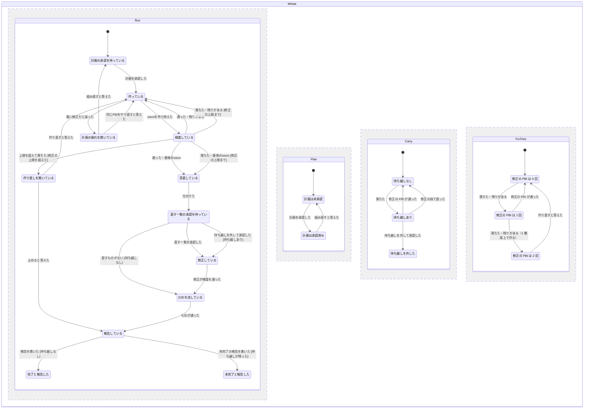

# 検査の失敗で止めない: 作業者の中で直し、直らなければ持ち越す

合意: 2026-11-19。持ち主が design-flow（grilling 4 巡）で決めた。すべて推しの答えのとおり。前提は Atelier v8（`docs/specs/atelier-v8.md`）と、保留の PBI に依る PBI を進める直し（PR #74）。この仕様は、テストの期待値の直し（PR #76 の最初の形）を置き換える。

## Problem Statement

Atelier の run で、検査の軽い失敗のたびにユーザーが止められている。

1. PBI が仕様どおりにある物の寸法を変えたところ、その物を確かめる既存の単体テストが古い寸法を期待していて落ちた。テストのファイルは PBI の `targets` の外だったので、作業者は触らずに `plan_broken` を返した。ユーザーは「計画を組み直す」を選ぶしかなく、計画役（既定は Opus）の起動と計画の承認をやり直した。テスト 1 ファイルの期待値のためだった。
2. 足すだけの PBI がリポジトリ全体の未使用コードの検査で落ち、CRLF で保存したファイルが書式の検査で落ちた。どちらも作り直しの問いで止まった（PR #74 で、保留にしても依る PBI を進められるようにした）。

どちらも、後の見直しと修正で直せば足りる程度の失敗だった。持ち主の言葉では「結局後で見直しがあるんだから、そこで直すみたいな感じで TODO 残しておけば事足りる」。

止まる原因は Atelier の作りにある。

- 作業者は検査を流して終了コードを書くだけで、落ちても直さずに返す。
- 落ちると、進行役は新しい作業者を起動して直させる（自動修正）。新しい作業者は、規約の文書・チケット・差分を読み直す。
- それでも落ちると、作り直しの問いでユーザーを止める。
- 作業者は `targets` の外を触れないので、外のファイルが要ると計画の崩れを返す。組み直すには、計画役の起動と計画の承認がもう一度要る。

## Solution

持ち主から見た変わり方は次のとおり。

- 作業者は、チケットの検査（lint・書式・型・単体テスト）を自分で流し、落ちたらその場で直して流し直す。直すのは 2 回まで。それでも通らなければ、落ちた検査を**持ち越し**として結果に書いて返す。
- 作業者は、`targets` の外でも既にあるファイルなら変えてよい。`do_not_touch` は変えない。ファイルを足す・消す変更は今までどおり止まる。変えたファイルは理由つきで報告に載る。
- 進行役が流す wave の検査は、最後の判定として残る。落ちても止めず、持ち越しとして記録する。
- 持ち越しが出たら、進行役が**修正の PBI** を作り、次の wave の頭に入れる。落ちた PBI に依る PBI は、修正の PBI が通るまで待つ。計画役は呼ばない。
- 最後の wave で落ちた持ち越しは、最後の見直しのあと、修正の段で見直しの指摘と一緒に直す。
- 修正の作業者が「計画の崩れ」（重い修正）を返したときだけ、計画の組み直しを聞く。
- 同じ持ち越しの修正の PBI が 2 回落ちたら（同じ難度で 1 回、1 難度上で 1 回）、そこで初めてユーザーに聞く。
- 持ち越しが残ったまま run が終わったら、報告は「未完了」になる。

```
今:   作る → 検査 → 落ちた → 自動修正（新しい起動） → まだ落ちた → 作り直しの問いで止まる
新:   作る（作業者が検査を流し、2 回まで直す） → 検査 → 落ちた → 持ち越し → 次の wave の頭に修正の PBI
                                                                  └ 最後の wave なら修正の段で直す
```

## User Stories

1. As a 持ち主, I want 作業者が自分の変更で落ちた lint をその場で直すこと, so that lint の失敗のたびに新しい作業者を起動しない
2. As a 持ち主, I want 作業者が型の検査と単体テストも同じくその場で直すこと, so that 文脈を持つ作業者がいちばん安く直す
3. As a 持ち主, I want 作業者が直すのは 2 回までで、直らなければ持ち越しとして返すこと, so that 作業者が直らない失敗にトークンを使い続けない
4. As a 持ち主, I want 作業者が持ち越しを返しても、計画役が呼ばれないこと, so that 軽い失敗のたびに Opus を起動しない
5. As a 持ち主, I want 作業者が lint の直しなどで対象の外の既にあるファイルを変えられること, so that 外のファイルが 1 つ要るだけで計画の崩れにならない
6. As a 持ち主, I want 仕様どおりの変更で古くなったテストの期待値を、作業者が対象の外でも直すこと, so that テスト 1 ファイルのために計画を組み直さない
7. As a 持ち主, I want `do_not_touch` のファイルは対象の外でも変えられないこと, so that 計画で守ると決めたファイルは守られる
8. As a 持ち主, I want 対象の外でファイルを足す・消す変更は今までどおり止まること, so that 計画に無い新しいファイルや削除が紛れ込まない
9. As a 持ち主, I want 作業者が対象の外で変えたファイルが、理由つきで報告に載ること, so that 何が対象の外で変わったかを後で確かめられる
10. As a 持ち主, I want wave の検査を進行役がこれまでどおり流すこと, so that 作業者の申告ではなく終了コードで合否が決まる
11. As a 持ち主, I want wave の検査で落ちても止められず、持ち越しとして記録されること, so that 作り直しの問いに答えなくても run が進む
12. As a 持ち主, I want wave の検査が、落ちても最後のコマンドまで流れること, so that 先の lint で止まって型の検査の失敗が隠れない
13. As a 持ち主, I want 持ち越しが出たら、修正の PBI が次の wave の頭に入ること, so that リポジトリ全体の検査が落ちたまま後の wave が進まない
14. As a 持ち主, I want 落ちた PBI に依る PBI が、修正の PBI が通るまで待つこと, so that 壊れた前提の上に積まない
15. As a 持ち主, I want 修正の PBI を計画役ではなく進行役が作ること, so that 修正のたびに計画の承認をやり直さない
16. As a 持ち主, I want 修正の PBI が、元の PBI の目的・対象・難度・経路を引き継ぐこと, so that 修正の PBI の作業者が同じ前提で直せる
17. As a 持ち主, I want 修正の PBI ではテストのファイルを変えさせないこと, so that 落ちたテストの期待値を書き換えて通す修正が紛れ込まない
18. As a 持ち主, I want 修正の作業者が計画の崩れを返したときだけ、計画の組み直しを聞かれること, so that 重い修正のときだけ計画役を呼ぶ
19. As a 持ち主, I want 同じ持ち越しの修正の PBI が、同じ難度で 1 回、1 難度上で 1 回まで作られること, so that 直らない失敗で際限なく作り直さない
20. As a 持ち主, I want 2 回の修正の PBI でも直らなければ聞かれること, so that 自分で決められる
21. As a 持ち主, I want 最後の wave で落ちた持ち越しが、修正の段で見直しの指摘と一緒に直ること, so that 最後の wave のためだけに wave を足さない
22. As a 持ち主, I want 持ち越しが、仕分けを通らずに直す一覧に入ること, so that 計画役の仕分けを待たない
23. As a 持ち主, I want 直す一覧の承認ページで持ち越しが見え、外せること, so that 直さないと決められる
24. As a 持ち主, I want 持ち越しを外したり、直らずに残ったりしたら、報告が「未完了」になること, so that 全部できたと取り違えない
25. As a 持ち主, I want 対象の外で変えたテストのファイルが、直す一覧の承認ページに載ること, so that テストの期待値の変更を目で確かめられる
26. As a 持ち主, I want 報告に、持ち越しとその行方（修正の PBI で直った・修正の段で直った・残った）が並ぶこと, so that どの失敗がどう片付いたかが分かる
27. As a 持ち主, I want 振る舞いを変える PBI では、計画役がそれを確かめるテストも対象に入れること, so that そもそも持ち越しが出にくい

## Implementation Decisions

### 用語

- **持ち越し**: PBI の検査で落ち、止めずに記録した失敗。落ちたコマンド・その出力の最後・元の PBI・何回直そうとしたかを持つ。
- **修正の PBI**: 持ち越しを直すため、進行役が作って差し込む PBI。計画役は書かない。
- 用語集（`skills/atelier/GLOSSARY.md`）に 2 つを足す。

### 作業者

- 作業者の指示に、チケットの検査を自分で流し、落ちたら直して流し直す手順を足す。直すのは 2 回まで（指示で決める。進行役は数えない）。lint と書式は、変更したファイルに流す。
- 2 回直しても通らない検査は、結果の `carry_over`（`{ "command", "output", "why" }` の配列）に書き、`status` は `ok` で返す。
- 古くなったテストの期待値を直す指示（PBI の目的と仕様どおりの変更で古くなった期待値だけ。テストを足す・消す・飛ばす・緩めない。古い期待値が仕様に合う、または分からなければ直さない）は残す。直さなかったテストは持ち越しに書く。
- 対象の外で変えたファイルは、結果の `outside_edits`（`{ "file", "why" }`）に書く。PR #76 の `test_updates` はこれに置き換える。
- 修正の PBI の作業者には、チケットに持ち越し（コマンドと出力）と元の PBI の目的を渡す。テストのファイルは変えない。

### 守り（G1）

- 作業者の起動では、作業ルートの中の既にあるファイルの中身の変更を、`targets` の外でも止めない。止めるのは、`do_not_touch` に当たる変更、ファイルを足す・消す・リンクにする変更、テストのファイルの変更のうち修正の PBI のもの。
- 対象の外の変更は、進行役が起動の前後のスナップショットの比較で拾い、作業者の `outside_edits` の理由と合わせて run に残す。テストのファイルかどうかは、PR #76 の判定（テストのフォルダか、テストの名前の決まり）を使う。
- G5（依存のファイル）・G12（削除・migration・schema）・G14（文字化け）は今のまま。

### 進行役

- wave の検査は、落ちても最後のコマンドまで流し、コマンドごとの終了コードと出力の最後を結果に書く。合否はこれまでどおり終了コード。
- 自動修正（`auto_fixing` の状態と、新しい作業者の起動）はやめる。
- wave の検査で落ちたら:
  - 落ちた PBI（結果の `failed_pbis`、無ければその wave で作った PBI すべて）を「持ち越しあり」にし、落ちたコマンドごとに持ち越しを記録する。
  - まだ作っていない PBI が残っていれば、修正の PBI を作って次の wave の頭に入れる。目的は「落ちた検査を通す。元の PBI の目的は変えない」。対象は落ちた PBI の対象を合わせたもの、`do_not_touch` は元の PBI のもの（テストのファイルは G1 が止め、チケットの `no_test_edits` でも伝える）、検査は落ちたコマンド、難度と経路は元の PBI から引き継ぐ。
  - 「持ち越しあり」の PBI は、依る PBI から見て通っていない。修正の PBI が通ったら、元の PBI も通ったにする。
  - 残りが無ければ（最後の wave）、持ち越しを残したまま最後の見直しへ進む。
- 同じ持ち越しの 2 回目の修正の PBI は、1 難度上の経路で作る。2 回目も落ちたら、作り直しの問いを出す（今の問いと、PR #74 の保留の 2 つの選択肢を使う）。
- 修正の作業者が計画の崩れを返したら、今の計画の崩れの問い（組み直す・同じ PBI をやり直す・止める）を出す。PR #76 の「テストのファイルを対象に足す」選択肢はやめる（作業者が対象の外の既にあるファイルを変えられるため）。
- 最後の見直しのあと、残った持ち越しを、仕分けを通さずに直す一覧に入れる。直す一覧の承認ページに、持ち越しと、対象の外で変えたテストのファイルを載せる。ユーザーは持ち越しを外せる。
- 修正の段の検査が通ったら、残った持ち越しを片付いたにする。
- 報告（REPORT.md）に、持ち越しとその行方、対象の外で変えたファイルを並べる。持ち越しが残る・外したときは、状態を「未完了」にし、`done` の `complete` を false にする。

### 計画役

- PR #76 の指示（振る舞いを変える PBI では、それを確かめる既存のテストも `targets` に入れる）は残す。

### 状態の図

作る段から報告までの図。計画役の起動は「計画の承認を待っている」の前にあるものとして省いた。E2E の失敗と上限の問いは今のままなので省いた。



図は、領域どうしの条件を省いて読みやすくした版。条件まで書いた検査用の図と TLC の結果は `docs/specs/carry-over-failures-notes/statechart/` にある。5 つの規則は、56 の状態すべてで破れなかった（TLC、2026-11-19）。

## Testing Decisions

- よいテストは、進行役のコマンド（`start`・`next`・`done`・`answer`）を外から叩き、返る次の 1 手と run の状態・報告だけを見る。内部の関数の呼ばれ方は見ない。
- 合意済みの seam は 1 つ: **進行役のコマンドライン**（`tests/test_conductor.py` の `run_cli` と、`tests/test_flow_rules.py` の git 付きの準備）。G1 の判定だけは、`guards.snapshot` / `guards.compare` を直接たたく（`tests/test_runners.py` と同じ seam）。
- 確かめること:
  - 作業者が `carry_over` を返しても、問いにならずに wave の検査へ進む。
  - wave の検査が落ちると、次の 1 手が修正の PBI の作業者になり、落ちた PBI に依る PBI はその後になる。修正の PBI のチケットに、持ち越しのコマンドと出力、テストのファイルの `do_not_touch` が入る。
  - 修正の PBI が通ると、元の PBI も通ったになり、依る PBI が作られる。
  - 同じ持ち越しで 2 回落ちると、2 回目は 1 難度上の経路で、そのあと作り直しの問いになる。
  - 最後の wave で落ちると、見直しへ進み、直す一覧に持ち越しが仕分けなしで入る。外して承認すると報告は未完了になる。
  - wave の検査は、落ちたコマンドのあとのコマンドも流し、結果にコマンドごとの終了コードがある。
  - G1: 対象の外の既にあるファイルの変更は通り、`do_not_touch`・足す・消す・修正の PBI のテストのファイルの変更は止まる。
  - 自動修正の起動が無くなる。
- 前例: `tests/test_hold_and_unfinished.py`（保留と未完了）、`tests/test_review_loops.py::ReplanTests`（計画の崩れ）、`tests/test_stale_test_expectations.py`（PR #76）。既存のテストのうち、自動修正と作り直しの問いを前提にしたものは、新しい流れに書き直す。

## Out of Scope

- E2E の失敗の扱い（修正の段に戻る・上限で聞く）は変えない。
- 最後の見直しの回数（1 回）と、見直しの指摘の仕分けは変えない。
- 作業者の中で直す回数を、進行役が機械で数えて止める仕組みは作らない（作業者の指示で決める）。
- 作業者が変更したファイルに lint を流すときのコマンドの組み立て（リポジトリごとに違う）は、作業者に任せる。進行役は組み立てない。
- 状態の図の、計画役の起動・詰める段・E2E の上限の部分は描き直さない（`docs/specs/atelier-v8.md` の図のまま）。

## Further Notes

- 全体の検査（型・lint・単体テスト）の失敗は、修正の段まで持ち越せない。持ち越すと、後の wave の検査が毎回落ち、新しい失敗と見分けられないため。そのため「落ちたら次の wave の頭に修正の PBI」を規則にした。修正の段まで持ち越すのは、最後の wave の失敗だけ。
- 修正の PBI でテストのファイルを変えさせないのは、「落ちた検査を通す」「止めない」「既にあるファイルは変えてよい」がそろうと、期待値を今のコードに合わせて書き換えるだけで通ってしまうため。期待値の直しは、PBI の目的を知っている元の作業者だけがする。
- PR #74 の「保留にして依存する PBI は続ける」は、作り直しの問いの選択肢として残る（2 回の修正の PBI でも直らないときにだけ出る）。
- この直しは PR #76 と同じブランチで行い、PR #76 の最初の形（テストのファイルだけの例外と「対象に足す」選択肢）を置き換える。
