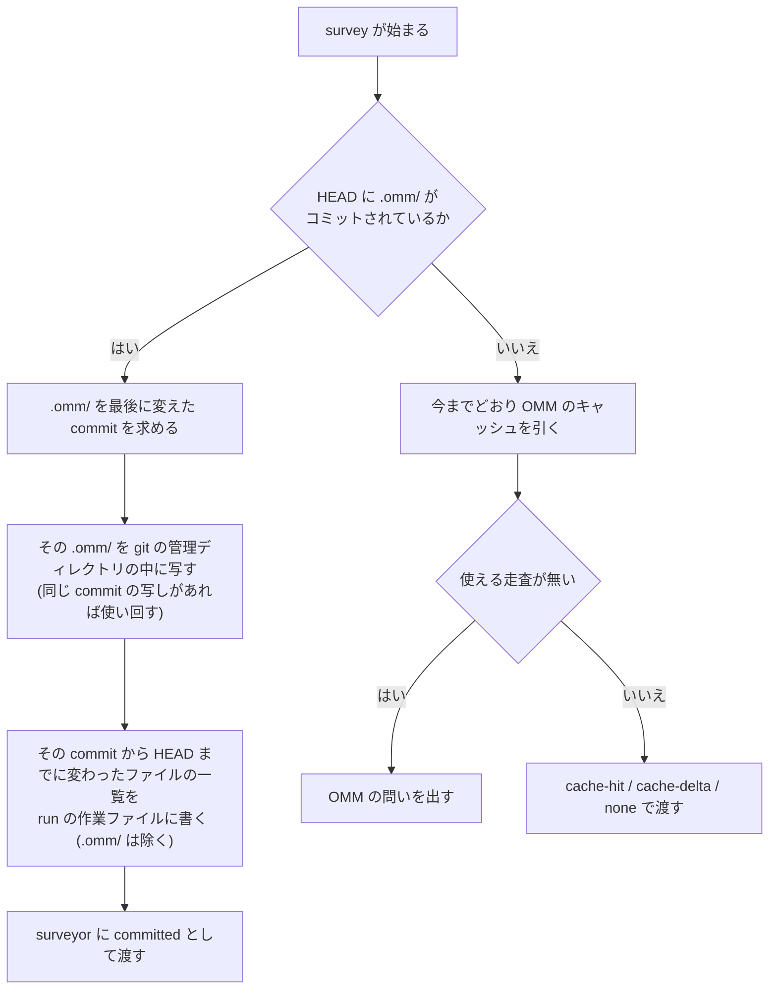
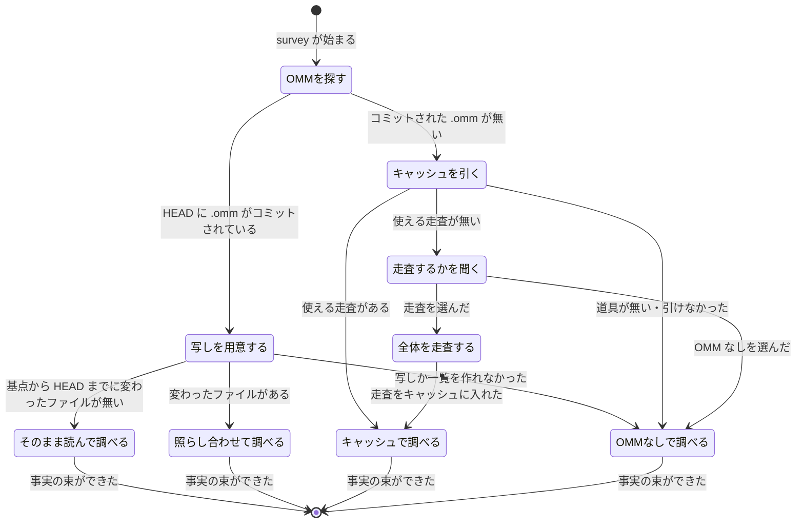

# コミット済みの OMM を survey で読む (committed-omm)

2026-11-20 に持ち主と design-flow v4 で詰めた (grilling Q1〜Q15、すべて推奨どおり。Q15 は持ち主の「先に .omm を直す」を受けて改訂)。用語は `skills/atelier/GLOSSARY.md` に従う (この仕様で **Committed OMM (コミット済みの OMM)** と **OMM cache (OMM のキャッシュ)** を足した)。

## Problem Statement

atelier の run の最初の工程 survey は、OMM (oh-my-mermaid の構成図と説明) を omm-pr-scan v1.2 の OMM のキャッシュから引いて、surveyor に渡す。ところが、`.omm/` を自分のコミットに入れているリポジトリ (コミット済みの OMM を持つリポジトリ) では、この仕組みが働かない。

- omm-pr-scan の `cache.mjs store` は、`.omm/` が追跡されているリポジトリでは必ず断る。そのため、そのリポジトリの OMM のキャッシュは一度も作られず、lookup は毎回 `miss … no-candidate` になる。
- run のたびに OMM の問い (`asking_omm`: 全体を走査するか / OMM なしで調べるか) が出る。走査を選んでも、追跡中の `.omm/` が書き換えられたうえで store が失敗し、OMM なしと同じ結果になる。
- 結果として、構成図をわざわざコミットしているリポジトリほど、surveyor が OMM なしで調べることになる。atelier リポジトリ自身 (`.omm/` を 143 ファイルコミット) がこの状態にある。

## Solution

リポジトリにコミット済みの OMM があれば、survey は OMM のキャッシュを引かず、OMM の問いも出さず、git だけでコミット済みの OMM を用意して surveyor に渡す。

- 読む元は作業ツリーではなく HEAD のコミットの `.omm/`。これは「`.omm/` を最後に変えた commit」の `.omm/` と同じ中身になる。
- 写しはリポジトリの作業ツリーの外 (git の管理ディレクトリの中) に置く。run の差分に `.omm/` の変更は混ざらない。
- 「`.omm/` を最後に変えた commit から HEAD までに変わったファイルの一覧」を添える。一覧が空なら、surveyor は写しをそのまま信じて読む。空でなければ、一覧のファイルを受け持つ要素だけをコードと照らし合わせてから使う。
- 差分の更新 (omm-pr-scan で図や説明を書き直すこと) はしない。surveyor は Skill を持たない安いモデルで、今の `cache-delta` でも実際の更新は起きていないため。コミット済みの OMM を最新に保つのは、そのリポジトリの PR の作業に任せる。
- コミット済みの OMM が無いリポジトリの振る舞い (OMM のキャッシュ・OMM の問い) は今のまま変えない。omm-pr-scan も変えない。



## User Stories

1. As a atelier の持ち主, I want `.omm/` をコミットしているリポジトリでも surveyor に OMM を渡したい, so that 構成図をコミットしているリポジトリほど OMM なしで調べる、という逆転が無くなる
2. As a atelier の持ち主, I want コミット済みの OMM があるリポジトリでは OMM の問いを出さないでほしい, so that 選んでも意味の無い問いに毎回答えずに済む
3. As a atelier の持ち主, I want run がリポジトリの `.omm/` を書き換えないでほしい, so that run の差分 (PR) に、頼んでいない `.omm/` の変更が混ざらない
4. As a atelier の持ち主, I want 読む元を HEAD のコミットにしたい, so that 作業ツリーに未コミットの `.omm/` の変更があっても、run の基点と同じ中身を読める
5. As a atelier の持ち主, I want 写しをリポジトリの作業ツリーの外に置きたい, so that git の状態にも run の差分にも写しが出てこない
6. As a atelier の持ち主, I want 同じ commit の写しを使い回したい, so that 同じリポジトリで run を重ねても写し直しの手間が増えない
7. As a atelier の持ち主, I want worktree の間で写しを共有したい, so that メインの clone と worktree のどちらで run を始めても同じ写しを使える
8. As a surveyor, I want `.omm/` を最後に変えた commit から HEAD までに変わったファイルの一覧を受け取りたい, so that どの要素の記述が古いかもしれないかが分かる
9. As a surveyor, I want 一覧が空なら写しをそのまま読みたい, so that 追いついている図を無駄に照らし合わせずに済む
10. As a surveyor, I want 一覧のファイルを受け持つ要素だけをコードと照らし合わせたい, so that 照らし合わせる範囲が差分の大きさに収まる
11. As a surveyor, I want 照らし合わせて合わなかった記述を事実に入れたくない, so that 古い図の主張を今の事実として書かない
12. As a surveyor, I want 名前の変更と削除も状態つきで一覧に見たい, so that 担当パスが動いた・消えた要素に気づける
13. As a surveyor, I want 一覧をプロンプトに埋め込まず別のファイルで受け取りたい, so that `.omm/` を長く更新していないリポジトリでもプロンプトが膨らまない
14. As a atelier の持ち主, I want node・omm・omm-pr-scan が無い PC でもコミット済みの OMM を使いたい, so that 道具の有無で survey の質が変わらない
15. As a atelier の持ち主, I want run の報告に OMM の行として「何ファイル変わっていたか」を見たい, so that surveyor がどれだけ古い図を読んだかが後から分かる
16. As a atelier の持ち主, I want 差分が無いときは報告に「HEAD に追いついている」と出したい, so that コミット済みの OMM が最新かどうかが一目で分かる
17. As a atelier の持ち主, I want 写しを用意できなかったとき (git が失敗したとき) は問いを出さずに OMM なしで進めたい, so that OMM のために run が止まらない
18. As a atelier の持ち主, I want コミット済みの OMM が無いリポジトリでは今までどおりの OMM のキャッシュと OMM の問いを使いたい, so that この変更が既存の使い方を壊さない
19. As a atelier の持ち主, I want 止めて再開した run では、最初に決めた OMM の渡し方をそのまま使いたい, so that 再開のたびに写し直しや一覧の作り直しで中身が変わらない
20. As a atelier の持ち主, I want omm-pr-scan を変えずに済ませたい, so that 別のリポジトリ・別の版管理の道具に変更が広がらない

## Implementation Decisions

- **見分け方**: run の作業フォルダで HEAD のツリーに `.omm` が入っているとき (git の ls-tree が空でないとき)、コミット済みの OMM があるとみなす。作業ツリーの `.omm/` があるかどうか・未コミットの変更があるかどうかは見ない。
- **優先順位**: コミット済みの OMM があれば、OMM のキャッシュの lookup を呼ばない。`--omm-cache-dir` が渡されていても使わない。道具 (node・omm・omm-pr-scan v1.2) の有無も問わない。git だけで用意する。
- **基点の commit**: HEAD から辿れる中で `.omm/` を最後に変えた commit (git log の `-1 HEAD -- .omm`)。この commit の `.omm/` と HEAD の `.omm/` は同じ中身。
- **写しの置き場所**: `<git の共通ディレクトリ>/atelier/omm/<基点の commit の先頭 12 桁>/.omm`。作業ツリーの外で、worktree の間で共有される。同じ commit の写しが揃っていれば作り直さない。途中で失敗した写しを揃ったものと取り違えないよう、別名で書いてから名前を変える。写しは git のオブジェクトから取り出し、作業ツリーは読まない。
- **変わったファイルの一覧**: 基点の commit から HEAD までの `git diff --name-status -M` から `.omm/` の行を除いたもの。名前の変更 (R) と削除 (D) は状態つきで残す。run の作業ファイルの置き場 (survey のプロンプトの隣、git に無視されている場所) に 1 ファイルで書く。
- **OMM の種類**: `run["omm"]` の `source` に新しい値 `committed` を足す。中身は写しの `.omm` の場所、基点の commit、一覧のファイルの場所、一覧の件数。`run["omm"]` は run の状態に残るので、再開した run は同じ値を使う (今の `cache-hit` などと同じ扱い)。
- **用意できなかったとき**: git が失敗するなどで写しか一覧を作れなければ、`source` は `none`、理由は `committed-failed` とする。OMM の問いは出さない。
- **OMM の問いを出す条件**: 今と同じく `source` が `miss` のときだけ。`committed` と `none` では出さない。
- **survey のプロンプト**: OMM の行に次の 4 行を使う。一覧そのものは埋め込まない。

  ```text
  OMM source: committed
  OMM folder: <写しの .omm>
  OMM commit: <基点の commit>
  OMM changes: <一覧のファイル> (<件数> files)
  ```

- **surveyor のプロンプト (surveyor.md) に足す読み方**: OMM source が `committed` のとき、一覧が 0 件なら写しを HEAD のコードに追いついたものとして読み、`omm:要素パス` を出典にしてよい。1 件以上なら、一覧のファイルを担当パスに持つ要素 (担当パスは親の図のノードのラベル 2 行目) を HEAD のコードと照らし合わせてから使う。合わない記述は事実に入れず、コードで確かめた事実を `path:行番号` の出典で書く。一覧に当たらない要素はそのまま使ってよい。写しにもリポジトリの `.omm` にも書かない (今の決まりを残す)。
- **run の報告**: OMM の行を `- OMM: committed (<短い commit> から <件数> ファイル変更)` にする。0 件なら `- OMM: committed (HEAD に追いついている)`。`committed-failed` のときは、その理由が分かる行にする。
- **変えないもの**: omm-pr-scan (v1.2 のまま)、OMM のキャッシュの流れ (`cache-hit`・`cache-delta`・`miss`・`none`)、OMM の問いの選択肢と文、状態の遷移表 (`asking_omm`・`scanning_omm` はそのまま。コミット済みの OMM では通らないだけ)、事実の束の形 (`atelier.facts/1`)。
- **版**: atelier の小さな版上げ (v8.5 → v8.6) として出す。手元のスキルの切り替えは skill-versioning で行う。

### 状態の図



起きてはいけないこと:

```text
%% never コミットされた .omm があるリポジトリで、走査するかを聞く
%% never run がリポジトリの .omm を書き換える
%% never 変わったファイルがあるのに、照らし合わせずに図をそのまま事実にする
```

この図の規則は、pstack の `/statechart` (from-chart、TLC) で検査した。検査用の図は、survey の流れ・リポジトリにコミット済みの OMM があるか・`.omm/` を変えた後にコードが変わったか・リポジトリの `.omm/` が書き換えられたか、の 4 つの領域に分けて描いた。3 つの規則 (コミット済みの OMM があるのに走査するかを聞かない・run がリポジトリの `.omm` を書き換えない・変わったファイルがあるのに照らし合わせずに読まない) がすべて守られた (28 状態、規則を破る状態は 0)。「リポジトリの `.omm/` が書き換えられた」状態には、合意した図の遷移では届かない (今の不具合の状態が無くなったことを示す)。図と TLA+ と結果は `committed-omm-notes/statechart/` にある。TLA+ が日本語の文字列を受け付けないので、検査用の図の状態名は英語にしている。

## Testing Decisions

- よいテストは、外から見える振る舞い (返る OMM の種類と中身、conductor が出す次の行動、surveyor のプロンプトの文) だけを確かめ、写しの作り方の内部 (どの git コマンドで取り出したか) には立ち入らない。git は本物を使い、一時フォルダに小さなリポジトリを作る。
- **合意済みの seam**:
  1. **survey の OMM の用意 (`omm_context`)**: 一時の git リポジトリに `.omm/` をコミットしたうえで確かめる。コードを変えていないとき、件数 0 の `committed` が返り、写しが作業ツリーの外にあって中身が HEAD の `.omm/` と同じこと。コードだけを後のコミットで変えたとき、基点の commit が `.omm/` を変えた commit で、一覧に変えたファイルが状態つきで入り、`.omm/` の行が入らないこと。作業ツリーの `.omm/` を書き換えて未コミットにしても、写しは HEAD の中身であること。2 回呼ぶと同じ写しを使い回すこと。道具の偽物 (`ATELIER_OMM_SCRIPT` を存在しないスクリプトに向けた状態) のままでも `committed` が返り、キャッシュの lookup が呼ばれないこと。git が失敗したときに `none`・`committed-failed` になること。
  2. **conductor の start → drive (run の流れ)**: コミット済みの OMM があるリポジトリで run を始めると、surveying から OMM の問いに行かず surveyor の launch になること。survey のプロンプトに 4 行 (source・folder・commit・changes) が入ること。コミット済みの OMM が無いリポジトリで lookup が `miss` のときは、今までどおり OMM の問いが出ること。run の報告の OMM の行が決めた文になること。
- **前例**: seam 1 は `skills/atelier/tests/test_survey.py` (OMM のキャッシュの hit・near・cache-inside-repo を確かめているテスト)。seam 2 は `skills/atelier/tests/test_review_loops.py` の、`survey.omm_context` を差し替えて start から OMM の問いが出ることを確かめているテスト。seam 2 では `omm_context` を差し替えず、本物の git リポジトリで確かめる。
- テストの一式は `skills/atelier/run_tests.py` で回す。

## Out of Scope

- コミット済みの OMM を差分で更新すること (omm-pr-scan で図や説明を書き直すこと)。survey でも呼び手でも行わない。
- run の変更でコミット済みの OMM がコードとずれる件 (仕上げで omm-pr-scan を勧めるなど)。必要なら別の作業にする。
- omm-pr-scan の変更 (コミット済みの OMM をキャッシュの元として取り込むサブコマンドなど)。
- `.omm/` を長く更新していないリポジトリで、OMM なしに切り替える閾値。
- surveyor に Skill ツールを持たせること。
- 写しの掃除 (古い commit の写しを消すこと)。写しは 1 つあたり `.omm/` の大きさで、数も `.omm/` を変えた commit の数までしか増えない。

## Further Notes

- 持ち主の最初の案は「リポジトリに `.omm` があれば、そちらに差分の更新をかける」だった。詰める中で、surveyor が Skill を持たない (atelier の役割の agent の道具は Read・Write・Edit・Glob・Grep・Bash・PowerShell、`claude -p` の runner でも Read・Edit・Write・Glob・Grep) ため survey の中では更新できないこと、今の `cache-delta` も実際には「近い走査の写し + 照らし合わせ」で動いていることが分かり、「更新せず、変わったファイルの一覧を添えて読ませる」に決めた。
- 順番: caller-benchmark (`skills/atelier/` を変える PR に `bench.py check` の差分レポートを貼る決まりを入れる作業) より先に入れる。持ち主の決定で、caller-benchmark の run はこの作業が終わるまで止めてある。ベンチの決まりはまだ main に無いので、この PR には差分レポートを貼らない。ベンチの最初の基準値はこの変更を含んだ main で作られるが、ベンチの題材は `.omm/` を持たないので、測る値にはほぼ響かない見込み。
- マージして手元の atelier スキルを v8.6 に切り替えたら、caller-benchmark の作業に知らせる (止めている run をそのまま drive で進めるか、始め直すかをそちらで決める)。
- 1 つの PR に、仕様・用語・実装をまとめる。コミットは関心ごとに分ける。
