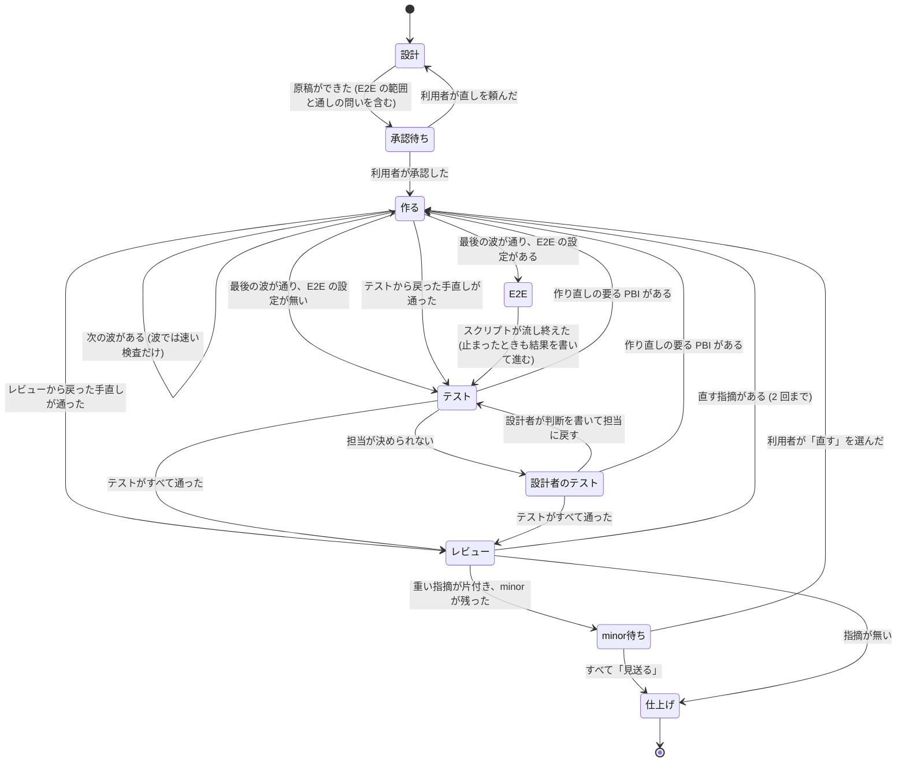

# テスト工程とレビューで設計者の呼び出しを減らす

合意: 2026-11-14、持ち主と 8 つの変更に合意 (共有メモリ `01M7C850WWF58BQ1JRFTKRV6SG`)。細部は design-flow の 4 問で決めた (下の「決めたこと」)。前提は PR 59 (テストケースとテスト実装を分け、テスト PBI を安い段で作る) のマージ。

## Problem Statement

Atelier の実行記録では、費用の大半が設計者 (Opus) の呼び出しだった。偏っていたのは次の 2 か所。

- テスト工程: E2E の待ち (波ごとの関係 spec と最後の関係 spec の間、設計者のエピソードが開いたまま待つ)、失敗の照合 (原因の分からない失敗を設計者が自分で流し直す)、テスト PBI の作成 (survey の表を設計者が読んで PBI に書き直す)、質問による立ち上げ直し (最後の full-run の問い)。
- レビュー: 整形の指摘での差し戻し、Sonnet が作った PBI を Opus がレビューすること、最後のレビューの minor が直されずに後のレビューで出直すこと。

## Solution

設計者 (Opus) は実装のループ (設計・build・照合) だけを持つ。E2E はモデルを使わないスクリプトが流し、テストの工程は振り分けテンプレートの中段のモデルが進め、機械で済む検査 (整形・lint・原因の振り分け・テスト PBI の作成) はスクリプトに移す。人に聞くのは承認の 1 回と、最後のレビューの minor をまとめた 1 回だけにする。

## User Stories

1. 利用者として、承認のときに E2E の範囲と通しを流すかを決めたい。後で問いに答えるために戻ってこなくて済むように。
2. 利用者として、E2E を流している間に Opus の費用がかからないようにしたい。
3. 利用者として、テストの工程を安いモデルで進め、判断に困ったときだけ設計者に回してほしい。
4. 利用者として、整形や lint の違反でレビューが差し戻されないようにしたい。
5. 利用者として、ふつうの PBI のレビューは中段のモデルで済ませ、深いレビューの PBI だけ Opus を使ってほしい。
6. 利用者として、リポジトリにレビューのスキルや規約があれば、最後のレビューはそれを使ってほしい。
7. 利用者として、最後のレビューの minor を一度にまとめて見て、直すか見送るかを推奨付きで決めたい。決めたものはその実行の中で片付けてほしい。
8. 持ち主として、規則はどの実行にも当てはまる一般の形で書かれていてほしい。

## Implementation Decisions

### 決めたこと (design-flow の 4 問)

- E2E は新しい出番 `e2e` (モデル無し) で流す。最後の build のあとに置き、test の前に流す。波では速い deferred だけを流し、関係 spec は流さない。最後の `full-run` の問いはやめ、通しは承認で決める。
- test の出番の担当は、振り分けテンプレートの中段 (`tiers.sonnet`) のモデル。
- ふつうの PBI のレビュー (`reviewer.other` の既定) も、振り分けテンプレートの中段のモデル。
- 最後のレビューの並び: リポジトリ独自のスキル → lens-review → code-review → 組み込み。

### 1. E2E の出番 `e2e` (`conductor.py`・`e2e_run.py`・`verify.py`・`appendix/tests-at-end.md`・`appendix/approve.md`)

- 出番のつながりに `build → e2e`、`e2e → test` を足す。build は E2E が設定されている (tests at the end が on で `investigate` か `final` がある) とき、最後の波のあとの next を `e2e` にする。設定が無ければ今までどおり `test` に進む。
- `e2e` の出番は設計者を起こさない。`next` は `launch: script` と `then: conductor.py run --detach` を出し、`run` (detach) が `e2e_run.py` を裏で動かす。呼び出し側は headless と同じく `wait --timeout 300` を繰り返す。終わると `e2e_run.py` が episode の結果 (status `done`、next `test`) を書く。スクリプトは問いを出さない。止まったとき (上限・サーバーが立たない) も結果に `blocked` を書いて test に進み、判断は test の担当に渡す。
- 範囲は `e2e_run.py` が決める。(a) 各 PBI の `Related specs:` 行の spec、(b) 変えたシンボルを読む spec、(c) 承認済みなら通し (`final`)。
  - PBI の頭に `- Related specs: <spec, spec | none>` の行を置く (今は承認の原稿にしか無く、機械が読めない)。
  - 変えたシンボル: merge-base (`tests-at-end.json` の `e2e.base`、既定 `origin/main`) からの差分で、test_paths 以外のソースの変わった行にある定義 (関数・クラス・定数・export) の名前を集め、`e2e.specs` の glob に合う spec のうち、その名前を語として含むものを選ぶ。`e2e.symbols: false` で切れる。
  - 範囲の spec は 1 本ずつ流し (`verify.py --related <specs> --each`)、spec ごとの終了コードを `docs/pbi/verify/e2e.json` に書く。サーバーは最初に 1 回だけ用意する。
  - 通しは `e2e.full` が `true` のときだけ、範囲の spec のあとに 1 回流す。`e2e.full` は、承認の原稿の `ask` (通しを流すか) の答えから設計者が書く。
- 結果は `docs/pbi/verify/tests/e2e.test-result.json` (kind `e2e`)。落ちた spec ごとに、それを関係 spec に持つか、そのシンボルを変えた PBI を `pbi` に書き、`cause` は 4. の振り分けで決める。
- 承認の原稿の `## 作る人と見直し` に、E2E の範囲 (PBI ごとの関係 spec、シンボルで足した spec の数の見込み) と、通しを流すかの `ask` を書く。
- 波の終わりのテスターは `when: wave` の deferred だけを流す。test の最後 (kind `final`) は、e2e で落ちた spec と test PBI が触れた spec だけを流し直す。
- `full-run` の問いと `answer --full-run` は、途中の run と互換のために残すが、新しい流れでは出さない。

### 2. テスト PBI をスクリプトで作る (`tests_plan.py`)

- 入力は survey の表とケース (`docs/pbi/notes/test-survey.md`)。ケースは test file ごとに `### Cases: <test file>` の見出しの下に `Exemplar:` の行とケースの表を置く (今の書き方を機械が読める形に固める)。
- `python <skill>/tests_plan.py docs/pbi` が、test file ごとに 1 つの PBI (`PBI-<n>.md`、facts、brief) を書き、`waves.json` にテストの波を足す (1 つの波に 3 件まで)。Targets はその test file、Do not touch は差分のソース、Notes に `Cases:`・`Exemplar:`・`Delete:`、受け入れ条件はケース id ごと、検証コマンドは `tests-at-end.json` の `test_command` (`{file}` を置き換える) と `test_typecheck`。
- lint (同じスクリプトの中) が例外を出す: `?` のあるケース、埋まっていない欄、ケースの無い fix・rewrite・add の行、覆うテストを名指さない delete の行、test_paths に合わない file、同じ file に keep と delete が並ぶ行。例外のある file の PBI は書かず、`exception:` の行で出して終了コード 4。担当が読むのは例外の行だけ。
- 例外のうち、要件から期待値が決まらないものだけを利用者に聞く (今と同じ `decision`)。

### 3. test の出番を中段のモデルで動かす (`conductor.py`・`appendix/setup.md`)

- 役割に `episodes.test` を足す。層 (run → repo → home) のどれも決めていなければ、振り分けテンプレートの中段 (`tiers.sonnet`) の手順のうち、設計者に置ける実行先 (agent・codex・claude) で使えるものの先頭を取る。出所は `template` と出す。
- `next` は test の出番を `episodes.test` のモデルで起こす。依頼文に `Lead: test (you run the test stage; when you cannot decide, end with needs_designer)` を足す。
- 担当が決められないときは、結果の `next` を `{"episode": "test", "needs_designer": "<理由>"}` にして終える。conductor は同じ test の出番を設計者 (`designer`) のモデルで起こし直し、依頼文に `Escalated: <理由>` を足す。設計者の test の出番がまた `test` を next にしたら (needs_designer 無し)、担当に戻す。
- 出番のつながりに `test → test` を足す (needs_designer のときだけ)。

### 4. 失敗の振り分け (`role_results.py`・`prompts/tester.md`)

- PBI の Notes の `Breaks by design: <test file か spec>[::<test>] — <why>` の行を、設計どおり壊れる印にする (今は自由な文で書いている)。
- `python <skill>/role_results.py classify <test-result>` が、落ちたテストのうち、この印に合うものの `cause` を `intended` に、`pbi` をその PBI にして書き直す。合わないものは `unknown` のまま。`e2e_run.py` と波のテスターがこれを流す。
- `unknown` の切り分けはテスターの新しい kind `investigate` が受け持つ。落ちたテストを 1 本ずつ流し、読んでいるファイルとそれを変えた PBI を調べ、`regression` か `intended` かを提案する。担当 (設計者か test の担当) はその提案から決める。自分で流し直さない。

### 5. 整形と lint をレビューの前に済ませる (`appendix/plan.md`・`verify.py`・`prompts/pbi-review.md`)

- 設計者は Start で、プロジェクトの整形 (書き込み) と lint (自動修正) のコマンドを `docs/pbi/checks.json` (`{"format": "<コマンドの頭>", "lint": "<コマンドの頭>"}`) に書く。見つからなければ書かない。
- 各 PBI の検証コマンドの 1 と 2 は、その PBI の Targets に対する整形と lint にする。作業者は検証のたびにこれを流すので、レビューの前に整形は済んでいる。
- `verify.py` は、`checks.json` があるのに PBI の検証コマンドに整形か lint が無いとき、`refused: ...` で終了コード 2 にする。
- レビューの依頼文に「整形と lint は検証コマンドが済ませている。整形・書式だけの指摘は findings に書かない」を足す。

### 6. PBI ごとのレビュー (`conductor.py`・`role_results.py`・`prompts/pbi-review.md`)

- `reviewer.other` の既定は、振り分けテンプレートの中段の手順の先頭 (役割に置ける実行先で使えるもの)。同梱の routing では今までどおり sonnet/high。
- ふつうのレビューは、作ったモデルと同じでも `reviewer.other` で見る (文脈は別)。「作ったモデルで見ない」は深いレビューだけに残し、深いレビューで `reviewer.deep` が作ったモデルと同じときは `reviewer.other` を使う。
- `role_results.py bundle` の「作ったモデルとレビューのモデルが同じ」の誤りは、その PBI の route.json の `review` が `deep` のときだけ出す。

### 7. 最後のレビューの選び方 (`adapter_gate.py`・`appendix/review.md`・同梱テンプレート)

- `adapter_gate.py` が、リポジトリ独自のレビューのスキル (`.claude/skills/*/SKILL.md`・`skills/*/SKILL.md` で名前に `review` を含むもの) と規約 (`REVIEW.md`・`docs/review*.md`・`.github/review*.md`) を探し、表に `review-skill` の行を出す (`repo:<skill>`、または `none`)。規約のパスは `rules` の列に出す。
- `review-skill` が `repo:<skill>` なら、そのスキルを最後のレビューに使う (agents.json のスキル名と同じ扱い)。無ければテンプレートの並びの先頭から: `review.lens-review` → `review.code-review` → `review.builtin`。規約は `Rules:` 行に渡す (今と同じ)。
- `review.lens-review` を同梱の部品に足し、同梱テンプレート (jev-routed・high-model) の review をこの並びにする。agents.json の `adapters.review` にスキル名があれば、それがいちばん強い。

### 8. 最後のレビューの minor (`appendix/review.md`・`appendix/rework.md`・`appendix/finish.md`)

- critical と major を片付けたあと (2 回の上限の中で)、確かめた minor を 1 つの `decision` の問いにまとめる。1 行に 1 件、ファイル・行・中身と、推奨 (`直す` か `見送る`) を付ける。推奨は、直す手間が小さく誤りの元になるもの (名前の取り違え、古いコメント、抜けた確認) を `直す`、好みや書きぶりを `見送る`。minor が無ければ聞かない。
- 「直す」になった minor は、持ち主の PBI の手直し (rework、Sent by review) としてその実行の中で片付ける。この手直しは PBI のレビューまで流し、3 回目の最後のレビューは流さない。手直しの上限には数えるが、上限に達した PBI の minor は直さずに完了報告の「見送り」に入れる。
- 「見送る」になった minor と、どの PBI も持たないファイルの minor は、完了報告の Findings に「見送った minor」として載せる。完了報告に minor をそのまま流すことはしない。

### 状態の図 (tests at the end が on の run)

## Testing Decisions

合意済みの seam (テストを書く境界):

- `conductor.py`: `next`・`done`・`run --detach` の出力と `run.json` (e2e の出番、episodes.test の役割と出所、needs_designer の起こし直し、つながり)。
- `e2e_run.py`: tests-at-end.json・PBI ファイル・git の作業ツリーを入力にし、範囲 (spec の一覧と理由) と結果のファイル。git と verify.py の呼び出しは引数で差し替えられるようにする。
- `tests_plan.py`: survey の Markdown を入力にし、書いた PBI ファイル・waves.json と `exception:` の行。
- `role_results.py classify`・`bundle`: JSON と PBI ファイルを入力にし、書き直した JSON と表の行。
- `verify.py`: `--related --each` の spec ごとの結果、checks.json による拒否。
- `adapter_gate.py`: 一時ディレクトリのリポジトリを入力にし、`review-skill` の行。
- 文書: `test_references.py` (付録・プロンプトの参照が切れていないこと) をそのまま通す。

よいテストは外から見える振る舞い (出力の行・書いたファイル・終了コード) だけを確かめる。前例は `test_conductor.py`・`test_verify.py`・`test_role_results.py`・`test_adapter_gate.py`。

## Out of Scope

- 手元のスキル (`~/.claude/skills/atelier/versions/`) の書き換えと版の作成 (マージ後に持ち主に聞く)。
- 優先テンプレートを役割の既定に当てること (役割の既定は振り分けテンプレートだけから取る)。
- E2E の結果を Cypress 以外の出力から spec 単位に分けること (spec を 1 本ずつ流すので要らない)。

## Further Notes

- 根拠の原則: pstack の principle-never-block-on-the-human (人に聞くのは承認と minor の 1 回だけ。スクリプトは問いを出さず、止まっても結果を書いて進む) と blast-radius (E2E の範囲を、関係 spec と変えたシンボルを読む spec に絞る)。
- 規則はどの実行にも当てはまる形で書く。1 回の実行の数字や事例は規則の中身にしない。
