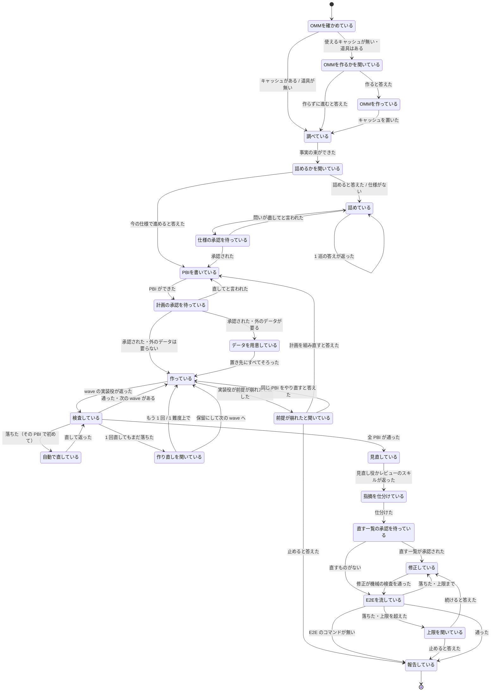

# 見直しと作り直しを繰り返さない: 規約・調べ・検査・組み直し・データ・見落としの指摘

合意: 2026-11-18。持ち主が design-flow（grilling Q1〜Q15）で決めた。Q2 は B（リポジトリのレビューのスキルを使う）、Q14 は「呼び出し側が場所を知っていれば渡す」に改め、ほかは推奨どおり。前提は Atelier v8（PR #67、`docs/specs/atelier-v8.md`）。

## Problem Statement

Atelier v8 で複数ファイルの実装を流したところ、計画の前提が何度か崩れ、Atelier の外での作り直しが起きた。終わったあとに対象のリポジトリのレビューのスキルを流すと、規約の指摘がまとめて出た。持ち主の目から見ると、Atelier が「見直しは 1 回」と決めているのに、実際には見直しと作り直しが何度も起きている。

記録から確かめた原因は次のとおり。どれも 1 回の run の事情ではなく、Atelier の作りから来ている。

1. **規約が役に届かない。** 対象のリポジトリには「実装の前とレビューで読む」と指された規約の文書がある。しかし、調査役の事実の束に、それを拾う欄が無い。計画役・作業者・見直し役の指示にも入らない。最後の見直しは「好みや書き方の指摘は出さない」とされ、規約の違反はだれも見ない。
2. **計画役がコードを読めない。** 計画役は「渡したものだけを読む」とされ、触れてよいファイルを、事実の束だけから決める。網羅の表（型のすべての値を持つ表）・呼び出し元・同じ役割の既存の仕組みを見落とし、作業者が「計画の前提が崩れた」と止まった。
3. **前提が崩れても組み直せない。** 「続ける」は同じ PBI をやり直すだけで、触れてよいファイルを広げる道が無い。
4. **外のデータを用意する段が無い。** 作業者はリポジトリの外を読めない。リポジトリの外にある実データで確かめるテストが書けず、模擬の形で通って、実データでは外れていた。
5. **検査のコマンドが決め打ち。** 波・直し・E2E の検査は `python run_tests.py` に決まっている。対象のリポジトリには無く、呼び出し側が代わりを流した。直しの作業者はこのコマンドで止まり、E2E の型の検査が抜けた。
6. **見落とした指摘が人に見えない。** 確信度 80 未満の指摘は、振り分けの前に黙って捨てられる（例えば確信度 55 の minor）。振り分けで「見送る」とされた指摘も、承認ページに出ない。
7. **OMM の図が使われない。** worktree で動くと、OMM のキャッシュの場所を取り違えて「無い」と判断する。キャッシュが本当に無いときも、作るかを聞かずに、図なしで調べる。
8. **（詰める段）** 既存の操作の仕組み（取り消す操作・元に戻す・ほかのモードとの入れ替え）との関係を仕様で決めず、実装の途中で決め直した。

## Solution

持ち主から見た変わり方は次のとおり。

- 調査役は、対象のリポジトリの規約の文書・検査のコマンド・レビューのスキルを、出典つきで事実の束に書く。計画役・作業者・見直し役は、規約の文書を読んでから仕事をする。
- 最後の見直しは、リポジトリにレビューのスキルがあれば、呼び出し側がそのスキルで流す。Atelier のあとに人が流す full レビューと同じ物差しになる。無ければ、見直し役が規約の文書も見て、規約の違反を出す。
- 計画役はコードを読み、呼び出し元・網羅の表・同じ役割の既存の仕組みを調べてから、触れてよいファイルを決める。調べた場所は PBI ごとに残る。
- 計画の前提が崩れたら、「計画を組み直す」を選べる。合格済みの PBI はそのままで、残りを計画役が組み直し、承認をもう一度通る。
- 外のデータが要るテストは、計画の承認ページにデータの一覧が出る。承認すると、呼び出し側がリポジトリの中に写してから作業者が動く。
- 検査のコマンドは、事実の束と計画から組み立てる。E2E のコマンドが無ければ、E2E を飛ばしたと報告に書く。
- 修正の承認ページには、直さないことになった指摘も、すべて理由つきで並ぶ。どれでも直す一覧に足せる。
- OMM のキャッシュは omm-pr-scan と同じ場所を探す。無ければ、調べる前に「全体を走査して作るか」を聞かれる。

```
今:   調べる → (詰める) → 計画 → 承認 → 作る ⇄ 検査 → 見直し(1回) → 仕分け → 直す → E2E → 報告
新:   [OMM を作るか] → 調べる(規約・コマンド・レビューのスキル) → (詰める) → 計画(コードを読む) → 承認
      → [データを用意] → 作る ⇄ 検査 → [前提が崩れた → 計画を組み直す → 承認] → 見直し(1回、リポジトリのスキル)
      → 仕分け → 直す → E2E(コマンドがあれば) → 報告
```

## User Stories

### 規約

1. 持ち主として、対象のリポジトリの「実装の前に読む」規約を作業者が読んでから作ってほしい。終わったあとの full レビューで、規約の指摘がまとめて出ないように。
2. 持ち主として、調査役に、規約の文書のパスと「読む」と書いてある行を出典つきで事実の束に書いてほしい。どの文書をなぜ読ませたかを、あとで確かめられるように。
3. 持ち主として、規約の文書が無いリポジトリでも、run が止まらずに進んでほしい。
4. 持ち主として、計画役にも規約の文書を読んでほしい。規約に合わない分け方（置き場所の決まりに反するファイル）をしないように。

### 最後の見直し

5. 持ち主として、リポジトリにレビューのスキルがあれば、最後の見直しをそのスキルで流してほしい。Atelier の見直しと、あとで流す full レビューの物差しをそろえるために。
6. 持ち主として、どのスキルで見直すかを、計画の承認ページで確かめたい。違えば「計画を直す」で変えられるように。
7. 持ち主として、スキルの指摘も、Atelier の仕分けと直す一覧の流れに乗ってほしい。見直しのあとの流れが 2 つに分かれないように。
8. 持ち主として、レビューのスキルが無いリポジトリでは、見直し役が規約の文書を見て、規約の違反も出してほしい。
9. 持ち主として、規約の違反の指摘には、根拠の規約の場所が付いていてほしい。好みと規約を見分けられるように。
10. 持ち主として、見直しは今までどおり 1 回だけにしてほしい。直したあとに全体の見直しをやり直して、費用が倍にならないように。

### 計画

11. 持ち主として、計画役がコードを読んで、触れてよいファイルを決めてほしい。作業者が「触れてよいファイルが足りない」と止まらないように。
12. 持ち主として、計画役に、変える型や関数の呼び出し元・網羅の表・同じ役割の既存の仕組みを調べてほしい。見落としが前提の崩れになるのは、この 3 つだったので。
13. 持ち主として、PBI ごとに、計画役が調べた場所（`path:行`）を残してほしい。調べずに書いた計画を、進行役が受け付けないように。

### 前提が崩れたとき

14. 持ち主として、作業者が計画の前提が崩れたと止まったら、計画を組み直すかを選びたい。同じ PBI をやり直しても、また同じ所で止まるので。
15. 持ち主として、組み直しでは、もう合格した PBI を変えないでほしい。済んだ作業が無駄にならないように。
16. 持ち主として、組み直した計画も、承認してから作り始めてほしい。触れてよいファイルが広がるのを、知らないうちに認めないように。
17. 持ち主として、作業者に、触る必要があったファイルと理由を報告させてほしい。計画役がそれを見て組み直せるように。
18. 持ち主として、今までの「同じ PBI をやり直す」と「止める」も選べるようにしてほしい。

### 外のデータ

19. 持ち主として、実データで確かめるテストに要るファイル（リポジトリの外にある）を、計画の承認ページで一覧で見たい。何をどこへ写すかを、承認の前に分かるように。
20. 持ち主として、承認したデータは、作業者が動く前にリポジトリの中へ写されていてほしい。作業者が模擬のデータだけでテストを通さないように。
21. 持ち主として、写したはずのファイルが無ければ、作業者を起動せずに止まってほしい。
22. 持ち主として、データの置き先は必ずリポジトリの中にしてほしい。リポジトリの外に書かないように。

### 検査のコマンド

23. 持ち主として、波の検査では、その波の PBI の検査のコマンドと、リポジトリ全体の速い検査を流してほしい。リポジトリに無いコマンドで検査しないように。
24. 持ち主として、直しの検査では、リポジトリ全体の速い検査と、直したファイルに関わる PBI の検査を流してほしい。
25. 持ち主として、E2E は、調査役が見つけ計画役が選んだ E2E のコマンドで流してほしい。
26. 持ち主として、E2E のコマンドが無いリポジトリでは E2E を飛ばし、そのことを報告に書いてほしい。

### 見落とした指摘

27. 持ち主として、修正の承認ページで、すべての指摘を見たい。確信度が低くて落ちたもの・見送ると仕分けられたもの・書き方だけのものも、理由つきで。
28. 持ち主として、見送りの候補のどれでも、ID を指定して直す一覧に足したい。
29. 持ち主として、振り分けに回すのは、今までどおり確信度 80 以上の指摘だけにしてほしい。決める役の手間を増やさないように。

### OMM

30. 持ち主として、worktree で run を始めても、メインの clone の横にある OMM のキャッシュを使ってほしい。
31. 持ち主として、呼び出し側がキャッシュの置き場所を知っていれば、それを渡せるようにしてほしい。
32. 持ち主として、使えるキャッシュが無く、OMM の道具がそろっていれば、調べる前に「全体を走査して作るか」を聞いてほしい。
33. 持ち主として、走査しないと答えたら、今までどおり図なしで調べてほしい。
34. 持ち主として、OMM の道具が無いときは、聞かずに進み、報告にそう書いてほしい。

### 詰める段

35. 持ち主として、詰める役に、新しい振る舞いと既存の仕組み（取り消す操作・元に戻す・ほかのモードとの入れ替え）の関係を質問に入れてほしい。実装の途中で決め直さないように。

## Implementation Decisions

### 事実の束（`atelier.facts/1` に欄を足す）

- 足す欄は 3 つ。どれも必須の配列で、空でもよい。項目はどれも、今と同じく `id`・`text`・`source`（`path:行` か `omm:要素パス`）を持つ。
  - `rule_docs`: 実装の前やレビューで読むと指された規約の文書。`path`（リポジトリからの相対パス）を足す。`source` は「読む」と書いてある行。
  - `commands`: 検査のコマンド。`command` と `kind`（`unit`・`type`・`lint`・`e2e`・`all` のどれか）を足す。`source` はコマンドを定義した行（`package.json` の scripts など）。
  - `review_skills`: リポジトリのレビューのスキル（`skills/` と `.claude/skills/` のうちレビューに使うもの）。`name` と `path` を足す。`source` は SKILL.md の説明か、規約がそのスキルを名指しした行。
- 進行役は、`rule_docs` の `path` がリポジトリの中にあり、ファイルとしてあることを確かめる。無ければ受け付けない。
- 調査役の指示に、規約を名指しする場所（`AGENTS.md`・`CLAUDE.md` と、そこが指す文書）を探すことを足す。

### 規約の文書を役に渡す

- 進行役は、事実の束の `rule_docs` のパスを、計画役・作業者（PBI・自動の直し・修正の段）・見直し役の指示に `Rule documents:` として入れ、「仕事を始める前に全文を読む」と指示する。
- 指示の部品として `section.rule_docs` を足し、テンプレートの `reading` で読む・読まないを切り替えられるようにする（ほかの部品と同じ）。

### 最後の見直し

- 計画（`atelier.plan/1`）に `final_review` を足す。値は `null` か、`{"skill": <名前>, "args": <文字列>}`。名前は事実の束の `review_skills` のどれかでなければならない。規約がスキルを名指ししていれば、計画役はそれを選ぶ。
- 計画の承認ページに、最後の見直しの方法（スキルの名前と引数、または「見直し役」）を出す。
- `final_review` があるとき、見直しの工程の行動は、新しい行動 `review_skill` にする。中身は次のとおり。
  - `skill`・`args`・`base`（run を始めたときのコミット）・`result`（書く場所）・`rule_docs`
  - `instructions`: スキルの指摘を `atelier.findings/1` に直す決まり
- 呼び出し側は、Skill ツールでそのスキルを流し（範囲は `base` から作業ツリーまで）、指摘を `atelier.findings/1` に直して `result` に書き、`done` を返す。
  - 規約の違反は `kind: rule`。
  - 確信度をスキルが出していなければ、呼び出し側が裏を取れた指摘を 90、取れなかった指摘を 50 にする。
  - 進行役は、今の見直し役の結果と同じ検査（`validate_findings`）をかけ、同じ流れ（仕分け → 直す一覧の承認）に乗せる。
- `final_review` が無いときは、今の見直し役を起動する。指示に規約の文書を渡し、`kind: rule` を出させる。
- 記録では、`review_skill` は役 `reviewer`・実行先 `caller`・モデル `skill:<名前>` の起動として 1 行を残す。
- 見直しは 1 回のまま。「最後の見直しが 2 回目に入らない」規則は変えない。

### 指摘の形（`atelier.findings/1`）

- `kind` に `rule` を足す。`rule` の指摘は、`rule`（根拠の規約の場所。`文書:行` か規約の ID）が空でない文字列でなければならない。
- 振り分けに回す指摘の選び方は今と同じ（確信度 80 以上、`style` ではない）。`rule` は `style` と違い、捨てない。
- 落とした指摘は捨てずに、理由（`confidence` か `style`）を付けて run に残す。

### 修正の承認ページ

- 直す（`fix`）と聞く（`ask`）に加えて、見送りの候補を理由つきで並べる。候補は 3 種類。
  - 振り分けで `skip` になった指摘（決める役の理由）
  - 確信度 80 未満で落ちた指摘（確信度）
  - `style` で落ちた指摘
- 返事のファイルで ID を指定すると（今の `approved_ask_ids` と同じ口）、見送りの候補も直す一覧に足せる。

### 計画役がコードを読む

- 計画役の指示から「渡したものだけを読む」を外し、リポジトリのコードを読めるようにする。書いてよいのは今どおり結果のファイルだけ。
- 触れてよいファイルを決める前に、PBI ごとに次の 3 つを調べるよう指示する。
  - 変える型・関数・定数の呼び出し元
  - 網羅の表（型のすべての値を持つ表や分岐。値を足すと型の検査で落ちる所）
  - 同じ役割を持つ既存の仕組み（例えば操作のモードの管理）
- 調べて見つかった、変えないといけないファイルは `targets` に入れる。触れない決まりのファイルにあるなら、その PBI の分け方を変える。
- PBI に `evidence` を足す。調べた場所（`path:行`）の配列で、1 件以上。進行役が形を確かめる。

### 計画の前提が崩れたとき

- 作業者の報告に `needed_files`（触る必要があったファイル）と `reason` を足す。`plan_broken` のときに書く。
- 「計画の前提が崩れました」の問いの選択肢を 3 つにする。
  - **計画を組み直す**（推奨）: 計画役を `revise` で起動する。依頼文は、作業者の `reason` と `needed_files`、止まった PBI の ID。
  - **同じ PBI をやり直す**: 今の「続ける」。
  - **止めて報告する**
- 「計画を組み直す」は、作っている段・自動で直している段から止まったときだけ出す（修正の段や E2E からは出さない）。
- 組み直しでは、計画の承認を取り消してから計画役を起動する。返った計画で、合格済みの PBI は ID・目的・触れてよいファイル・検査が前と同じでなければならない。違えば進行役が受け付けない。
- 返った計画は、計画の承認をもう一度通る。承認のあとは、合格済みの PBI の状態を残し、残りの PBI を新しい計画の内容で作り直す。

### 外のデータ

- PBI に `data_needs` を足す。配列で、空でもよい。項目は次の 3 つを持つ。
  - `source`: リポジトリの外の元のパス
  - `dest`: リポジトリの中の置き先（相対パス）
  - `why`: 何に使うか
- 進行役は、`dest` がリポジトリの中を指していることを確かめる（`..` や絶対パスは受け付けない）。
- 計画の承認ページに、データの一覧を出す。承認を、一覧の写しを認めたこととして扱う。
- 計画の承認のあと、作り始める前に、新しい工程「データを用意している」に入る（`data_needs` が 1 件でもあるとき）。行動は `prepare` で、写す組（`source` → `dest`）の一覧を持つ。
- 呼び出し側は、ファイルを写して `done` を返す。進行役は、すべての `dest` にファイルがあることを確かめる。欠けていれば、受け付けずに同じ行動を返す。
- 作業者の票に、そのデータの `dest` を入れる。
- 置き先をコミットするかは、Atelier では決めない（Atelier は commit をしない）。

### 検査のコマンド

- 計画に `checks`（リポジトリ全体の速い検査。直したあとにも流す）と `e2e`（E2E のコマンド）を足す。どちらも配列で、空でもよい。計画役は事実の束の `commands` から選ぶ。
- 波の検査: その検査に入る PBI の `checks` と、計画の `checks` をつなぎ、重なりを 1 つにする。
- 自動の直しの作業者の票: その PBI の `checks` と、計画の `checks`。
- 修正の段の検査と票: 計画の `checks` と、直したファイルを `targets` に持つ PBI の `checks`。そういう PBI が無く、計画の `checks` も空なら、すべての PBI の `checks`。
- E2E: 計画の `e2e`。空なら、E2E の工程を飛ばして報告へ進み、報告に「E2E のコマンドが無いため流していない」と書く。
- `python run_tests.py` の決め打ちは消す。

### OMM

- `start` に `--omm-cache-dir <dir>` を足す。呼び出し側は、自分のメモリでキャッシュの置き場所を知っていれば渡す。知らなければ渡さない。
- 進行役は、渡された場所を run に記録し、`cache.mjs` に `--cache-dir` で渡す。渡されていなければ `--cache-dir` を付けず、omm-pr-scan の既定（`OMM_CACHE_DIR`、無ければメインの clone の横）に任せる。返ってきたフォルダが作業ルートの外にあるかの確かめは残す。
- `lookup` の答えを、`hit`・`near`（差分で更新）・`miss`・`none`（道具が無い）に分ける。
- `miss` で、まだ聞いていなければ、調べる前に新しい工程「OMM を作るかを聞いている」に入る。選択肢は次の 2 つ。
  - 「全体を走査してキャッシュを作る」（推奨）: 新しい工程「OMM を作っている」に入る。行動は `omm_scan` で、走査の手順（`/omm-scan` で走査し、`cache.mjs store --at HEAD` でキャッシュに置く）と置き場所を持つ。呼び出し側が `done` を返したら、調べる工程に進み、もう一度 `lookup` する。
  - 「OMM なしで調べる」: 調べる工程に進む。
- 道具が無いときは聞かずに進み、報告に「OMM の道具が無い」と書く。

### 詰める役

- 詰める役の指示に 1 行足す。「事実の束にある同じ役割の既存の仕組みと、新しい振る舞いの関係（取り消す操作・元に戻す・ほかのモードとの入れ替え）を、決めていなければ質問に入れる」。

### 呼び出し側（SKILL.md）

- 新しい行動 `omm_scan`・`prepare`・`review_skill` の扱いを、それぞれ 1 項目で書く。`start` の `--omm-cache-dir` を書く。

### 状態の図

新しい工程は、OMM を作るかを聞いている・OMM を作っている・データを用意している、の 3 つ。新しい遷移は、計画の前提が崩れた → 計画を組み直す、の 1 つ。E2E を飛ばす遷移も足す。



- 「OMMを確かめている」は、進行役が `lookup` を回す一瞬の工程で、行動を返さない（図では分かれ道を見せるために置いた）。
- 「前提が崩れたと聞いている」は、今の横断の問い（予算・sensitive などと同じ型）のまま。「同じ PBI をやり直す」と「止める」は、今の `resume`・`stop` と同じ。予算・sensitive・テンプレートの切り替え・守りの規則の横断の問いは、今と同じなので図から省いた。

## Testing Decisions

- 良いテストは、進行役の外から見える振る舞い（`start`・`next`・`done`・`answer` が返す行動と、run の状態）だけを確かめる。関数の中の組み立て方には依らない。
- 合意済みの seam（テストを書く境界）は 2 つ。
  1. **進行役の CLI**（`conductor.py` の `start`・`next`・`done`・`answer`。偽の役の結果を書いて進める）: 既存の `tests/test_conductor.py`・`tests/test_integration.py` の流儀（`start_run`・`write_result_for`・`run_cli`）に倣う。新しい工程（OMM を作るか・OMM を作る・データの用意）、計画の組み直し、`review_skill`、検査のコマンドの組み立て、E2E を飛ばす、修正の承認ページの見送りの候補を、ここで確かめる。
  2. **形の検査の関数**（`survey.validate_facts`・`plan.validate_plan`・`plan.validate_findings`、落とした指摘を分ける関数）: 既存の `tests/test_survey.py`・`tests/test_plan.py` に倣う。欄の欠け・形の誤り・`dest` の外向き・`evidence` の欠け・`rule` の根拠の欠けを確かめる。
- 状態の遷移（`atelier/flow.py`）は、新しい遷移と「承認していない計画・そろっていないデータで作り始めない」を、`tests/test_flow_rules.py` に倣って確かめる。
- OMM の `lookup` は、`node` と `omm` と `cache.mjs` を偽物に差し替えて答えを返させる（既存の `tests/test_survey.py` の差し替えに倣う）。
- 指示の文面（規約の文書・`evidence`・`needed_files`・既存の仕組みの質問が入っているか）は、`tests/test_plan.py` の指示の検査に倣って、文字列が入っていることだけを確かめる。
- テストは `python run_tests.py`（unittest）で流し、CI（`.github/workflows/test.yml`）の 3 つの OS で通す。

## Out of Scope

- Atelier の外の設計スキルの直し（既存の操作のモードとの関係を設計で聞く）。別の作業にする。
- 直したあとの差分の LLM の見直し。過去の決定（見直しは 1 回、直しはまとめて、E2E は最後に 1 回）どおり入れない。
- 手元のスキル（`~/.claude/skills/atelier/versions/`）の更新。この PR がマージされてから、skill-versioning で版を作る。
- `atelier-role` などのサブエージェントの定義の変更。`review_skill` は呼び出し側が流すので、役に Skill ツールは足さない。
- interrogate（重い見直し）を動かすこと。
- 置き先のデータをコミットするかの判断。

## Further Notes

- 原因は run の記録（`docs/pbi/` の `prompts/`・`results/`・`plan.json`・`REPORT.md`）で確かめた。
  - 落ちた minor の指摘は、振り分け役が落としたのではなかった。確信度が 80 未満のため、振り分けの前に `filter_findings` が捨てていた。
  - OMM は、メインの clone の横にキャッシュがあったのに、`--cache-dir` に worktree の親（`.claude/worktrees/.omm-cache`）を渡していたため、`none` になっていた。
- README のアーキテクチャ図は、呼び出し側がレビューのスキル・OMM の走査・データの写しを受け持つ形に変わるので、arch-diagram で描き直す。
- 用語集（`skills/atelier/GLOSSARY.md`）に、規約の文書・レビューのスキル・外のデータを足す。
