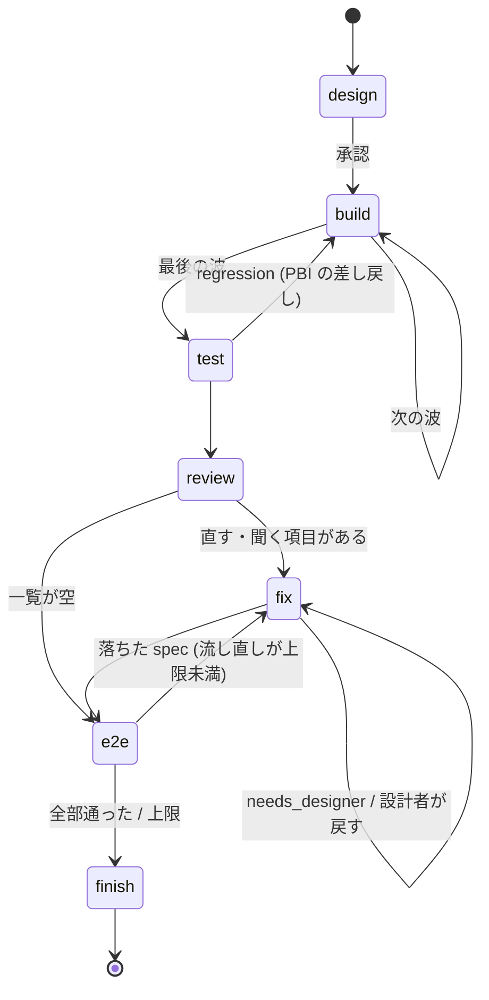

# 最後の見直しは 1 回、直しは修正の段で一度に、E2E は最後の最後に

合意: 2026-11-15、持ち主の決定 (Case-B の実行を止めたあとに出した 5 点)。前提は PR 60 (設計者の呼び出しを減らす、`docs/specs/fewer-designer-calls.md`) のマージ。

## Problem Statement

Case-B の実行 (2026-11-15) で、最後の見直しの 1 回目のあと、指摘をその PBI の差し戻し (wave 7 の rework) にして、作業者 → PBI ごとの見直し → bundle → テスト → 最後の見直しの 2 回目と同じループを回した。設計者の出番が 6 回 (各 15〜18 万トークン) 動いても終わらず、持ち主が止めた。

- 設計者は出番ごとに新しく起動し、記録を読み直すだけで 10 万トークン前後を使う。差し戻しのたびに build と review の出番が 1 回ずつ増えるので、指摘の数だけ設計者の出番が増える。
- 指摘は最初の見直しの時点ですべて分かっている。それなのに PBI ごと・波ごとに分けて直すので、同じファイルの指摘が別々の出番に散る。
- どの PBI にも属さないファイル (仕様・ADR など) の指摘は直す道が無く、完了の報告に回るだけだった。
- E2E は最後の見直しの前に流れ、差し戻しのあとにまた流れる。直すたびに E2E の待ちと照合が増える。

## Solution

最後の見直しは 1 回だけにする。見直しで確かめた指摘を 1 つの直しの一覧にし、新しい出番 `fix` (修正の段) が一覧を一度に直す。直したあとは速い確かめと直しの差分の見直しだけをし、全体の見直しはやり直さない。E2E は最後の最後に 1 回流し、落ちたものだけを直して流し直す (回数に上限)。

```
今:   build (波) → e2e → test → review #1 → build (差し戻し) → review #2 → build (minor) → finish
新:   build (波) → test → review (1 回) → fix (一覧を一度に) → e2e → [fix (落ちた spec) → e2e] ×上限 → finish
```

## User Stories

1. 持ち主として、最後の見直しで見つかった指摘をまとめて 1 回で直してほしい。指摘の数だけ設計者が起動し直さないように。
2. 持ち主として、仕様や ADR のような、どの PBI にも属さないファイルの指摘も、その実行の中で直してほしい。
3. 持ち主として、直したあとは直した所だけを確かめてほしい。全体の見直しをやり直して費用が倍にならないように。
4. 持ち主として、E2E は全部を直し終えた最後に 1 回だけ流してほしい。落ちたものだけを直して流し直し、その回数には上限があってほしい。
5. 持ち主として、minor を直すかと、ADR と食い違うときにどちらを直すかを、まとめて 1 回で答えたい。
6. 持ち主として、止めたあとの resume で、見直しや直しをやり直さずに続きから進んでほしい。

## Implementation Decisions

### 決めたこと (持ち主の 5 点と、そこから決めた細部)

- 最後の見直しは 1 回。確かめた指摘 (critical・major・ユーザーが直すと答えた minor) を 1 つの直しの一覧にする (ファイル・行・何が悪いか・直し方)。
- 修正の段 `fix` が一覧を一度に直す。PBI ごとに分けず、ファイルが重ならない範囲で作業者にまとめて渡す。PBI に属さないファイル (仕様・ADR など) も直せる。
- 修正の段は設計者ではなく担当 (lead) が受け持つ。役割 `episodes.fix` (test の担当と同じく、振り分けテンプレートの中段が既定)。担当が決められない点だけを `needs_designer` で設計者に渡す。これで設計者の出番は増えない。
- 直したあとは、型・lint・単体テストと、その指摘に関わる確かめのコマンドだけを流し、直しの差分だけを見直す。全体の最後の見直しはやり直さない。
- E2E は最後の最後に 1 回 (関係する spec。通しは承認で聞く)。落ちたものだけを直して流し直す。流し直しは `e2e.fix_rounds` 回まで (既定 2)。E2E を最後の見直しの前に流すのはやめ、単体テストと確かめのコマンドの結果を最後の見直しに渡す。
- minor の問いと ADR との食い違いの問いは、修正の段の担当が、作業者を起こす前に 1 回だけ聞く (見直しの出番で聞くと、答えのあとに設計者がもう 1 回起動するため)。

### 1. 出番のつながり (`conductor.py`・`role_results.py`・`harness.schema.json`)

- 出番に `fix` を足す。つながりは `review → fix・e2e・finish`、`fix → e2e・finish・fix` (`fix → fix` は担当の `needs_designer` と、設計者が担当に戻すときだけ。test と同じ規則)、`e2e → fix・finish`。
- `review → build` はやめる (見直しは差し戻さない)。`build → e2e` と `e2e → test` は、この版より前に始めた run の途中のためだけに残す。conductor は e2e の出番を起こすとき、履歴に review が無ければ `e2e_run.py --before-review` を付け、スクリプトはそのとき next を `test` にする (今までの動き)。
- 担当を持つ出番 (`LEAD_EPISODES`) を `test`・`fix` にし、役割に `episodes.fix` を足す。層 (run → repo → home) のどれも決めていなければ、振り分けテンプレートの中段の、使える手順の先頭を取る (出所 `template`)。`next` の依頼文には `Lead: fix on <model> ...` が付く。

### 2. 最後の見直し (`appendix/review.md`・`prompts/final-review.md`・`designer.md`)

- 見直しの前の全体の確認 (テスト担当の kind `final`: 各 PBI の検証コマンドと deferred) はそのまま。E2E はここでは流さない。その test-result (単体テストと確かめのコマンドの結果) の場所を、レビュー担当の依頼文の `Test results:` の行で渡す。
- 最後の見直しは 1 回。工程の記録は `stage review: <component> run (<reason>) findings <c>,<m>,<n>` の 1 行で、`#1`・`#2` は付けない。工程の記録が既にあれば (resume)、見直しを流さずにその結果の照合から続ける。
- 設計者は指摘を 1 つずつ確かめ、直しの一覧 `docs/pbi/fix/round-1.json` (下の 3.) を書く。critical と major は、どのファイルでも (PBI の外でも) `decision: fix`。minor は推奨 (`recommend`) を付けて `decision: ask`。ADR と食い違う指摘は `decision: ask` で、選択は `code` (コードを直す) と `adr` (前の記録を置き換える新しい記録を書く)。好みや言い回しの指摘は落とす。
- 直すものも聞くものも無ければ、next は `e2e` (E2E のある run) か `finish`。あれば `fix`。

### 3. 直しの一覧とスクリプト (`fix_plan.py`)

- 一覧の形 (`atelier.fixes/1`): `round`、`source` (`review` か `e2e`)、`tier` (直しを作る段。既定 `sonnet`)、`checks` (全ての直しに流す型と単体テストのコマンド)、`items` (`id`・`severity`・`file`・`line`・`files`・`what`・`fix`・`check`・`pbi`・`decision`・`recommend`・`from`・`answer`)、e2e の回は `e2e_round` と `rerun` (通しのログから読んだ、流し直す spec)。
- `python <skill>/fix_plan.py plan docs/pbi [--round <r>]`: `decision: fix` の項目を、ファイルを共にする項目どうしでまとめ (つながったファイルの塊)、塊を `MAX_WORKERS` (3) 人の作業者に、項目の数が釣り合うように分ける。1 人分を 1 つの直しの PBI (`PBI-<n>.md`・facts・brief) にし、`waves.json` に 1 つの波 (`kind: fix`、`round`) を足す。
  - 直しの PBI: 頭に `- Fix round: <r>` と `- Fix items: F1, F3`。Targets はその人の項目のファイルだけ (テストのファイルでもよい)、Do not touch はそれ以外のすべて。受け入れ条件は項目ごとに 1 つ (`F1 (<file>:<line>): <what> — fixed as: <fix>`) と整形・lint。検証コマンドは checks.json の整形と lint (Targets に)、一覧の `checks`、項目の `check` (重なりは 1 つに)。
  - 直す前の Targets を `docs/pbi/fix/round-<r>/base/` に写す (既にあれば写し直さない)。`fix_plan.py diff docs/pbi PBI-<n>` がその写しとの差分 (直しの差分だけ) を出す。
  - 例外 (`exception:` の行、終了コード 4): 一覧が読めない形、`decision` が `ask` のまま、`fix` の空の項目、id の重なり、ファイルの無い項目。例外のある項目の PBI は書かない。同じ回を流し直しても、波に入った PBI は書き直さない。
  - `then:` の行で `prepare.py --only <PBI,...> --tier <tier>` と `design_record.py work PBI-<n>` を出す。

### 4. 修正の段 (`appendix/fix.md` を新しく足す、`components/fix.list.json`)

- 修正の工程の部品を `fix.list` (`appendix/fix.md`) にする。今の `fix.rework` (`appendix/rework.md`) は、PBI ごとの差し戻し (検証と PBI の見直しで落ちたとき) にだけ使う。
- 担当の手順: (1) `decision: ask` の項目があれば、作業者を起こす前に 1 回だけ問い (kind `decision`) で聞き、答えを一覧の `answer` と `decision` に書く。(2) `fix_plan.py plan`、例外を直して流し直す。(3) 直しの PBI を route し、作業者に渡す (ファイルが重ならないので同じ波で並べて走らせる)。(4) PBI ごとの見直しは直しの差分 (`fix_plan.py diff`) と受け入れ条件だけ。(5) 波の終わりのテスト担当 (kind `wave`、deferred の単体テスト)。(6) 落ちたものは PBI の差し戻し (PBI ごとの見直しは 2 回まで、`fix.max_rework`)。上限に来ても run を止めず、残った項目を完了の報告に回す。(7) 工程の記録 `stage fix: fix.list run (round <r>, <n> items, <k> workers) fixed <a>, left <b>, skipped <s>`。(8) next は `e2e` (E2E のある run) か `finish`。
- e2e の回 (`source: e2e`): 担当が `docs/pbi/verify/tests/e2e.test-result.json` の落ちた行から一覧を書く。`intended` は spec を直す項目、`regression` はコードを直す項目、`unknown` はテスト担当の kind `investigate` で原因を出してから決める。通しの `full suite` の行は、ログから落ちた spec を読んで `rerun` に書く。

### 5. E2E を最後の最後に (`e2e_run.py`・`appendix/tests-at-end.md`・`appendix/approve.md`)

- 最後の波のあとの next は、tests at the end が on なら `test`、off なら `review`。test の工程は単体テストだけを扱い、e2e の落ちた行は範囲に入れない。test の最後 (kind `final`) は spec を流さない。
- `e2e_run.py` は回を `docs/pbi/verify/e2e.rounds.json` に残す。1 回目は今の範囲 (関係 spec・変えたシンボルを読む spec・この実行で変わった spec・承認済みなら通し)。2 回目からは、前の回に落ちた spec と、直しの一覧の `rerun` だけを流す (spec の読めない通しが落ちていれば、通しをもう 1 回)。
- 次の出番: 落ちた spec があり、流し直しが `e2e.fix_rounds` (既定 2) 回に満たなければ `fix`。落ちたものが無いか上限に来たら `finish`。止まったとき (`blocked`) で落ちた spec が無ければ `finish` (報告に書く)。

### 6. 記録・resume・完了の報告 (`appendix/engine.md`・`appendix/finish.md`・`designer.md`・`appendix/handoff.md`)

- 工程の記録: `stage review` は 1 行。`stage fix` は回ごとに 1 行。`stage e2e: run #<k> (<n> specs, <f> failing[, full suite <passed|failed>])` は finish が `e2e.rounds.json` から写す。
- STATUS.md の表に直しの PBI の行を足す (Note に `fix round <r>: F1, F3`)。
- resume: review の出番は工程の記録と `fix/round-1.json` から続ける (見直しを流し直さない)。fix の出番は `Continue from:` が無ければ一覧・STATUS.md・runs.jsonl から最初に終わっていない手順を探す (`answer` の無い `ask` → 問い、PBI の無い `fix` の項目 → plan、報告の無い PBI → 作業者、見直しの無い報告 → 見直し)。`fix_plan.py plan` は同じ回を流し直しても PBI を二重に作らない。
- 完了の報告の Findings: 直せなかった項目 (上限・例外)、見送った minor (ユーザーの答え)、ADR の扱い、E2E の回ごとの結果と、上限のあとも落ちている spec。

### 状態の図 (tests at the end が on で E2E のある run)



## Testing Decisions

- `conductor.py`: 新しいつながり (`review → fix`、`fix → e2e`、`e2e → fix`、`review → build` の拒否)、`episodes.fix` の役割と出所、fix の担当の `needs_designer`、`--before-review` の付け方。前例は `test_conductor.py` の test の担当と e2e の出番のテスト。
- `fix_plan.py`: 一覧の JSON を入力にし、書いた PBI・waves.json・写し・`exception:` の行と終了コード、`diff` の出力。前例は `test_tests_plan.py`。
- `e2e_run.py`: 回の記録、2 回目の範囲 (落ちた spec と `rerun`)、上限での `finish`、`--before-review` の `test`。
- 文書: `test_references.py` をそのまま通す。

## Out of Scope

- 手元のスキル (`~/.claude/skills/atelier/versions/`) とホームの設定 (`~/.config/atelier`) の書き換え。版はマージのあとに skill-versioning で作る。
- 直しの項目ごとに作る段を変えること (一覧の `tier` 1 つで足りる)。
- PR 61 (重い見直しを差分で判定して聞く) の取り込み。マージのあとに main を取り込んで食い違いを直す。

## Further Notes

- 根拠: 設計者の費用の大半は、出番ごとに記録を読み直す分である。段の数を減らすことが一番効く。修正の段を担当 (中段) に持たせるのは、直しの一覧がファイル・行・直し方まで決まっていて、判断が要らないため。
- 規則はどの実行にも当てはまる形で書く。1 回の実行の数字や事例は規則の中身にしない。
