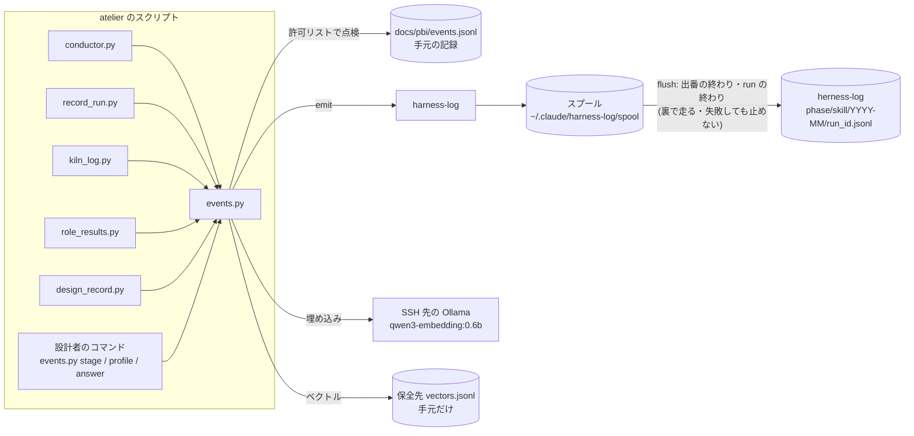
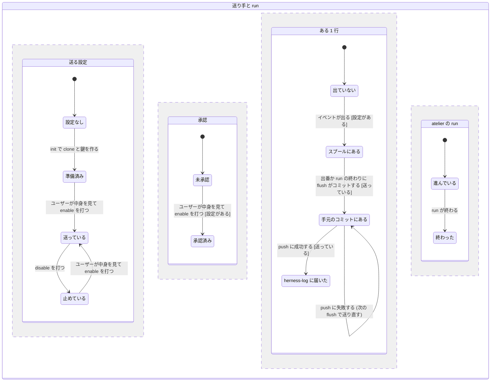

# ハーネスのための指標とログの送り先 (harness-log)

2026-11-11 にユーザーと design-flow で詰めた。atelier を改善するループ (ハーネス) に使う指標を見直し、集めたログを private のリポジトリ (herness-log) に送る。今ある記録の棚卸しは [harness-metrics-inventory.md](../notes/harness-metrics-inventory.md) にある。用語は `skills/atelier/CONTEXT.md` に従う。

## Problem Statement

- atelier を改善するには、どこに費用がかかり、どこで差し戻され、どこでユーザーを待たせ、どこで後ろ盾に落ちたかを、run をまたいで比べる必要がある。今の記録は 10 か所以上に散らばり、結び付けるキーがそろっていない (conductor の run_id、kiln の run_id、work_key、design_id、session_id)。
- 工程ごとの時刻、問いを出した時刻と種類、出番ごとの費用、fallback の数が残らない。#40・#41 で増えた問い (使えない runner・OMM・recheck・不明点・Approve の ask) の答えは、多くが自由文でしか残らない。
- 記録には本文・自由文・絶対パスが混ざっているので、そのままでは外に集められない。
- 数字だけを集めると、タスクの難しさやジャンルの偏りが分からない。易しい run が続いて合格率が上がったのか、atelier が良くなったのかを区別できない。
- 集める先が決まっていない。atelier 以外のスキル (design-flow・review-flow など) も、いずれ同じ先に集めたい。

## Solution

- 改善の判断に使う指標を 5 つの軸 (費用・品質・人の手間・頑健さ・所要時間) に絞る。それを **イベント** (1 行 1 件の JSON) として、atelier の各スクリプトから出す。
- イベントは、どのスキルでも使える共通の **送り手** `harness-log` を通す。送り手は、スキルが渡した **許可リスト** (スキーマのファイル) にある項目だけを通す。そのうえで手元の **スプール** にため、出番の終わりと run の終わりに herness-log へ commit と push をする。
- タスクの形は、**タスクの特徴** (測った値と決まった語彙のタグ) と **アンカーとの近さ** (埋め込みで計算する) で表す。どちらも本文を外に出さずに済む。
- 送るのは、ユーザーが中身を見て `enable` してからにする。設定が無ければ何も送らない (atelier は公開リポジトリなので、ほかの人が使っても何も送られない)。

## User Stories

1. As a atelier の持ち主, I want 1 回の run のイベントが 1 つのファイルにまとまっていてほしい, so that run を頭から追える
2. As a atelier の持ち主, I want すべてのイベントに run_id・seq・stage・pbi が付いていてほしい, so that 散らばった記録を同じキーで結べる
3. As a atelier の持ち主, I want run・工程・役割・PBI・モデルごとのトークンと USD を知りたい, so that どの役割に安いモデルを当てるかを決められる
4. As a atelier の持ち主, I want 出番ごとの費用を、設計者・レビュー担当・テスト担当それぞれについて知りたい, so that 今は run 全体の合計でしか見えない役割の費用を比べられる
5. As a atelier の持ち主, I want 費用を測れなかった出番を「測れなかった」と区別したい, so that 0 円と測れなかったことを取り違えない
6. As a atelier の持ち主, I want PBI ごとの初回合格率を知りたい, so that モデルや起票の書き方の良し悪しを比べられる
7. As a atelier の持ち主, I want 差し戻しの原因を決まった分類 (spec・convention・scope・memory・model・env) で数えたい, so that 何を直せば差し戻しが減るかが分かる
8. As a atelier の持ち主, I want 原因が付いていない差し戻しの数も知りたい, so that 記録の抜けそのものを減らせる
9. As a atelier の持ち主, I want レビューの findings を重さごとの数で知りたい, so that レビュー担当がどのくらい見つけているかが分かる
10. As a atelier の持ち主, I want テストの失敗を「意図した変更」「壊した動き」「不明」の数で知りたい, so that テスト担当の仕分けの質が分かる
11. As a atelier の持ち主, I want ユーザーに出した問いの数を種類ごとに知りたい, so that 減らせる問いを見つけられる
12. As a atelier の持ち主, I want 問いを出してから答えが来るまでの待ち時間を知りたい, so that ユーザーを待たせている場所が分かる
13. As a atelier の持ち主, I want 使えない runner・OMM・recheck・不明点・Approve の ask・設計の承認を、種類として区別したい, so that #40・#41 で足した問いの効き目を測れる
14. As a atelier の持ち主, I want 問いに対してどれが選ばれたかを列挙値で残したい, so that 既定値を変える判断ができる (いつも cache が選ばれるなら既定を cache にする)
15. As a atelier の持ち主, I want 工程が run・skip・fallback・off のどれになったかと、それを決めたのが誰か (ユーザー・既定・自動・後ろ盾) を残したい, so that 後ろ盾に落ちた率が出せる
16. As a atelier の持ち主, I want 設計者の定義が無くて general-purpose で代わりに起こしたことを残したい, so that 入れ忘れの影響が見える
17. As a atelier の持ち主, I want 役割の値とその出所 (run・repo・home・default) を出番ごとに残したい, so that どの設定がどの結果に効いたかを比べられる
18. As a atelier の持ち主, I want 出番と工程の実時間を知りたい, so that 遅い工程が分かる
19. As a atelier の持ち主, I want 文脈の圧縮 (kiln) が起きた境界と圧縮前のトークンを、同じ run_id で残したい, so that 圧縮と失敗の関係を見られる
20. As a atelier の持ち主, I want タスクの大きさ・広がり・文脈の重さを段階に丸めて残したい, so that 難しさの違うタスクを分けて比べられる
21. As a atelier の持ち主, I want タスクの種類と領域を決まった語彙で残したい, so that ジャンルごとに比べられる
22. As a atelier の持ち主, I want 設計者の難しさの見立てと、実際の差し戻し数を並べたい, so that 見立てが当たっているかを測れる
23. As a atelier の持ち主, I want ジャンル × 大きさごとの件数の表 (coverage) を見たい, so that 試していない区画を意図して試せる
24. As a atelier の持ち主, I want 各 PBI が代表のタスク (アンカー) のどれに近いかを知りたい, so that 語彙のタグより細かく似たタスクを集められる
25. As a atelier の持ち主, I want 埋め込みのベクトルを手元にだけ置きたい, so that 本文に近い情報を外に出さずに済む
26. As a atelier の持ち主, I want 埋め込めなかった PBI を後から埋め込み直したい, so that SSH 先が寝ていた日の分も欠けずに済む
27. As a atelier の持ち主, I want 本文が要るときは、手元の cases.jsonl を case_id で引きたい, so that 本文を外に出さずに失敗の中身を読める
28. As a atelier の持ち主, I want 送る中身が許可リストで決まっていてほしい, so that 自由文・本文・パス・秘密が混ざらない
29. As a atelier の持ち主, I want 許可リストにない項目が落とされたことを、項目名だけで知りたい, so that 許可リストの直し忘れに気付ける
30. As a atelier の持ち主, I want 自分のリポジトリ (`reeschan/*`) の名前はそのまま、ほかのリポジトリとブランチは鍵付きのハッシュで残したい, so that 仕事のリポジトリの名前を出さずに、同じリポジトリの run を結べる
31. As a atelier の持ち主, I want 送る前に、スプールにたまった中身をそのまま見たい, so that 何が送られるかを確かめてから送り始められる
32. As a atelier の持ち主, I want `enable` するまでは送られないようにしたい, so that 承認の前に外へ出ない
33. As a atelier の持ち主, I want いつでも `disable` で送るのを止めたい, so that 止めている間もスプールにたまり、再開したときにまとめて送れる
34. As a atelier の持ち主, I want 送れなかったときに run が止まらないようにしたい, so that ネットワークや GitHub の不調で開発が止まらない
35. As a atelier の持ち主, I want 送れなかった分は次の flush で送り直されてほしい, so that 欠けが出ない
36. As a atelier の持ち主, I want 出番が終わるたびに送られてほしい, so that 長い run の途中でも様子が見える
37. As a atelier の持ち主, I want 1 回の flush が 1 つのコミットになってほしい, so that コミットの数が出番の数にとどまる
38. As a atelier の持ち主, I want ログが `<開発段階>/<スキル>/<年月>/<run_id>.jsonl` に並んでほしい, so that 段階ごと・スキルごとに集められる
39. As a 別のスキル (design-flow・review-flow など) の作者, I want 同じ送り手に、自分の許可リストと段階を渡して送りたい, so that 送る仕組みを作り直さずに済む
40. As a atelier をほかの人が使うとき, I want 設定が無ければ何も送られず、何も止まらないでほしい, so that 公開のスキルが勝手に外へ送らない
41. As a ハーネスの作者, I want 各行に外枠の版 (`harness.event/1`) と中身の版 (`atelier.event/1`) が付いていてほしい, so that 版が変わっても読み分けられる
42. As a ハーネスの作者, I want herness-log の直下に、項目の一覧 (SCHEMA.md) がほしい, so that ログだけを見て意味が分かる
43. As a atelier の持ち主, I want 手元の `docs/pbi/events.jsonl` にも同じイベントが残ってほしい, so that 送るのを止めていても、手元で集計できる

## Implementation Decisions

### 指標の軸と、使う判断

| 軸 | 指標 | 使う判断 | 出所のイベント |
|---|---|---|---|
| 費用 | run・工程・役割・PBI・モデルごとのトークン 4 種と USD。測れなかった出番の数 | 役割ごとのモデルの当て方、安い runner の採否 | `episode.cost`・`pbi.attempted` |
| 品質 | 初回合格率、差し戻しの回数と原因の分類、原因なしの差し戻しの数、findings の重さごとの数、テストの失敗の分類 | 起票の書き方、モデルの段、レビューの観点 | `pbi.attempted`・`review.judged`・`test.judged` |
| 人の手間 | 問いの数を種類別に、待ち時間、選ばれた答え | 問いを減らす、既定値を変える | `question.asked`・`question.answered`・`stage.decided` |
| 頑健さ | fallback・skip・使えない runner・出番のやり直し・設計者の代替起動の率 | 後ろ盾の要否、runner の入れ替え | `stage.decided`・`pbi.attempted`・`episode.ended` |
| 所要時間 | 出番と工程の実時間、PBI の attempt ごとの秒 | 遅い工程の見直し | `episode.started`/`ended`・`pbi.attempted` |

難しさとジャンルの補いには `task.profiled` を使う。どの指標も、`task.profiled` の段階とタグで層に分けて比べる。

### イベントの外枠 (harness.event/1)

送り手が付ける。スキルは `data` と、外枠のうち `run_id`・`seq`・`stage`・`pbi`・`type` を渡す。

| 項目 | 意味 |
|---|---|
| `schema` | `harness.event/1` |
| `ts` | UTC の ISO 8601 (秒まで) |
| `phase` | 開発段階。`design`・`implement`・`review`・`test`・`release`・`ops`・`other` のどれか |
| `skill`・`skill_version` | 送ったスキルとその版 (atelier は `atelier`、版は CHANGELOG の先頭の版) |
| `data_schema` | `data` の版 (atelier は `atelier.event/1`) |
| `repo` | 許可リスト (`show_repos`、glob) に合えば `owner/name`、合わなければ `h:<12 桁>`。git の remote が無ければ `none` |
| `branch` | 常に `h:<12 桁>` |
| `host` | 端末の名前の `h:<12 桁>` |
| `run_id`・`seq`・`stage`・`pbi` | 結び付けキー。無ければ null |
| `type` | イベントの種類 |
| `data` | 許可リストで点検した中身 |
| `dropped` | 許可リストに無くて落とした項目の名前 (値は入れない)。無ければ省く |

- ハッシュは HMAC-SHA256 で、鍵は `init` が作る乱数。先頭 12 桁を使う。鍵の無い sha256 では、名前の候補を試せば元に戻せてしまうため。
- `run_id` が無いイベント (conductor を通さずに動かしたとき) は、`adhoc-<UTC の日付>` のファイルにまとめる。

### atelier のイベント (atelier.event/1)

許可リストは `skills/atelier/harness.schema.json` に置き、送り手と `events.py` が同じファイルを読む。値の型は、整数・数・真偽・列挙・短い識別子 (英数字と `._:/@-`、64 字まで) と、それらの入れ子だけにする。自由文の型は作らない。

| type | 出す人・いつ | data の項目 |
|---|---|---|
| `run.started` | conductor の start | `workflow`・`launch`・`roles_from` (役割ごとの出所) |
| `run.ended` | conductor が finished・aborted にしたとき | `result` (finished/aborted)・`episodes`・`waves`・`pbis`・`seconds` |
| `episode.started` | conductor の next・run (起動したとき) | `episode`・`wave`・`launcher` (agent/headless)・`designer` (installed/fallback)・`roles` (役割ごとに model・effort・from) |
| `episode.ended` | conductor の done (結果を受け取ったとき) | `episode`・`status`・`reason` (列挙)・`seconds`・`failures`・`next_episode` |
| `episode.cost` | 出番の後片付け (裏で走る) | `episode`・`method` (transcript/headless/unmeasured)・役割ごとの `requests`・`input`・`output`・`cache_read`・`cache_write`・`usd` |
| `stage.decided` | 設計者のコマンド・lint_run approve | `component`・`decision` (run/skip/fallback/off/repo/cache/report-only/fix/next-runner/stop)・`by` (user/default/auto/fallback)・`reason` (列挙) |
| `pbi.attempted` | record_run | `attempt`・`step`・`rework`・`runner`・`model`・`tier`・`effort`・`outcome` (pass/sent-back/promoted/unusable/held)・`causes`・`findings` (重さごとの数)・`unchanged`・`seconds`・トークン 4 種・`usd`・`case_id` |
| `review.judged` | role_results check (review の結果) | `report`・`recommendation`・`findings` (重さごとの数)・`criteria` (pass/fail/unknown の数) |
| `test.judged` | role_results check (test-result) | `kind` (wave/survey/final)・`passed`・`failed`・`failing` (intended/regression/unknown の数) |
| `question.asked` | conductor (出番の結果か進行役の問いを受けたとき) | `kind` (approve/rework-limit/destructive/send-approval/decision/handoff-loop/launch-failure)・`topic` (runner-unavailable/omm/recheck/unknown/approve-ask/design-approval/headless/other)・`items` |
| `question.answered` | conductor の answer・設計者のコマンド (inline の問い) | `kind`・`topic`・`choice` (列挙。分からなければ null)・`wait_s`・`revise` |
| `task.profiled` | 設計者のコマンド (plan の確定時は PBI ごと、finish のときは run 全体) | 測った値・タグ・近さ (次の節) |
| `context.compacted` | kiln_log | `boundary`・`role`・`phase`・`regime`・`tokens_before`・`action` |

- 問いの `topic` は、出番の結果の question に任意の項目として足す (無ければ `other`)。設計者の付録で、使えない runner・OMM・recheck・不明点の問いに付ける値を決める。
- 答えの `choice` は、スクリプトで分かるときだけ埋める (Approve の返信なら `parse_choices`)。選択の中身は、多くの場合 `stage.decided` (OMM の repo・cache・skip、recheck の skip・report-only、runner の next-runner・stop) で残る。両方を `run_id`・`seq` で結ぶ。
- 役割の値の出所は、`episode.started` の `roles` と `run.started` の `roles_from` に入れる。値が不正で読み飛ばした warn も、`roles` の出所が `default` になることで分かる。
- 今ある記録 (runs.jsonl・run.json など) は変えない。イベントは足すだけ。kiln の記録には conductor の run_id を `atelier_run_id` として足す。

### タスクの特徴 (task.profiled)

- **測った値** (スクリプトが計算する。段階に丸め、細かい数は送らない):
  - 大きさ: 変更したファイルの数・行の数 (`git diff --numstat` の base_commit から)、PBI の数、wave の数、PBI の入力の文字数
  - 広がり: 触ったトップレベルのフォルダの数、言語の数、テストのファイルを触ったか
  - 文脈の重さ: リポジトリのファイル数 (`git ls-files`)、CLAUDE.md と規約の行数、refs と memory の数
  - 技術: 言語 (拡張子の表から)、フレームワーク (`package.json`・`pyproject.toml` などの依存名を、taxonomy の許可リストと突き合わせる)
  - 段階の境目は `taxonomy.json` に置く (例えばファイル数は 1・2–3・4–8・9–20・21+)
- **タグ** (設計者が選ぶ。語彙の外は弾く):
  - `task_type`: feature・bugfix・refactor・test・docs・infra・migration・perf
  - `domain`: frontend・backend・cli・library・data・infra・docs・skill
  - `difficulty_hint`: low・mid・high
- **アンカーとの近さ**: PBI の目的と受け入れ条件の節 (run 全体では goal) を、SSH 先の Ollama (`qwen3-embedding:0.6b`、shared-memory と同じトンネル) で埋め込む。`taxonomy.json` のアンカー (代表のタスクの文) とのコサイン類似度の上位 3 つを、`anchor_id` と近さ (小数 2 桁) で送る。アンカーのベクトルは手元にキャッシュする (taxonomy の版とモデルをキーにする)。
- ベクトルは保全先 (`~/.claude/pbi-runs/<repo>/<branch>__W-n/vectors.jsonl`) にだけ書き、`case_id`・モデル・次元を添える。herness-log には送らない (埋め込みからは元の文がある程度戻せるため)。
- 埋め込めなかったときは、近さを null にして続ける。`events.py backfill` が、近さが null の PBI を cases.jsonl から埋め込み直し、`task.profiled` を出し直す。本文が atelier の側にあるので、backfill は送り手ではなく atelier に置く (合意のときの `harness-log backfill` から場所だけ変えた)。
- `taxonomy.json` には版 (`taxonomy_version`) を付ける。語彙・段階の境目・アンカーを変えたら版を上げ、`task.profiled` に版を入れる。

### 送り手 harness-log

- 置き場所は `skills/harness-log/`。中身は、小さな Python の CLI (`harness_log.py`) と、短い SKILL.md (いつ使うか)。標準ライブラリと git だけを使う。atelier は送り手を import で使い、見つからなければ手元の events.jsonl にだけ書く。
- 設定は `~/.claude/harness-log.json` に置く (環境変数 `HARNESS_LOG_CONFIG` で場所を変えられる)。項目は `remote`・`enabled`・`key`・`show_repos`・`clone_dir`・`spool_dir`・`embedding` (`url`・`model`)。設定が無ければ、emit も flush も何もしない。
- 操作:
  - `init --remote <URL>`: 設定を `enabled: false` で作り、鍵を作り、clone を用意する。送らない。
  - `emit` (関数としても使える): 許可リストで点検し、外枠を付け、スプールの `<phase>/<skill>/<YYYY-MM>/<run_id>.jsonl` に追記する。
  - `flush`: `enabled` のときだけ動く。ロックを取り、`pull --rebase` し、スプールの行を clone の同じパスに追記する。`coverage.json` と `SCHEMA.md` を作り直して、1 回のコミットにする。push に成功しても失敗しても、コミットに入れた行はスプールから消す。コミット済みで push していない分は、次の flush で送る。
  - `preview`: スプールの行と、まだ push していないコミットを、そのまま表示する。
  - `enable`・`disable`: 送るかどうかを切り替える。止めている間もスプールには書く。
- flush はどこでも失敗を外に投げない。標準エラーに 1 行出し、終了コード 0 で返す (呼び出し側の run を止めないため)。
- herness-log の並び:
  - `<phase>/<skill>/<YYYY-MM>/<run_id>.jsonl`: イベント
  - `<phase>/<skill>/coverage.json`: `task.profiled` の run 全体の行を、`task_type` × `domain` × 大きさの段階で数えた表
  - `SCHEMA.md`: 外枠の項目と、スキルごとの許可リストの写し

### atelier への組み込み

- `skills/atelier/events.py` を足す。役割は 3 つ。今の run の `run_id`・`seq` を run.json から読むこと、許可リストで点検して手元の `docs/pbi/events.jsonl` に書き、送り手に渡すこと、設計者が打つコマンド (`stage`・`profile`・`answer`・`backfill`) を受けること。どの失敗も呼び出し側を止めない。
- conductor は start・next・done・answer・abort でイベントを出す。出番が終わるたびと run の終わりに、`events.py settle` を裏で起こす (出番の費用を `agent_stats` で集めて `episode.cost` を出し、そのあと flush する)。run.json の `question` に `asked_at` を足す。
- record_run・role_results (check)・kiln_log・design_record (check-reply)・lint_run (approve) は、それぞれ自分の書き込みの横でイベントを出す。
- 設計者の付録に、いつどのコマンドを打つかを書く (stage record を書くとき・plan を確定したとき・inline で問いに答えを受けたとき・finish のとき)。本文には 1 行の道しるべだけを足す。

### 送り始めの流れ

4 つの領域が並んで動く。同じ名前のきっかけ (`enable を打つ`) は、そのきっかけを持つ領域を同時に動かす。

- 2026-11-11 に pstack の `/statechart` (from-chart) で、英語のラベルの写しを検査した (TLA+ の文字列は ASCII に限られるため)。3 つの規則はどれも成り立った (22 状態・47 遷移、規則を破る状態は 0)。検査の途中で、設定が無いのに `enable` で承認済みになれる穴が見つかったので、承認の遷移に「設定がある」の条件を足した。
- 図の push の失敗は「ある 1 行」の領域だけを動かし、「atelier の run」の領域には何もしない。送れなかったことで run が止まらない、という決まりは、この形で表している。
- 図に出てこない決まりは、テストで確かめる。許可リストに無い項目の値がスプールにも herness-log にも入らないこと、一度コミットに入れた行が二度送られないこと、の 2 つ。

## Testing Decisions

- 良いテストは、外から見える振る舞いだけを確かめる。CLI に渡したもの・書かれたファイル・git のリポジトリに入ったものを見る。関数の中の手順は見ない。リポジトリの今のテストと同じく、`unittest` で、一時ディレクトリと `subprocess` か `main(argv)` を使う。
- **合意済みの seam**:
  1. **送り手の CLI と関数** (`skills/harness-log`): 設定を一時ファイルにし、送り先を手元の bare リポジトリにして、`init`・`emit`・`preview`・`enable`・`flush`・`disable` を通しで確かめる。許可リストの外の項目が落ちること、`enabled: false` では bare リポジトリに何も入らないこと、push の失敗 (送り先を消す) で終了コード 0 とスプールの保持、次の flush での送り直し、二重に送らないこと、ハッシュと `show_repos` を確かめる。
  2. **conductor の CLI** (`test_conductor.py` の今の作り): start → next → done → answer → finish を通し、`docs/pbi/events.jsonl` に出た行 (種類・run_id・seq・待ち時間) を確かめる。送り手の設定が無いときに、何も送らず run が今までどおり進むことも確かめる。
  3. **events.py の CLI**: `stage`・`profile`・`answer` の語彙の点検、`profile` の測った値 (一時の git リポジトリで)、埋め込みを偽の HTTP サーバーで返したときの近さ、つながらないときの null、`backfill`。
  4. 記録を書く各スクリプト (record_run・role_results・kiln_log・design_record・lint_run) は、今のテストに「イベントの行が 1 つ出る」ことを足すだけにする。
- 先例: `test_conductor.py` (CLI を通しで回す)、`test_record_run.py` (一時の docs/pbi と偽の会話記録)、`test_omm_cache.py` (home の外のキャッシュ)。

## Out of Scope

- session-log (会話の全文を Proton Drive に残すスキル) から herness-log へ送ること。
- session-log の Jev 列が atelier の使用を数えていないことの修正。
- 名前がぶつかっている所の改名 (kiln の run_id と conductor の run_id、統計の `stats/roles.json` と設定の `roles.json`)。
- design-flow・review-flow からの送信 (送り手は共通にしておき、後で各スキルが許可リストを持って使う)。
- 埋め込みのベクトルを SSH 先の OpenSearch に置くこと (件数が増えて手元の近傍検索が遅くなったら検討する)。
- herness-log の中身を集計・可視化する側 (harness2 などのハーネス)。
- `~/.claude/skills/atelier` (今は v7.3) への反映。リポジトリで実装とテストを終えたあと、`skill-versioning` で版を足す。

## Further Notes

- 送り先の URL はリポジトリに書かず、ホームの設定にだけ置く。
- herness-log への push と、atelier への push・PR は、どちらもユーザーが頼んだときだけ行う。送り始め (`enable`) は、`preview` の見本をユーザーが見てから行う。
- 送り手は atelier の用語を知らない (ハーネスと Jev の境界の決まりと同じく、スキル固有の項目はスキルの許可リストにだけ置く)。
