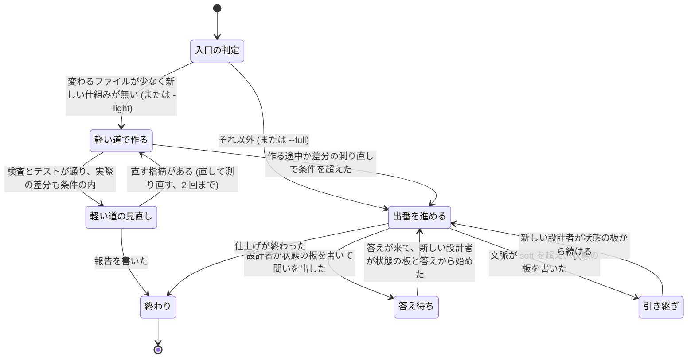

# 設計者の段の数とトークンを減らす

合意: 2026-11-15、持ち主と design-flow の聞き取り (Q1〜Q24) で決めた。答えはすべて推すとおり。Q1〜Q18 のあとにデメリットを点検し (6 つの調べ役と 1 つの反論役、指摘 88 件)、その結果で Q19〜Q24 を決め直した。材料は example-org/example-app の Case-B の run (run id `0463c999`。Atelier v7.11 で始まり、途中から v7.13) の記録で、数字は会話記録の usage から数え直した値。

直しは 3 つの PR に分ける (Q24)。PR-1 は起動を軽くする直し、PR-2 は問いをまとめる直し、PR-3 は軽い道。効き目の大半は PR-1 にある。

## Problem Statement

Case-B は 58 ファイルほどの直しだった。それでも Claude 側だけで約 2 億 6,800 万トークン・約 $128 かかり、そのうち設計者が 1.372 億トークン (1,156 リクエスト、43 episode) を使った。持ち主は「この程度の修正でこんなにかかるのは過剰すぎる」と判断した。数え直すと、重さは次のとおり。

- **起動の下地**: `atelier-designer` の定義が `~/.claude/agents` に無く、41 回の起動がすべて general-purpose の代わりの起動だった。全部の道具の定義・全部のスキルの一覧・全部の MCP を毎回抱え、最初のリクエストの時点で文脈が 6.35 万ある。この下地 × リクエスト数で約 7,300 万トークン、設計者の 53% になる。
- **起動の読み込み**: 作業を始めるまでに文脈が中央値で +3.75 万増え、作業を始める時点で中央値 10.1 万ある。`designer.md` (約 1 万トークン) は 42 episode すべてで丸ごと読まれ、`appendix/episodes.md`・`kiln.md`・`tests-at-end.md` もほぼ毎回読まれていた。スキル文書の読み込みの持ち越しは約 1,948 万。STATUS.md (26.8KB) は 103 回読まれた。
- **Kiln の引き継ぎ**: 作業開始の時点で soft の 12 万まで 1.9 万しか残らない。15 回の handoff はすべて soft の suggest で起きていた。
- **問いのたびの起動し直し**: 問いは 15 回で、答えのあとは毎回新しい設計者が一から読み直していた (合計 663 万)。聞き取り 3 回と「理解が揃ったか」の確認 1 回は、2 回目からの答えがすべて推すとおりだった。実行先の選び直しの問いは 3 回出た。
- **入口が 1 つ**: 小さな作業でも、Atelier に入ると必ず design の episode から始まる。

## Solution

- **PR-1 起動を軽くする**: 設計者を、定義を通して起動する (定義を入れるか、入れないなら headless の claude に `--agents` で渡す)。ふだんの設計者の定義には `Skill` を持たせない。設計者は段ごとに要るものだけを、conductor が 1 つにまとめたファイルから読む。STATUS.md から段の記録を外し、状態の板の形と上限を決める。作業開始の文脈を実測して残す。
- **PR-2 問いをまとめる**: 聞き取りの最後の回に「揃ったか」を含める。推す答えを前提にした子の問いを先に聞く。map と optional の問いを聞き取りの 1 回目に載せる。方向が決まっている作業では、決まっていない点だけを 1 回で聞く。使えない実行先の答えを run の残りに効かせる。
- **PR-3 軽い道**: 呼び手が `start` の前に `lane.py` で道を決める。小さな作業は、呼び手のセッションで作り、検査とテストを流し、作り手と別の系統のモデルで見直す。

問いの答えのあとに同じ設計者を続ける直し (Q1・Q2) は後回しにする (Q21)。効き目は Case-B で約 −120 万 (0.9%) だが、壊れ方が 9 つ見つかった。PR-1・PR-2 のあとの run で測り直してから、入れるかを決める。

## User Stories

1. 利用者として、設計者の起動のたびに、使わない道具・スキルの一覧・MCP の費用を払いたくない。
2. 利用者として、設計者の定義を入れるかどうかは 1 回だけ聞かれ、その答えが残ってほしい。入れなくても、軽い起動で動いてほしい。
3. 利用者として、設計者が段ごとに要るものだけを読み、毎回すべての手順を読み直す費用を払いたくない。
4. 利用者として、圧縮のせいで、使えるはずのレビューのスキル・関所・手順が黙って抜け落ちないでほしい。
5. 利用者として、聞き取りは少ない回数で終わってほしい。ただし、推す答えと違う答えを出せる場は残してほしい。
6. 利用者として、使えない実行先について一度答えたら、同じ run で同じ問いを繰り返されたくない。
7. 利用者として、小さな直しは Atelier の段を通さず、1 つのセッションで作って見直す道で済ませたい。
8. 利用者として、どちらの道に回ったかと理由を 1 行で知り、引数 (`--light` / `--full`) で上書きしたい。
9. 持ち主として、規則はどの実行にも当てはまる一般の形で書かれていてほしい。1 回の実行の数字は、規則の中身にしない。
10. 持ち主として、段ごとに読む量が増えすぎたら、テストで気づきたい。
11. 持ち主として、閾値を後で合わせ直せるよう、作業開始の文脈と軽い道の実行が記録に残ってほしい。

## Implementation Decisions

### 決めたこと

| Q | 決めたこと | PR |
|---|---|---|
| Q1・Q2 | 問いの答えのあと同じ設計者を続ける案は、Q21 で後回しにした | — |
| Q3 | `start` が定義を確かめ、無ければ呼び手が 1 回だけ聞く (`~/.claude/agents` / 作業ルートの `.claude/agents` / 入れない)。答えは `agents.json` に残す | 1 |
| Q4 | designer.md を核と段ごとのファイルに分ける。conductor が段で読むものを 1 つのファイルにまとめ、依頼文の `Read first:` で名指す。読む量の上限をテストで検査する | 1 |
| Q5 | STATUS.md の段の記録を `docs/pbi/stages.md` に移す。状態の板の形と上限を決め、設計者が自分で検査する | 1 |
| Q6 | Kiln の閾値を作業開始 + 余裕にする案は、Q20 で取り下げた | — |
| Q7 | 聞き取りの最後の回に「揃ったか」を含める。推す答えを前提にした子の問いを同じ回で先に聞く。聞き取りの前の問いを 1 回目に載せる (Q23 で範囲を絞った) | 2 |
| Q8 | 方向が決まっていれば聞き取りを飛ばす案は、Q19 で「縮める」に替えた | — |
| Q9 | 使えない実行先の問いに「この run の残りはこの実行先を飛ばす」を足す | 2 |
| Q10〜Q13 | 呼び手が `start` の前に `lane.py` を流し、機械の信号で道を決める。軽い道の条件・中身・上書き | 3 |
| Q14 | E2E が 0 本だった件は別の作業で直す | — |
| Q15 | ふだんの設計者の定義の tools から `Skill` を外す (Q22 の例外付き) | 1 |
| Q16 | headless の MCP は絞らない | — |
| Q17 | CLAUDE.md とユーザー設定は読ませたまま | — |
| Q18 | 定義を入れない家・定義が見つからないとき・定義を入れたばかりのセッションでは、設計者を headless の claude (`--agents`) で起動する | 1 |
| Q19 | 方向が決まっている作業でも聞き取りは飛ばさず、ゴールと添付が決めていない点だけを 1 回で聞く。0 件のときだけ飛ばす。添付が作業の起点より古いときは、方向が決まっているに数えない | 2 |
| Q20 | Kiln の soft 12 万・peak 18 万は変えない。作業開始の文脈を実測して記録に残し、PR-1 のあとの run で見直す | 1 |
| Q21 | 同じ設計者を続ける直しは、この 3 つの PR から外す | — |
| Q22 | 設計者の定義を 2 つ持つ。ふだんは `Skill` なし、その episode で Skill ツールを要る部品を使うときだけ `Skill` 付き。スキルを使えるかは `flow.py` が解決した状態で決める | 1 |
| Q23 | 聞き取りの 1 回目にまとめるのは map と optional の問いだけ。「設計するか」は今どおり単独で聞く。「揃ったか」は推す印の無い問いにする | 2 |
| Q24 | PR を 3 つに分け、PR-1 から順に出す | — |

### 起動の下地の実測 (2026-11-15)

`claude -p` に「ok とだけ返す」を送り、最初のリクエストの文脈を測った。フックは切り、作業フォルダは example-org のリポジトリ。

| 起動の仕方 | 下地 |
|---|---|
| 定義なし (general-purpose 相当) | 55.6k |
| 設計者の定義あり (今の headless) | 34.0k |
| 定義あり + 定義の tools から `Skill` を外す | 21.9k |
| 定義あり + MCP を shared-memory だけ | 32.8k |
| `Skill` を外し、MCP も絞る | 20.7k |
| さらに CLAUDE.md とユーザー設定を読まない | 17.0k |
| 定義から `ToolSearch` も外す (参考) | 23.0k |

`Skill` があると、入っている全部のスキル (プラグインのものを含む) の一覧が毎回載る。Case-B の agent の起動 (general-purpose の subagent) は 63.5k だった。

PR-1 の定義での実測 (同じ条件。subagent は `claude -p --agents` の main から Agent tool で起こした、その subagent の最初のリクエスト):

| 定義 | headless | Agent tool の subagent |
|---|---|---|
| general-purpose | 55.6k | 47.4k |
| `atelier-designer-skills` (Skill 付き) | 34.0k | 31.2k |
| `atelier-designer` (Skill なし) | 21.9k | 19.1k |

### PR-1 起動を軽くする

#### 1a. 定義を通して起動する (`conductor.py`・`setup_agents.py`・`agents/*.md`・`appendix/setup.md`・`SKILL.md`)

- `start` が、`~/.claude/agents/` (または `CLAUDE_CONFIG_DIR`) と作業ルートの `.claude/agents/` に Atelier の定義 (`atelier-designer.md`・`atelier-designer-skills.md`・`atelier-reviewer.md`・`atelier-tester.md`・`pbi-worker.md`) があるかを調べる。
- 定義が足りず、`agents.json` に `agent_defs` の記録も無ければ、`start` は `ask agents:` の行を出して終了コード 2 で止まる。`ask harness-log:` も要るときは、2 つの行を 1 回で出す。呼び手は AskUserQuestion で 1 回だけ聞き、`python <skill>/setup_agents.py defs --install home|work|none` を流してから、`start` をもう一度流す。
  - `home`: `~/.claude/agents/` に写す。
  - `work`: 作業ルートの `.claude/agents/` に写し、`.claude/agents/` を `.git/info/exclude` に足す (コミットに混ざらないように)。
  - `none`: 写さない。設計者は headless の claude で起動する。設計者ごとにフックが動き、呼び手の画面に設計者の動きが見えないことを、問いの選択肢の説明に書く。
- `defs --install` は `agents.json` に `agent_defs` (`home`・`work`・`none`)・写した定義のハッシュ・写したセッションの ID (呼び手の環境の `CLAUDE_CODE_SESSION_ID`、無ければ空) を書く。
- 写す定義の frontmatter に `atelier-defs: <整数>` を入れる (`setup_agents.py` の `DEFS_VERSION` と同じ。定義を変えたら上げる)。`start` は、写したハッシュと今のファイルが同じで、同梱の版が新しいときだけ写し直し、`warn agents: updated <files> (next session)` を出す。ハッシュが違う (利用者が手で直した) ときは上書きせず、同梱の版を `<file>.atelier-new` として隣に置き、`warn` を出す。
- **起動の仕方の決め方** (`next`): 次の順で、最初に当たったものを使う。
  1. 定義が読み込まれている (定義のファイルがあり、写したセッションが今の呼び手のセッションと違う) launch `agent` の run: 今までどおり Agent tool で、`subagent_type` は定義の名前。
  2. それ以外で `claude` の CLI が使える: headless の claude。`next` は `launch: headless (<理由>)` と `then: ... run --detach` を出す。理由は `no agent definition`・`definition installed this session`。`designer_argv` は `--agents` で同梱の定義を渡す。
  3. `claude` の CLI が無い、または headless の起動が 2 回続けて終了コード 0 以外か `is_error` で終わった: 今の general-purpose の代わりの起動。`warn agents:` を出す。
- reviewer と tester も 1. と同じ判定で、読み込まれていなければ今の代わりの起動 (general-purpose と定義を読む行) にする。
- `atelier-defs` の無い (または `DEFS_VERSION` より古い) 定義は、足りないものとして数える (前の版の手順で手で写した古い定義を、読み込まれているとみなさない)。`defs --install` は、写す先に別の中身の定義があれば `<file>.atelier-old` として隣に残してから写す。
- SKILL.md の Loop に「Agent tool が `Agent type not found` を返したら `next --relaunch --agent-type-missing` を流す (conductor は、このセッションの残りの起動を headless か代わりの起動に替える)」を足す。旗の無い `--relaunch` (止まった設計者の起こし直し) では、定義での起動のまま。headless の節に「`wait` は `run_in_background` で流し、終わりの通知で次に進む」「ユーザーが止めたいと言ったら `conductor.py abort` を流す」を足す。
- headless の設計者の環境に `ATELIER_EPISODE=<run>.<seq>` を渡す (フックが Atelier の episode を見分けられるように)。

#### 1b. 設計者の定義を 2 つにする (`agents/atelier-designer.md`・`agents/atelier-designer-skills.md`・`flow.py`・`conductor.py`・`appendix/engine.md` ほか)

- `agents/atelier-designer.md` の tools から `Skill` を外す。`agents/atelier-designer-skills.md` は今の tools (`Skill` 付き) のまま、本文は同じ。
- **スキルを使えるかの判定を flow.py に移す**: `flow.py` の `status()` は、kind `skill` の行を `check skill list` でなく、次のどれかにする。
  - `skill ok <SKILL.md のパス>`: `find_skill_file` で見つかった。プラグインのものは、`installed_plugins.json` の版の置き場 (`installPath`) から取り、marketplaces の写しは使わない。
  - `skill builtin`: Claude Code に組み込みのスキル (`code-review`・`security-review` などの固定の一覧)。
  - `skill missing`: どちらでもない。
- `engine.md`・`review.md`・`design.md`・`adapters.md`・`finish.md` の「スキルの一覧にあれば」は、すべて `flow.py` の状態 (`ok` か `builtin`) で決める書き方に改める。`where: subagent` の行は、Skill を持つ子 (reviewer・tester) が `BLOCKED` か not found を返したときだけ fallback にする。
- **どちらの定義で起こすか**: 部品の JSON に任意の `needs_skill_tool: true` を足す (中で Skill ツールを呼ぶスキル、`$ARGUMENTS` を置き換える前提のスキル、組み込みのスキルを `where: main` で使う部品)。`component.py add` は、`where: main` の kind `skill` の部品に既定でこれを付ける。conductor は、その episode が走らせる段 (design の episode なら understand・design・map・lint-survey・plan・route と、その後ろの optional・gate) に、使える行で `where: main` かつ `needs_skill_tool` の部品があるときだけ、`atelier-designer-skills` で起こす。それ以外は `atelier-designer`。`flow.py` に、episode ごとにこれを返す関数を置く。
- `where: main` の kind `skill` で `needs_skill_tool` の無い部品は、設計者が `flow.py` の出したパスの SKILL.md を読んで従う (read-skill と同じ。手順は `appendix/engine.md` の read-skill の節、その段の Read first に入れる)。
- **既存の不具合も直す**: `adapter_gate.py` の review-skill の選び方は、名前の順で最初の「review」を取るので、example-org では `repo-review` でなく `review-agent-content-security` が選ばれていた。agents.json の名前 → 決まった名前 (`repo-review`・`code-review`・`review`) → 名前に `review` を含み `security`・`content` を含まないもの → 残り、の順にする。

#### 1c. 段ごとに読むもの (`designer.md`・`episode/*.md`・`read_first.json`・`conductor.py`・`prompts/designer-episode.md`・`appendix/episodes.md`・`appendix/conductor.md`)

- `designer.md` を核にする: Who you are・When to stop・Invariants・Re-entry・Keep the context small・Working memory の要約・Read on event の表、inline のときに段の順で読むファイルの小さな表。
- 段の手順は `episode/design.md` (Start・Run the stages・Approve の前まで)・`episode/build.md`・`episode/test.md`・`episode/review.md`・`episode/fix.md`・`episode/finish.md` に移す。build・test・fix が使う One PBI は `episode/one-pbi.md`、design と build (stale の再承認) が使う Approve は `episode/approve.md` に分けて共有する。
- `appendix/episodes.md` には設計者が使う節 (Episode result・Links・Questions・Kiln・Bundle・Reconcile・Fallback when a definition is missing・no-agent-tool・Depth) を残す。呼び手と conductor だけが使う節 (Launch の呼び手の部分・Status・Done preconditions の表) は `appendix/conductor.md` に移す。
- **読むものの表** `read_first.json`: キーは (episode, 入口)。入口は `first`・`answer:<kind>[:<topic>]`・`continue`・`escalated`・`lead`。値は `<file>` か `<file>#<見出し>` の並び。conductor が `Continue from`・`Answer`・`Escalated`・`Lead` から入口を決める。
- **1 つのファイルにまとめる**: conductor は、表の並びをつなげて `docs/pbi/conductor/episodes/<seq>-read.md` に書く。節を切り出すときは、そのファイルの最初の見出しまでの前置きを必ず付ける。依頼文の `Read first:` の行はこのファイルを名指し、設計者は最初に 1 回だけ Read する。`designer.md` を丸ごと読む行はやめる。
- まとめたファイルの最後には、次の 2 つを必ず載せる。
  - **Kiln**: 状態の板のパス・見出しの雛形・上限・`kiln_log.py` の完全な引数・各 action (`ok`・`suggest`・`compact`・`handoff`・`aux_on`) の動き・「読み終えたら `--boundary start` で 1 回測る」。kiln.md の「区切りのたびに読む」はやめる。
  - **問いの原稿**: 問いを出しうる episode には、問いの原稿の 6 つの節と `design_record.py lint --kind` の 1 行。種類ごとの表は、その種類の問いを書くときに `appendix/questions.md` を読む。
- `test_read_first.py` (新しいテスト): 表のすべてのファイルと見出しがあること、episode と入口ごとの合計が上限 (`read_first.json` の `limits`) 以下であること、build・test・fix に `episode/one-pbi.md` が入っていること、design と build に `episode/approve.md` が入っていることを確かめる。
- `test_references.py` の対象に `episode/*.md` を足し、`<file>#<見出し>` の参照は見出しがあるかまで確かめる。

#### 1d. 状態の記録 (`appendix/engine.md`・`appendix/kiln.md`・`kiln_log.py`・`conductor.py`)

- 段の記録 (stage record) は `docs/pbi/stages.md` に書く。STATUS.md は見出しの行と PBI の表だけにする。STATUS.md の見出しの行 (Work key・Workflow) を読むスクリプトはそのまま。`stages.md` が無い run (途中の run) では、今どおり STATUS.md の段の記録を読む。
- handoff の進みの検査 (`conductor.py` の handoff_count) は、STATUS.md と `stages.md` を合わせた sha256 で測る。
- run 全体の行き止まり (試して駄目だったこと) は `docs/pbi/dead-ends.md` に書き、build・test・fix・review の Read first に入れる。状態の板の上限には数えない。
- **状態の板の形**: 任意の H1 のあと、`## Objective`・`## Facts`・`## Changes`・`## Verification`・`## Dead ends`・`## Remaining plan` の 6 つ (番号は付けても付けなくてもよい)。雛形は kiln.md と、まとめた Read first のファイルに置く。
- `python <skill>/kiln_log.py tablet-check <path>` (新しい): 6 つの見出しがそろい、ほかの `##` が無く、文字数が上限 (`kiln.json` の `tablet_max_chars`、既定 6000) 以下かを確かめる。行数の下限は見ない。設計者は板を書いた直後に流す。
- `done` は、handoff と問いの結果の `state` の板に同じ検査をかける。外れていれば `error: state tablet (<理由>)` で終了コード 2 にし、同じ episode を起動し直す。このとき `Continue from` には板を残し、依頼文に「まず板を直す」の行を付ける (作業を失わないため)。
- **作業開始の実測**: `kiln_log.py` に `--seq <seq>`・`--boundary start`・`--probe <agent か session の指定>` を足す。`--probe` があれば、`kiln_log.py` が `agent_stats.py --ctx` を呼んで自分で測る (設計者が手で書いた丸めた値を残さない)。行には seq と boundary を書く。閾値の数 (soft 12 万・peak 18 万) と判定は変えない。`agent_stats.py` は episode ごとに作業開始の文脈を集計に出す。

### PR-2 問いをまとめる (`appendix/design.md`・`appendix/questions.md`・`appendix/map.md`・`runners.md`・`conductor.py`・`design_record.py`)

- **最後の回と揃ったか**: 聞き取りの回が frontier を空にする見込みのとき、ページの最後に「揃ったか」の ask を足す。この ask には推す印を付けない。持ち主がはっきり「揃った」を選んだときだけ、conductor はその答えのファイルを `answered_in` と `aligned_in` の両方に使う。
- **子の問いの先回り**: 親の問いが推す答えになったときにだけ要る子の問いは、同じ回で聞く (1 段まで、1 回の子は 4 問まで)。grill.json の問いに `parent`・`if_recommended: true` を持たせ、答えたときに設計者が `took_recommended` を書く。親が推す答えでなかった子は `dropped` に移し、`grill_open` は数えない。次の回で前提を書き直して聞く。
- **聞き取りの前の問い**: map と optional の ask-user の問いは、聞き取りの 1 回目と同じページに載せる。「設計するか」は今どおり単独で聞く。
- **方向が決まっている作業**: ゴールにユーザーの決定か添付の設計があり、添付が作業の起点 (merge-base) より新しいときは「方向が決まっている」とする。この場合も、設計と仕様は回す。聞き取りは、ゴールと添付が決めていない点 (状態 × 操作の組み合わせ・分け方・入出力・データモデルに効く点) だけを 1 回で聞く。0 件なら聞き取りを飛ばし、grill.json に `skipped` と根拠を書く。`grill_open` はこれを確かめる。
- **使えない実行先**: runners.md の問いの選択肢に「この run の残りは <runner> を飛ばす」を足す。答えは `docs/pbi/runners.skip.json` (run_id・runner・原因の種類・代わりの段) に書き、`start` の消すファイルにも入れる。以後、同じ run の route・`prepare.py`・`role_run.py` はその runner を使えないものとして扱う。代わりが問いで示した段か同じ価格帯のときだけ自動で回し、agent (Claude) に落ちるときは今どおり聞く。上限が原因のときは、モデル単位で外す (runners.md の今の仕組み)。
- 問いの雛形と例を `appendix/questions.md` と `examples/` に足し、lint の検査とテストを置く。

### PR-3 軽い道 (`lane.py`・`SKILL.md`・`appendix/light.md`・`harness.schema.json`)

- **判定**: `python <skill>/lane.py --goal-file <file> --paths <file> [--new <file>]`。`--paths` は呼び手が Glob と Grep で集めた変わりそうなファイル、`--new` は足すファイル (git の追跡に無いパスも足すファイルとして扱う)。heavy_check の関数 (`is_code`・`module_of`・`is_manifest`・`matches`) を当て、`lane: light|atelier` と、当たった信号ごとの `reason:` の行を出す。
  - 軽い道の条件: テストと文書を除いて変わるファイルが 8 本以下、モジュールが 2 つ以下、新しいモジュールが無い、データモデル・入出力・マニフェスト・配置先のファイルを新しく足さない、ゴールとパスが sensitive の語の表に当たらない。テストの glob とモジュールの深さは、リポジトリの設定 (`tests-at-end.json` の test_paths) があればそこから読む。閾値は `lane.py` の定数にまとめる。
  - 次のときは `lane: atelier`: 一覧が空、閉じていない `run.json` がある、呼び手が Claude Code の main のセッションでない。
  - `--light` / `--full` は判定を上書きする (理由に `override`)。
- **SKILL.md**: Start の前に `## Entry` を置く。呼び手は、変わりそうなファイルを集めて `lane.py` を流し、ゴールの言い直しの中で、道と理由と、軽い道なら変えるファイルと中身の要点を 1 行で言う。返事は待たない。
- **appendix/light.md**: 軽い道の手順。
  1. `lane.py record start --builder-model <作り手のモデル>` で `run.started` (`lane: light`) と `task.profiled` を書く。
  2. 呼び手のセッションで作る。関係するテストを先に書くか直す。
  3. `checks.json` (無ければリポジトリの整形・lint・型のコマンド) と、関係する単体テストと E2E の spec (`e2e_run.py` の範囲の選び方) を流す。通しを流すかはユーザーに聞く。合否は終了コードで決める。
  4. `lane.py check --diff` で実際の差分を同じ閾値に当てる。超えたら Atelier に上げる。
  5. 見直し: 最後のレビューと同じ選び方 (`adapter_gate.py` の review-skill の行) のスキルを、作り手と別の系統のモデルで流す (`reviewer.other` が作り手と同じ系統なら、opus と sonnet のうち作り手でない方)。`Rules:` の行は review.md と同じく埋める。critical と major があれば、作る手順 2 に戻って直し、手順 3・4 (検査と差分の測り直し) を通してから 2 回目の見直しを流す。2 回目は直した指摘だけを確かめる (最大 2 回)。minor は報告に載せる。定義の無い家での reviewer の起こし方は episodes.md の Fallback と同じ。
  6. 短い報告 (変えたこと・流した検査・見直しの結果・残り・戻し方) を書く。コミットはしない。`lane.py record end` で `run.ended` と、実際のファイル数・行数・呼び手の文脈の差・指摘の数を書く。終わりに、呼び手の文脈が大きくなっていれば compact を勧める 1 行を出す。
  - 破壊的な操作の前には、ユーザーに聞く。
  - Atelier に上げるときは、`record end --result escalated` を書き、ここまでのメモと差分をゴールに足して `conductor.py start` に進む。設計者は、元から変わっていたファイルをどれかの PBI に割り当てる。
- **記録**: `harness.schema.json` の `run.started` に任意の `lane` (`light` か `atelier`) を足す。

### 状態の図

3 つの規則は、pstack の `/statechart` (from-chart、TLC) で破れないことを確かめた。検査には、道・状態の板・差分の大きさを並行する 3 つの領域に分けた図 (`docs/specs/statechart/lean-designer.mmd`。TLA+ の文字列に日本語が使えないので、状態の名前は英字) を使った。次の 2 つは状態の組み合わせで書けない規則なので、テストで守る。

- 軽い道に回すかを、ユーザーに問いで聞かない (`lane.py` は問いを出さない)。
- 軽い道の見直しは、作り手と別の系統のモデルで行う (`lane.py record start --builder-model` と見直しのモデルの選び方のテスト)。

## Testing Decisions

合意済みの seam (テストを書く境界):

- **PR-1**
  - `conductor.py start`: 定義が無く記録も無いときの `ask agents:` (と `ask harness-log:` を 1 回で出すこと)、記録が `home`・`work`・`none` のときの動き、写し直しと手直しを残すこと。
  - `conductor.py next`: 起動の仕方の 3 段の決め方 (定義が読み込まれている / 入れたばかりのセッション / 定義なし / CLI なし / headless が 2 回失敗)。`atelier-designer` と `atelier-designer-skills` の選び分け。依頼文の `Read first:` が `<seq>-read.md` を指し、そのファイルに表の節と Kiln・問いの原稿の行があること。
  - `conductor.py done`: 状態の板の検査と、外れたときに `Continue from` を残して起こし直すこと。handoff の進みが `stages.md` の変化も数えること。
  - `setup_agents.py defs`: 写す先、`.git/info/exclude`、`agents.json` の記録 (ハッシュ・セッション)。
  - `flow.py`: kind `skill` の行の `skill ok <path>`・`skill builtin`・`skill missing`。episode ごとの `needs_skill_tool` の判定。
  - `adapter_gate.py`: review-skill の選び方の順 (example-org と同じ並びの一時リポジトリで `repo-review` が選ばれること)。
  - `kiln_log.py`: `tablet-check`、`--seq`・`--boundary start`・`--probe` の行。閾値の判定は今のテストのまま。
  - `test_read_first.py` と `test_references.py`。
- **PR-2**: `grill_open` (揃ったかを明示したとき・子の問いの `dropped`・`skipped`)、`design_record.py lint` (まとめたページの雛形)、`runners.skip.json` の読み書きと run_id。
- **PR-3**: `lane.py` (ファイルの一覧からの `lane` と `reason`、`--light`・`--full`・空の一覧・閉じていない run・`check --diff`・`record start|end` が書くイベント、見直しのモデルの選び方)。

よいテストは外から見える振る舞い (出力の行・書いたファイル・終了コード) だけを確かめる。前例は `test_conductor.py`・`test_kiln_log.py`・`test_flow.py`・`test_adapter_gate.py`・`test_setup_agents.py`・`test_references.py`。conductor や lint を走らせる試験は、本物の home とプラグインから切り離す (`ATELIER_HOME`・`PBI_PLUGINS_DIR`・`HARNESS_LOG_CONFIG` を一時フォルダに向ける)。

## 見込みの効果 (Case-B の数字で見積もる)

設計者の 1.372 億トークンに対する見込み。数字は互いに重なるので、合計は単純な足し算より小さい。

| 直し | 根拠 (Case-B の実測) | 見込み |
|---|---|---|
| 1a・1b 定義を通し、ふだんは `Skill` なし | 下地 6.35 万 × 1,116 リクエスト。subagent の実測は general-purpose 4.74 万 → `Skill` なし 1.91 万・`Skill` 付き 3.12 万。design の 289 リクエストは `Skill` 付きとみる。差 (2.8〜4.4 万) は環境 (MCP・プラグイン) で変わる | −3,200〜4,600 万 |
| 1c 段ごとに読む | スキル文書の持ち越し 1,948 万 (designer.md 775 万・episodes.md 315 万)。核が designer.md の約 4 割を占める | −400〜1,000 万 |
| 1d 状態の記録 | 状態のファイルの持ち越し 414 万 (STATUS.md が主) | −150〜250 万 |
| PR-2 問いをまとめる | 聞き取り + 確認 (seq 5〜8) 936 万、実行先の問い 375 万。聞き取りは縮めるだけなので、減るのはその一部 | −300〜800 万 |
| PR-3 軽い道 | Case-B は Atelier 側 (src 22 本・7 モジュール) | 0 (小さな作業では、設計者の費用がほぼ無くなる) |

PR-1 だけで設計者のトークンはおおよそ 3〜4 割減り (約 −3,800〜5,800 万)、3 つを合わせて 4 割前後の見込み。起動が軽くなると、Kiln の soft (12 万) までの余裕が約 2 万から約 6 万に広がるので、handoff も減る見込み (数は PR-1 のあとの run で測る)。費用はキャッシュの読み込みの単価が低いため、トークンほどは減らない。

## Out of Scope

- 問いの答えのあと同じ設計者を続けること (Q21)。PR-1・PR-2 のあとの run で、金額・キャッシュの有効期間・余分な handoff を入れて測り直し、得があるときだけ、既定を切にして別の PR で入れる。そのときは点検で見つかった壊れ方 (下の Further Notes) を先に直す。
- Kiln の閾値の数の見直し (Q20)。作業開始の実測が貯まってから。
- E2E が 0 本だった件 (PBI の `Related specs:` の検査、範囲が 0 本のときの `blocked`)。
- headless の MCP の絞り込み (Q16)、CLAUDE.md を読ませないこと (Q17)。
- 手元のスキル (`~/.claude/skills/atelier/versions/`) とホームの設定 (`~/.config/atelier`) の書き換え。マージ後の版の作成と切り替えは持ち主に聞く。

## Further Notes

- **続けることの損得**: 続けると、読み直し (1 回あたり約 44 万トークン) の代わりに、問いの時点の文脈を後ろのリクエストすべてに持ち越す。Case-B では、15 回すべてを続けると +831 万、差 3 万以内に絞ると −120 万になった。agent の subagent のキャッシュは 5 分で切れ、15 回中 8 回が 5 分を超えていた。点検で見つかった壊れ方は、古い Result のパスへの書き込み、`--resume` で定義が外れること (`--agent`・`--agents` を付け直す必要がある)、費用の二重計上 (`total_cost_usd` はセッションの累計)、続けた seq の Context probe が `context=unknown` になること、Kiln の作業開始の測り違い、agentId の渡し違い、SendMessage が deferred で呼べないホスト、続けた seq が fail したときに板を失うこと、続きの依頼文に Read first が無いこと。
- **Kiln の閾値を上げることの損得**: handoff を減らす代わりに、重い文脈で残りの作業を続ける。Case-B では、soft を作業開始 + 5 万にすると、持ち越しの増え分を入れて差し引き約 +530 万になる見込みだった。起動を軽くするほうが先に効く。
- 閾値はどれも run の写し (`kiln.json`)・`read_first.json`・スクリプトの定数にまとめる。1 回の実行の数字は規則の中身にしない。
