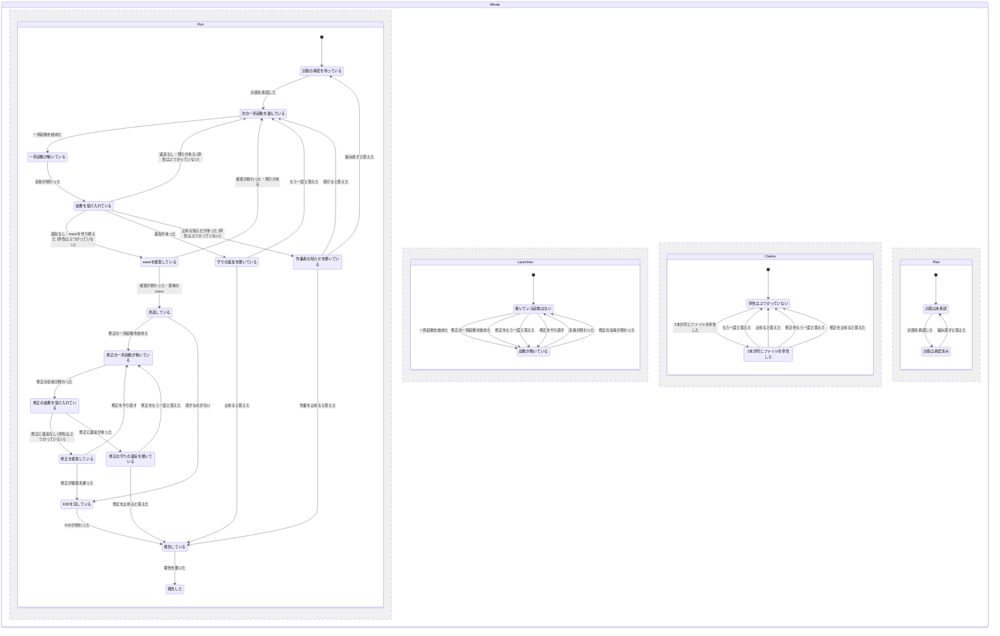

# 同じ wave を一斉起動で動かす

合意: 2026-11-20。持ち主が design-flow（grilling 3 巡、17 問）で決めた。すべて推しの答えのとおり。前提は Atelier v8（`docs/specs/atelier-v8.md`）、検査の失敗の持ち越し（`docs/specs/carry-over-failures.md`）、drive を裏で回す仕組み（`docs/specs/background-drive-and-handoff.md`）。今の作りは `.omm/` の図（`overall-architecture`・`launch-lifecycle`・`state-transitions`）にある。

## Problem Statement

Atelier の run が、時間とトークンを必要以上に使っている。

1. ある run で、依存の無い 2 つの PBI が順に動いた。最後の見直しのあとの修正も、ファイルが重ならないように 3 つに分けてあったのに、1 つずつ動いた。待つ時間は、PBI とグループの本数だけ足し算で延びる。
2. 同じ run で、親の会話（呼び手）がトークンのほとんどを使った。runner が `agent` のとき、親は起動 1 回ごとに 3 回起きる（サブエージェントを起こす、終わりの知らせ、`drive --done`）。長い会話では、1 回起きるたびに 15〜28 万トークンを読む。

原因は Atelier の作りにある。

- 進行役は、次の行動を 1 つしか持たない（run.json の `pending_action`）。building では、依存の通った PBI のうち先頭の 1 本しか起動にしない。修正の段も、グループを 1 つずつ起動する。
- 外部 runner は `subprocess.run` で同期して動くので、drive の中でも 1 本ずつになる。
- 用語集は Wave を「まとめて作る」と定義しているが、コードは 1 本ずつ作っている。

## Solution

持ち主から見た変わり方は次のとおり。

- 同じ wave の PBI のうち、変えるファイル（`targets`）が重ならないものを、**一斉起動** で同時に動かす。wave の検査は今と同じく、wave を作り終えたあとに 1 回。
- 修正の段のグループも、一斉起動で同時に動かす。修正の検査は、全グループのあとに 1 回。
- 同時に動かす本数は、テンプレートの `limits.parallel`（既定 3）まで。`parallel: 1` なら今と同じく 1 本ずつ動く。
- 外部 runner の一斉起動は、drive が全部を同時に起こし、全部が終わるのを待つ。
- runner が `agent` の一斉起動は、呼び手が 1 つのメッセージで全部のサブエージェントを前景で起こし、全部が終わってから `drive --done` を 1 回流す。親が起きる回数は、起動 1 本につき 3 回から、一斉起動 1 つにつき 2 回になる。
- 起動ごとの守りの検査（G1〜G14）と使用量の記録は、今と同じく起動ごとに残る。
- 違反した起動があっても、違反の無い起動は受け入れる。違反した起動はまとめて 1 つの問いにする。

```
今:   PBI-1 を起動 → 終わる → PBI-2 を起動 → 終わる → PBI-3 を起動 → 終わる → wave の検査
新:   一斉起動（PBI-1・PBI-2）→ 両方が終わる → 起動（PBI-3。PBI-1 とファイルが重なる）→ 終わる → wave の検査
```

## User Stories

1. As a 持ち主, I want 依存の無い PBI が同時に作られること, so that wave を作る時間が、PBI の本数の足し算にならない
2. As a 持ち主, I want 変えるファイルが重なる PBI は同時に作られないこと, so that 2 人の作業者が同じファイルを同時に書いて、片方の変更が消えない
3. As a 持ち主, I want ファイルが重なる PBI が、計画の誤りにならず、次の起動に回ること, so that 計画役の作り直しと計画の承認が増えない
4. As a 持ち主, I want 計画役が、同じ wave の PBI の `targets` を重ねないように計画すること, so that 同時に動ける PBI が増える
5. As a 持ち主, I want `targets` の glob やディレクトリも、重なりの判定で安全な側に倒れること, so that 判定の漏れで同じファイルを 2 人が書かない
6. As a 持ち主, I want 同時に動かす本数の上限をテンプレートで決められること, so that runner の使用量の制限に合わせられる
7. As a 持ち主, I want `parallel: 1` で今と同じ 1 本ずつの動きに戻せること, so that 問題が出たときにすぐ戻せる
8. As a 持ち主, I want wave の検査が、wave を作り終えたあとに 1 回だけ流れること, so that 検査の回数と時間が増えない
9. As a 持ち主, I want 修正の段のグループも同時に動くこと, so that 最後の修正の待ち時間がグループの本数の足し算にならない
10. As a 持ち主, I want ファイルの無い指摘のグループは単独で動くこと, so that 書いてよい場所の分からない起動が、ほかの起動と同時に書かない
11. As a 持ち主, I want 外部 runner の起動を drive が同時に起こすこと, so that headless の runner でも同時に動く
12. As a 持ち主, I want runner が agent のとき、親が一斉起動 1 つにつき 2 回しか起きないこと, so that 長い会話を読み直すトークンが減る
13. As a 持ち主, I want 外部 runner と agent が同じ wave に混ざっても、run が止まらずに外部の一斉起動、次に agent の一斉起動と進むこと, so that テンプレートの組み方で run が壊れない
14. As a 持ち主, I want 起動ごとに G1 などの守りの検査と使用量の記録が残ること, so that 一斉起動でも、どの起動が何をしたかを後で確かめられる
15. As a 持ち主, I want 一斉起動の仲間が変えるファイルの変更が、自分の G1 の違反に見えないこと, so that 同時に動かしたせいで誤った問いが出ない
16. As a 持ち主, I want 作業者のチケットに、同時に動く仲間が変えるファイルが書かれること, so that 作業者がそのファイルに手を出さない
17. As a 持ち主, I want 2 本の起動が同じファイルを `outside_edits` で申告したら、ぶつかったとして聞かれること, so that 同じファイルを 2 人が書き換えた事態を黙って通さない
18. As a 持ち主, I want 誰も申告しなかった `targets` の外の変更が、全員の検査に残ること, so that 申告の漏れで守りが緩まない
19. As a 持ち主, I want HEAD や branch の変更（G2）が、一斉起動の全員の違反になること, so that 誰が変えたか分からない変更を見逃さない
20. As a 持ち主, I want ファイルの削除（G12）や文字化け（G14）が、そのファイルの持ち主の起動の違反になること, so that 関係の無い起動まで止まらない
21. As a 持ち主, I want 違反の無い起動の結果が受け入れられること, so that 違反した 1 本のために、通った起動をやり直さない
22. As a 持ち主, I want 違反した起動がまとめて 1 つの問いになること, so that 本数分の問いに答えなくて済む
23. As a 持ち主, I want 違反した起動が 1 本だけのとき、経路の次の候補を選べること, so that 今と同じ選び方ができる
24. As a 持ち主, I want 作業者が「計画の崩れ」などを返したとき、ほかの起動の結果は受け入れられ、問いは 1 つだけ出ること, so that 一斉起動でも今と同じ問いで決められる
25. As a 持ち主, I want 止める知らせを返した起動が 2 本以上なら、後ろの PBI は未着手に戻り、続けるなら起動し直されること, so that 知らせが失われない
26. As a 持ち主, I want 予算が一斉起動の見積もりの合計で 1 回だけ見られること, so that 同じ予算の問いが繰り返されない
27. As a 持ち主, I want 予算の承認が一斉起動の全体に効くこと, so that 承認したのに 2 本目で止まらない
28. As a 持ち主, I want 外部 runner の制限時間が、起動ごとに始まった時点から数えられること, so that 1 本が遅くてもほかの起動の時間が削られない
29. As a 持ち主, I want 時間を過ぎた起動だけが止まり、使えなかった起動として聞かれること, so that 間に合った起動の結果は残る
30. As a 持ち主, I want run の記録に、どの一斉起動で動いたかが残ること, so that 時間がどれだけ縮んだかを後で振り返れる
31. As a 持ち主, I want 報告に、同時に動いた PBI が載ること, so that 衝突が出たときに原因を追える
32. As a 持ち主, I want 一斉起動の途中で承認した変更（`approve-edit`）が、全員の検査に効くこと, so that 承認したファイルで違反が出ない
33. As a 持ち主, I want 起動が 1 本だけのときの行動の形が今と変わらないこと, so that 今の手順と run がそのまま動く
34. As a 持ち主, I want 用語集の言い回し（起動・一斉起動・次の行動）で仕様とコードが書かれること, so that 「launch」「束」などの言葉で取り違えない

## Implementation Decisions

### 用語

- 用語集（`skills/atelier/GLOSSARY.md`）に **起動（Launch）**・**一斉起動（Launch batch）**・**次の行動（Next action）** を足した。進行役の定義を「次の行動を出す」に、Wave の定義を「1 回以上の一斉起動で作り、検査は 1 回」に直した。
- 一斉起動に入れるのは、次をすべて満たす起動だけ: 同じ wave（または同じ修正の段）、変えるファイルが重ならない、同じ種類の runner（外部 runner どうし、または agent どうし）、`limits.parallel` 本まで。

### 次の行動の形

- 起動が 1 本なら、今の `launch` の形のまま出す。
- 2 本以上なら、新しい行動 `launches` にする。`launch_id`（一斉起動の番号、例えば `batch-0021`）・`runner`（`external` か `agent`）・`launches`（今の `launch` の形の起動の並び。各起動は自分の番号を持つ）を持つ。
- run.json の `pending_action` は、1 本の起動か、1 つの一斉起動を持つ。`pending_snapshot` は、agent の一斉起動の前の作業木を 1 つ持つ。
- `done --launch-id <一斉起動の番号>` と `run --launch-id <一斉起動の番号>` が、一斉起動の全部を片付ける。一斉起動の中の起動を 1 本ずつ片付けるコマンドは作らない。

### 一斉起動の選び方（進行役）

- building: 依存の通った未着手の PBI を計画の順に見て、先頭の PBI の runner の種類に合うものを、`targets` が重ならない限り `parallel` 本まで足す。漏れた PBI は次の起動に回る。
- `targets` の重なり: 同じパス、片方がディレクトリでもう片方がその中、glob は `*`・`?`・`[` より前の固定の部分で前の 2 つに当たれば重なる、とみなす。重なりは計画の誤りにしない。
- 修正の段: 終わっていないグループを、`parallel` 本まで一斉起動にする。ファイルの無いグループは単独で起動する。グループの最大数（`plan.fix_groups` の上限）も `parallel` にする。どのグループが終わったかは起動ごとに覚える（今の「何番目のグループか」の数え方を置き換える）。修正の検査が落ちたら、今と同じく全グループをやり直す。E2E の修正（FIX-E2E）は 1 本のまま。
- 外部 runner の事前の検査（G3・G4・G11）は起動ごとに見る。1 本でも違反したら、組みかけた一斉起動を取り消し（PBI は未着手に戻す）、今と同じくその違反の問いを出す。
- 予算は、一斉起動の全部の起動の見積もりを足して 1 回だけ見る。予算の承認は、次の行動（1 本の起動か一斉起動）の全体に効く。

### 作業者への伝え方

- 作業者のチケットに `running_alongside`（同時に動く仲間の PBI の番号と `targets`）を足す。作業者の指示に「ここにあるファイルは、同時に動いている別の作業者が変えている。変えない」と 1 文足す。これは指示だけで、守られたかを検査では見抜けない。破られて壊れたら、wave の検査で落ち、持ち越しとして修正の PBI で直る。
- 計画役の指示に「同じ wave の PBI は、`targets` を重ねないと同時に動く」と 1 文足す。

### drive と外部 runner

- 外部 runner の起動を「起こす」と「待って読む」に分ける。1 本の起動は今と同じ結果になる。
- drive は外部 runner の一斉起動を、全部を起こしてから全部を待つ。制限時間（`--timeout`）は起動ごとに、自分が始まった時点から数える。過ぎた起動だけを止め、使えなかった起動として扱う。
- 一斉起動の前に、作業木の snapshot を 1 つ取る。

### 一斉起動の結果の受け入れ（外部・agent 共通）

1. 起動ごとに使用量と起動の記録を足す。記録には一斉起動の番号（`batch`）を入れる。
2. 起動ごとの G1 の比較: 一斉起動の前の snapshot と今の作業木を、起動ごとに比べる。比べる前に、ほかの仲間が持つファイルの変更を除く。持ち主は、`targets`（修正の段ならグループのファイル）と、結果の `outside_edits` の申告で決まる。
   - 誰の `targets` でもないファイルを、2 本以上が `outside_edits` で申告したら、申告した全員の G1 の違反（ぶつかり）にする。
   - 誰も申告しなかった変更は、全員の比較に残す。
   - 承認した変更（`approve-edit`）は、一斉起動の番号で記録し、全員の比較に効かせる。
3. 作業木全体を見る検査は、一斉起動につき 1 回: G2（HEAD・branch・stash）は全員の違反、G5（依存のファイル）・G12（削除など）・G14（文字化け）は、そのファイルの持ち主の起動の違反（持ち主が分からなければ全員）。
4. 違反の無い起動を、計画の順に受け入れる（今の受け入れと同じ。PBI は built、CRLF を LF に戻す、外の変更を報告用に残す）。
5. 次の行動を決める:
   - 違反した起動があれば、全部をまとめて 1 つの guard の問いにする。問いの選択は「違反した起動をもう一度」「止めて報告する」。違反した起動が 1 本なら「経路の次の候補で」も出す。違反した PBI は未着手に戻す。
   - 違反が無く、止める知らせ（`plan_broken`・`sensitive_detected`・`budget_exceeded`）を返した起動があれば、計画の順で先の 1 本の問いを出す。ほかに知らせを返した PBI は未着手に戻し、続けるなら起動し直す。
   - どちらも無ければ、今と同じく、作る PBI が残っていれば building のまま、無ければ wave の検査（修正の段なら修正の検査）。
- 状態の表（`flow.py` の遷移）は変えない。

### 呼び手（SKILL.md）

- `launches` の `runner` が `external`: 今の外部 runner の `launch` と同じく、drive を裏で回す。
- `launches` の `runner` が `agent`: 1 つのメッセージで、全部の起動のサブエージェントを前景で起こす（同時に動き、全部が終わるまで待つ）。終わったら `drive --done <一斉起動の番号>` を裏で流してターンを終える。
- 1 本の agent の `launch` も、前景で起こして待つ。

### テンプレート

- `limits.parallel` を足す。1 以上の整数。既定は 3。

### 記録と報告

- run の記録の起動の行に `batch`（一斉起動の番号。1 本の起動では無し）を足す。
- 報告（REPORT.md）に、一斉起動ごとに同時に動いた PBI（または修正のグループ）を並べる。

### 状態の図

作る段から報告までの図。作業者が知らせを返す前の計画役の段と、E2E の上限の問いは今のままなので省いた。



図は、領域どうしの条件を省いて読みやすくした版。条件まで書いた検査用の図と TLC の結果は `docs/specs/parallel-launch-batches-notes/statechart/` にある。9 つの規則は、21 の状態すべてで破れなかった（TLC、2026-11-20）。1 本だけの起動は、この図では「仲間が 1 本の一斉起動」として読む。

## Testing Decisions

- よいテストは、進行役のコマンド（`start`・`next`・`drive`・`done`・`run`・`answer`）を外から叩き、返る次の行動と run の状態・記録・報告だけを見る。内部の関数の呼ばれ方は見ない。
- 合意済みの seam:
  - **進行役のコマンドライン**（`tests/test_conductor.py` の `run_cli`、`tests/test_flow_rules.py` の git 付きの準備、`tests/test_drive.py` の偽の外部 CLI）。外部 runner の同時性は、偽の CLI が始まりと終わりの時刻を書き、2 本の区間が重なることで確かめる。
  - **守りの比較**（`guards.snapshot` と比較の関数を直接たたく。`tests/test_guards.py` と同じ seam）。仲間のファイルを除く比較と、申告のぶつかりを確かめる。
  - **`targets` の重なりの判定**（純粋な関数。`tests/test_plan.py` と同じ seam）。パス・ディレクトリ・glob の組み合わせを確かめる。
- 確かめること:
  - `targets` の重ならない 2 つの PBI が、`launches` の 1 つの行動で出る。重なる PBI は次の起動に回り、wave の検査は 1 回だけ流れる。
  - `parallel: 1` では、今と同じ `launch` が 1 本ずつ出る（既存のテストがそのまま通る）。
  - 外部 runner と agent が混ざった wave で、外部の一斉起動、次に agent の一斉起動が出る。
  - drive が外部 runner の一斉起動を同時に動かす（区間が重なる）。制限時間を過ぎた起動だけが使えなかった起動になる。
  - agent の一斉起動を `done --launch-id <一斉起動の番号>` で片付けると、全部の PBI が built になり、wave の検査に進む。
  - 仲間の `targets` の変更が、自分の G1 の違反にならない。2 本が同じファイルを申告すると G1 の違反になる。誰も申告しない外の変更は全員の比較に残る。
  - 違反した起動が 1 本なら、ほかの起動は受け入れられ、問いは 1 つで「経路の次の候補で」がある。2 本なら、問いは 1 つで「経路の次の候補で」が無い。「もう一度」で、違反した PBI だけがもう一度起動される。
  - 止める知らせが 2 本から返ると、先の 1 本の問いが出て、後ろの PBI は未着手に戻る。
  - 予算は一斉起動の合計で見られ、承認すると一斉起動の全体が出る。
  - 修正の段のグループが一斉起動になり、ファイルの無いグループは単独になる。修正の検査は全グループのあとに 1 回。
  - run の記録の起動の行に `batch` があり、報告に同時に動いた PBI が載る。
  - `limits.parallel` の検証（1 以上の整数、既定 3）。
- 前例: `tests/test_drive.py`（drive と偽の外部 CLI）、`tests/test_carry_over.py`（持ち越しと修正の PBI）、`tests/test_guards.py`（G1 の比較）、`tests/test_review_loops.py`（修正の段）。

## Out of Scope

- PBI ごとの git の worktree（第二案）。同じ作業木で起きる、仲間のファイルへの書き込みを確実に見抜くには、これが要る。一斉起動で衝突が実際に問題になったら考える。
- 外部 runner と agent を同時に動かすこと（呼び手が drive とサブエージェントを同時に回す手順）。
- 状態の表（`flow.py` の遷移）を変えること。
- 計画役が wave 番号を書く仕組み。wave は今と同じく、その時点で依存が通った PBI の集まり。
- runner ごとの同時実行の上限（runner ごとに `parallel` を分けること）。
- 役を headless の runner `claude` にする設定（別に検討する。組み合わせると、外部 runner の一斉起動が drive の 1 回で済む）。

## Further Notes

- 仲間のファイルへの書き込みを見抜けないのは、同じ作業木では「どの起動がそのファイルを書いたか」が分からないため。指示で避け、破られたら wave の検査と持ち越しで受け止める。
- 違反の問いを一斉起動ごとに 1 つにまとめるのは、run が問いの状態を 1 つしか持てないため。止める知らせ（計画の崩れなど）も同じ理由で 1 つずつ聞く。
- `parallel` の既定 3 は、今の修正のグループの上限と同じ値で、runner の使用量の制限にも当たりにくい。
- 実装のあと、`.omm/` の図を新しい流れに描き直す。
