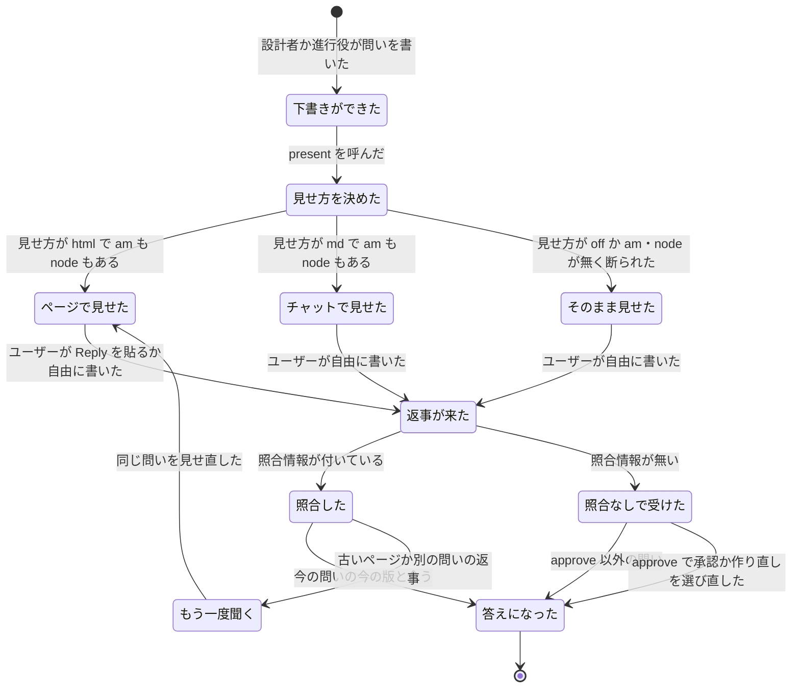

# ユーザーには HTML、AI 同士は JSON: answer-me-with-any で見せる (present)

2026-11-11、design-flow で持ち主と合意した。対象は atelier v7.4 (`skills/atelier`) と answer-me-with-any (`reeschan/answer-me-with-any`、スキル名は `answer-me-with-html`、CLI は `am`)。

**2026-11-13 の改訂**: 11/11 の版の run (worktree `atelier-present`、土台 37b7e72) は、今の main と 13 ファイルで衝突した。そのため、今の main (e76eba8) の上で作り直す。下の本文は 11/11 のままである。本文と食い違うところは、末尾の「## 今の main との差分 (2026-11-13)」を優先する。precondition は `docs/specs/atelier-reorg-and-eval.md` (PR 3) から、この仕様に入れる。

## Problem Statement

atelier がユーザーに見せるものは、見せ方がそろっていない。

- 承認 (Approve) だけは、`confirm` のアダプターが `auto` (既定) で、スキル `answer-me-with-html` が入っているときに HTML のページになる。入っていなければ、黙ってチャットの Markdown に落ちる。
- そのほかの問い (`decision`・`send-approval`・`rework-limit`・`destructive`) と完了報告は、いつもチャットの Markdown になる。進行役の問いのファイルには、ユーザー向けの説明と、呼び出し側向けのコマンド (`Next:` の `answer --text` や `abort`) が混ざっている。
- 承認のページを作るとき、呼び出し側は `design_record.py markdown --draft …` の出力を `am render -` に渡すパイプを、自分で組む。2026-11-11 に呼び出し側が `markdown` を通さずに描き、照合情報 (下の用語) の無いページを出した。そのページへの返事は `check-reply` で照合できない。
- どの見せ方で、呼び出し側の文脈をどれだけ使ったかの記録が無い。HTML と Markdown のどちらが文脈を節約するかを比べられない。

持ち主は「answer-me-with-any を常に使い、出力の形はオプションで変えられる」形を望んでいる。ただし調べた範囲 (フォークの main と claude/project-thread-brouho、上流 QingYunA/answer-me-with-html の main、手元の clone) では、`am render` に出力の形を変えるオプションは無かった。

## Solution

原則を「ユーザーには HTML のページで見せ、AI 同士で機械が確かめる受け渡しは JSON にする」と決め、見せる処理を 1 本の入口にまとめる。

- answer-me-with-any に `am render --format html|md` を足す。`md` はページを作らず、チャットにそのまま貼れる Markdown を標準出力に出す。
- atelier に `present.py` を足す。呼び出し側は、ユーザーに何かを見せるとき (問い 5 種と完了報告) に、必ずこの 1 本を呼ぶ。present は次の 3 つを行う。
  1. 照合情報を付ける
  2. am で描く
  3. 見せた形と量をログに残す
- `confirm` のアダプターの値は `html` (既定) / `md` / `off` にする。am か node が無いときは、黙って落とさず、入れるかをユーザーに聞く。
- 見せるたびに `docs/pbi/presentations.jsonl` に 1 行を書き、呼び出し側の文脈に入った量 (文字数と推定トークン数) を形式ごとに比べられるようにする。

## User Stories

1. As a atelier の持ち主, I want 承認・問い・完了報告がいつも同じ見せ方 (既定は HTML のページ) で出てほしい, so that どの場面でも同じ読み方・返し方ができる
2. As a atelier の持ち主, I want 見せ方を `html`・`md`・`off` の 3 つから agents.json の 1 か所で選びたい, so that 環境に合わせて切り替えられる
3. As a atelier の持ち主, I want am か node が無いとき、黙ってチャットに落とさず、入れるかを聞いてほしい, so that 知らないうちに照合の無い承認で進まない
4. As a atelier の持ち主, I want 入れるのを断ったときは、今と同じチャットの Markdown (照合なし) で進んでほしい, so that am が無くても run が止まらない
5. As a 呼び出し側, I want ユーザーに見せるときは `present.py` を 1 本呼ぶだけにしたい, so that パイプの組み忘れで照合情報の無いページを出さない
6. As a 呼び出し側, I want present の出力をそのままユーザーに見せればよい形にしてほしい, so that 何を見せて何を自分が使うかを迷わない
7. As a 呼び出し側, I want present の出力で、ページのリンクと、自分が次に打つコマンド (`answer …`) が分かれていてほしい, so that ユーザーにコマンドを見せない
8. As a atelier の持ち主, I want 承認のページの返事が、今と同じく `check-reply` で照合されてほしい, so that 古いページや別の run のページの返事で承認されない
9. As a atelier の持ち主, I want approve 以外の問いのページにも軽い照合情報が付いてほしい, so that 古い問いのページの返事が今の問いの答えにならない
10. As a atelier の持ち主, I want チャットに書いた自由な返事も、今までどおり答えとして受けてほしい, so that ページを開かずに答えられる
11. As a atelier の持ち主, I want `md` のときに照合情報を付けないでほしい, so that 戻ってこない情報で文脈を使わない
12. As a atelier の持ち主, I want 問いのページにはユーザー向けの説明と選べる道だけが載っていてほしい, so that コマンドの行を読まされない
13. As a atelier の持ち主, I want 選べる道がページで ask (選択肢) になっていてほしい, so that ボタンで選んで返せる
14. As a atelier の持ち主, I want 完了報告が読み進める形 (doc) のページで、チャットには結論 2〜3 行とリンクだけが出てほしい, so that 長い報告でチャットが埋まらない
15. As a atelier の持ち主, I want `md` のときは完了報告の本文がチャットに出てほしい, so that ページを使わない環境でも報告を読める
16. As a atelier の持ち主, I want 見せるたびに、形式と、呼び出し側の文脈に入った文字数と推定トークン数が記録されてほしい, so that 見せ方ごとの文脈の消費を比べられる
17. As a atelier の持ち主, I want HTML で見せたときも、md で見せたら何トークンだったかが記録されてほしい, so that 同じ問いで 2 つの形式を比べられる
18. As a atelier の持ち主, I want 返事の文字数と推定トークン数も記録されてほしい, so that 返事を貼る側の消費も分かる
19. As a atelier の持ち主, I want トークンの数え方の名前 (`chars-est/1`) と、正確な文字数・バイト数が一緒に残ってほしい, so that あとで数え方を変えても計算し直せる
20. As a atelier の持ち主, I want am か node が無くて `off` になったときも、その理由がログに残ってほしい, so that 何が足りなかったかが分かる
21. As a atelier の持ち主, I want am の版が atelier の側で固定されていてほしい, so that am の更新で照合情報の形が変わって承認が通らなくなることがない
22. As a atelier の持ち主, I want 古い設定 (`confirm: auto` やスキル名) が警告付きで `html` として動いてほしい, so that 設定を書き換えずに新しい版へ上がれる
23. As a answer-me-with-any の利用者, I want `am render --format md` で、ページを作らずに Markdown を受け取りたい, so that ページを開けない環境でも同じ原稿を使える
24. As a answer-me-with-any の利用者, I want `am config set format md` で既定の形を変えたい, so that 毎回オプションを書かなくてよい
25. As a answer-me-with-any の利用者, I want `--format md` でも原稿の誤り (`✗ L<line>`) と STE の警告を今と同じ形で受けたい, so that 直し方が同じになる
26. As a answer-me-with-any の利用者, I want `--format html` (既定) の出力が今とバイト単位で同じであってほしい, so that 既存のページと試験が変わらない
27. As a 設計者, I want 問いのファイルにユーザー向けの本文だけを書けばよいことにしてほしい, so that 呼び出し側への指示を混ぜて書かずに済む
28. As a 進行役, I want 自分が作る問い (decision・launch-failure・handoff-loop) も、本文と呼び出し側のコマンドを分けて出したい, so that 設計者の問いと同じ流れで見せられる

## Implementation Decisions

### 用語

- **照合情報** (reply check info、コードの名前は `reply-meta-*` と `am-reply-meta`): 原稿の frontmatter に書き、ページの Reply ボタンが返信の末尾に付ける小さな JSON。「どの run の、どの問いの、どの版のページへの返事か」を示し、atelier はこれで古いページや別の run への返事を弾く。これまで「返信の封筒」(envelope) と呼んでいたものと同じ。日本語の文書では「照合情報」と書く。
- **見せ方** (presentation format): `html`・`md`・`off` のどれか。`confirm` のアダプターの値で決まる。
- **見せた記録** (presentation log): `docs/pbi/presentations.jsonl` の 1 行。

### answer-me-with-any: `--format`

- `am render` に `--format html|md` を足す。既定は `html` で、`am config` の新しいキー `format` で変えられる。`html` の出力は今とバイト単位で同じにする。
- `md` はページを書かず、ブラウザも開かず、`-o` と `--replace` を受け付けない (受けたら誤り)。標準出力に Markdown を出し、`✓` の行は出さない。原稿の誤りと STE・code の警告は、今と同じ形で標準エラーに出す。原稿の誤りがあれば終了コードも今と同じにする。
- `md` の変換の規則:
  - frontmatter の `title` を `# 見出し`、`subtitle` をその下の 1 行にする。そのほかの frontmatter は出さない。`reply-meta-*` も出さない (照合情報は付けない)。
  - パネルは `## 題名` にする。英字の ID と `{span=…}` などの属性は落とす。
  - `ask` は問いの行と、番号付きの選択肢にする。推す選択肢 (`*`) には「(推奨)」を付け、`| 補足` は ` — 補足` にする。
  - 表・リスト・引用・コードブロックは、そのまま出す。`flow`・`er` などの部品は、その言語名のままのコードブロックとして出す (中身は人が読める文なので)。`{table sort}` などの行は落とす。
  - `html`・`svg` の生のブロックは「(この図は HTML 版のみ)」の 1 行に置き換える。
- 変更は answer-me-with-any のブランチ `feat/render-format-md` に入れて PR にする。マージは持ち主が行う。

### atelier: confirm のアダプター

- 値は `html` (既定) / `md` / `off`。`auto` と、スキル名を書いた古い値は `html` と読み替え、`adapter_gate.py` の confirm の行に警告を出す。
- `html` と `md` は、どちらも am を通す。`off` は am を使わず、問いのファイルをそのままチャットに出す。照合情報は付けず、`check` も無い (今の `off` と同じ)。
- `tools_check.py` は、answer-me-with-html の行に加えて node の行 (20 以上) を出す。`CONFIRM_COMMIT` は、any の `--format` がマージされた main のコミットに上げる。入れ方は今のまま、`skills/answer-me-with-html` を `~/.claude/skills` に写す。
- 見せ方が `off` 以外で、am か node が無いとき: 設計者は、approve の文面に入れ方とその代わりの道 (off) を選択肢として 1 度だけ書く (今の install の選択と同じ流れ)。断られたら、その run は `off` で進め、見せた記録の `reason` に `missing-am` か `missing-node` を書く。

### atelier: present (`present.py`)

- 使い方: `python <skill>/present.py <question のパス> --kind <kind> [--format html|md|off] [--dir docs/pbi]`。`--format` を省くと、アダプターの設定と道具の有無から決める。完了報告は `--kind report`。
- 照合情報: approve で `check: design-record` のときは、今の `design_record.py markdown` と同じ 4 項目 (design_id・revision・record_hash・draft_hash) を付ける (処理は design_record を関数として呼び、同じ計算にする)。approve 以外の問いには、run_id・seq・kind・draft_hash の 4 項目を付ける。`md`・`off` と `report` には付けない。
- 描いた原稿 (照合情報付き) は `docs/pbi/conductor/present/<seq>-<kind>.md` に残す。返事の draft_hash は、これと比べる。
- am は `~/.claude/skills/answer-me-with-html/scripts/am.mjs` を `node` で呼ぶ (探し方は今の `flow.find_skill_file` と同じ)。`--no-open` は付けず、開くかどうかは am の設定に任せる。完了報告は `--template doc`。
- 標準出力 (呼び出し側が読むもの) の形:
  - `show:` で始まる行以降は、ユーザーにそのまま見せる部分。`html` ならページのリンクの 1 行、`md` と `off` なら本文。
  - `then:` で始まる行は、呼び出し側だけが使う (今の `question_lines` の `then:`・`approve:`・`revise:` と同じ役)。
  - `log:` の行に、見せた記録のパスを書く。
- 終了コード: 0 見せた / 3 am が原稿の誤りで描けなかった (誤りの行を出す。原稿を直すのは設計者) / 2 引数の誤り。am や node が無くて `off` に落ちたときは 0 で、`show:` は本文になり、記録に理由が残る。

### atelier: 問いのファイル

- 問いのファイルには、ユーザー向けの本文だけを書く。選べる道は `ask` ブロックにする。設計者の付録 (`designer.md` の `## Approve` と、問いを出す各付録) にそう書く。
- 進行役の `conductor_question` は、ファイルに `Next:` の行を書くのをやめる。コマンドは標準出力の `then:` の行にだけ出す。

### atelier: 返事の照合

- approve: 今と同じ (`conductor.py answer --reply` → `check-reply`、終了コード 0・3・4・5)。
- approve 以外: `answer --reply` に `am-reply-meta` の囲みがあれば、run_id・seq・kind・draft_hash を今の問いと present の原稿から計算した値と比べ、合わなければ exit 3 で止める。囲みが無ければ (チャットの自由な返事)、今の `--text` と同じに受ける。
- `md` で見せたときは照合情報が無いので、返事はいつも「照合情報の無い返信」の道 (approve なら exit 4 → `answer --approve --choices …` か `--revise`) になる。

### atelier: 見せた記録 (`docs/pbi/presentations.jsonl`)

- schema `atelier.presentation/1`。1 行に `event` を持ち、`shown` と `answered` の 2 種類がある。
- `shown`: `ts`・`run_id`・`seq`・`kind` (問いの種類か `report`)・`format` (`html`/`md`/`off`)・`reason` (`setting`/`missing-am`/`missing-node`)・`draft_chars`・`shown_chars`・`shown_bytes`・`shown_tokens_est`・`md_tokens_est`・`page_bytes` (`html` のときだけ。ほかは null)・`method` (`chars-est/1`)。
  - `shown_*` は、呼び出し側の文脈に入る `show:` 以降の量。`html` ならリンクの行だけ、`md` と `off` なら本文全部。
  - `md_tokens_est` は、同じ原稿を `md` で見せた場合の量。`html` のときも、am を `--format md` でもう 1 度呼んで数える。
- `answered`: `ts`・`run_id`・`seq`・`kind`・`reply_chars`・`reply_bytes`・`reply_tokens_est`・`check` (`ok`/`mismatch`/`none`)・`method`。`conductor.py answer` が書く。
- `chars-est/1`: ASCII の文字は 4 文字で 1 トークン (切り上げ)、それ以外の文字は 1 文字で 1 トークンとして足す。
- metrics の作業 (harness-metrics の仕様、`question.asked`) には、`format` と `shown_tokens_est` を項目に足すことを頼む。その仕様は変えない。

### atelier: SKILL.md と付録

- SKILL.md の `## Questions` を、「どの kind も `present.py` で見せ、`show:` 以降をユーザーに見せ、`then:` の通りに答えを渡す」に書き直す。パイプ (`design_record.py markdown --draft … | am render -`) は present の中身として `appendix/adapters.md` の `## Confirm` に書き、呼び出し側が自分で組まないことを明記する。
- 完了報告 (`appendix/finish.md`) の「inline ではファイルの本文を送る」を「present で見せる」に変える。
- 原則「ユーザーには HTML、AI 同士は JSON」を `designer.md` の冒頭の規則に 1 行足す。
- 用語「照合情報」「見せ方」「見せた記録」を `CONTEXT.md` に足し、日本語の文書の「封筒」を「照合情報」に直す。
- スキル本体は skill-versioning で v7.5 にし、CHANGELOG に書く。

## Testing Decisions

- 良い試験は、外から見える振る舞い (CLI の出力・終了コード・書いたファイル) だけを確かめる。内部の関数の分け方には頼らない。
- 合意済みの seam:
  1. **answer-me-with-any の `am render --format md`** (CLI): 原稿を渡し、標準出力の Markdown、ask の変換、照合情報が出ないこと、`-o` を誤りにすること、原稿の誤りの終了コードを確かめる。`--format html` の出力が今の snapshot と同じであることも確かめる。前例は any の今の render の試験と snapshot。
  2. **atelier の `present.py`** (CLI): am の代わりに、出力を固定した偽の `am.mjs` (試験用のディレクトリに置く) を使う。`html`・`md`・`off` のそれぞれで、`show:` と `then:` の行、残した原稿の照合情報、`presentations.jsonl` の 1 行 (`chars-est/1` の数) を確かめる。am や node が無いときの `off` への落ち方と `reason` も確かめる。
  3. **atelier の `conductor.py answer`** (CLI、`test_conductor.py` の今の作り): approve 以外の問いで、照合情報が合う返事・合わない返事 (exit 3)・囲みの無い返事を通し、`answered` の行を確かめる。進行役の問いのファイルに `Next:` が無いことも確かめる。
- 前例: `test_design_record.py` (照合と hash)、`test_conductor.py` (answer の流れ)、`test_tools_check.py` と `test_adapter_gate.py` (confirm の行)。`skills/atelier` の unittest をすべて通す。

## Out of Scope

- PBI 本体・brief・作業者の報告・設計者への指示を JSON にすること (原則の文言だけ入れる。報告の JSON 化は別の作業)。
- 呼び出し側のセッションの実際の文脈を、見せる前後に測ること (セッション ID が確実には取れないため)。
- API (count_tokens) で正確なトークン数を数えること。
- answer-me-with-any をプラグインとして入れること、atelier に am を同梱すること。
- 途中経過の 1 行の報告 (波の開始・終了など) をページにすること。
- harness-metrics の仕様や events.py を変えること (項目の追加を頼むだけ)。

## Further Notes

- 進める順: answer-me-with-any の `feat/render-format-md` → (持ち主のマージ) → atelier の `claude/atelier-present` で実装し、`CONFIRM_COMMIT` を上げる。マージを待つあいだも、atelier の試験は偽の am で通せる。push と PR は、どちらも持ち主の指示を待つ。
- `~/.claude/skills/answer-me-with-html` は 2026-11-11 に 8856dde51ff8 から写して入れてある。any のマージ後に入れ直す。
- 照合情報の形 (frontmatter の `reply-meta-<name>: <value>`、返信の末尾の ```` ```am-reply-meta ```` の囲み) は、answer-me-with-any の 8856dde の形をそのまま使う。

## 状態の図 (1 つの問いを見せてから答えになるまで)



## 今の main との差分 (2026-11-13)

11/11 の版のあとに、main には次の 4 つが入った。この節の決定は、上の本文より優先する。
- #48: どの問いの行にも `confirm:` を付ける。confirm のスキル名を変えた。grill の問いのラウンド。`full-run` の問い。
- #49: 重いレビューと、レビューの回数の上限。
- #50: confirm の入れ方の固定先を `bd70c602d794` にした。
- #51: 作業票の JSON (`design_record.py work`) と、その承認への結び付け。

### 名前と am の版

- スキル名は `answer-me-with-any` にする。古い名前 `answer-me-with-html` だけが入っているときは、今の main と同じく warn 付きで使う (v8 まで)。present は、am を両方の名前の `scripts/am.mjs` から探す。新しい名前を先に探す。
- `CONFIRM_COMMIT` は `bd70c602d794` のままにする。このコミットには `--format md` (answer-me-with-any#2) が入っている。上げなくてよい。

### confirm の値と、問いの行

- 値は本文どおり `html` (既定)・`md`・`off` にする。`auto` とスキル名は `html` と読み替え、`adapter_gate.py` の confirm の行に warn を出す。
- 今の main の `confirm:` の行 (`confirm: skill <name>`・`confirm: chat`・`confirm: off`) は、`present:` の行に置き換える。`present:` の行には、caller が打つ `python <skill>/present.py <path> --kind <kind>` をそのまま書く。見せ方は present が決める。古い名前の warn は、present の出力の `warn` の行に移す。
- `full-run` の `yes:`/`no:`、approve の `approve:`/`revise:`、ほかの問いの `then:` は、present の標準出力の `then:` の行に移す。`next`・`done`・`status` は、問いについて `question:`・`summary:`・`present:` の行だけを出す。

### 作業票 (#51) と grill (#48) との関係

- approve の照合情報 (`design_record.py markdown` と同じ 4 項目) と `check-reply` は、#51 で作業票の hash を含むようになった record を、そのまま使う。present は record を読むだけで、record の形を変えない。
- grill のラウンド (`decision` の問い、`docs/pbi/notes/grill.json`) も、present で見せる。`done` が approve を拒む grill の条件 (答えの無い問い、frontier が空でない、認識がそろっていない) は変えない。

### precondition (`docs/adr/0002-precondition-over-prose.md`)

- **answer**: 待っている問いと同じ `run_id`・`seq` の `shown` の行が `docs/pbi/presentations.jsonl` に無ければ、`conductor.py answer` を exit 2 で拒む。出す行は `error: not shown: run python <skill>/present.py <path> --kind <kind> first` の 1 行にする。見せ方が `off` のときは、この確認を掛けない。
- **done**: 出番の種類ごとに「揃っているべきもの」を 1 か所に持ち、欠けていれば exit 2 と `error: missing <何>` の 1 行で拒む。一覧は `appendix/episodes.md` に書き、conductor は同じ一覧を 1 つの表として持つ。最初の版に入れるのは次の 2 つだけにする。ほかは後で足す。
  - approve で終わる design の出番: 承認の原稿が `design_record.py markdown` を通っていること (`reply-meta-` の行がある)。見せ方が `off` のときは要らない。
  - finish: 今の main のとおり (`docs/pbi/REPORT.md` か `report_body`)。
- **問いを受ける条件**: 問いは、揃っているかの確認を通った `done` からだけ受け付ける。設計者を起こし直すのは、返事の照合が通ったときだけにする。聞き直しの間は起こさない (`docs/specs/statechart/reorg-and-eval/` で TLC 検査済み)。
- SKILL.md の `## Questions` の最初に、「present で見せる → `show:` をユーザーに見せる → `then:` で答える」を 1 つの番号付きの手順として書く。

### 作り方

- 11/11 の版の run の成果は、参考の実装として使う。`present.py`・`test_present.py`・`testdata/present/` と、各ファイルの差分 (worktree `~/dev/atelier-present`) がそれにあたる。今の main に合わせて書き直す。そのまま写して衝突を手で解くことはしない。
- 本文の「スキル本体は skill-versioning で v7.5 にし」は取り消す。版は、マージのあとに `skill-versioning` で決める (手元の ACTIVE は v7.8)。
- 本文の「answer-me-with-any のブランチ `feat/render-format-md`」は済んでいる (#2 でマージ済み)。

### 試験の追加 (合意済みの seam に足す)

- seam 3 (`conductor.py answer`): `shown` の行が無い answer が exit 2 と決まった 1 行で拒まれること。`off` では拒まれないこと。
- seam 3 (`conductor.py done`): 原稿が `markdown` を通っていない approve の `done` が exit 2 で拒まれること。
- 問いの行: `next`・`done`・`status` が `confirm:` を出さず、`present:` を出すこと。
