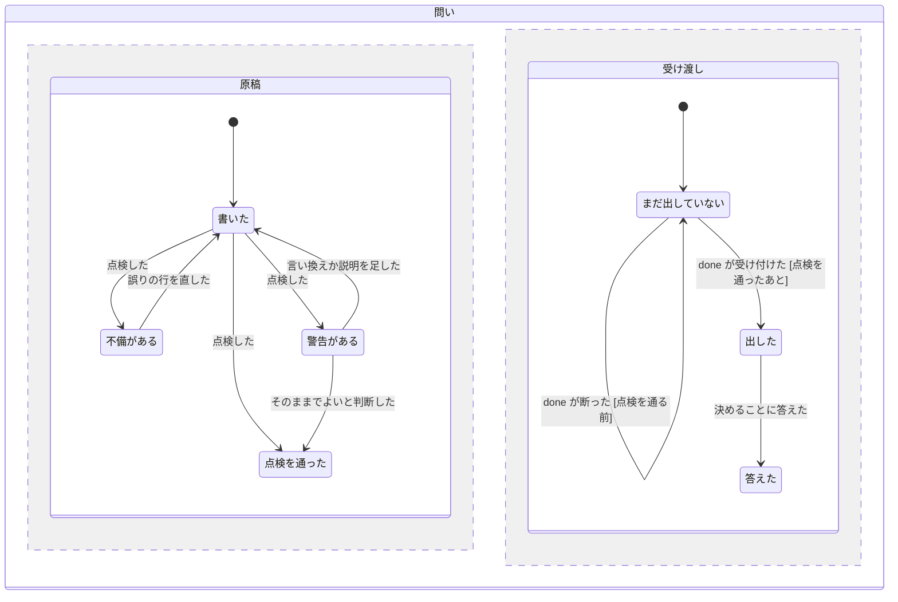

# 承認以外の問いも、承認の原稿と同じ章立てで書く (question-pages)

2026-11-13、design-flow v2.1 (今の設定のまま、grilling Q1〜Q17、すべて推奨どおり) で持ち主と合意した。起点は main の `e76eba8` (v7.9)。用語は `skills/atelier/CONTEXT.md` に従う。承認の原稿の形は `approval-draft.md`、見せ方 (am でページにする・照合情報) は present-with-am (`docs/specs/present-with-am.md`、ブランチ `claude/atelier-present`、未マージ) の関心で、この仕様では変えない。

## Problem Statement

承認の原稿は、`approval-draft.md` で形が決まり、`design_record.py lint` が点検している。ところが、承認以外の問いには決まった形も点検も無い。

- 設計者の問い (decision・grill の 1 回・send-approval・rework-limit・destructive・full-run) は、`question.path` の Markdown を設計者が好きな形で書く。何を決めればよいのか、答えると何が変わるのかが、問いごとにばらばらになる。
- 承認の原稿で決めた「結論が先・流れの図・決めることは ask」という書き方が、問いには及ばない。`designer.md` の問いの基準 (選ぶと何が変わるかを書く) は文で書いてあるだけで、機械では確かめていない。
- grill の 1 回は Q を何問も並べるのに、どの答えで設計がどう変わるのかを図で見られない。
- 進行役の問い (no-agent-tool の decision・handoff-loop・launch-failure) は、`conductor_question` が `# Conductor question: <kind>` と短い説明、`Next:` のコマンドの一覧を書くだけ。持ち主に向けた文と、呼び出し側に向けたコマンドが 1 つのファイルに混ざる。
- 日本語の原稿の言い回し (不自然な比喩・決まり文句など) を点検する道具がどこにも入っていない。

## Solution

承認以外の問いも承認の原稿の章立てを基にした決まった形で書き、同じ点検にかける。

- 問いのファイルは `## 結論` → `## 今の流れ` → `## 答えたあとの流れ` → `## 決めること` の 4 つの節を必ず持つ。要るときだけ `## 判断の材料` と `## 影響範囲` を足す。PBI と作る人の節は持たない。
- 2 枚の図で、答えると何が変わるかを見せる。設計の問いは「今の振る舞い → 推す答えでの流れ (印付き)」。run を進める問いは「ここまでと止まった所 → 選択肢ごとの分かれ道 (線のラベル)」。
- 決めることには ask を 1 つ以上置く。選択肢には「選ぶと何が変わるか」を必ず書く。
- `design_record.py lint --kind <kind>` が問いの形を点検する。`done` は、approve 以外のすべての問いをこの点検にかけ、誤りがあれば受け付けない。
- 進行役の問いは、スクリプトが英語の決まった文で同じ節を書く。コマンドはファイルに書かず、標準出力の `then:` と relaunch にだけ出す。
- 日本語の原稿には、`lint` が yomiyasu の `yomiyasu_lint.py` もかけ、言い回しの見直し候補を警告で出す。承認の原稿にも同じようにかける。
- 見本 `examples/question-send-approval.md` と `examples/question-grill.md` を置き、kind ごとに載せるものを新しい付録 `appendix/questions.md` に書く。

## User Stories

1. As a atelier の持ち主, I want どの問いでも、最初に何を決めるのかと答えると何が変わるのかが 2〜3 文で書かれていてほしい, so that 全部を読まなくても何の問いかが分かる
2. As a atelier の持ち主, I want 設計の問いでは、今の振る舞いと推す答えを選んだときの流れが 2 枚の図で並んでいてほしい, so that 答えで何が変わるかを見比べられる
3. As a atelier の持ち主, I want run を進める問い (send-approval・full-run・rework-limit・destructive・進行役の問い) では、ここまでの流れと選択肢ごとの分かれ道が図で見えてほしい, so that どれを選ぶと run がどこへ進むかが分かる
4. As a atelier の持ち主, I want 決めることが図のすぐあとにあり、どの選択肢にも選ぶと何が変わるかが書かれていてほしい, so that 材料を探さずに選べる
5. As a atelier の持ち主, I want 承認と同じ順番の章立てで問いを読めてほしい, so that 問いの種類が違っても、どこに何があるかを探さずに済む
6. As a atelier の持ち主, I want grill の 1 回が 1 枚のページで、Q ごとに推す答えが先頭にあってほしい, so that 推すとおりでよければすぐ答えられる
7. As a atelier の持ち主, I want grill の 1 回で、推す答えがすべて通ったときの設計の流れが 1 組の図で見えてほしい, so that Q をばらばらに読まずに全体を確かめられる
8. As a atelier の持ち主, I want grill の終わりの「認識がそろったか」の問いでも、それまでに決まったことの総まとめの図が見えてほしい, so that 何に合意するのかが分かる
9. As a atelier の持ち主, I want 対象のファイルが設計のあとで変わったとき (stale) の問いでも、何が変わって、どの PBI の設計をやり直すのかが図で見えてほしい, so that 再設計を頼むかを判断できる
10. As a atelier の持ち主, I want 進行役の問い (起動の失敗・進みの無い繰り返し・Agent ツールが無い) も同じ節で書かれていてほしい, so that 設計者の問いと同じ読み方で判断できる
11. As a atelier の持ち主, I want 問いのファイルにコマンドの一覧が出ないでほしい, so that 自分が決めることだけを読める
12. As a atelier の持ち主, I want 選択肢の無い問い (「なし」) を出されないでほしい, so that 答えようのない問いで止められない
13. As a atelier の持ち主, I want 内部の言葉 (kind の名前・grill・stale など) が問いに出るときは、同じ行で説明されていてほしい, so that 用語を調べずに読める
14. As a atelier の持ち主, I want 日本語の問いや承認の原稿の不自然な言い回しが、ページになる前に設計者に知らされてほしい, so that 読みにくい文を見せられにくくなる
15. As a 設計者, I want 問いの kind を渡すだけで、その問いに合う点検が走ってほしい, so that 承認と問いで別の道具を覚えずに済む
16. As a 設計者, I want 問いの誤りが行の番号と直し方付きで出てほしい, so that どこを直せばよいかがすぐ分かる
17. As a 設計者, I want kind ごとに何を載せるかが 1 つの表で読めてほしい, so that 問いを書くたびに考えずに済む
18. As a 設計者, I want send-approval と grill の見本を読めてほしい, so that 2 種類の図の書き方を真似できる
19. As a 設計者, I want yomiyasu の候補が警告で出て、止められないでほしい, so that 直すかどうかを文脈で判断できる
20. As a 設計者, I want yomiyasu が入っていない環境でも点検が走ってほしい, so that 道具が無いだけで問いを出せなくならない
21. As a 呼び出し側, I want 形の崩れた問いを `done` が受け付けないでほしい, so that 不備のある問いをユーザーに見せない
22. As a 呼び出し側, I want 次に打つコマンドは、今までどおり標準出力の `then:` と relaunch で受け取りたい, so that 問いのファイルを読まずに次へ進める
23. As a atelier の持ち主, I want 見本と進行役の問いがいつも点検を通ることが試験で確かめられていてほしい, so that 見本・スクリプトと点検の規則がずれない
24. As a atelier の持ち主, I want 承認の原稿の点検と照合 (`check-reply`) が今のまま動いてほしい, so that 問いの変更で承認が通らなくなることがない

## Implementation Decisions

### 用語 (CONTEXT.md に足す)

- **問いの原稿** (question draft): 設計者が `question.path` に書く、承認以外の問いの Markdown。承認の原稿の章立てを基にした 4 つの必ずの節と 2 つの任意の節を持つ。避ける語: 質問票、問いのメモ。
- **答えたあとの流れ** (after-answer flow): 問いの原稿の 2 枚目の図。設計の問いでは推す答えを選んだときの流れを印で、run を進める問いでは選択肢ごとの分かれ道を線のラベルで描く。避ける語: 変更後の図、予想図。
- 「承認の原稿」の項に、問いの原稿との違い (PBI・作る人の節を持たない、「なし」を書けない) を 1 行足す。

### 対象

- 設計者が出すすべての問い: decision (grill の 1 回、design の判断の問い、ask-user の選択肢、道具を入れるかの問い、map・optional の問いを含む)・send-approval・rework-limit (stale を含む)・destructive・full-run。
- 進行役が出す 3 つ: decision (no-agent-tool)・handoff-loop・launch-failure。
- approve は今の `approval-draft.md` のまま。inline (呼び出し側が自分で `designer.md` に従い、ユーザーに直接聞く) は対象から外す。inline には問いのファイルが無いため。
- kind は増やさない。stale は rework-limit のまま、結論の文で書き分ける。

### 問いの原稿の節

見出しの名前と順番を固定する。日本語と英語のどちらの組でも受ける。原稿は利用者の言語で書く。

| 順 | 日本語 | 英語 | 要るか | 中身 |
|---|---|---|---|---|
| 1 | `## 結論` | `## Summary` | 必ず | 何を決めるのかと、答えると何が変わるのか、2〜3 文 (callout) |
| 2 | `## 今の流れ` | `## Before` | 必ず | 設計の問いは今の振る舞い。run を進める問いはここまでの流れと止まった所 |
| 3 | `## 答えたあとの流れ` | `## After` | 必ず | 設計の問いは推す答えでの流れ (印付き)。run を進める問いは選択肢ごとの分かれ道 (線のラベル) |
| 4 | `## 決めること` | `## Decisions` | 必ず | ask を 1 つ以上 |
| 5 | `## 判断の材料` | `## Details` | 任意 | 比べる表・数・見つかったことなど。表の見出しは固定しない |
| 6 | `## 影響範囲` | `## Impact` | 任意 | 答えで変わる所と、それに頼っている所 |

- 6 つ以外の `##` の節は誤りにする。特に `## PBI`・`## 作る人と見直し` (とその英語) は、承認の原稿の節なので問いには置けない。
- 任意の節を使わない問いでは、その節を省く。順番は表のとおりで、省いた節を飛ばして並べる。
- 図は am の部品 `flow`・`tree`・`er`・`sequence` のどれか。ノードと線のラベルは利用者の言葉で書き、関数名を書かない (承認の原稿と同じ規則)。
- 答えたあとの図は印の行 (`+ `・`- `・`~ ` で始まる行) か、線のラベルのどちらかを持つ。設計の問いは印、run を進める問いはラベルが基本だが、点検はどちらか 1 つがあれば通す。
- 決めることに「なし」は書けない。ask が 1 つも無い問いは、問いにしない。

### kind ごとに載せるもの (`appendix/questions.md` の表)

| kind | 結論に書くこと | 今の流れ | 答えたあとの流れ | 判断の材料 (任意) |
|---|---|---|---|---|
| decision (grill の 1 回) | この回で決める点の数と、推すとおりならどうなるか | 今の振る舞い | 推す答えがすべて通ったときの流れ (印) | Q ごとの補足 |
| decision (grill の終わり) | 認識がそろったかを聞く。決まった点の数 | 今の振る舞い | これまでに決まったことの総まとめ (印) | 決定の一覧の表 |
| decision (設計の判断・ask-user・map・optional) | 何を選ぶと何が変わるか | 今の振る舞い | 推す答えでの流れ (印) | 比べる表 |
| decision (道具を入れるか) | 入れるか、代わりの手段で進めるか | ここまでの流れと止まった所 | 入れる・代わりで進めるの分かれ道 (ラベル) | 入れ方と代わりの手段 |
| send-approval | 何をどこへ送るか、送らないとどうなるか | ここまでの流れと止まった所 | 送る・送らないの分かれ道 (ラベル) | 送るものの一覧 |
| rework-limit | 作り直しの上限に達したこと。どうするか | ここまでの流れと止まった所 | 続ける・設計に戻す・止めるの分かれ道 (ラベル) | 失敗の中身 |
| rework-limit (stale) | 設計のあとで対象のファイルが変わったこと。どの PBI の設計をやり直すか | 設計 → 承認 → 作業の流れと、変わったファイル | やり直す PBI と、そのほかの PBI の分かれ道 (ラベル) | 変わったファイルと設計のときの版 |
| destructive | 何を消す・上書きするか。戻せるか | ここまでの流れと止まった所 | する・しないの分かれ道 (ラベル) | 対象の一覧 |
| full-run | E2E を通しで 1 回走らせるか。かかる時間 | ここまでの流れと止まった所 | 走らせる・走らせないの分かれ道 (ラベル) | 対象の spec の数と見込みの時間 |
| decision (no-agent-tool)・handoff-loop・launch-failure (進行役) | 何が起きて止まったか | ここまでの流れと止まった所 | 選択肢ごとの分かれ道 (ラベル) | なし |

- grill の 1 回は 1 枚のページにする。流れの図は 1 組だけ描き、Q ごとに ask を 1 つ置く。推す答えを先頭 (`*`) にする。
- `appendix/design.md` の grill の手順、`appendix/lint.md` の send-approval の手順、`appendix/rework.md` の rework-limit の手順、`appendix/tests-at-end.md` の full-run の手順は、載せるものを自分で並べるのをやめ、`appendix/questions.md` の表を指す。

### 進行役の問い (`conductor_question`)

- `conductor_question` は、英語の決まった文で `## Summary`・`## Before`・`## After`・`## Decisions` の 4 つの節を書く。日本語にはしない (進行役は利用者の言語を知らないため)。
- Before は「ここまでの出番 → 止まった所」の `flow`、After は選択肢ごとの分かれ道の `flow` (線のラベル) にする。Decisions は ask 1 つで、選択肢は「同じ出番を答え付きでやり直す」「headless で走らせる」(relaunch があるときだけ)「run を閉じる」。どれにも `| what changes when you pick it` を付ける。
- `# Conductor question: <kind>` の見出しと `Next:` のコマンドの一覧は消す。コマンドは今の `question_lines` が出す標準出力の `then:` と relaunch の行にだけ出す。呼び出し側は今までどおりそれを読む。
- 内部の言葉 (handoff・headless など) は、決まった文の中で括弧の説明を付ける。

### 点検 (`design_record.py lint --kind`)

- 使い方: `python <skill>/design_record.py lint --draft <file> [--kind <kind>]`。`--kind` を省くと approve とし、今の承認の原稿の点検をそのまま走らせる。
- `--kind` に approve 以外 (decision・send-approval・rework-limit・destructive・full-run・handoff-loop・launch-failure) を渡すと、問いの原稿の点検を走らせる。kind ごとに規則は分けない (載せるものの違いは付録の表と見本で伝え、点検は節の形だけを見る)。
- 誤りの出し方は承認の原稿と同じ。`✗ L<行> <何が違うか>` と `  例: <直した形>` を標準エラーに全部出し、終了コード 6。
- 問いの原稿で誤りにするもの:
  1. 必ずの 4 つの節が揃っていない、順番が違う、6 つ以外の `##` の節がある (PBI・作る人の節を含む)。
  2. 今の流れ・答えたあとの流れに am の図が無い。
  3. 答えたあとの流れの図に、印の行も線のラベルも無い。
  4. 決めることに ask が無い (「なし」も誤り)。ask の選択肢に `|` の補足が無い。
  5. ask が決めることの節の外にある。
- 警告 (終了コード 0 のまま) は承認の原稿と同じ `! L<行> <言葉> → <言い換えの案>`。
- 内部の言葉の一覧 (`INTERNAL_TERMS`) に足す: kind の名前のうち語として紛れない `rework-limit`・`send-approval`・`full-run`・`handoff-loop`・`launch-failure`・`no-agent-tool`、`grill`、`stale`。`approve`・`decision`・`destructive` はふつうの語として英語の原稿に出るので、一覧に入れない。一覧は承認の原稿の点検にも効く。
- 承認の原稿の点検 (`--kind` を省いたとき) の誤りの規則と、`markdown`・`check-reply` の動きは変えない。

### yomiyasu の点検

- `lint` は、日本語の原稿 (frontmatter が `lang: ja` か、本文にひらがな・カタカナ・漢字を含む) に、yomiyasu の `yomiyasu_lint.py --json` をかける。承認の原稿と問いの原稿の両方に使う。
- かける範囲: 図の囲み (```` ``` ```` の中) は外す。ask の問いの文と選択肢の文は含める。外した行の分を数え直し、候補の行の番号は原稿のファイルの行に戻す。
- 候補は警告で出す: `! L<行> yomiyasu <規則の ID> → <候補の中身>`。終了コードは変えない (0 のまま、誤りがあれば 6 のまま)。言い回しの判断は機械に任せきれないので、止めない。自動で書き直しもしない。
- 道具の探し方: home の `agents.json` の `tools.yomiyasu.path`。無ければ、プラグインのキャッシュ (`~/.claude/plugins/cache/yomiyasu/yomiyasu/<版>/scripts/yomiyasu_lint.py`) のいちばん新しい版。
- 道具が見つからないとき・時間切れ・異常終了のときは、yomiyasu の点検を飛ばし、`! yomiyasu skipped: <理由> (tools_check.py)` の 1 行だけを出す。ほかの点検は続ける。
- `tools_check.py` に yomiyasu を足す: 状態 (ok <場所> か missing)、入れ方 (yomiyasu のプラグインを入れる)、無いときの代わり (点検を飛ばす) を載せる。

### `done` での止め方

- `done` は、approve 以外の kind の問いの結果を受けたとき、`question.path` の原稿に `lint --kind <kind>` と同じ点検をかける。誤りがあれば、結果を受け付けず、`✗` の行を出して止める。断り方は、承認の原稿の `reply-meta-draft_hash` が合わないときと同じにする (設計者が直して `done` を出し直す)。
- 警告 (内部の言葉・yomiyasu) では止めない。
- 進行役の問いは `done` を通らないので、`done` では点検しない。決まった文が点検を通ることは試験で確かめる。

### 文書

- `appendix/questions.md` (新しい付録): 6 つの節、2 種類の図の描き方、kind ごとに載せるものの表、`lint --kind` と yomiyasu の警告の読み方。設計者は承認以外の問いを書くときだけ読む。
- `designer.md`: When to stop の問いの基準の行に「問いは `appendix/questions.md` の形で書き、`lint --kind` を走らせる」を足す。付録を読む場面の表に 1 行足す。
- `appendix/design.md`・`appendix/lint.md`・`appendix/rework.md`・`appendix/tests-at-end.md`・`appendix/map.md`・`appendix/optional.md`: 問いに載せるものの箇条書きを、`appendix/questions.md` の表への参照に置き換える。手順そのものは変えない。
- `appendix/approve.md`: yomiyasu の警告が出ることを 1 行足す。
- `appendix/episodes.md`: `question.path` の原稿は `appendix/questions.md` の形で書き、`done` が点検することを 1 行足す。
- `SKILL.md` の `## Questions`: 問いのファイルにコマンドが無くなったこと (呼び出し側は標準出力の `then:` を使う) を書く。
- `examples/question-send-approval.md` (run を進める問いの見本、線のラベル) と `examples/question-grill.md` (設計の問いの見本、印) を日本語で置く。
- `CHANGELOG.md`: 「未リリース」の節に書く。版の番号はマージのときに決める。

## Testing Decisions

- よい試験は外から見える振る舞い (CLI の出力・終了コード・書かれたファイル) だけを確かめる。点検の関数の分け方には頼らない。
- 合意済みの seam:
  1. **`design_record.py lint --kind`** (CLI): よい問いの原稿は終了コード 0。誤りの 5 種類のそれぞれで終了コード 6 と `✗ L<行>`。PBI の節を持つ問い、「なし」だけの決めること、印もラベルも無い答えたあとの図をそれぞれ誤りにする。任意の節を省いても通る。英語の見出しの組も通る (試験の中の原稿で確かめる)。`--kind` を省くと、今の承認の原稿の試験がそのまま通る。
  2. **yomiyasu の警告** (CLI): 日本語の原稿で `! L<行> yomiyasu` の行が出て、終了コードは変わらない。図の囲みの中の行には出ない。道具の場所を無い所に向けると `! yomiyasu skipped` の 1 行だけで、ほかの点検は走る。試験は道具の偽物 (決まった JSON を返すスクリプト) を `agents.json` で指して、本物の yomiyasu に頼らない。
  3. **`conductor.py done`** (CLI): approve 以外の kind で誤りのある原稿を出すと受け付けず、run の状態が question にならない。よい原稿では今と同じに問いになる。
  4. **進行役の問いのファイル** (CLI): handoff-loop・launch-failure・no-agent-tool の問いを起こし、書かれたファイルが `lint --kind` を誤り無く通る。ファイルに `Next:` とコマンドが無く、標準出力に `then:` (と relaunch) が出る。
  5. **見本** (`examples/question-send-approval.md`・`examples/question-grill.md`): `lint --kind` を誤りも内部の言葉の警告も無く通る。
- 前例: `test_design_record.py` (lint・markdown・check-reply の CLI)、`test_conductor.py` (done と問い)、`test_tools_check.py`、`test_references.py` (文書の中のパス)。`skills/atelier` の unittest をすべて通す。

## Out of Scope

- inline の問い (呼び出し側がユーザーに直接聞く。ファイルが無い)。
- 見せ方 (am でページにすること、`present.py`、照合情報)。present-with-am の関心。
- kind を増やすこと (stale を別の kind にすることを含む)。
- yomiyasu の候補で原稿を自動で書き直すこと。警告だけにする。
- kind ごとの点検の規則 (send-approval には送るものの表が要る、など)。付録の表と見本で伝える。
- 承認の原稿の節と誤りの規則の変更。
- スキル本体の版上げ (マージのあとに skill-versioning で行う)。

## Further Notes

- present-with-am の仕様も「問いのファイル」の節で、ユーザー向けの本文だけにする・選べる道は ask にする・`conductor_question` の `Next:` を消す、を書いている。重なるのはこの 2 点 (問いの本文の形と `Next:` を消すこと)。この 2 点はこの仕様が持つ。present-with-am は問いをページにすることと照合情報を持つ。先にマージされた側に、あとの側が合わせる。
- present-with-am の PBI も `designer.md` と `SKILL.md` の `## Questions` を書き換えるので、マージで衝突しうる。あとから入る側が直す。
- main の `e76eba8` から切ったブランチ `docs/question-page-structure` (worktree `atelier-question-pages`) で書いた。push と PR は持ち主の指示を待つ。

## 状態の図 (問いの原稿を書いてから答えになるまで)

原稿と問いの 2 つの領域に分けた。問いの側は、原稿が点検を通ったあとでしか動かない。進行役の問いは決まった文で書くので、原稿の領域を通らずに「出した」へ進む (図では設計者の問いだけを描く)。



- 2026-11-13 に pstack の `/statechart` (from-chart) で検査した。TLC は文字列に日本語を受けないので、状態の名前だけを英字にし、ガードを `%% when` の行で書いた同じ構造の写しで検査した。5 つの規則がすべて成り立った (6 状態、11 の遷移。図はそのまま描き戻せた)。
- 図に描けない規則は点検の誤りとして守る。「決めることの前に材料が並ばない」は節の順番の点検 (誤り 1) で、「選ぶと何が変わるかの無い選択肢を選ばされない」は選択肢の補足の点検 (誤り 4) で、「答えようのない問いで止められない」は「なし」を誤りにする点検 (誤り 4) で守る。
