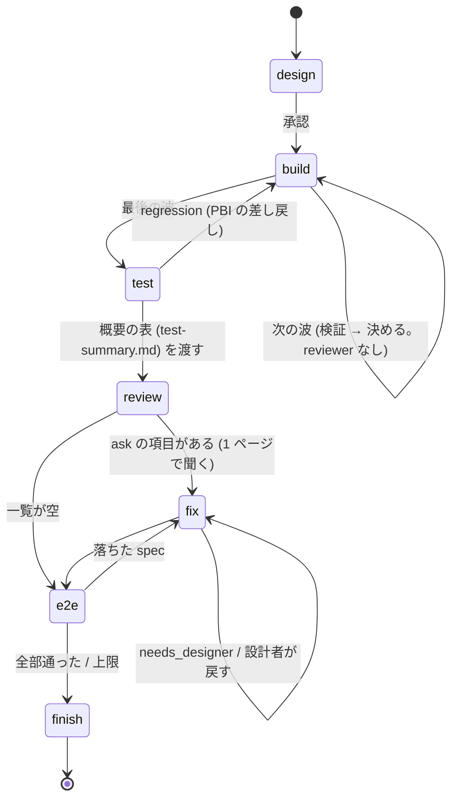

# PBI ごとの見直しをやめ、見直しは最後の 1 回だけにする

合意: 2026-11-16、持ち主の方針 (Atelier の run `4b3605fd` を止めた原因の調査のあとに出した案)。前提は PR 62 (最後の見直しは 1 回、直しは修正の段で一度に、`docs/specs/fix-stage-once.md`) と PR 65 (問いをまとめる・軽い道、`docs/specs/lean-designer.md`) のマージ。

## Problem Statement

Atelier の run (`4b3605fd`、2026-11-16 に持ち主が止めた) は、作る段で PBI-001〜010 がすべて見直しに合格したあと、試験の段で試験の PBI 1 件ごとに Opus の見直しが入り、試験の段だけで約 1,450 万トークンを使った (持ち主の見積もり。試験の段のエピソード費用は記録に残っていない)。

- 今の流れは、PBI ごとに「作業者 → 検証 → reviewer → 束ねる (`role_results.py bundle`) → 担当が決める → 直し (reviewer がもう 1 回)」と回る。PBI が増えるほど、reviewer の起動と束ねの往復が増える。
- build の 5 つの波では、reviewer が約 1,000 万トークンで、設計者に次ぐ大きさだった。
- 見直しの記録 (PBI-001〜013) を読むと、reviewer が見つけた critical・major は 3 件 (PBI-005・008・009)、試験の PBI では 1 件 (PBI-011 の C7、検証したい動きを外しても通る形) だった。このうち 005 は全体の単体テストが、008・009 と 011 は最後の見直しが拾える。PBI ごとに 1 回ずつ見直す必要はない。
- 試験の PBI の見直しは、試験を全部読むので、見直し 1 回ごとにコンテキストが膨らむ。どの試験を書くかは `Cases:` で決まっているので、書き手の概要を読めば足りる。
- 最後の見直しは 1 回だけ流れ、確かめた指摘を直しの一覧にまとめて、修正の段が一度に直す (`fix-stage-once.md`)。PBI ごとの見直しを外せば、見直しは最後の 1 回に揃う。

## Solution

PBI ごとの見直し (reviewer の起動・束ね・見直しのための差し戻し) をやめる。PBI の合否は、検証コマンド (モデルを使わない) と、触ってよいファイルの外を変えていないかの確認で決める。見直しは最後の 1 回だけにし、見直しのスキルが裏を取った指摘は、そのままユーザーに見せる。直すのはユーザーが答えた項目だけにする。

```
今:   build (波: 作業者 → 検証 → reviewer → 束ね → 決める → [直し → reviewer]) → test (試験の PBI も同じ) → review (1 回) → fix → e2e → finish
新:   build (波: 作業者 → 検証 → 決める → [直し]) → test (試験の PBI も同じ、概要の表を作る) → review (1 回、裏取り済みの指摘をそのまま) → ask (1 ページ) → fix → e2e → finish
```

## User Stories

1. 持ち主として、PBI が増えても reviewer の起動と束ねの往復が増えないでほしい。
2. 持ち主として、試験の PBI の見直しで全部の試験を読まず、書いた内容の概要だけで済ませてほしい。
3. 持ち主として、検証のコマンドは PBI ごとに流し続けてほしい。壊れた PBI の上に次の波が積まれないように。
4. 持ち主として、最後の見直しの指摘を、裏取り済みのままページで見て、直すものを 1 回で答えたい。
5. 持ち主として、試験の書き手が自分で「空振りの試験 (その動きを消しても通る試験)」に気づいてほしい。モデルの呼び出しを増やさずに。
6. 持ち主として、最後の見直しが試験の中身を見るとき、全部を読み直さず、書き手の概要の表を見てほしい。

## Implementation Decisions

### 決めたこと

- PBI ごとの見直しは、build の PBI・試験の PBI・直しの PBI のどれでもやめる。reviewer (`prompts/pbi-review.md`) を起動せず、`role_results.py bundle` も呼ばない。
- PBI の合否は、その PBI の検証コマンド (`docs/pbi/verify/<report>.json`) と、触ってよいファイルの外の変更が無いこと (`docs/pbi/tools/unchanged.py`) で決める。受け入れ条件のうちコマンドで確かめられないものは、作業者の Self-check と最後の見直しに任せる。
- 検証コマンドの PBI ごとの実行 (`verify.py`) と、波の終わりのテスト担当 (kind `wave`) は今のまま残す。モデルを使わないので費用がほぼゼロで、壊れた土台の上に次の波を積まないために要る。
- 最後の見直しは今のまま 1 回。全体の単体テストの結果 (`Test results:`) を渡す。選ぶ見直しは `## Pick the review` の表のまま (`adapters.review` で持ち主がスキル名を決められる。裏取りまでするスキルを選ぶと、次の項目で担当の確かめを省ける)。
- 裏取り済みの指摘は、担当が 1 件ずつ開き直さない。裏取りまでするスキル (`review-flow`・`lens-review`・pstack の `interrogate`) の結果は、そのまま直しの一覧に書く。裏取りをしない見直し (built-in の `code-review` など) は、今までどおり担当が 1 件ずつ確かめる。
- 最後の見直しの指摘は、critical・major も含めて `decision: ask` にし、推奨 (`recommend`) を付ける。critical と major は `fix`、minor は今の基準 (`appendix/review.md`, `## Minor findings`) の `fix`・`skip`。修正の段の担当が、作業者を起こす前に 1 回だけ 1 ページで聞く (今の minor の問いと同じ仕組み。`appendix/fix.md`, `## Steps`)。持ち主は「推奨どおり」の 1 行で答えられる。直すのは答えが `fix` の項目だけ。
- 試験の PBI の作業者は、Self-check に case ごとの行を書く (下の 2.)。モデルの呼び出しは増やさない。
- 直しの PBI も PBI ごとの見直しをしない。直しの項目は repro のコマンド (`check`) を持つので、機械で確かめる。repro の無い項目 (文書の規則など) は機械の確かめが無いので、次の 2 つで補う。
  - 直しの作業者は、その項目の受け入れ条件 (`F<n> (<file>:<line>): <what> — fixed as: <fix>`) の結果を Self-check に 1 行で書く。
  - 修正の段の担当は、その PBI を pass と記録する前に、repro の無い項目の直しの差分 (`fix_plan.py diff`) を自分で読み、`fix` の文のとおりに直っているかを確かめる (reviewer は起動しない)。確かめた差分は、完了の報告にも載せる。
  repro のある項目の扱いは変えない。

### 1. PBI の流れ (`episode/one-pbi.md`・`appendix/episodes.md`・`appendix/verify.md`・`appendix/rework.md`・`appendix/fix.md`・`runners.md`)

- `episode/one-pbi.md` の「波の作業者が全部戻ったら reviewer を 1 つずつ起動する」と「`bundle` を実行する」の手順をやめる。作業者が戻ったら、検証 (`verify.py`) と `unchanged.py` の確認だけをし、`## Reconcile` で決める。
- `appendix/episodes.md` の `## Reconcile`: `bundle` の表を前提にした行 (exit 3 の `error` の行、`open` の行) を外す。決め方は、検証が通れば pass、落ちれば rework、触ってよいファイルの外の変更があれば rework (`out-of-scope`)、波のテスト担当の結果の `cause` は今までどおり。
- `appendix/verify.md`: `bundle` の段落を外す。検証の合否の読み方 (`docs/pbi/verify/<report>.json`) は残す。
- `appendix/rework.md`: 「見直しは PBI ごとに最大 2 回」の段落と、`bundle` の `limit` に関する文を外す。差し戻しの上限は `fix.max_rework` だけにする。止める条件 (`## Stop`) の `limit` も外す。
- `appendix/fix.md` の `## Steps` の (4) (直しの PBI ごとの見直し) を外し、直しの PBI の合否は検証コマンドで決める。
- `runners.md` と `role_run.py` の、`pbi-review` の役割 (reviewer の実行先の指定) は、最後の見直し (`final.review`・`final.security`) だけに限る。
- `role_results.py` の `bundle` サブコマンドと `prompts/pbi-review.md` は、文書から呼ばなくなるだけで、この仕様では消さない (消すのは別の整理)。

### 2. 試験の PBI (`worker.md`・`appendix/tests-at-end.md`・`tests_plan.py`)

- 試験の PBI の作業者は、報告の `## Self-check` に case ごとの行を書く。形は `<case id>: pass|fail — <その動きを消すと落ちる assert の位置と内容>`。assert が動きを消しても通ってしまう case (空振り) は、その行を書く時点で作業者が気づける。`?` の case は今までどおり PBI に入れない。
- `tests_plan.py` に `summary` を足す: `python <skill>/tests_plan.py summary docs/pbi`。試験の PBI の `Cases:` と、報告の Self-check の case の行から、1 つの表 `docs/pbi/notes/test-summary.md` を書く。列は `file`・`case id`・`behaviour`・`assert (作業者の行)`。実行結果の列は持たない: `docs/pbi/verify/<report>.json` が持つのは検証コマンドごとの終了コードだけで、1 つの試験ファイルの case は 1 つの `test_command` を共有するので、case ごとの結果は取れない。`summary` を流すのは、すべての試験の PBI の検証が通ったあと (`## Test stage` の 4. の終わり) なので、表に載る行はすべて通った試験である。検証が通っていない PBI があるときは、`summary` は表を書かず `exception: <PBI>: verify not passed` と出す (終了コード 4)。作業者が行を書かなかった case は `assert` が `missing` になり、`summary` が `exception: <file>: <case id>: missing` と出す (終了コード 4)。担当は例外のある PBI を作業者に戻す。
- `appendix/tests-at-end.md` の `## Verify, per PBI`: 試験の PBI にも reviewer を起動しないことを 1 行足す。`## Test stage` の 5. **Close** の前に、`tests_plan.py summary` を実行し、表を `docs/pbi/notes/test-summary.md` に書く手順を足す。stage record `tests` に、例外の数を足す。
- 落ちた試験の PBI の差し戻しの規則 (`appendix/rework.md`) は変えない: 落ちた case id・assert・出力だけを渡す。

### 3. 最後の見直し (`appendix/review.md`・`prompts/final-review.md`)

- `prompts/final-review.md` の依頼文に `Test summary: <docs/pbi/notes/test-summary.md, or none>` の行と、次の 1 文を足す: 表の assert が、その case の動きを消しても通る形のとき、または試験の対象のコードを mock しているときは、major の指摘にする。
- `## Findings` の 1. を直す: 見直しのスキルが裏取り済みの指摘だけを返す場合 (上の「決めたこと」の 3 つのスキル) は、担当は指摘を 1 件ずつ開き直さず、直しの一覧に書く。それ以外は今までどおり確かめる。
- `## Findings` の 2.: 指摘は critical・major・minor のすべてを `decision: ask` に書き、`recommend` を付ける。critical・major は `fix`、minor は `## Minor findings` の基準。ADR との食い違いは今までどおり `ask` で、選択は `code` と `adr`。`fix` を決めた項目 (`decision: fix`) を、この段では書かない。
- `## Findings` の 5.: 次の出番は、一覧に `ask` の項目があれば `fix` (修正の段の担当が 1 ページで聞く)、空なら `e2e` か `finish`。

### 4. 修正の段の最初の問い (`appendix/fix.md`・`appendix/questions.md`)

- 修正の段の担当は、作業者を起こす前に、`decision: ask` の項目すべてを kind `decision` の 1 ページで聞く。1 項目ごとに、ファイル・行・何が悪いか・直し方・推奨 (`recommend`) を載せ、選択肢は `fix`・`skip` (ADR との食い違いは `code`・`adr`)。ページの先頭に、推奨のまま答える方法 (「推奨どおり」) を 1 行で書く。
- 答えを一覧の `answer` に書き、`decision` を次のように決める (今の `appendix/fix.md`, `## Steps` の 1. と同じ。どの項目も `ask` のまま残さない。`fix_plan.py` は `ask` が残る間、何も書かないため)。
  - `fix` の答え: `decision: fix`。
  - `skip` の答え: `decision: skip`。完了の報告の見送りに載せる (今の minor と同じ)。
  - ADR との食い違いの `code` と `adr` の答え: どちらも `decision: fix`。項目の `fix` を、選ばれた直し方 (コードの直し、または前の記録を置き換える新しい記録。後者では項目の `file` が新しい記録) に書き換える。ADR との食い違いは `skip` を選べない。
- `decision: fix` の項目があれば `fix_plan.py plan` へ進む。すべて `skip` なら、修正の段を流さず `e2e` か `finish` へ進む。

### 状態の図



## Testing Decisions

- `tests_plan.py summary`: 試験の PBI と報告と検証の結果の JSON を一時フォルダに作り、表の列、`missing` の例外 (終了コード 4)、`?` の case を持つ PBI、検証が通っていない PBI で表を書かず例外を出すことを見る。前例は `test_tests_plan.py`。
- 文書の変更: `test_references.py` をそのまま通す (消した手順が他の文書から参照されていないこと)。`bundle` を呼ぶ文書が残っていないことを grep で確かめる。
- 最後の見直しの指摘の `decision: ask` 化は、`fix_plan.py` が `ask` のまま来た一覧を `exception:` にする既存の動きと、修正の段の最初の問いの手順で担保する。`design_record.py lint --kind decision` を、critical・major を含むページで通す試験を足す。前例は `test_design_record.py`。
- 実装で確かめること: `review-flow` を `adapters.review` に指定したとき、reviewer (深さ 2) の子の起動 (`appendix/review.md`, `## Run a review skill` の 2.) の制約に当たらないか。当たるなら、`lens-review` と同じ扱い (子を持たずに動く形) にする。

## Out of Scope

- `role_results.py bundle` と `prompts/pbi-review.md` を消すこと。
- PBI の `review:` 欄 (`deep` など) の削除。欄は残し、PBI ごとの見直しが無いので読まれないだけにする。
- 最後の見直しの回数や見直しの選び方 (`## Pick the review`) の変更。
- 試験の PBI をモデルを使わないスクリプトで流すこと (`e2e_run.py` のような形)。この仕様の変更を入れて費用を測り直したあとに考える。
- `~/.claude/skills/atelier/versions/` とホームの設定の書き換え。版はマージのあとに skill-versioning で作る。

## Further Notes

- 根拠: PBI ごとの見直しが見つけた critical・major は 13 件の PBI のうち 4 件。試験で拾えるもの、最後の見直しで拾えるものに分かれ、PBI ごとに 1 回ずつ見る理由にならなかった。往復を減らす一番大きい手は、reviewer を起動する回数を PBI の数に比例させないことである。
- 失うもの: 後の波が、見直しを通っていない PBI の上に積まれる。検証コマンドと `unchanged.py` は波ごとに流れるので、壊れた土台は検証で止まる。見直しでしか見つからない種類 (文書の規則の抜けなど) は、後の波に伝わる性質のものではなく、最後の見直しで拾う。
- 指摘を持ち主に見せる回数が 1 回増える (critical・major も `ask` になるため)。「推奨どおり」で答えられるようにして、往復の手間を増やさない。
- 規則はどの実行にも当てはまる形で書く。1 回の実行の数字や事例は規則の中身にしない。
