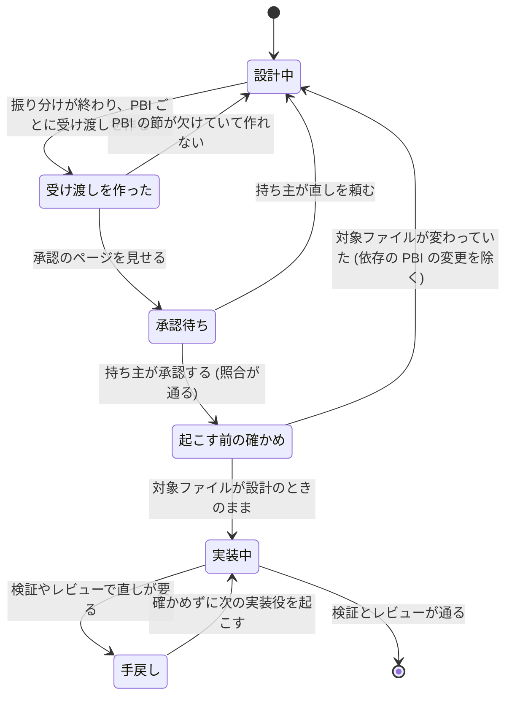

# 実装役への受け渡しを JSON の作業票にする (work-json)

2026-11-13、design-flow v2.1 (今の設定のまま、grilling Q1〜Q14、すべて推奨どおり。そのあと名前を work に、slice の指し方を Notes の行に決め、状態の図に合意した。pstack の検査はしない) で持ち主と合意した。起点は main の `ff92987`。用語は `skills/atelier/CONTEXT.md` に従う。見せ方 (am でページにする・照合情報) は present-with-am (ブランチ `claude/atelier-present`、未マージ)、承認の原稿の書き方は `approval-draft.md` の関心で、この仕様では変えない。

## Problem Statement

Atelier の当初の原則は「人には HTML のページで確かめてもらい、AI 同士の受け渡しは必要な情報だけの JSON (＋短い説明) にする」だった。ところが今、JSON は承認の照合 (`design-record.json` のハッシュ) にしか使われていない。

- 実装役 (`pbi-worker` と外部の実行先) は、PBI の Markdown を読んで動く。範囲 (`## Targets`)・制約 (`## Do not touch`)・目的 (`## Goal`)・モデル (`- Model:` と `route.json`) は Markdown の中にあるが、機械で確かめられない。
- 根拠になったコードの版 (SHA) がどこにも残らない。設計してから実装役を起こすまでに対象のファイルが変わっても、誰も気づかない。
- 関心事ごとの `slice.json` は照合のハッシュに入るだけで、誰にも渡されない。
- 持ち主は、HTML で承認したものと実装役に渡るものが同じだと言い切れない。

## Solution

PBI ごとに、実装役への受け渡しの JSON (`docs/pbi/PBI-<n>.work.json`) を作る。これを正本とする。

- 設計役は今までどおり PBI の Markdown を書く。道具がその Markdown と `route.json` から JSON を作るので、二重に書かない。
- JSON には、範囲・制約・設計のときの SHA と対象ファイルの blob・モデル (route)・関わる slice・refs が入る。
- JSON は承認の照合のハッシュに入る。HTML で承認したものと渡すものが、機械で同じだと確かめられる。
- 実装役を起こす直前に、対象ファイルが設計のときから変わっていないかを道具で確かめる。変わっていれば、その PBI を起こさずに設計役へ戻す。
- どの実行先にも、依頼文の `Work:` の 1 行で渡す。実装役は、範囲と制約をこの JSON に従って守る。手順と検証は今までどおり Markdown で読む。

## User Stories

1. As a 持ち主, I want HTML で承認した設計と実装役に渡る情報が同じだと機械で確かめられること, so that 承認が実装に効いていると信じられる
2. As a 持ち主, I want 承認のあとに PBI の範囲や制約が書き換わったら照合で分かること, so that 承認していない変更が実装に流れない
3. As a 設計役, I want PBI の Markdown を書けば受け渡しの JSON が道具で作られること, so that 同じ内容を 2 か所に書かずに済む
4. As a 設計役, I want PBI の Markdown に `Goal`・`Targets`・`Do not touch` の節が欠けていたら道具が止めること, so that 欠けた受け渡しが実装役に渡らない
5. As a 設計役, I want モデルの指定が `route.json` から JSON に写されること, so that 振り分けの結果と受け渡しが食い違わない
6. As a 実装役, I want 範囲と制約を 1 つの小さな JSON で受け取ること, so that 長い文章から読み取らずに守るべき範囲が分かる
7. As a 実装役, I want 関わる slice の id と refs を JSON で受け取ること, so that 設計で何を読んで何が未決だったかをたどれる
8. As a 外部の実行先 (codex・dsh・claude -p など) で動く実装役, I want Agent tool と同じ 1 行で受け渡しを受け取ること, so that 実行先によって渡る情報が変わらない
9. As a 呼び出し側, I want 実装役を起こす前に、対象ファイルが設計のときから変わっていないかを 1 つのコマンドで確かめられること, so that 古い前提で実装させない
10. As a 呼び出し側, I want 先に終わった依存 PBI が変えたファイルでは止まらないこと, so that 同じ run の波の流れが普通に進む
11. As a 呼び出し側, I want 古くなった PBI を起こさずに設計役へ戻す道があること, so that 前提が崩れたときに作り直せる
12. As a 呼び出し側, I want 手戻し (rework) のときは古さの確かめを飛ばすこと, so that 実装役自身の変更で止まらない
13. As a 新しいファイルを作る PBI の実装役, I want そのファイルが設計のときに無かったことが記録されること, so that 起こす前に誰かが同じパスにファイルを作っていたら気づける
14. As a `confirm off` で使う利用者, I want 照合が無くても受け渡しの JSON と古さの確かめは同じように動くこと, so that 設定で実装役への受け渡しの質が変わらない
15. As a 途中で止まった run を再開する利用者, I want 古い形の `slice.json` (`/1`) もそのまま読めること, so that 版を上げても再開が壊れない
16. As a 将来の調査役, I want slice に設計のときの SHA が入っていること, so that 同じ JSON をそのまま調査の依頼にも使える
17. As a 持ち主, I want 承認の照合で作業票が変わったときに revision が上がること, so that 古い承認の返信で新しい受け渡しを通さない
18. As a ハーネスの記録を見る人, I want 受け渡しの JSON が PBI ごとのファイルとして残ること, so that あとで実装役に何が渡ったかを確かめられる

## Implementation Decisions

- **受け渡しの単位は PBI**。関心事 (slice) の単位は実装役の単位と合わないので、slice は作業票から id で指す。PBI の Markdown はやめず、人と実装役が読む説明・手順・検証の場所として残す。
- **正本は JSON**。`goal`・`targets`・`do_not_touch`・`depends_on`・`route` は、Markdown と route.json から道具が作る。設計役は JSON を手で書かない。
- **作業票の形** (schema `atelier.work/1`):

  ```json
  {
    "schema": "atelier.work/1",
    "pbi": "PBI-3",
    "goal": "<## Goal の本文>",
    "targets": ["<path>"],
    "do_not_touch": ["<path や API>"],
    "depends_on": ["PBI-1"],
    "base_sha": "<作ったときの HEAD>",
    "target_blobs": {"<path>": "<blob のハッシュ。無いファイルは null>"},
    "route": [{"runner": "agent", "model": "sonnet", "effort": null}],
    "slices": ["c1"],
    "refs": ["<共有メモリの id>"]
  }
  ```

  受け入れ条件と検証コマンドは入れない (検証コマンドは `verify.py` が Markdown の決まった形から読むため)。`targets` は `## Targets` の各行の先頭のパス、`refs` は `## Refs` の id、`slices` は `## Notes` の `slice: <id>` の行から取る (grilling のあとで持ち主と決めた)。
- **`design_record.py work PBI-<n>`** を足す。PBI の Markdown と `PBI-<n>.route.json` を読み、`docs/pbi/PBI-<n>.work.json` を書く。`Goal`・`Targets`・`Do not touch` の節が無い、または空のとき、route.json が無いとき、指した slice のファイルが無いときは誤り (exit 6) で、何も書かない。
  - **`none` の扱い** (2026-11-13、PBI-1 の修正上限で持ち主が決めた): `Do not touch`・`Depends on`・`Refs` に明示的に書かれた `none` (`- none` を含む) は、空の並び (制約なし・依存なし・refs なし) として受け付ける。節が無い、または中身が空のときだけ exit 6 にする。`Targets` と `Goal` では `none` を認めず、exit 6 にする。
- **作る時**: 設計役は route (とそのあとの関所) の後、`## Approve` の前に、全 PBI 分を流す (`designer.md` の `## Approve` と `appendix/adapters.md` の `## Confirm`)。
- **承認の照合**: `design_record.py write` に `--work PBI-<n>.work.json` を足し、正本 `design-record.json` に `works` の並びを入れる (schema は `atelier.design-record/2`)。`works` の並びかファイルの中身が変わったら revision を上げる。record_hash は今までどおり正本から計算し、作業票の中身のハッシュを正本に含めることで範囲に入れる。
- **`design_record.py stale PBI-<n>`** を足す。`target_blobs` と今の作業ツリーのファイルを比べる。違うファイルがあり、それが `depends_on` の PBI の `targets` に入っていなければ、終了コードで「古い」を返し、どのファイルかを出す。呼び出し側は、その PBI を起こさずに設計役へ戻す (episode の扱いは `designer.md` の build に足す)。確かめるのは各 PBI を最初に起こすときだけで、手戻しでは流さない。
- **依頼文**: `runners.md` の依頼文の形に `Work: docs/pbi/PBI-<n>.work.json` の行を `PBI:` の次に足す。`agents/pbi-worker.md` と `worker.md` に「まず作業票を読み、範囲と制約はそれに従う。手順と検証は PBI の Markdown に従う」と書く。全実行先で同じ形にする。
- **`confirm off` のとき**: 正本も照合も無いが、作業票と stale は同じように作って流す。
- **slice の形**: `atelier.design-slice/2` にし、`base_sha` を足す。読む側は `/1` も受ける (`base_sha` は無いものとして扱う)。
- **brief.md** (Jev の振り分け用) は変えない。役目が違う。
- **用語**: `CONTEXT.md` に「作業票 (work)」の項を足す。PBI ごとの実装役への受け渡しの JSON (`PBI-<n>.work.json`) のことで、episode の引き継ぎ (`appendix/handoff.md`) や Kiln の handoff の行とは別のもの。名前に handoff を使わないのは、この 2 つとぶつかるため (grilling のあとで持ち主と決めた)。

## Testing Decisions

- よいテストは、コマンドの入力 (ファイル) と出力 (書いたファイル・終了コード・標準エラー) だけを見る。中の関数は見ない。
- **合意済みの seam**:
  1. `design_record.py work`: PBI の Markdown と route.json から JSON ができること。節が欠けたら exit 6 で何も書かないこと。新しいファイルの blob が null になること。
  2. `design_record.py stale`: blob が同じなら起こしてよい、違えば古い、違っても `depends_on` の PBI の targets なら起こしてよい、無かったファイルができていたら古い。
  3. `design_record.py write`: `works` の中身が変わると revision が上がり record_hash が変わる。同じなら変わらない。`/1` の slice も受ける。
- 依頼文の `Work:` の行は、依頼文がコードではなく `runners.md` の形から組み立てられているため、文書の点検で確かめる。依頼文の形を点検している既存のテストがあればそこに 1 件足す。無ければ seam 1〜3 で足りるものとする (grilling の Q13 では conductor のテストと書いたが、依頼文を組み立てるのは conductor ではなかったので直した)。
- 先行例: `test_design_record.py` の slice・write・check-reply のテスト、`testdata/design/pbi/` の作り方。

## Out of Scope

- 調査役 (設計の未決の点を、slice を受け取って調べるサブエージェント) を作ること。slice をそのまま渡せる形にするところまでで止める。別の仕様にする。
- PBI の Markdown をやめて JSON だけにすること。
- 受け入れ条件と検証コマンドを JSON に移すこと。
- brief.md と Jev の振り分けを変えること。
- 承認の見せ方 (HTML・am・照合情報の形) を変えること。
- レビュー役・テスト役への受け渡しを JSON にすること。

## Further Notes

- 貼られた分析は「対象範囲・制約・モデル・短い説明が無い」としていたが、main ではそれらは PBI の Markdown と route.json にある。本当に無かったのは JSON であること・SHA・slice を渡す道の 3 つ。
- present-with-am (`claude/atelier-present`) と approval-draft は `designer.md` の `## Approve` と `appendix/adapters.md` の `## Confirm` を触る。マージの順で衝突しうるので、先にマージされたほうに合わせる。

## 状態の図



%% never 承認のあとに中身が変わった受け渡しで実装役を起こす
%% never 対象ファイルが設計のときから変わったまま、最初の実装役を起こす
%% never 受け渡しを作らずに承認を待つ
