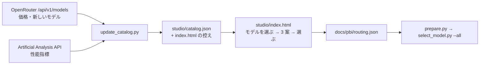

# Template Studio (振り分けテンプレートを画面で組む)

## ねらい

今の振り分けは `select_model.py` の中の表 (段ごとの route) に書き込まれていて、契約している実行先やモデルが変わるたびにコードを直す必要がある。これを **テンプレート (routing.json)** として外に出し、画面でモデルを選ぶと **性能・コスパ・バランス** の 3 案が出て、選んだ案をそのまま置ける形にする。

段の決め方 (Jev の score と facts から haiku / sonnet / opus を決める決定表) は変えない。テンプレートが決めるのは「その段で、どの実行先・モデル・effort を、どの順に試すか」だけ。

## 全体



## 1. モデル一覧 (catalog.json) とその更新

| 項目 | 中身 |
|---|---|
| `providers` | 会社ごとの名前・色・アイコンの文字 |
| `models[]` | モデル名、`quality` (0〜100)、`price_in` / `price_out` ($/100 万トークン)、`until` (使える最終日)、`openrouter_id` / `aa_slug` (更新の突き合わせ用) |
| `models[].options[]` | そのモデルを呼べる実行先。`runner` (opencode / codex / agy / agent)・`model`・`effort`・`billing` (subscription / api)・`quality_delta` (effort を下げたときの差) |
| `candidates[]` | 更新で見つかった新しいモデル (実行先との対応がまだ無いもの) |

更新は `python studio/update_catalog.py` 1 回で行う。

- **価格**: OpenRouter の `GET /api/v1/models` (キー不要)。1 トークンあたりの USD を 100 万トークンあたりに直す。
- **性能**: Artificial Analysis の `GET /api/v2/data/llms/models` の `artificial_analysis_intelligence_index`。無料のキーを `AA_API_KEY` に置いたときだけ取り、無ければ前の値のまま。
- **新しいモデル**: catalog に載っている会社の、60 日以内 (`--new-days`) に出たモデルを `candidates` に出す。どの CLI のどのモデル名で呼ぶかは人が決めることなので、`models` には自動で足さない。画面では「新しく出たモデル」として出し、`options` を書けば選べるようになる。
- 取れなかった値は `sample: true` のまま残り、画面に「仮の値」と出る。今のコミットの値はすべて仮の値。
- 定期的に回すなら、Claude Code のルーティン (週 1 回 `update_catalog.py` を実行して PR を出す) か GitHub Actions の cron を使う。どちらにするかは後で決める。

「AI が特定サイトを見て判断する」部分は、まず **数字は API から決まった方法で取り、案の組み立ても決まった式で行う** ことにした。同じ一覧からは毎回同じ案が出るので、案の差が「モデルの差」だと読める。AI (オーケストレーター) の出番は、一覧の更新後に `candidates` を見て `options` の下書きを作ることと、案の説明を書くこと (次の段階)。

## 2. 3 案の作り方 (index.html の `build()`)

チップ 1 つ = route の 1 段 (実行先 × モデル × effort)。ユーザーが残したチップだけを使う。

1. 段ごとに性能の下限を置く (既定 haiku 55 / sonnet 70 / opus 85、画面で変えられる)。下限より低いものはその段に入れない。
2. Claude Code の Agent 以外 (opencode / codex / agy) を案ごとの順に並べ、同じ実行先は 1 つだけ、`1 段あたりの実行先の数 − 1` 個まで取る。opus の段は、既定では外部の実行先を使わない (今の方針と同じ)。
3. 最後に Agent のモデルを 1 つ置く (route は必ず agent で終わる)。下限に届く Agent が無ければ、いちばん性能の高い Agent を置いて警告を出す。

| 案 | 並べ方 |
|---|---|
| 性能 | 性能の高い順 |
| コスパ | 実質の費用の安い順 |
| バランス | 0.4 × 性能 (正規化) + 0.6 × (1 − log 費用 (正規化)) の高い順 |

実質の費用は API 価格の 3:1 加重平均。「サブスクの枠内は安いとみなす」をオンにすると、`billing: subscription` の実行先は 0.15 倍で数える (枠を使い切るまでは追加の支払いが無いため)。カードの「API 換算 / PBI」は 1 PBI = 入力 30 万・出力 3 万トークン、段の出方 haiku 40% / sonnet 45% / opus 15% の目安で、各段の先頭の実行先の API 価格から出す。

## 3. テンプレート (routing.json) と select_model.py

```json
{
  "name": "balanced",
  "tiers": {
    "haiku":  [{"runner": "opencode", "model": "opencode-go/deepseek-v4.1-flash", "effort": null},
               {"runner": "codex", "model": "gpt-6-astra", "effort": "high", "until": "2026-10-23"},
               {"runner": "agent", "model": "sonnet", "effort": "high"}],
    "sonnet": [...],
    "opus":   [{"runner": "agent", "model": "opus", "effort": null}]
  }
}
```

- どの段も、最後の 1 つだけが `agent`。途中は opencode / codex / agy のどれか。形が違えば select_model.py はエラーで止まる。
- `until` を過ぎた実行先は route から外れる (今の `CODEX_UNTIL` を段ごとに書けるようにしたもの)。
- `sensitive` の PBI は、テンプレートに関係なくその段の `agent` だけになる。`--skip` も今までどおり効く。
- 読む順: `--routing <file>` → (`--all` のとき) `<dir>/routing.json` → スキルのディレクトリの `routing.json` → 組み込みの表 (`routing.default.json` と同じ中身)。prepare.py は `select_model.py --all docs/pbi` を呼ぶので、`docs/pbi/routing.json` を置くだけで効く。

## 次の段階 (この PR には入れない)

- `update_catalog.py` を実データで一度回して、仮の値を置き換える (このコンテナからは外部 API に出られなかったので、取り込みは手元のテスト用 JSON でしか確かめていない)。
- スキルに `/pbi-orchestration-jev templates` を足し、オーケストレーターが一覧を更新して `candidates` の `options` を下書きし、3 案に一言ずつ説明を付ける。
- `agent_stats.py` と jev-log の実績 (段ごとの差し戻し率・実際の費用) を一覧に戻して、性能の数字を「公開ベンチマーク」から「このリポジトリでの実績」に寄せる。
- 画面で route の順を手で入れ替える。
