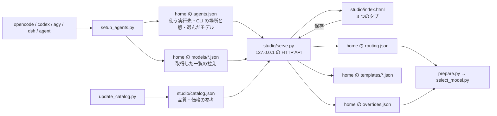

# Template Studio (セットアップと編集画面)

## ねらい

実行先の検出・モデルの取得・使うモデルの選択・振り分け (段ごとの route)・優先テンプレートと適用を、1 つの画面で扱えるようにする。以前はテンプレートの案を作る画面と、優先テンプレートの Web ページが別々で、保存先も対象リポジトリと home に分かれていた。今は保存先をすべて home にそろえ、画面も 1 つにした。

段の決め方 (Jev の score と facts から haiku / sonnet / opus を決める決定表) は変えない。画面が決めるのは、使う実行先とモデルの一覧、その段でどの実行先・モデル・effort をどの順に試すか、優先テンプレートとその適用だけ。

## 全体

画面は 3 つのタブに分かれ、どのタブも home のファイルだけを読み書きする。

| タブ | 読み書きする home のファイル |
|---|---|
| エージェントとモデル | `agents.json`・`models/<実行先>.json` |
| 振り分けテンプレート | `routing.json` (前の版は `routing.prev.json`) |
| 優先テンプレートと適用 | `templates/<name>.json`・`overrides.json`・`history.jsonl` |

保存のたびに、サーバーは標準出力に `SAVED <kind> <path>` を出す (kind は agents / models / routing / template / application)。対象リポジトリには書かない。

## 画面の言葉

画面では、スキルの中の言葉をそのまま出さない。

| スキルの中 | 画面 (日本語) | 画面 (英語) |
|---|---|---|
| 段 (tier) haiku / sonnet / opus | 作業の重さ: 軽い作業 / ふつうの作業 / 設計が要る作業 | workload: Light work / Standard work / Design-heavy work |
| route | 試す順番 | try order |
| route の最後の agent | 最後に受ける Claude Code | Final fallback (Claude Code) |

画面の文言は `index.html` の `TEXT` に日本語 (`ja`) と英語 (`en`) を同じキーで持つ。言語は URL の `?lang=`、前回選んだ言語 (localStorage)、ブラウザの言語の順に決め、ヘッダーのボタンで切り替える。切り替えても選んだモデル・並びはそのまま残る。

## モデル一覧の取り方

`setup_agents.py` が `model_fetch.py` を通して実行先ごとに取る。取れた一覧は `models/<実行先>.json` に、取得日時・取得方法・エラーとともに残す。

| 実行先 | 取り方 | effort の取り方 |
|---|---|---|
| opencode | `opencode models --standalone` の標準出力 (1 行に 1 つの `<provider>/<model>`、空行は捨てる) | opencode のキャッシュ (`<XDG_CACHE_HOME か ~/.cache>/opencode/models.json`) の `reasoning_options` のうち `type == "effort"` の `values`。無ければ `[]` |
| codex | `codex debug models` の JSON (`models[].slug`・`display_name`・`visibility`・`supported_reasoning_levels[]`)。`visibility == "hide"` は除く | 同じ JSON の `supported_reasoning_levels[].effort` |
| agy | `agy models` の標準出力 (1 行が `<id>\t<表示名>`)。タブの無い行は捨てる | ID の末尾。`-low` / `-medium` / `-high` ならその語を `level` に入れ、`efforts` は `[]` |
| dsh | 一覧のコマンドは無い。同梱の `dsh.models.json` と `dsh headless --dump-config` の `agent-default-model` | カタログの `efforts`。ダンプにしか無いモデルは `[]` |
| agent | CLI を呼ばない。Agent ツールの定義 (haiku・sonnet・opus・fable) | `low` / `medium` / `high` / `xhigh` / `max` |

- 取れなかった実行先は `FetchError` にして、その実行先だけ失敗として扱う。ほかの実行先には波及させない。
- 失敗したときは前の一覧をそのまま残し、`error` と `failed_at` を書く。前のファイルが無ければ、モデル `[]`・方法 `manual` で作り、手入力で足せる状態にする。
- 取り直しに成功すると一覧を取得結果で置き換える。手入力したモデル (`manual: true`) のうち、取得結果に同じ id が無いものは末尾に残す。
- 一覧から消えたモデルが `agents.json` で選ばれていれば、その id を `missing_selected` として返して画面に警告する。選択は消さない。
- 取り方は実行先の版で変わりうる。確認した版と日付は `appendix/setup.md` の「既知の問題」に置く。

取れなかった実行先にモデルを足すときは、画面の「エージェントとモデル」タブの手入力、または `python setup_agents.py add-model --runner <実行先> --id <モデル> [--effort <段> ...]` を使う。

## 品質・価格の参考

`studio/catalog.json` は、モデルの一覧に添える品質と価格の参考で、必須ではない。画面で選べるモデルは `models/<実行先>.json` の一覧で決まり、カタログは選べる範囲を変えない。

- `catalog.json` の `models[].options[]` に (実行先, モデル) が一致すれば、そのモデルの `quality`・`price_in`・`price_out`・`sample` を使う (source は `catalog`)。
- 無ければ、id の provider 部分 (`/` より前) と末尾の `-low` / `-medium` / `-high` / `-free` を落として `.` を `-` にした文字列を、`aa_slug` と照合する (source は `catalog`)。
- それも無く、`models/<実行先>.json` の項目に `price_in` / `price_out` があればそれを使う (`quality` は null、`sample` は false、source は `cli`)。
- どれも無ければ null で、画面には参考が無いものとして出る。

カタログの更新は `python skills/pbi-orchestration-jev/studio/update_catalog.py` で行う。価格と新しいモデルは OpenRouter の `GET /api/v1/models` から、品質は Artificial Analysis のコーディング指標から取る (`AA_API_KEY` があるときだけ)。取れなかった値は `sample: true` のままで、画面に仮の値と出る。

## HTTP API

`studio/serve.py` は home のファイルを読み書きする小さなサーバーで、画面はこの API だけを使う。応答は JSON で、失敗は `{"ok": false, "error": "<英語の 1 文>"}`。

| エンドポイント | 用途 |
|---|---|
| `GET /` | `index.html` に起動ごとの合言葉と home を埋め込んで返す |
| `GET /api/state` | home の今の中身 (runners・routing・templates・examples・application・status・flow・warnings) を返す |
| `PUT /api/agents/<runner>` | その実行先の enabled・選んだモデル・課金の種類を変える (`selected: null` はモデルの指定を消す) |
| `POST /api/models/<runner>` | 手入力のモデルを `models/<runner>.json` に足す |
| `PUT /api/routing` | 振り分けテンプレートを検査して `routing.json` に書く (前の版は `routing.prev.json`) |
| `PUT /api/templates/<name>` | 優先テンプレートを検査して `templates/<name>.json` に書く |
| `DELETE /api/templates/<name>` | 優先テンプレートを消す (今の適用が使っていれば 409) |
| `POST /api/examples/<name>/copy` | 同梱の例を home の `templates/` に名前を変えてコピーする |
| `PUT /api/application` | 優先テンプレートの適用を始める (期限と期限切れの扱いを付ける) |
| `POST /api/application/answer` | 期限切れへの答え (延長 / やめる / 期限なし) |
| `PUT /api/workflows/<name>` | 開発フローのテンプレートを flow.py と同じ検証にかけて `workflows/<name>.json` に書く |
| `DELETE /api/workflows/<name>` | home の開発フローのテンプレートを消す (同梱の同名があればそれに戻る。応答の `fallback`) |
| `POST /api/close` | 応答を返してからサーバーを終える |

- 起動は `python studio/serve.py [--home DIR] [--port 0] [--no-open] [--timeout 1800] [--tab agents|routing|priority|flow]`。起動すると `OPEN <url>` を出し (`--tab` は URL の `#<tab>`)、保存のたびに `SAVED <kind> <path>`、`POST /api/close` で `CLOSED`、`--timeout` 秒何も保存されなければ `TIMEOUT` を出して終わる。保存のたびに数え直し、0 以下は無制限。
- `PUT /api/routing` の検査は、形 (`select_model.routing_error`) に加えて `agents.json` との照合も行う。agent 以外の手順は実行先が enabled で、`agents.json` のその実行先に選んだモデル (`models`) があれば、モデルがその中にあること。取得した一覧 (`models/<runner>.json`) にあっても、選んでいなければ通さない。
- `GET /api/state` の `flow` は、工程・when の値・部品の一覧 (title・stages・when・kind・where・memory・cost・後ろ盾か・出どころ home / bundled) と、同梱と home のテンプレート (home の同名が同梱を隠す。`source`・`bundled`・`path`・`data`・`errors`)、部品の定義の誤り (`errors`) を返す。
- `PUT /api/workflows/<name>` は、本文の `name` が無ければ URL の名前を入れ、違えば 400。`flow.load_components(home=home)` の誤りと `flow.workflow_errors` の誤りが 1 つでもあれば 400 で何も書かない (壊れた home の部品があるあいだは保存できない。component.py と同じ)。名前は `templates.NAME_RE`。
- `PUT /api/application` の応答には `opus_override` が入る。テンプレートが opus の段を上書きしていれば true で、画面は設計判断が要る PBI まで安いモデルに回しているおそれがあると注意を出す。

## セキュリティ

- サーバーは 127.0.0.1 だけで待ち受ける。ほかの機械からは届かない。
- Host が `127.0.0.1:<port>` か `localhost:<port>` でなければ 403 (DNS rebinding よけ)。
- `/api/*` は、起動ごとに作る合言葉と `X-Studio-Token` ヘッダーが一致しなければ 403 (`hmac.compare_digest`)。合言葉は `GET /` で画面に埋め込むだけで、ファイルには書かない。
- 書き込みは `Content-Type: application/json`・本文 64 KB 以下に限る。応答も JSON。
- 読む先も書く先も home だけで、対象リポジトリのファイルには触れない。home の外のパスは受け取らない。
