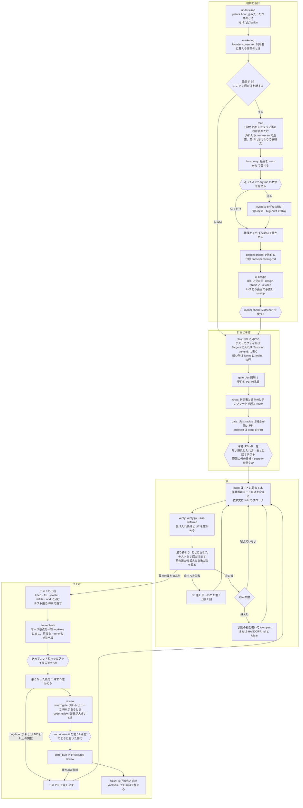
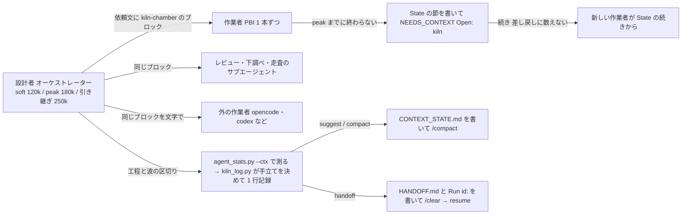

# 作者のおすすめのテンプレート (`recommended`)

[English](README.md)

作者がふだん atelier を回している構成です。同梱の `jev-routed` に、ほかの人のスキル (pstack・mattpocock-skills・lens-review・yomiyasu・founder-skill・design-studio・ui-video・unslop・security-audit) と推奨の道具 (oh-my-mermaid・jevlint・sac-strategic-compact) を足しています。見本の `recommended.json` が持つのは、テンプレートと、スキルごとの入れ方・登録のしかただけです。ほかの人のスキルの中身は、このリポジトリに入れていません。

<!-- 画像: 流れの全体 (recommended-flow-light.png / recommended-flow-dark.png) をここに置く -->

## 流れの全体



- 角の丸い四角はこのスキルが自分で動かす手順、`{{ }}` はユーザーに聞く時点です。
- 図の中の名前は部品の役目です。部品の id は下の表にあります。

## 工程ごとの部品

| 工程 | 部品 (上から順に、使える最初のもの。関所とオプションの工程の一部は、成り立つものをすべて) | 動く条件 |
|---|---|---|
| understand | `understand.pstack-how` → `understand.builtin` | how は込み入った作業のとき |
| marketing (understand のあと) | `marketing.founder-skill-founder-consumer` | 利用者に見える・お金を払う部分を変えるとき |
| map (understand のあと) | `map.builtin` (中で omm-scan を呼ぶ。無ければ代わりの依頼文) | 設計するとき |
| lint-survey (understand のあと) | `lint-survey.jevlint` → `lint-survey.builtin` (代わりの依頼文) | 設計するとき |
| design | `design.mattpocock-skills-grilling` → `design.builtin` | 設計するとき |
| ui-design (design のあと) | `ui-design.design-studio`、`ui-design.ui-video` | `ui-change`: 画面や操作の流れを足す・新しい方向性で見た目を作るとき |
| ui-design (design のあと) | `ui-design.unslop` | `ui-retouch`: いまある画面の見た目 (AI っぽさ) を直すだけのとき。上の行と同じ回には流さない |
| model-check (design のあと) | `model-check.pstack-statechart` | 毎回聞いて、はいのとき |
| plan | `plan.builtin`、関所 `gate.jev` | いつも |
| route | `route.jev`、関所 `gate.pstack-blast-radius`・`gate.pstack-architect` | 関所は PBI ごと (結合が強い・opus の段) |
| build / verify / fix | `build.runners` / `verify.builtin` / `fix.rework` | いつも |
| lint-recheck (verify のあと) | `lint-recheck.jevlint` → `lint-recheck.builtin` | いつも (全 PBI とテストの工程が終わったあと 1 回) |
| review | `review.pstack-interrogate` → `review.lens-review` → `review.code-review` → `review.builtin` | interrogate は深いレビューの PBI があるとき (設計者が動かし、敵役は opus xhigh と sonnet high)。lens-review (日本語の観点別レビュー、[reeschan/claude-plugins-official](https://github.com/reeschan/claude-plugins-official/tree/reeschan/plugins/lens-review)) と code-review は adapter_gate.py が run と言うとき |
| security (review のあと) | `security.security-audit`、関所 `gate.security-review` | security-audit は承認のときに聞いて、はいのとき |
| finish | `finish.builtin`、関所 `gate.yomiyasu` | いつも |

## ユーザーに聞く時点

止まって答えを待つのは、本文 (`SKILL.md` の When to stop) の 5 つと、迷うときだけ聞く設計の判断です。それ以外は、次の手と同じメッセージに 1〜2 行の状況を書いて進みます。

| いつ | 何を聞くか | 答えの残し場所 |
|---|---|---|
| understand の直後 (迷うときだけ) | 設計するか。marketing を使うかも一緒に | `docs/pbi/adapters.json` |
| lint-survey と lint-recheck で、モデルに送る直前 | 送るか、AST だけにするか (ファイル数・トークン・費用・送り先を見せる) | `docs/pbi/adapters.json` の `sends` |
| route のあと | PBI の一覧の承認。無い道具を入れるか、security-audit を使うか、範囲の外の候補を足すか、あとに回すテストの案 | `docs/pbi/STATUS.md` |
| PBI が差し戻しの上限に達したとき、直しが設計のやり直しになるとき | 段を上げる・書き直す・止める | `docs/pbi/STATUS.md` |
| 波の区切りで、Kiln の引き継ぎの線を越えたとき | `/clear` して `resume` する | `docs/pbi/HANDOFF.md` |
| データを消す・force push・リポジトリの外を変えるなど、壊す操作の前 | してよいか | 答えだけ (残さない) |

model-check を使うかは、design のあと、その工程の最初に聞きます。

## 手元の外に出るもの

| 何が | どこへ | いつ | 許可 |
|---|---|---|---|
| PBI の本文・要約・報告の抜粋・差し戻しの文 (ソースコードは送らない) | Jev (TypeSafe) | 関所 1、報告の仕分け、差し戻しの点検 | Jev のキーを置いたこと |
| 範囲のファイルの中身 | jevlint のプロバイダー (既定は TypeSafe の Jev) | lint-survey、lint-recheck | 送る直前に毎回 |
| PBI と、その PBI に要る ref | 振り分けで選んだ外の作業者 (opencode・codex など) | build | 振り分けテンプレートで有効にしたこと |

- 秘密のファイル (`.env*`・鍵・credentials) と、sensitive な PBI (認証・権限・スキーマ・利用者のデータの削除・秘密) のファイルは、許可があっても jevlint で送りません。sensitive な PBI は、優先テンプレートでも外の作業者に回しません。
- OMM の走査、代わりの依頼文、テストの工程、Kiln の記録は、Claude Code の中だけで動きます。

<!-- 画像: 外に出るもの (data-boundary-light.png / data-boundary-dark.png) をここに置く -->

## Kiln (文脈の上限)



- 実装者 (作業者とサブエージェント) の線は soft 60k / peak 90k です。
- 記録は `docs/pbi/.kiln/compact-events.jsonl` に、何もしなかったとき (`noop`) も含めて 1 行ずつ残ります。

## 推奨の道具と、無いときの代わり

| 道具 | 使う工程 | 無いとき |
|---|---|---|
| [oh-my-mermaid](https://github.com/oh-my-mermaid/oh-my-mermaid) (`omm` と `omm-scan`) | map | `prompts/map-fallback.md` がコードを読んで、層・モジュール・依存の向きと Mermaid 1 枚を書く |
| [jevlint](https://github.com/INDXDev/jevlint) | lint-survey、lint-recheck | `prompts/lint-fallback.md` が同じ物差し (100 行以上の関数・bug-hunt の問いの抜粋) で読む。外には送らない |
| [sac-strategic-compact](https://github.com/reeschan/sac-strategic-compact) | Kiln | `appendix/kiln.md` の写しと `prompts/kiln-chamber.md` |
| pstack の `principle-test-behavior-not-implementation` | テストの工程 | `appendix/tests-at-end.md` の Test principle (fallback) |

`python skills/atelier/tools_check.py` で有無を見られます。承認のときに無い道具を見せ、入れると言えばそこで止まり、入れずに進めば代わりで動きます。Atelier は自分では何も入れません。

## できるもの

| 工程 | 置き場所 |
|---|---|
| map | `docs/pbi/notes/map.md` (OMM の結果はリポジトリの外の `.omm-cache/<repo>/<フィンガープリント>/`) |
| lint-survey | `docs/pbi/notes/survey.md`、`docs/pbi/jevlint/survey.json` |
| design | `docs/specs/<slug>.md` |
| plan / route | `docs/pbi/PBI-<n>.md`、`.route.json` |
| build / verify | `docs/pbi/reports/`、`docs/pbi/verify/`、`docs/pbi/verify/tests-at-end.failing.md` |
| テストの工程 | `docs/pbi/notes/test-survey.md` |
| lint-recheck | `docs/pbi/jevlint/recheck.md` |
| review / security | `docs/pbi/reviews/final.review.md`、`docs/pbi/security/<slug>.md` |
| Kiln | `docs/pbi/CONTEXT_STATE.md`、`docs/pbi/.kiln/compact-events.jsonl` |
| finish | `docs/pbi/REPORT.md` |

## 入れ方と使い方

```sh
/atelier setup --recommended          # スキルの有無を見て、1 回だけ聞いて、無いものを入れ、登録し、テンプレートを書く
python skills/atelier/tools_check.py  # 推奨の道具の有無・入れ方・代わり
```

手で入れるときの手順と、テンプレートを既定にするときのコマンドは、リポジトリの [README.ja.md](../../../../README.ja.md) の「作者のおすすめのテンプレート」にあります。

- テストを最後にまとめるのを止めるには `docs/pbi/tests-at-end.json` に、Kiln を止めるには `docs/pbi/kiln.json` に、`{"enabled": false}` と書きます。
- lint の線 (点が 5 下がる・関数 100 行・合致 0.7・前からある指摘が 10% を超えて伸びる) は `docs/pbi/lint.json` で変えます。テストのファイルは `report_only_paths` に入れます。
- 仕様は [docs/specs/atelier-v4.md](../../../../docs/specs/atelier-v4.md) です。状態の図は TLC で検査しています。
