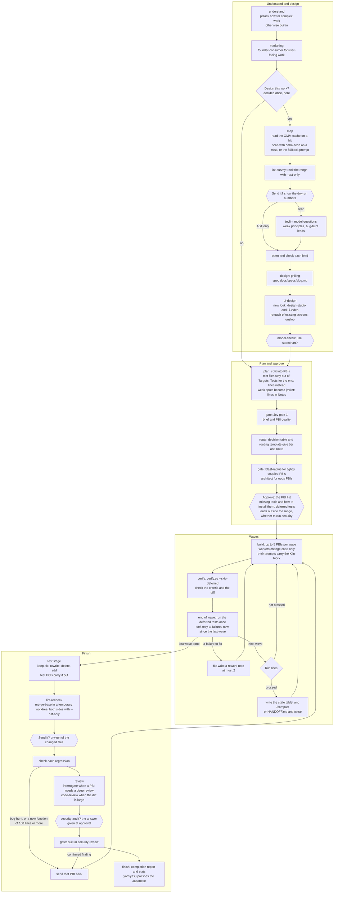
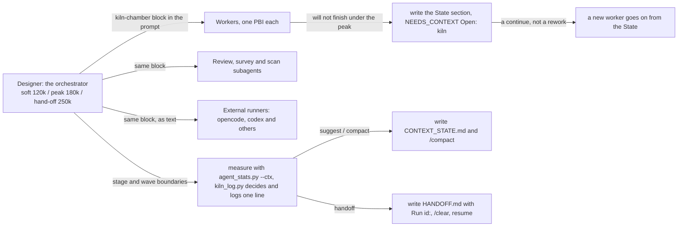

# The author's recommended template (`recommended`)

[日本語](README.ja.md)

This is how the author runs atelier day to day: the bundled `jev-routed` plus other people's skills (pstack, mattpocock-skills, yomiyasu, founder-skill, design-studio, ui-video, unslop, security-audit) and the recommended tools (oh-my-mermaid, jevlint, sac-strategic-compact). `recommended.json` holds only the template and, for each skill, how to install and register it. None of the other people's skills is copied into this repository.

<!-- image: the whole flow (recommended-flow-light.png / recommended-flow-dark.png) goes here -->

## The whole flow



- Rounded boxes are steps this skill runs itself; `{{ }}` marks a point where you are asked.
- The labels name what each component does; the component ids are in the table below.

## Components per stage

| Stage | Components (the first usable one, top to bottom; gates and some optional stages run every one that holds) | Runs when |
|---|---|---|
| understand | `understand.pstack-how` → `understand.builtin` | how: complex work |
| marketing (after understand) | `marketing.founder-skill-founder-consumer` | the work changes something users see or pay for |
| map (after understand) | `map.builtin` (calls omm-scan, or the fallback prompt) | the work is designed |
| lint-survey (after understand) | `lint-survey.jevlint` → `lint-survey.builtin` (fallback prompt) | the work is designed |
| design | `design.mattpocock-skills-grilling` → `design.builtin` | the work is designed |
| ui-design (after design) | `ui-design.design-studio`, `ui-design.ui-video` | `ui-change`: the work adds a screen or a flow, or a new look from a new direction |
| ui-design (after design) | `ui-design.unslop` | `ui-retouch`: the work only fixes how existing screens look (AI-looking signs). Never in the same run as the row above |
| model-check (after design) | `model-check.pstack-statechart` | asked every run |
| plan | `plan.builtin`, gate `gate.jev` | always |
| route | `route.jev`, gates `gate.pstack-blast-radius`, `gate.pstack-architect` | the gates per PBI (tight coupling, opus tier) |
| build / verify / fix | `build.runners` / `verify.builtin` / `fix.rework` | always |
| lint-recheck (after verify) | `lint-recheck.jevlint` → `lint-recheck.builtin` | always, once, after every PBI and the test stage |
| review | `review.pstack-interrogate` → `review.mattpocock-skills-code-review` → `review.code-review` → `review.builtin` | interrogate when a PBI needs a deep review (the orchestrator runs it, adversaries on opus xhigh and sonnet high); code-review when adapter_gate.py says run |
| security (after review) | `security.security-audit`, gate `gate.security-review` | security-audit when you said yes at approval |
| finish | `finish.builtin`, gate `gate.yomiyasu` | always |

## When you are asked

The run stops for your answer only at the five stop points of `SKILL.md` (When to stop), plus the design decision when it is unclear. Everything else goes on, with a one- or two-line status in the same message as the next action.

| When | What | Where the answer is kept |
|---|---|---|
| Right after understand, only when it is unclear | whether to design, and whether to run marketing | `docs/pbi/adapters.json` |
| In lint-survey and lint-recheck, right before a model send | send, or AST only (with files, tokens, cost and provider) | `sends` in `docs/pbi/adapters.json` |
| After route | approve the PBI list; install missing tools, run security-audit, add leads outside the range, the drafted deferred tests | `docs/pbi/STATUS.md` |
| A PBI reaches the rework limit, or a fix turns into a redesign | raise the tier, rewrite, or stop | `docs/pbi/STATUS.md` |
| A wave boundary past Kiln's hand-off line | `/clear` and `resume` | `docs/pbi/HANDOFF.md` |
| Before a destructive operation: deleting data, a force push, a change outside the repository | whether to go ahead | not kept |

Whether to run model-check is asked after design, before that stage starts.

## What leaves your machine

| What | To | When | Allowed by |
|---|---|---|---|
| PBI text, briefs, report excerpts, rework notes (never source code) | Jev (TypeSafe) | gate 1, report triage, rework checks | the Jev key you set up |
| the contents of the files in range | jevlint's provider (TypeSafe's Jev by default) | lint-survey, lint-recheck | your yes right before each send |
| a PBI and its refs | the external runners you routed to (opencode, codex and others) | build | enabling them in the routing template |

- Secret files (`.env*`, keys, credentials) and the files of sensitive PBIs (authentication, permissions, schemas, deleting user data, secrets) never go to jevlint, even with a yes. Sensitive PBIs never go to an external runner through a priority template either.
- The OMM scan, the fallback prompts, the test stage and the Kiln log stay inside Claude Code.

<!-- image: what leaves your machine (data-boundary-light.png / data-boundary-dark.png) goes here -->

## Kiln (the context limit)



- The implementer lines (workers and subagents) are soft 60k / peak 90k.
- `docs/pbi/.kiln/compact-events.jsonl` gets one line per decision, `noop` included.

## Recommended tools and their fallbacks

| Tool | Used in | Without it |
|---|---|---|
| [oh-my-mermaid](https://github.com/oh-my-mermaid/oh-my-mermaid) (`omm` and `omm-scan`) | map | `prompts/map-fallback.md` reads the code and writes the layers, modules, dependency direction and one Mermaid chart |
| [jevlint](https://github.com/INDXDev/jevlint) | lint-survey, lint-recheck | `prompts/lint-fallback.md` reads with the same measures (functions of 100 lines or more, a digest of the bug-hunt questions); nothing is sent |
| [sac-strategic-compact](https://github.com/reeschan/sac-strategic-compact) | Kiln | the copy in `appendix/kiln.md` and `prompts/kiln-chamber.md` |
| pstack's `principle-test-behavior-not-implementation` | the test stage | Test principle (fallback) in `appendix/tests-at-end.md` |

`python skills/atelier/tools_check.py` shows what is installed. The approval lists what is missing: say install and the run stops there; go on and the fallback runs. Atelier installs nothing itself.

## What each stage writes

| Stage | Where |
|---|---|
| map | `docs/pbi/notes/map.md` (the OMM scan stays outside the repository in `.omm-cache/<repo>/<fingerprint>/`) |
| lint-survey | `docs/pbi/notes/survey.md`, `docs/pbi/jevlint/survey.json` |
| design | `docs/specs/<slug>.md` |
| plan / route | `docs/pbi/PBI-<n>.md`, `.route.json` |
| build / verify | `docs/pbi/reports/`, `docs/pbi/verify/`, `docs/pbi/verify/tests-at-end.failing.md` |
| test stage | `docs/pbi/notes/test-survey.md` |
| lint-recheck | `docs/pbi/jevlint/recheck.md` |
| review / security | `docs/pbi/reviews/final.review.md`, `docs/pbi/security/<slug>.md` |
| Kiln | `docs/pbi/CONTEXT_STATE.md`, `docs/pbi/.kiln/compact-events.jsonl` |
| finish | `docs/pbi/REPORT.md` |

## Install and use

```sh
/atelier setup --recommended          # checks the skills, asks once, installs what is missing, registers them, writes the template
python skills/atelier/tools_check.py  # the recommended tools: status, install command, fallback
```

The manual steps and the command that makes this your default template are under "The author's recommended template" in the repository's [README.md](../../../../README.md).

- `{"enabled": false}` in `docs/pbi/tests-at-end.json` turns tests at the end off; in `docs/pbi/kiln.json`, Kiln.
- Change the lint lines (a score drop of 5, functions of 100 lines, compliance 0.7, an existing finding that grew by more than 10%) in `docs/pbi/lint.json`. Put test files in `report_only_paths`.
- The spec is [docs/specs/atelier-v4.md](../../../../docs/specs/atelier-v4.md) (Japanese); its state chart is checked with TLC.
